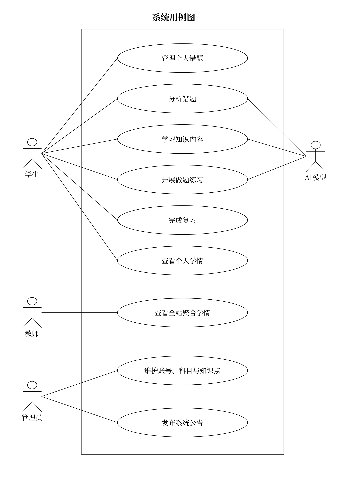
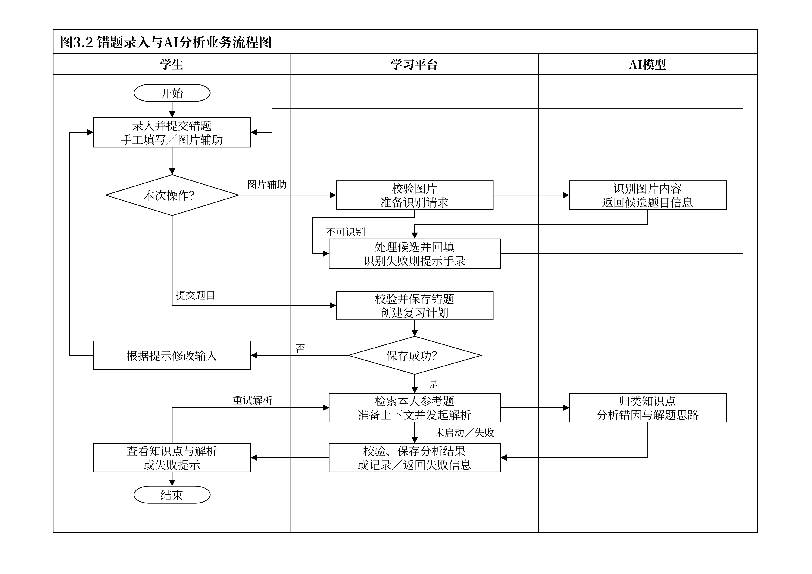
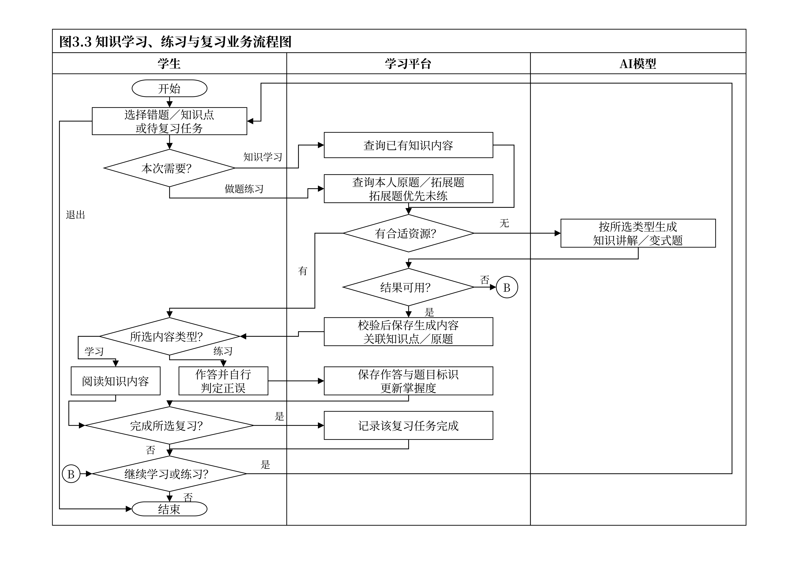
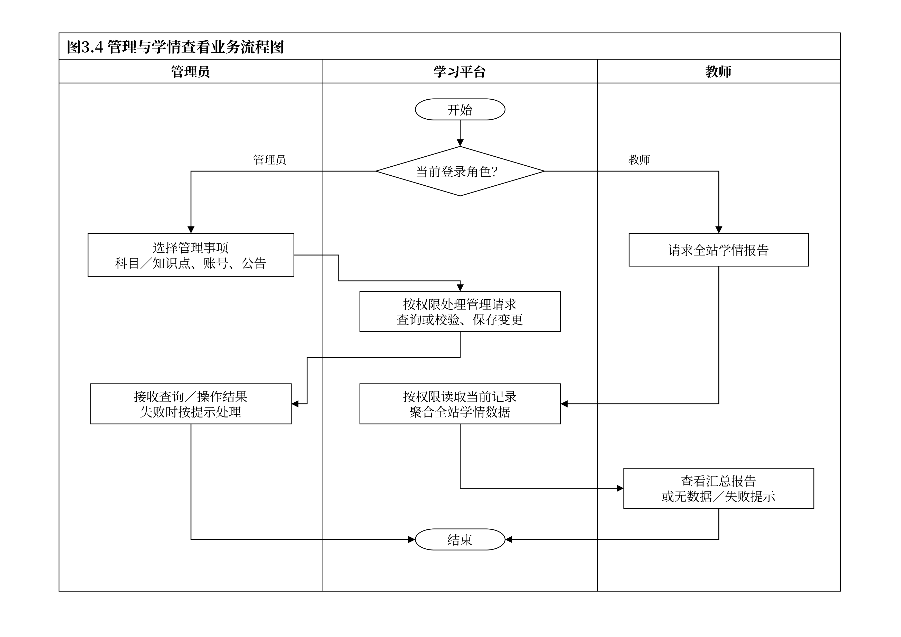
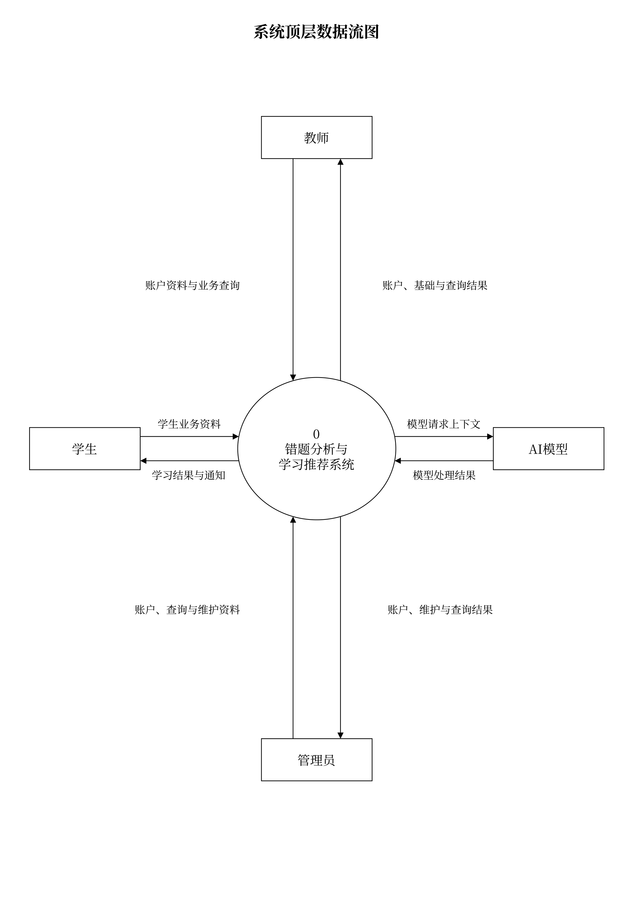
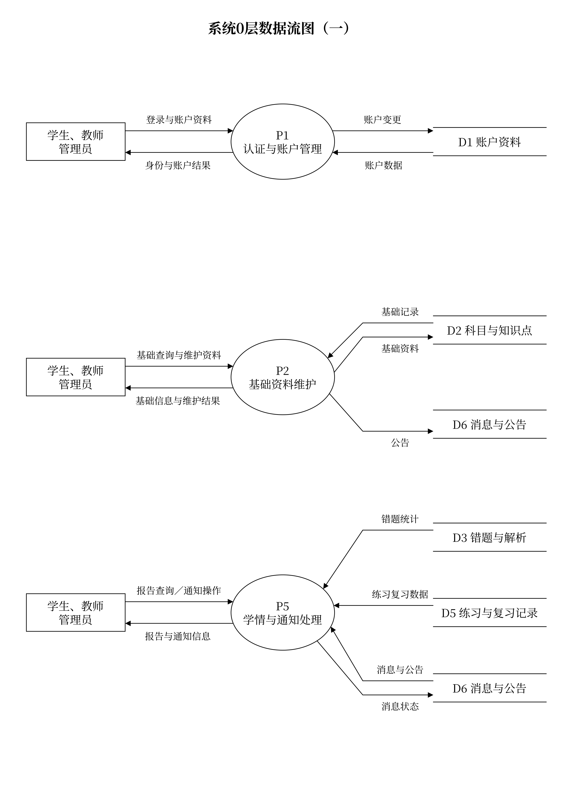
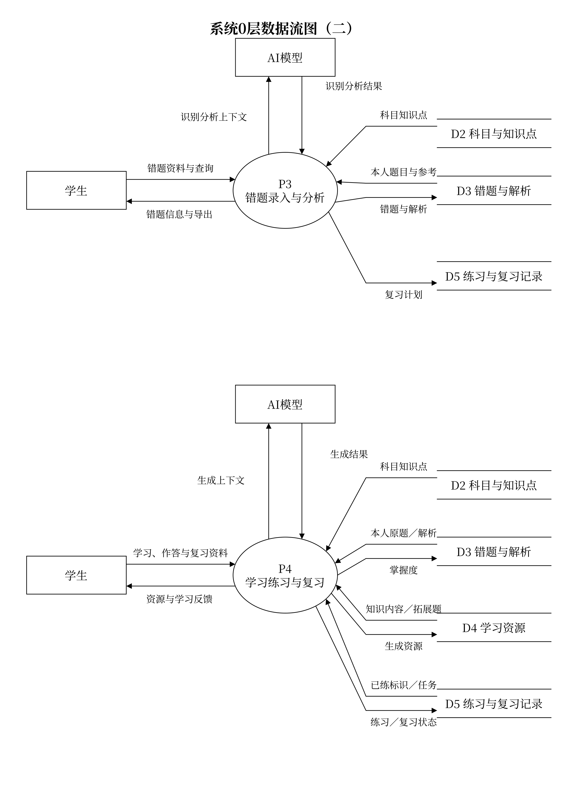
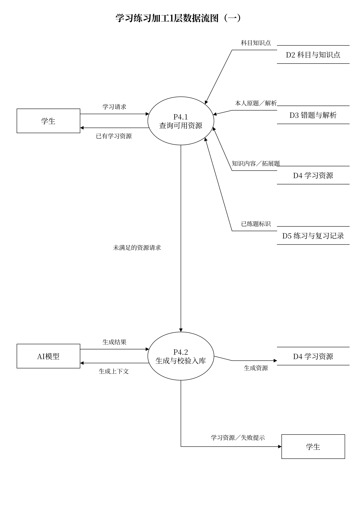
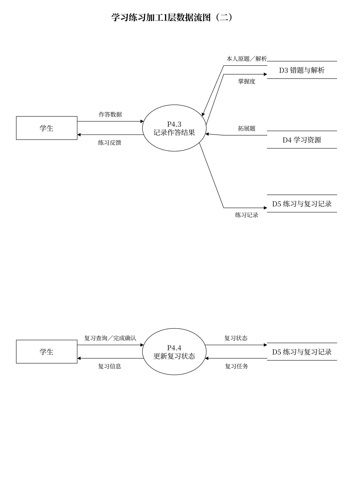

# 第3章需求分析审阅稿

> 与毕业论文.md第3章同源；图源路径按本文所在目录调整。业务流程候选来自未合并的PR #1。

## 3 系统需求分析

### 3.1 系统需求描述与获取

#### 3.1.1 问题与目标

错题整理不仅需要保存题干和答案，还需要把知识点、错误原因、后续练习和复习结果联系起来。若这些内容分散在不同记录中，学生再次遇到相近问题时，需要重复查找解析，也难以判断哪些题目已经练习、哪些复习任务尚未完成。错题资源研究强调分类、分析与再练习的连续性[8]，学习资源推荐研究则要求资源选择服务于具体学习过程[2][4][5]。本课题据此以个人错题为主线，组织录入、分析、知识学习、做题练习、复习和结果查看。

系统面向学生、教师和管理员。学生整理本人错题，根据解析选择学习知识内容或开展练习，并查看复习任务及个人学情；教师查看系统范围的聚合学情；管理员维护账号状态、科目、知识点与公告。AI模型属于平台调用的外部参与者，负责提供识别与生成结果，不直接访问业务数据库，也不代替学生判定作答结果。

学习资源的组织应体现平台自身的作用。学生提出学习或练习请求后，平台先检查已有资源；存在可用内容时直接提供，缺少时再调用GLM大模型。生成结果需要经平台接收、校验、保存并建立关联，才能继续提供给学生。平台同时记录生成题目和实际作答的标识，以支持后续复用和持续练习。知识内容缓存、未练题筛选与资源耗尽后的生成编排属于本章分析的目标需求，其实现范围在后续实现章节中另行说明，不能因出现在需求图中便认定已经实现。

#### 3.1.2 需求获取依据

需求分析采用文献分析、典型任务分析和指导讨论相结合的方式。错题资源、间隔复习及学习推荐研究提供业务背景[2][8][18]；大模型教育应用与检索增强生成研究用于识别上下文组织、结果核查和数据保护方面的约束[9][11][14][20]。文献中的模型效果和教学结论不直接转化为本系统的实验结论。

2026年11月1日的指导讨论进一步明确了业务要求：模型结果先返回学习平台；知识学习与题目练习分别组织；两类业务均优先查询已有资源；生成内容保存后供后续使用；记录已练题目并形成持续学习和练习的循环；管理与教师业务独立。需求梳理还按照各参与者的任务逐条检查输入、处理、反馈和结束条件，避免只列出孤立的功能名称。

本课题没有实施面向学生或教师的正式问卷、半结构化访谈，也没有可用于统计的竞品实测数据。因此，不以样本比例、满意度或用户原话证明需求的普遍性。代码与历史验证记录用于核对已有能力和数据边界，不能替代用户需求来源，更不能将代码中的固定参数倒写为导师已确认的业务规则。

#### 3.1.3 可行性分析

技术方面，Vue 3、TypeScript、Spring Boot、MyBatis-Plus与MySQL能够支撑浏览器交互、业务服务及关系数据存储。模型输入准备、参考题检索、结果校验与持久化可分成职责明确的处理环节，便于分别验证。RAG的检索范围限定在可访问的个人题库，避免在数据条件不足时承诺大规模知识库或复杂知识追踪能力。

经济方面，主要框架和数据库可采用开源版本，平台不要求专用训练设备。外部模型调用会产生费用，已有资源复用能够减少不必要的重复请求；具体调用次数与费用需要按实际运行记录计算，不能预先声称节省比例。常规工程测试可以使用明确标识的模拟模型，真实模型测试则单独执行和记录。

操作方面，学生通过表单、题目列表、内容展示与任务列表完成主要操作。识别失败时应能继续手工录入，模型等待、空资源、保存失败和权限不足应有明确反馈。浏览器测试可以检查操作路径是否可完成，实际易用性与满意度仍需由真实参与者测试，二者不能互相替代。

### 3.2 用户角色与需求分析

学生是核心业务使用者，需要按科目和知识点整理本人错题，查看辅助解析，并在知识学习和做题练习之间选择。学习内容应能再次查找，练习结果应关联具体题目；继续练习时应优先使用平台中尚可使用的题目，资源不足后再补充生成。复习既可重做原题，也可结合相关知识内容进行巩固，但完成复习任务与记录一次作答是不同的业务事实。

教师需要了解系统范围的错题、练习和复习统计，以查看总体使用情况与薄弱知识点。当前课题范围不建立班级、课程或教师与学生的对应关系，不将系统聚合报告描述为班级报告，也不提供教师逐题批改或个人明细下钻。

管理员需要维护科目和知识点，为题目归类与资源查询提供基础数据；同时查询、停用账号并发布公告。管理员的维护动作和教师的报告查询分别与平台交互，不存在“管理员操作完毕后教师才能查看”的顺序要求。账号恢复、任意角色分配等未确定功能不列入本次业务范围。

图3.1给出系统的核心用例。图中的关联线表示参与关系，不表示调用顺序；AI模型位于系统边界之外。登录、本人资料、消息和公告查看作为共同入口在功能需求表中列出，避免把每一条公共关联都挤入核心用例图。

**图 3.1　系统用例图**

### 3.3 业务流程分析

#### 3.3.1 错题录入与分析

学生录入错题时可以手工填写，也可以通过图片辅助提取候选内容。平台对图片和输入资料进行处理，识别结果回填至录入环节；无法识别时提示学生手工补充。填写、补全与提交作为录入过程统一表达，不再突出一个独立的“修改内容确认”业务步骤。

平台接收提交后保存错题并建立复习安排，再准备分析所需的题目、知识点候选及本人参考题上下文。GLM大模型返回分析结果，平台进行结构与业务校验，保存知识点、错因及解析后供学生查看。保存失败应返回录入处理；分析失败不应删除已经保存的错题，学生可以重试或结束。本流程不展开生成批量、复习日期和算法参数，相关规则放在详细设计中说明。

**图 3.2　错题录入与AI分析业务流程图**

#### 3.3.2 知识学习、练习与复习

学生选择错题、知识点或待复习任务后，明确本次进行知识学习还是做题练习。平台按所选类型查询已有内容：知识学习查询相关讲解，练习查询本人原题及可用拓展题。复习允许重做原题；持续拓展练习则需要结合已练题目标识，优先提供尚未练习的可用题目。没有合适资源时，平台向GLM大模型提交生成上下文，将返回内容校验、保存并关联到知识点或原题后再提供。

阅读知识内容不产生作答记录。学生实际做题并提交自评结果后，平台记录作答目标与结果，并更新相应学习状态。学生选择完成某一复习任务时，平台单独记录该任务完成；一次作答不自动代表所有复习任务已经完成。学生继续学习或练习时，流程返回选择与平台查询，不能每循环一次便无条件重新调用模型。生成失败时不保存为有效资源，学生可选择继续或结束。

图3.3保留上述业务关系。批量题数、复习次数、掌握度分值和资源匹配阈值不在业务图中确定。通用知识内容是否跨用户共享、如何判定内容足够匹配等规则仍需进一步确认，不能由本图推断为开放全站私人错题。

**图 3.3　知识学习、练习与复习业务流程图**

#### 3.3.3 管理与学情查看

管理员按需选择科目、知识点、账号或公告等管理事项，平台验证权限及输入后完成查询或保存，向管理员返回处理结果。教师提出学情查看请求后，平台读取现有学习记录并进行系统范围聚合，再展示报告或空数据、失败提示。两条路径从当前登录角色分开，各自完成后结束，既不串行为前后步骤，也不要求两种角色同时执行。

**图 3.4　管理与学情查看业务流程图**

### 3.4 功能性需求分析

#### 3.4.1 功能需求清单

按照业务步骤及其所需数据，系统功能需求归纳为表3.1。功能需求描述系统应提供的业务能力，不限定控制器数量或界面菜单划分；一个功能可以由多个接口协作完成。

**表 3.1　系统功能需求清单**

| 编号 | 功能名称 | 功能需求描述 | 使用角色 |
|---|---|---|---|
| FR01 | 用户与账户 | 注册学生账号、登录及维护本人资料；管理员查询和停用账号 | 学生、教师、管理员 |
| FR02 | 科目管理 | 查询科目；管理员新增、修改科目信息 | 全部角色、管理员 |
| FR03 | 知识点管理 | 按科目查看知识点；管理员维护归类所需知识点 | 全部角色、管理员 |
| FR04 | 错题管理 | 录入、查询、编辑和删除本人错题，图片识别辅助填写；保留内容归属 | 学生 |
| FR05 | 错题分析 | 准备上下文、调用模型、校验保存分析并返回结果或失败信息 | 学生 |
| FR06 | 知识学习 | 按知识点查询已有讲解，缺少时生成并保存，支持再次使用 | 学生 |
| FR07 | 相似题查询 | 从本人可访问题库查询与所选错题相关的题目 | 学生 |
| FR08 | 拓展练习资源 | 查询已有变式题，结合已练标识选择可用题；资源耗尽后补充生成并保存 | 学生 |
| FR09 | 复习任务 | 查看到期及逾期未完成任务，围绕原题学习或练习，单独确认任务完成 | 学生 |
| FR10 | 练习记录 | 保存题目标识、作答与自评结果，更新学习状态并支持历史查询 | 学生 |
| FR11 | 学情报告 | 学生查看本人统计，教师查看系统聚合统计，明确数据范围 | 学生、教师 |
| FR12 | 错题本导出 | 按筛选条件导出本人错题，保持题干可读及数据隔离 | 学生 |
| FR13 | 消息通知 | 查看本人消息、未读状态并标记已读，接收业务提醒 | 全部角色 |
| FR14 | 公告 | 管理员发布公告，登录用户查看公告 | 管理员、全部角色 |

#### 3.4.2 需求范围与待定规则

系统不把知识点归类和错因解释等同于完整学习诊断。正式错题数据没有独立持久化的学生解题步骤，模型只能依据可获得的题干、答案和参考信息提供辅助分析。学生自评与题目级状态记录也不属于AI自动判卷或概率知识追踪。

资源复用需要保留资源身份、内容类型、原题或知识点关联以及实际练习目标。仅仅保存生成文本还不足以完成“未练优先”和“耗尽后生成”的业务：还需要明确可用资源的查询、已练状态的关联和生成请求的触发。已有资源列表与完整自动编排应分别验证，不将两者混为同一能力。

尚未明确的共享范围、匹配判据、重新生成条件和并发生成处理方式，应在后续设计前确认。本文不提前给出固定题库容量、题数、复习次数或模型质量阈值。当前固定参数仅作为现有实现规则在详细设计中解释，不以此代替需求确认。

### 3.5 系统用例分析

图3.1中的核心用例按参与者目标划分。已登录和权限有效属于业务前提，不把“登录”重复画成每个用例的必然包含关系。图片辅助录入是录入方式，模型生成是平台取得资源的一种方式，二者不代表学生必须每次使用AI。

**表 3.2　核心用例说明**

| 用例 | 参与者与前提 | 基本交互 | 异常与完成结果 |
|---|---|---|---|
| UC01 录入与分析错题 | 学生；具有录入权限 | 填写或图片辅助录入；提交；平台保存错题并组织分析；学生查看平台处理后的结果 | 输入不合格返回修改；识别失败可手录；分析失败保留原题并允许重试 |
| UC02 学习知识内容 | 学生；已选择知识点或关联错题 | 平台查询已有知识内容；有则提供，无则组织生成、校验和保存；学生阅读并决定是否继续 | 无效生成不作为成功资源保存；纯阅读不写作答记录；继续时重新查库 |
| UC03 开展做题练习 | 学生；明确原题或知识点 | 平台优先提供已有可用题；必要时补充生成；学生作答并自评；平台保存题目标识与结果 | 无权题目拒绝；保存失败反馈；继续练习再次判断可用资源，不无条件调用模型 |
| UC04 完成复习 | 学生；存在本人待完成任务 | 查看任务，结合原题学习或练习，选择确认完成，平台更新该任务状态 | 无任务展示空状态；未确认则保留未完成；不据一次练习自动改期 |
| UC05 查看学情 | 学生或教师；具有报告权限 | 请求统计；平台读取记录并按角色确定范围；展示本人或系统聚合报告 | 无数据明确提示；教师不能据此钻取班级或个人作答详情 |
| UC06 维护基础资料 | 管理员；具有维护权限 | 选择科目、知识点、账户或公告事项；提交请求；平台校验并保存或查询 | 不合格输入和越权操作拒绝；返回处理结果，不依赖教师完成其他操作 |

这些用例的共同后置条件是平台反馈与已保存数据一致。外部模型请求成功并不意味着业务成功，只有结果通过校验并完成必要保存后，才可以作为可用分析或学习资源返回。

### 3.6 数据流分析

#### 3.6.1 顶层数据流

顶层图将整个平台视为一个加工，外部实体为学生、教师、管理员和AI模型。学生提供账户、错题、学习练习及复习资料，接收学习结果、记录反馈和个人统计；教师提供登录及报告查询资料，接收系统聚合统计；管理员提供账户和基础资料维护信息并接收处理结果。平台向AI模型提交经过整理的上下文，接收识别或生成结果。图中箭头表示数据传递，不表示业务执行顺序，也不使用开始、结束或判断菱形。

**图 3.5　系统顶层数据流图**

#### 3.6.2 系统0层数据流

0层将平台分解为P1认证与账户管理、P2基础资料维护、P3错题录入与分析、P4学习练习与复习、P5学情与通知处理。为保证打印可读性，同一层分为图3.6与图3.7两幅展示；两图合起来构成完整0层，而不是先后执行的两个流程。相同编号的数据存储表示同一逻辑对象，重复画出只是为了减少长连线。

P1处理身份和账户资料，账户操作受角色及数据归属约束；P2维护科目、知识点和公告；P3接收错题资料及导出查询，使用基础资料和本人题库组织模型分析，保存错题及解析并产生复习计划；P4承担资源查询、生成资源保存、作答记录和复习状态处理；P5按角色范围汇总学习记录，处理消息提醒、已读状态及消息与公告查询。公共实体合并表示共享接口的参与者，不表示三类角色拥有相同的管理权限。

**图 3.6　系统0层数据流图（一）**

**图 3.7　系统0层数据流图（二）**

#### 3.6.3 学习练习加工的1层数据流

P4是已有资源复用和持续练习要求的集中加工，进一步分为P4.1查询可用资源、P4.2生成与校验入库、P4.3记录作答结果及P4.4更新复习状态。图3.8、图3.9共同展开P4，保持与父加工相同的外部输入、输出和数据存储接口。

P4.1依据学习请求读取科目知识点、本人原题、已有学习资源及已练题目标识，输出可用资源；未满足的资源请求交给P4.2。P4.2整理生成上下文、接收模型结果并完成校验和存储，再返回资源或失败提示。P4.3校验实际作答目标，保存练习记录并更新相应原题状态；P4.4读取所选复习任务，依据用户确认更新完成状态。阅读内容不流入P4.3，作答记录也不自动流入P4.4作为完成确认。

**图 3.8　学习练习加工1层数据流图（一）**

**图 3.9　学习练习加工1层数据流图（二）**

#### 3.6.4 数据字典

数据流分析采用逻辑数据存储，不直接等同于数据库物理表。表3.3说明数据来源与用途，表3.4列出核心流的内容及约束。D4中独立知识内容的存储方案属于目标设计，不能据此宣称当前数据库已经存在知识讲解表。

**表 3.3　逻辑数据存储说明**

| 编号 | 名称 | 主要内容与来源 | 用途及当前物理对应 |
|---|---|---|---|
| D1 | 账户资料 | 用户标识、账户、角色与状态；来自注册、资料维护及管理员操作 | 身份与权限判断；对应user |
| D2 | 科目与知识点 | 科目及知识点标识、名称和层级；来自管理员维护 | 输入选择、归类及资源查询；对应subject、knowledge_point |
| D3 | 错题与解析 | 归属、题干、答案、知识点、解析、参考标识与状态；来自录入及平台处理 | 本人错题查询、分析和统计；对应question、ai_analysis |
| D4 | 学习资源 | 内容类型、资源标识、内容及原题或知识点关联；来自平台校验后的生成结果 | 已有变式对应variant_question；独立知识内容生成与缓存尚待实现 |
| D5 | 练习与复习记录 | 用户及作答目标、自评结果、用时、任务日期和完成状态 | 标识已练题、更新与统计；对应practice_record、review_plan |
| D6 | 消息与公告 | 接收人或发布人、标题、内容及阅读状态；来自业务提醒和管理员发布 | 个人消息与公告查看；对应message、announcement |

**表 3.4　核心数据流字典**

| 数据流 | 来源与去向 | 关键组成 | 约束 |
|---|---|---|---|
| 错题资料 | 学生→P3 | 科目、题干、可选答案、来源和图片 | 题干与归属有效；识别候选不直接当作正式保存结果 |
| 识别分析上下文 | P3→AI模型 | 输入内容、候选知识点、本人参考内容 | 最小必要数据，不含密钥或其他学生私有题目 |
| 识别分析结果 | AI模型→P3 | 候选题目信息或知识归类、错因、解析 | 平台校验后使用；失败保留已有错题 |
| 学习请求 | 学生→P4.1 | 原题或知识点标识、学习或练习类型 | 不把学习请求等同于作答记录 |
| 未满足的资源请求 | P4.1→P4.2 | 目标类型、知识点或原题上下文 | 只有缺少可用资源时形成，不携带擅定批量参数 |
| 生成上下文与结果 | P4.2↔AI模型 | 请求的内容类型、题目上下文；返回的讲解或练习题 | 未通过校验的内容不作为有效资源写入D4 |
| 作答数据 | 学生→P4.3 | 原题或变式目标、自评结果、可选作答及用时 | 目标明确且归属合法；不虚构自动判卷结果 |
| 练习记录 | P4.3→D5 | 用户、题目标识、结果与时间 | 支持后续识别已练题；不代表复习任务自动完成 |
| 完成确认与复习状态 | 学生→P4.4→D5 | 所选任务、本人确认与完成状态 | 只更新本人选定任务，不隐含动态改期 |
| 报告信息 | P5→学生或教师 | 题目、练习、复习及知识点聚合指标 | 学生本人范围、教师系统聚合范围；不推导学习效果 |

### 3.7 非功能性需求分析

（1）安全性。系统应验证登录状态、角色及数据归属，学生只能访问本人错题、图片、练习和复习记录。账号停用后旧会话不能继续访问受保护业务。富文本输入需要过滤危险内容，模型密钥只由服务端管理。验证时应覆盖跨用户访问、角色越权、停用账号与恶意输入，不能仅以隐藏菜单证明权限安全。

（2）可靠性。错题保存不应依赖外部模型成功；模型不可用或输出不合格时，应向用户反馈且保留已存数据。关联写入需要保持一致，异步旧结果不得覆盖修改后的题目。验证时应检查失败输入、并发编辑和事务回滚后的数据库状态，而不是只检查页面提示。

（3）易用性。页面应明确区分输入、等待、成功、空结果与失败，识别失败可转手工录入。知识阅读、练习自评和完成复习的含义应容易辨别，教师报告应明确其数据范围。浏览器走查可检查操作与反馈，真实用户体验需另行记录任务完成过程，不预写满意度结论。

（4）性能。普通查询与外部模型等待应分开观察，页面不能把模型等待误表现为错题尚未保存。资源复用应避免有可用资源时重复发起生成。题库规模、查询时延、模型耗时和并发负载需要在明确数据集及环境下测量；本课题尚无可据以确定统一响应时限和容量上限的证据，不在需求中编造数值门槛。

（5）可维护性。界面、接口、业务处理与数据访问应职责清晰；模型地址、凭据及运行开关通过配置管理。错误记录应能定位业务标识和失败类别，同时避免泄露密钥与完整私有内容。需求、数据流、接口和测试应能相互追踪，规则变化后可确定受影响的验证范围。

### 3.8 外部模型能力需求

GLM大模型需支持题目图片候选提取、知识点归类、辅助错因分析、知识讲解及练习题生成等任务。平台还需要向量表示能力，为本人题库中的参考内容检索提供依据。不同任务的输入和返回结构应明确，模型输出需能够由平台解析、校验并关联业务对象；超时、限流、无法识别或结构不合格时应作为失败处理，不以模拟内容伪装真实成功。

生成内容的结构合规与内容正确性需要分别检查。字段齐全不等于解析正确，检索到参考题也不等于模型结论可靠。系统以辅助学习为定位，不承诺自动评分、完整思维诊断或教学效果提升；模型质量结论只能由实际样本、人工核查与测试条件支持。

