# 基于智谱GLM模型的AI错题分析与学习推荐系统设计与实现

> **英文题目**：Design and Implementation of an AI-Powered Error Analysis and Learning Recommendation System Based on the Zhipu GLM Model

> 本文件为毕业论文正文的 Markdown 源稿，
> 章节结构依据 2027 届《云南工商学院本科毕业论文（设计）撰写规范及要求》和《毕业论文（设计）正文模板》整理。
> 源稿不承担排版：字体、页边距、页码、目录导航等在导出 DOCX 时统一处理。
> 正式论文文献独立筛选并按中文、外文及首次引用重编号；已通过开题报告保持原件。
> 需求分析与设计章节按方案形成阶段表述，系统实现与测试章节只采用仓库代码和验证记录中已有的事实；不得将规划功能写成已实现功能。

---

## 封面（导出层生成）

（本次导出复用2027届正文模板封面及学校标识，填写题目、学院、专业班级、姓名、学号和导师；学校系统封面、签字及完成日期以本人最终提交为准。）

## 目录（导出层生成）

（导出时生成 Word 目录域、可点击书签及实际PDF页码缓存；目录文字与正文标题一致。）

---

## 摘　要

针对个人错题分散、解析与后续练习脱节的问题，设计并实现基于智谱 GLM 大模型的 AI 错题分析与学习推荐系统。系统采用 Vue 3、Spring Boot 与 MySQL，组织 AI 辅助错因分析、知识内容复用、持续练习和固定节点复习，提供基于个人题库检索与规则匹配的个性化学习推荐。平台校验并保存模型结果，按角色和数据归属控制访问。工程回归中，后端 109 项通过、4 项联网入口按开关跳过，前端 33 项单元测试与 5 项浏览器端到端流程全部通过。历史真实模型实验与小样本评价进一步验证了分析、检索与生成链路的实际效果。系统由此把错题整理、知识学习、持续练习与复习安排连接为完整的学习闭环。

**关键词**：错题分析；学习资源推荐；检索增强生成；持续练习

## Abstract

To connect scattered personal error records with analysis and follow-up practice, this project designs and implements an AI-powered error analysis and learning recommendation system based on the Zhipu GLM model. Built with Vue 3, Spring Boot and MySQL, it combines AI-assisted error analysis, reusable knowledge content, continued practice and fixed-schedule reviews. Personalized learning recommendations use retrieval and rule matching within each learner's own question collection. The platform validates and stores model outputs and controls access by role and data ownership. Engineering regression yielded 109 passing back-end tests and four network-dependent entries skipped by configuration; all 33 front-end unit tests and five browser end-to-end workflows passed. Historical live-model tests and small-sample experiments further verify the analysis, retrieval and generation pipelines in practice. The system thus connects error review, knowledge study, continued practice and scheduled review into a complete learning loop.

**Keywords**: error analysis; learning resource recommendation; retrieval-augmented generation; continued practice

---

## 1 绪　论

### 1.1 研究背景与问题分析

#### 1.1.1 错题学习背景

随着教育数字化推进，依据学习过程数据识别薄弱环节并组织学习资源，成为个性化学习的重要问题。知识追踪研究关注从历史作答中描述学习者知识状态[1]，学习资源推荐研究关注学习者、知识点与资源之间的匹配[2]。错题是学生日常练习中能够直接积累的数据，既保留了题目内容，也提供了重新理解知识和检查解题方法的入口。

学生可以通过纸质错题本、拍照或电子笔记保存题目，但保存并不意味着已经完成分析与巩固。题干、答案、知识点和后续练习若分散在不同位置，复习时仍需重新寻找资料。对于同一类问题，只有题目而缺少解释，学生难以判断应先阅读知识还是继续做题；只有一次生成结果而不保存，又会在再次学习时重复请求外部服务。

#### 1.1.2 学习过程中的主要问题

本课题围绕三个具体问题展开。首先，错题录入与分析脱节。图片能够降低输入负担，但识别候选仍需确认；外部模型可能超时或返回不合格结果，不能让一次分析失败使已录入的题目丢失。其次，学习内容与练习资源缺少连续组织。阅读讲解、取得题目和实际提交作答是不同动作，平台需要区分这些状态，才能优先利用已有内容和未练题。最后，练习与复习缺少可追踪记录。学生应能看到自己的作答、计划及统计，而不是根据是否打开过页面推断练习已经完成。

大语言模型为知识归类、辅助解析和题目生成提供了工程实现路径。将本人题库中的参考内容加入生成上下文，可以把资源检索和模型调用连接起来；平台仍需承担访问控制、结果校验、保存及异常反馈。本系统提供 AI 辅助错因分析：模型以题干、参考答案与检索上下文为输入，给出常见错因推断与解题思路提示，供学生复盘核查。题目级分值用于表示单题的练习状态。

### 1.2 研究目的与意义

本课题设计并实现基于智谱 GLM 大模型的AI错题分析与学习推荐系统，连接错题录入、辅助分析、知识学习、练习与复习。学生以本人题目为中心取得讲解和练习资源，平台优先查询已有数据，在资源不足时组织生成，并保存实际作答与任务状态。

在应用层面，系统把分散的题目、解析、资源和记录关联起来，减少反复查找资料的操作，使学生可以沿同一原题继续学习。教师端以系统聚合学情了解使用情况，管理员维护基础资料和账号。系统的意义在于建立可操作、可追溯的业务过程，为后续教学应用与效果研究提供基础。

在软件工程层面，外部模型的响应需要与本地业务状态衔接。平台通过结构校验和输入快照检查接收有效结果，以短事务保存关联数据，再根据用户归属提供访问。个人资源缓存和未练题优先策略将一次生成与后续使用连接起来，为同类小规模学习应用提供实现参考。

### 1.3 可行性分析

#### 1.3.1 技术可行性

Vue 3与TypeScript可以组织浏览器页面，Spring Boot与MyBatis-Plus承担接口、业务和关系数据访问，MySQL保存错题及学习记录。模型调用、向量计算、检索和结构校验可以分别封装，便于定位失败环节。本课题采用个人题库和应用内向量计算，聚焦于错题学习业务闭环的设计与实现。

#### 1.3.2 经济可行性

系统使用开源框架与数据库，不需要专用模型训练设备。主要额外成本来自外部模型服务及部署资源，已有内容复用能够有效降低重复调用成本。工程验证与内容质量验证分别使用模拟服务与真实模型开展。

#### 1.3.3 操作可行性

学生通过录入表单、错题列表、学习与练习区、复习列表完成主要任务。识别失败保留手录入口，等待、空数据与失败均有反馈。学习内容阅读、作答自评和复习完成分别设置操作，减少状态含义混淆。浏览器验证用于检查各角色的操作路径与页面反馈。

#### 1.3.4 运行可行性

系统由前端、后端、MySQL和图片存储目录组成，模型凭据由服务端配置。测试库、上传目录与日常数据分开，真实模型入口显式启用。外部服务不可用时，已保存的题目和有效缓存仍可查询；需要生成的新内容返回失败提示。

### 1.4 主要研究内容与章节安排

本文先依据文献、典型任务及指导讨论分析三类角色的需求，建立泳道图、用例、分层数据流和数据字典；再完成总体架构、模块、权限、数据库及接口设计；随后围绕GLM调用、RAG、资源复用和持续练习实现系统，并以自动化测试、数据库联调、浏览器和历史模型实验核对其行为。

全文共9章。第1、2章介绍课题与相关研究，第3、4章明确需求及技术基础；第5章说明系统概要设计，第6章给出数据库、分层、接口和表示层详细设计；第7章结合真实源码与界面介绍实现，第8章报告分批测试及其限制，第9章总结完成情况与后续方向。

## 2 文献综述

### 2.1 前言

错题学习系统涉及资源整理、知识状态描述、推荐与生成反馈。国内研究主要关注学习记录建模、资源推荐和教育大模型应用；国外研究为间隔复习、知识追踪、检索增强和问题生成提供了方法参考。本章结合各项研究的数据条件与任务，分析其对个人错题场景的适用性，作为系统设计的依据。

### 2.2 国内研究现状

赵雅娟等归纳传统与深度知识追踪的模型、数据集及评价方法，指出知识状态需要结合历史学习过程进行描述[1]。董永峰等将在线学习推荐对象分为习题、学习路径、视频和课程，并总结学习者画像与资源表示等依据[2]。两类研究分别回答“如何描述学习者”和“如何选择资源”，说明错题系统需要保存学习记录，同时明确推荐使用的信号。本课题以个人错题、知识点、难度与实际作答为数据依据，界面分值表示题目级的练习状态。

孙辉以高中物理讨论错题的收集、分类、错误原因分析、专题讲解和再次练习，强调资源应持续利用[3]。这一研究将错题整理与后续学习活动联系起来。本文据此连接录入、解析、阅读、练习和复习，并分别记录资源保存与实际作答状态。

索晋贤等从学习者与习题特征、注意力机制及认知理论融合等方面评述可解释深度知识追踪，讨论预测性能和解释性之间的关系[4]。张维等进一步利用学习行为增强知识追踪模型[5]；何凡等通过图注意力和概念关联记忆建模知识关系[6]；周楚雄等总结图神经网络知识追踪中的建模方法及信息融合[7]。这些方法依赖较完整的作答序列或概念关系，本系统尚不具备相应训练数据。张所娟等梳理大语言模型与知识追踪的融合范式，提出语义信息与认知状态建模结合的研究方向[8]。本文由此明确生成讲解、记录练习与估计知识状态是不同任务，现有规则只用于题目级展示和统计。

资源推荐方面，朱敏利用大语言模型处理用户需求与兴趣信息，组织个性化资源推荐[9]。韩姣等研究联邦学习条件下的数据协同与个性化学习资源推荐，关注多方利用数据时的隐私保护[10]。前者提供自然语言参与资源组织的思路，后者提示推荐的数据使用范围需要先明确。本课题可用数据主要来自个人错题，推荐因此限定在学生本人题库，按知识点与相近难度选择，再用向量结果补足。该方案保留候选来源的可解释性，与需要多方训练数据的联邦推荐方法具有不同的适用条件。

检索增强生成把资源选择与模型上下文连接起来。吴璇和付涛从检索、生成、评价指标及基准等方面综述RAG技术，说明检索质量和生成质量应分别考察[11]。梅忆寒等面向数据库课程构建多模态与RAG知识问答系统，展示课程内容表示、检索和生成协作的路径[12]。张犬俊等总结RAG在软件工程不同任务中的应用，说明评价应结合具体任务，不能仅凭接入检索就假定输出可靠[13]。贾洪愿等围绕课程资源建设智能知识库，关注资料组织与课程应用[14]。这些研究提供了上下文组织的参考，但本课题资源来自个人错题，规模和质量均与课程知识库不同。因此，本文记录实际参考题标识，并将相关题命中、结构合规和人工内容核查分别报告。

教育大模型研究还关注技术如何嵌入平台。徐刚等从规范、框架与应用讨论大语言模型教育实践[15]；刘邦奇等分析教育大模型的体系架构及关键策略，强调知识准确性与安全要求[16]；余胜泉和熊莎莎提出借助专业知识库和外部组件增强人工智能教师的架构[17]。本课题借鉴服务封装和外部资源增强思路，但仅调用通用GLM大模型，不训练教育专用模型，也不把模型作为直接操作数据库的主体。肖建力等综述智慧教育中的模型技术、应用和定制方式[18]，陈静远和高雨婕则从教育任务及学习者视角分析核心技术、应用场景与挑战[19]。两者提示同一模型在识题、解析和知识讲解中的输入与责任不同，平台需要为各任务分别设置契约和失败路径。

在生成反馈应用中，罗恒等结合认知诊断数据生成教师评语，并开展初中数学课堂实践[20]。唐颖川以Python课程讨论大模型辅助探究学习与反馈评价的路径[21]；张鲁燕和巩清波讨论大模型参与“双师课堂”的角色与流程[22]。这些工作说明反馈应放在具体教学任务中理解，教师职责也不能简单转移给生成工具。本文的反馈基于题干、参考答案与检索上下文生成，教师端提供系统聚合统计，用于了解整体学情。

### 2.3 国外研究现状

Ebbinghaus对记忆保持与遗忘的实验研究，为间隔复习提供了经典认识[23]。这一认识支持分散安排复习，但具体日期仍需结合应用条件确定。本文采用第1、2、4、7、15天的固定计划节点安排复习，由学生单独确认任务完成，以稳定的间隔帮助学生回顾错题。

Corbett和Anderson提出贝叶斯知识追踪，以潜在知识状态及连续作答描述程序性知识的获得[24]。该研究要求明确知识单元和状态更新含义。本系统虽然保存作答结果并调整题目分值，但没有估计猜测率、失误率或掌握概率；因此仅借鉴通过反馈持续更新记录的思想，不把简单加减分命名为贝叶斯追踪。

Kasneci等讨论大语言模型在内容生成、交互和个性化反馈中的机会，同时指出事实错误、偏见、依赖和核查能力等问题[25]。这说明生成内容进入学习环节之前需要经过核查。本文由平台核验结构与业务关联，保存失败状态，生成内容供学生复盘时核对；作答结果由学生自评记录。

Zhao等系统梳理RAG的检索来源、检索方式、上下文融合及评价问题[26]。外部知识有助于补充输入，但结果取决于语料、检索和生成环节。本文据此把RAG定位为本人题库的参考内容检索，参考题最多取3条并记录ID；缺少合适候选时仍可进行辅助解析。检索命中率与解析内容质量分别评价。

Cheng等提出面向教育目标的数学问题生成框架，结合规划、评价与优化[27]。该工作表明题目生成应关注目标约束，不能只评价文本能否返回。本文采用原题、知识点、难度、结构与规范化题干去重约束变式生成。

### 2.4 研究评述

现有研究分别提供了错题资源组织、知识状态建模、个性化推荐和生成反馈的依据。本课题的数据条件更适合完成个人范围的学习业务闭环：用关系数据保存资源与记录，用检索提供参考，用GLM辅助生成，由平台负责校验和持续复用。本文的重点是上述环节如何协作及其设计、实现与验证方法。

## 3 系统需求分析

### 3.1 系统需求

#### 3.1.1 问题与目标

我把第一个问题放在错题录入后的使用上。一道题如果只留下照片，复习时还得从图片里找题干，再去找当时的解析。我希望以个人错题为线索，把题干、答案、知识点、错因、后续练习和复习记录放在一起。错题资源研究强调分类、分析与再练习的连续性[3]，学习资源推荐研究也把资源选择放在具体的学习任务中[2]。

我把学生的任务拆成录入、分析、学习或练习、复习和查看结果几个环节。拆分时，我重点看上一步留下的数据能否供下一步使用，例如录入后保存的题干能否作为分析输入，本次实际作答能否帮助下一次挑选题目。教师的学情查询和管理员的资料维护另行分析，因为两者处理的数据与学生的个人学习记录不同。

#### 3.1.2 需求获取

围绕 3.1.1 的问题和目标，我在开题阶段与指导教师胡韬讨论了功能范围。老师明确了错题录入、分析、练习和复习这条主线，任务书和开题报告中有相应记录。我据此逐个梳理各环节需要接收和留下的信息，也把教师查看学情和管理员维护资料分开考虑。我把教师作为查询学情的需求对象，主要依据课题范围分析其任务；教师侧没有独立的访谈记录。

我自己也是目标使用者。我试用了手机上的错题整理类和拍照搜题类应用，比较它们如何从拍照进入题目录入，以及怎样提示用户回头复习。我还非正式地问过同班几位同学平时怎样整理错题。几位同学大多用手机拍照存图，之后很少翻看；复习时，即使找到题目照片，也常找不到之前的解析。这些交流没有录音，我也没有做正式问卷，因此我把发现用于选取典型操作场景。

我据此先考虑如何减少录入步骤，再考虑怎样让学生从一条错题记录回到解析、练习和复习任务。错题整理、间隔复习和学习推荐研究帮助我理解这些环节的联系[2,3,23]。教育应用和检索增强生成研究帮助我判断分析时要提供什么上下文、哪些结果需要核查[12,15,17,26]。

#### 3.1.3 需求描述

**学生。** 从我自己的试用和同学反馈看，录入最好能从已有照片开始，先提取候选内容，再由本人核对科目、题干和答案；图片不清楚时仍可手工填写。学生需要注册、登录和维护本人资料，也需要按科目、知识点筛选本人错题，回查、编辑、删除或导出整理后的错题。移动端的使用期望是能直接用手机拍照录入，并利用碎片时间做几道题、查看到期任务和复习。我把这些写成双端设计要解决的使用需求。

我认为，学生查错因时既想看当前题目的解析，也希望从本人题库找回做过的相近题目。平台可把同一学生的参考题内容连同当前题干和参考答案送入分析，并在结果中保留实际采用的参考题标识；学生也可主动查找本人题库的相似题。看完解析后，学生应能直接进入知识讲解或后续练习。平台先找可复用的讲解或可用题目，缺少时再用原题上下文组织补充，校验后保存。继续练习时优先提供未练原题或关联变式，学生也可以主动重做。提交作答时由学生自评，平台登记实际题目、结果和用时，供回查历史和决定下一道题。学生可独立确认某个复习任务完成，也可查看个人学情和复习提醒。

**教师。** 我从教师了解整体使用情况的任务出发，安排教师查看系统范围的错题、练习、复习和薄弱知识点统计。教师希望快速看清总体情况，报告应说明统计范围并在暂无数据时给出提示。系统范围的聚合报告使用已有学习记录，不增加班级或课程关系，也不开放学生个人作答明细和逐题批改。

**管理员。** 我在梳理录入和分析时发现，科目与知识点必须先维护好，学生才有可选的归类依据。管理员需要查询、新增和修改科目，并增删知识点；引用中的知识点应受到删除约束。管理员还需要查询和停用账号、发布公告。三类登录用户都需要查看科目和知识点、维护本人资料、查阅公告和个人消息，并能查看未读状态、标记消息已读。管理员的维护入口与教师的学情入口分别授权。

### 3.2 业务流程分析

#### 3.2.1 错题录入与分析

我先区分学生确认输入和平台写入数据。学生可以直接手录，也可以将题图交给平台辅助识别。平台检查图片后向 GLM 大模型提交识别请求，把结果作为候选回填；学生核对后才提交正式资料。平台核对科目、归属和题干后保存错题，同时建立复习节点。保存失败返回修改，保存成功后可触发分析。平台查找本人参考题并准备上下文，接收模型返回后校验保存，再把解析、参考题标识或失败状态返回给学生。分析失败时仍可查看已保存的错题，也可重新发起分析。学生回查错题时，可进一步编辑或删除、按筛选导出，或者请求本人相似题。图3.1给出了各步骤交换的资料。

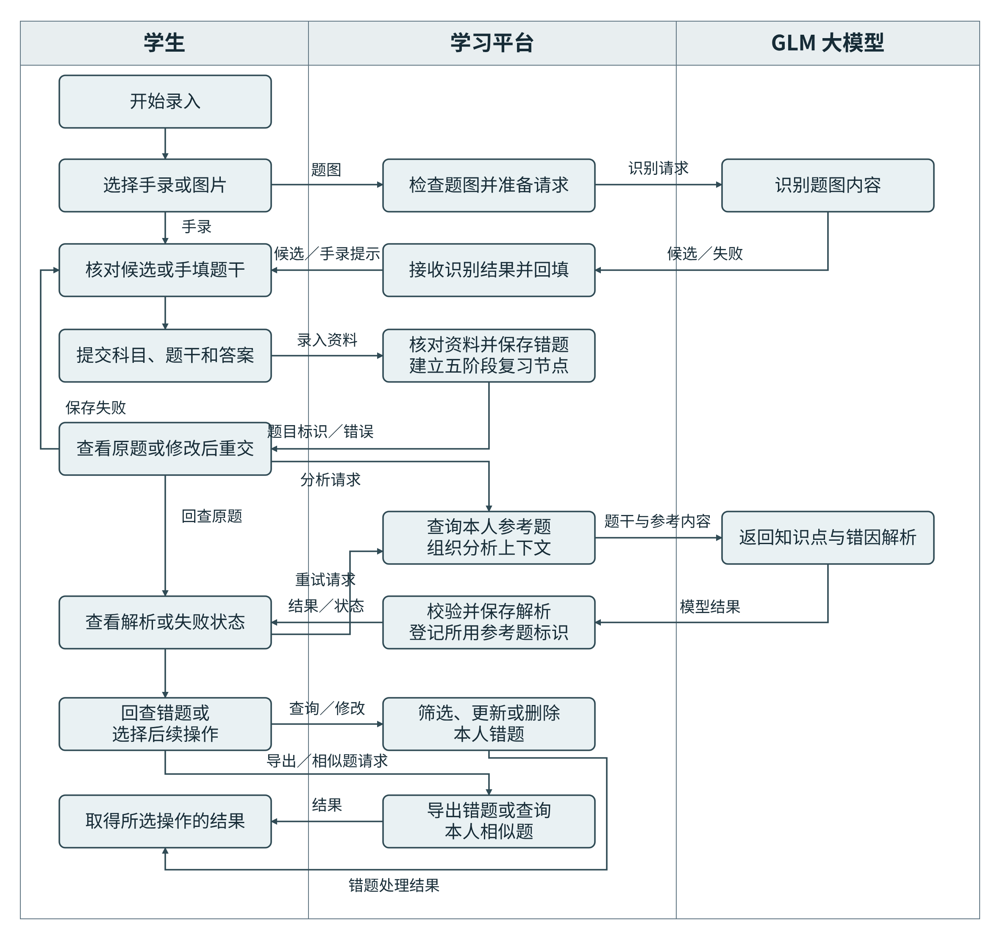

**图 3.1　错题录入与分析业务流程图**

#### 3.2.2 知识学习、练习与复习

我把查讲解、提交作答和完成复习设成不同的操作。学生从本人错题或复习任务选择原题，告诉平台本次要看讲解还是练习。平台按目标查找讲解或可用题；缺少资源时组织请求，接收模型结果并校验保存。学生阅读讲解即可结束或继续查找。做题时，学生提交实际题目和自评结果，平台保存作答、更新原题状态并提供历史查询。学生需要完成复习时，另行提交所选任务的确认。任一步失败均返回对应状态，继续练习时重新查资源。图3.2展示这三条路径，具体规则见第3.3.2节。

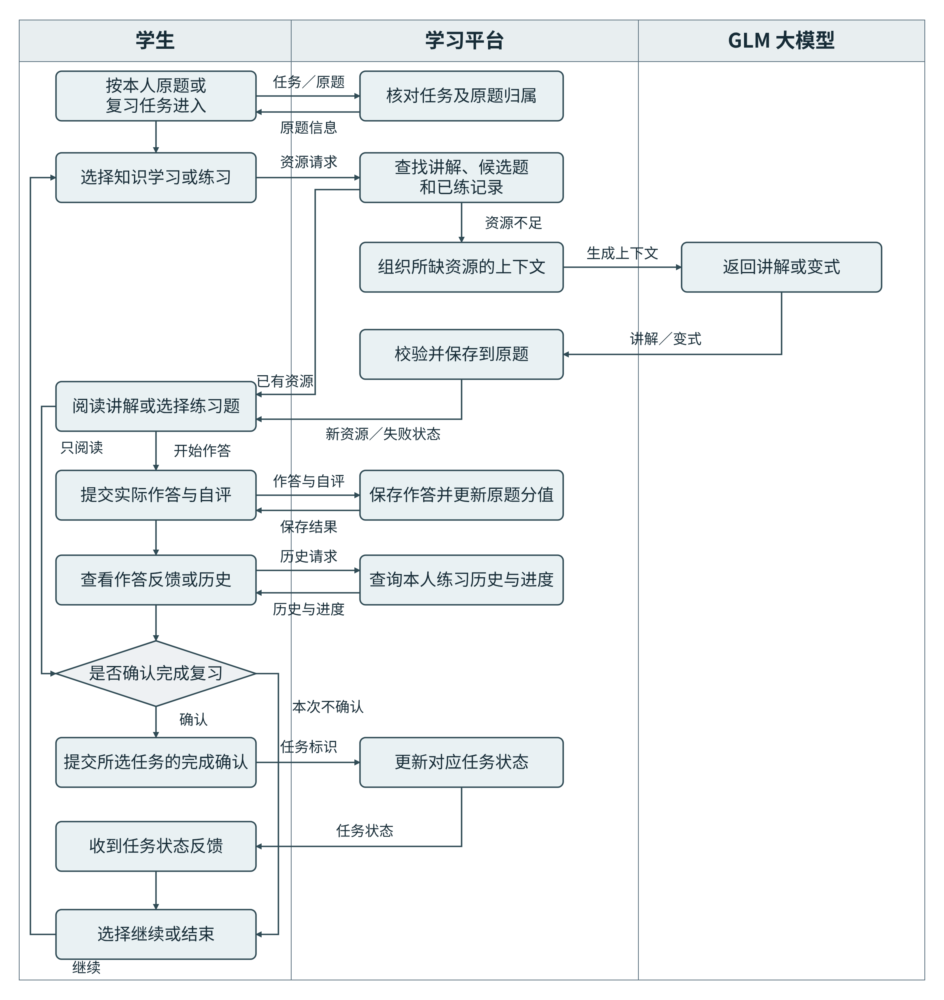

**图 3.2　知识学习、练习与复习业务流程图**

#### 3.2.3 公共操作、管理与学情查看

我按发起人区分图3.3中的请求。登录用户可以查看本人消息和公告，管理员可维护账号、科目、知识点和公告。平台根据角色及输入决定是否读写资料。学生请求本人统计，教师请求系统聚合统计，平台读取现有记录后按各自范围汇总。老师和管理员各自取得处理结果，一方的操作无需等待另一方发起。

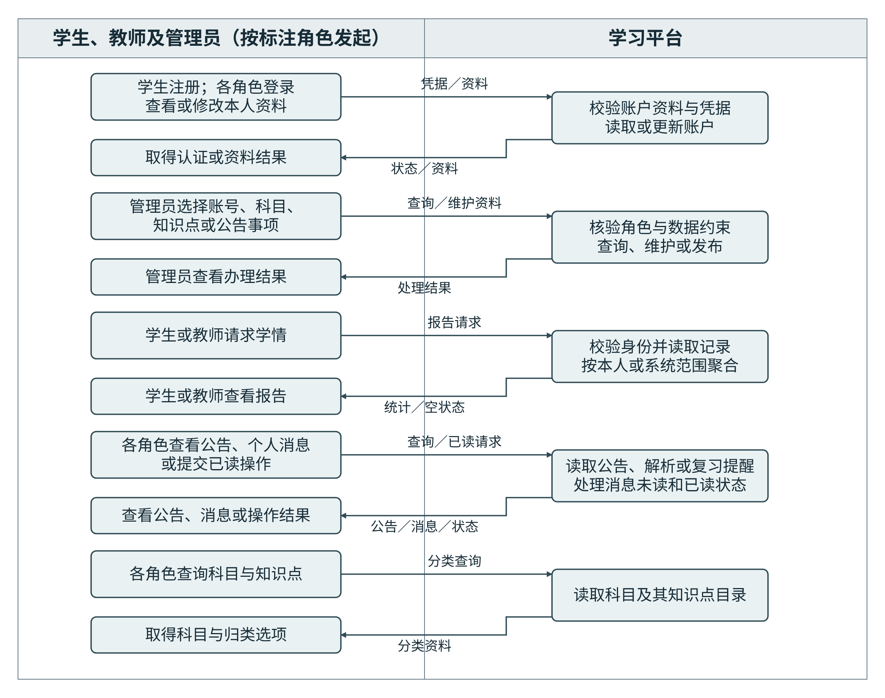

**图 3.3　公共操作、管理与学情查看业务流程图**

### 3.3 功能性需求分析

#### 3.3.1 功能需求清单

我沿图3.1至图3.3检查每一步需要由系统提供的能力，逐项整理到表3.1。表内沿用后续章节使用的 FR01–FR14 编号，同一项中并列列出相关子功能。

**表 3.1　系统功能需求清单**

| 编号 | 使用角色 | 功能及需求描述 | 所属操作端 |
|---|---|---|---|
| FR01 | 学生（注册）；三类角色（登录与资料）；管理员（账号管理） | 用户与账户，注册学生账号、登录、查看及编辑本人资料；管理员查询和停用账号 |  |
| FR02 | 三类角色（查询）；管理员（维护） | 科目管理，查询科目；管理员新增、修改科目 |  |
| FR03 | 三类角色（查询）；管理员（维护） | 知识点管理，按科目查询知识点；管理员新增、删除知识点，校验引用关系 |  |
| FR04 | 学生 | 错题管理，手录或图片识别辅助录入；人工确认候选后保存；分类筛选、查看、编辑和删除本人错题 |  |
| FR05 | 学生 | 错题分析，提交或重试分析；检索本人参考题并准备上下文；查看分析状态、结果和实际参考题标识 |  |
| FR06 | 学生 | 知识学习，按本人原题及输入快照复用讲解；缺少时组织生成、校验和保存 |  |
| FR07 | 学生 | 相似题查询，查询本人题库中与所选错题相关的题目 |  |
| FR08 | 学生 | 拓展练习资源，优先提供可用未练原题或关联变式；耗尽后补充变式；支持主动重做、查看练习进度及已有变式 |  |
| FR09 | 学生 | 复习任务，随录入建立固定节点；查看到期及逾期未完成任务，选择原题学习或练习，另行确认任务完成 |  |
| FR10 | 学生 | 练习记录，保存实际作答目标、自评结果与可选用时，更新原题掌握度；分页查看本人练习历史 |  |
| FR11 | 学生、教师 | 学情报告，学生查看个人统计；教师查询系统聚合统计；必要时请求汇总报告 |  |
| FR12 | 学生 | 错题本导出，按筛选条件导出本人错题 |  |
| FR13 | 三类角色 | 消息通知，接收分析完成或复习提醒，查看本人消息及未读状态，标记已读 |  |
| FR14 | 管理员（发布）；三类角色（查看） | 公告，发布公告；登录后查看公告 |  |

#### 3.3.2 需求范围与业务规则约定

我以学生本人和所选原题为查询范围。辅助错因分析使用题干、参考答案和本人题库的检索上下文，输出错因推断和解题思路。讲解与原题及其输入快照相符时可直接复用。有一条实际提交的作答记录即可判作已练，答错也计入；只拉取或浏览题目不产生练习记录。

统一继续练习先查本人原题与关联变式，全部已练后再生成一批 3 道变式；单独的变式入口只查关联变式池。录入时按第 1、2、4、7、15 天建立固定五阶段复习节点。作答自评按答对 +15、答错 -20 更新原题掌握度，分值范围为 0–100。复习完成状态单独保存。

### 3.4 用户角色与用例分析

#### 3.4.1 分场景用例图

我按学生核心业务、教师查学情和管理员维护三个场景拆出图3.4至图3.6。图中用 FR 编号对应表3.1。“include”连接用例必经的处理，“extend”连接满足条件才发生的操作。例如，提交作答后必须记录结果，图片辅助录入则仅在学生选用图片时发生。公共账户、消息和公告用例在图3.6中单独标明适用角色。

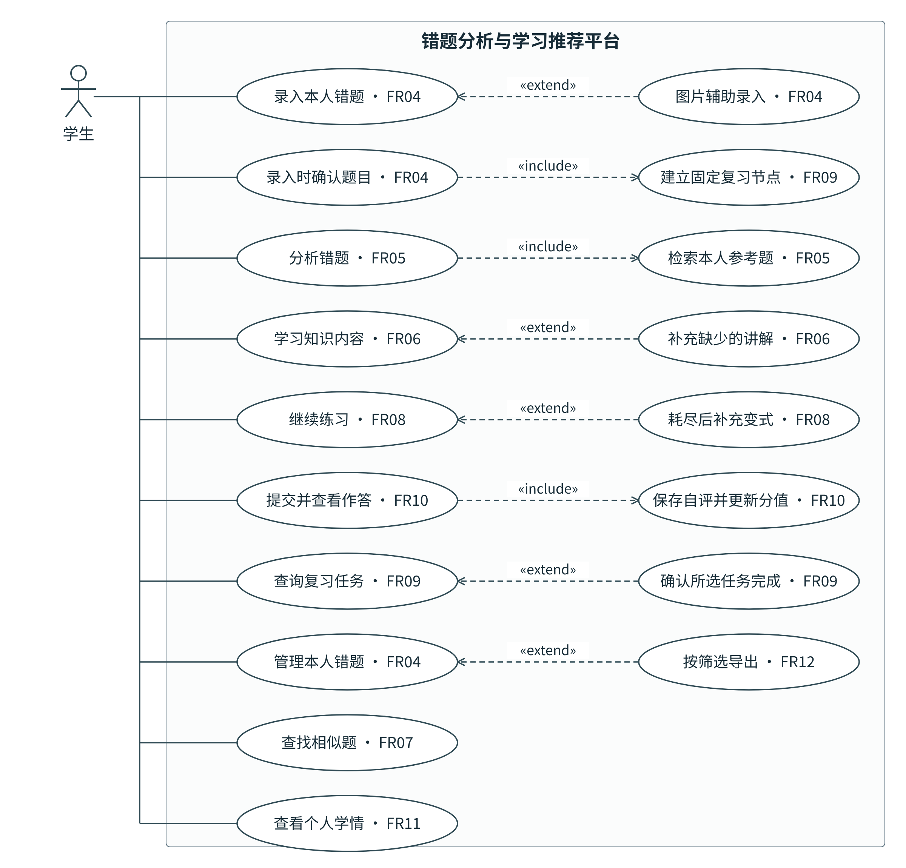

**图 3.4　学生核心业务用例图**

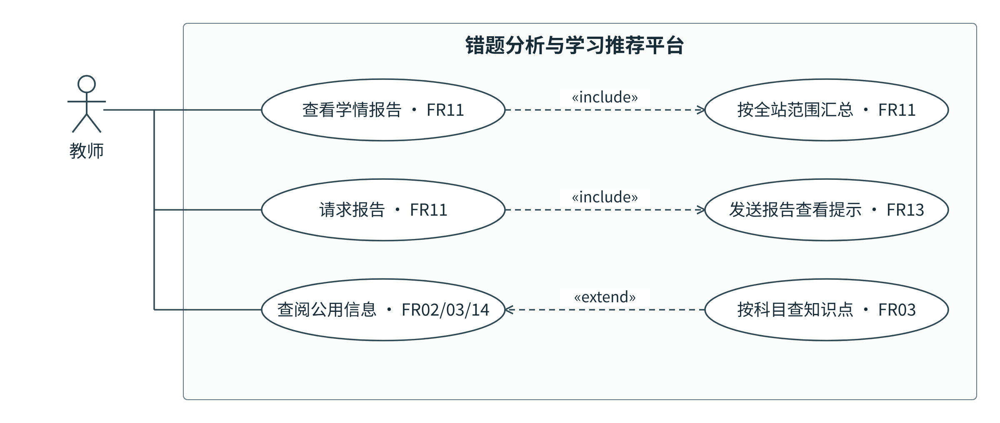

**图 3.5　教师学情用例图**

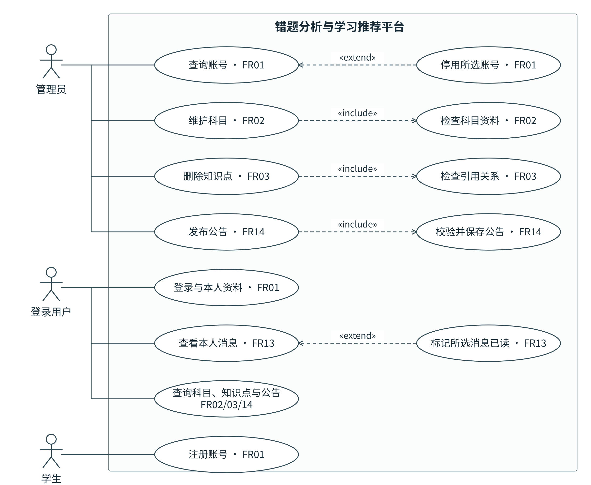

**图 3.6　管理员与公共操作用例图**

#### 3.4.2 核心用例说明

我把录入、学习、练习、复习、报告与维护各取一个用例，逐个列出前提、正常流程和失败情况下平台应返回的结果，见表3.2。录入、分析和生成用例分别检查相应记录是否真的保存；学习内容被阅读以后，学生仍可决定是否另行开始练习。

**表 3.2　核心用例说明**

| 用例 | 参与者与前提 | 基本交互 | 异常与完成结果 |
|---|---|---|---|
| UC01 录入与分析错题 | 学生；具有录入权限 | 填写或图片辅助录入；提交；平台保存错题并组织分析；学生查看平台处理后的结果 | 输入不合格返回修改；识别失败可手录；分析失败保留原题并允许重试 |
| UC02 学习知识内容 | 学生；已选择本人原题（可关联知识点） | 平台查询已有知识内容；有则提供，无则组织生成、校验和保存；学生阅读并决定是否继续 | 无效生成不作为成功资源保存；纯阅读不写作答记录；继续时重新查库 |
| UC03 开展做题练习 | 学生；已选择本人原题及其关联变式 | 平台优先提供已有可用题；必要时补充生成；学生作答并自评；平台保存题目标识与结果 | 无权题目拒绝；保存失败反馈；继续练习再次判断可用资源，不无条件调用模型 |
| UC04 完成复习 | 学生；存在本人待完成任务 | 查看任务，结合原题学习或练习，选择确认完成，平台更新该任务状态 | 无任务展示空状态；未确认则保留未完成；不据一次练习自动改期 |
| UC05 查看学情 | 学生或教师；具有报告权限 | 请求统计；平台读取记录并按角色确定范围；展示本人或系统聚合报告 | 无数据明确提示；教师不能据此钻取班级或个人作答详情 |
| UC06 维护基础资料 | 管理员；具有维护权限 | 选择科目、知识点、账户或公告事项；提交请求；平台校验并保存或查询 | 不合格输入和越权操作拒绝；返回处理结果，不依赖教师完成其他操作 |

### 3.5 结构化分析

#### 3.5.1 第 0 层数据流

我先在图3.7用加工 0 画出平台边界。学生、教师、管理员按各自的任务向平台提供账户资料和业务请求，平台返回身份、资料、学习反馈或报告。GLM 大模型接收平台整理后的识别、分析或资源生成上下文，向平台返回候选、分析或资源结果。

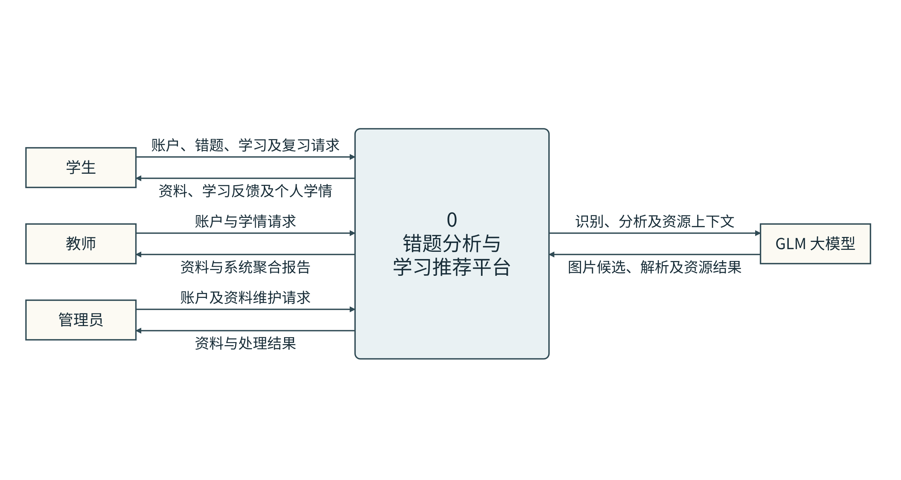

**图 3.7　系统第 0 层数据流图**

#### 3.5.2 第 1 层数据流

我把加工 0 分为 P1 账户与认证、P2 基础资料维护、P3 错题管理与分析、P4 学习练习与复习、P5 学情与通知，放在同一张图3.8中。P1 提供身份与角色信息，P2 提供选题和归类使用的科目与知识点，P3 保存错题和分析并建立复习任务。P4 依所选原题及已有分析组织学习和练习，P5 根据分析完成信息形成消息，并从错题、练习和复习记录汇总报告。P3 到 P4 的原题与分析数据只在学生选择资源时使用。图中的加工间连线表示逻辑资料传递，有些资料经共享存储或会话传递。

D1–D6 是逻辑存储，实际对应第 6 章的 11 张表。PC 端现有后端口径为 39 个接口；双端需求按复用同一套后端考虑。

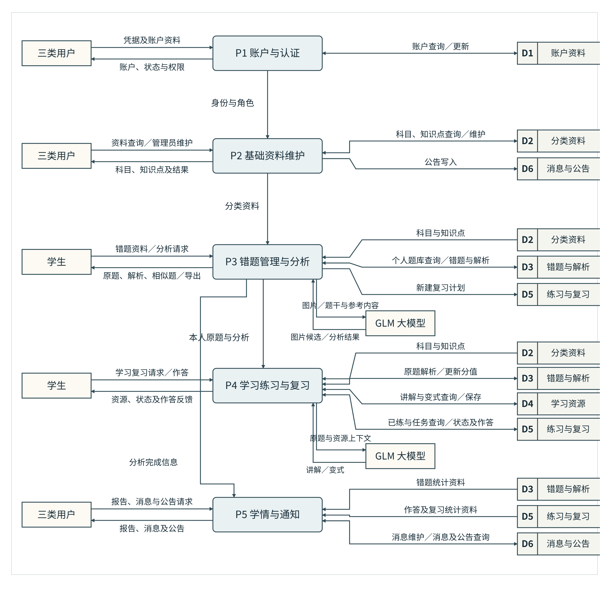

**图 3.8　系统第 1 层数据流图**

#### 3.5.3 第 2 层数据流

我只展开第 1 层的 P4，依次编号 P4.1 查询可用资源、P4.2 生成与校验入库、P4.3 记录作答、P4.4 确认复习。图3.9画查询与补充资源，图3.10画作答、复习和已练标识的形成。两图共用学生以及 P4 所用的存储编号。

P4.1 接收所选原题、操作类型，读取分类、错题、讲解或变式及实际作答标识。可用资源直接返回；缺少时把资源类型和原题上下文传给 P4.2。P4.2 向模型提交上下文，将经校验的讲解或变式写入 D4，再返回资源或失败提示。P4.3 把作答存入 D5，并更新 D3 的原题分值；再次选择题目时，由 P4.1 从 D5 判断是否已练。P4.4 读取 D5 的任务，只在收到学生确认后更新对应计划。

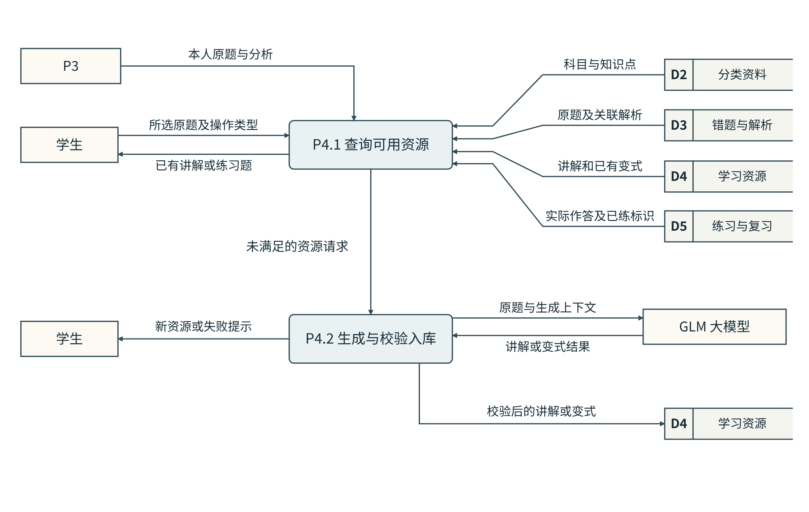

**图 3.9　第 2 层数据流图（P4.1 与 P4.2）**

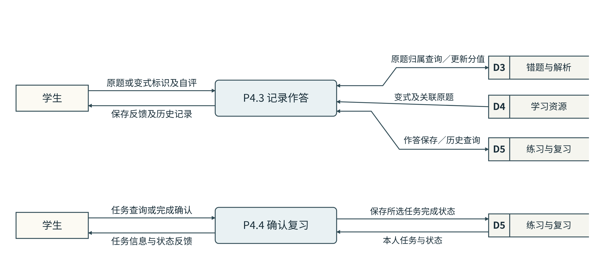

**图 3.10　第 2 层数据流图（P4.3 与 P4.4）**

#### 3.5.4 数据字典

我按用途将物理表归入 D1–D6，逐项核对数据来源和用途，见表3.3。表3.4列出外部交换和加工之间的主要资料，便于检查父加工和子加工的边界是否一致。

**表 3.3　逻辑数据存储说明**

| 编号 | 名称 | 主要内容与来源 | 用途及当前物理对应 |
|---|---|---|---|
| D1 | 账户资料 | 用户标识、账户、角色与状态；来自注册、资料维护及管理员操作 | 身份与权限判断；对应user |
| D2 | 科目与知识点 | 科目及知识点标识、名称和层级；来自管理员维护 | 输入选择、归类及资源查询；对应subject、knowledge_point |
| D3 | 错题与解析 | 归属、题干、答案、知识点、解析、参考标识与状态；来自录入及平台处理 | 本人错题查询、分析和统计；对应question、ai_analysis |
| D4 | 学习资源 | 内容类型、资源标识、内容及原题或知识点关联；来自平台校验后的生成结果 | 对应variant_question、learning_content；由原题限定个人归属 |
| D5 | 练习与复习记录 | 用户及作答目标、自评结果、用时、任务日期和完成状态 | 标识已练题、更新与统计；对应practice_record、review_plan |
| D6 | 消息与公告 | 接收人或发布人、标题、内容及阅读状态；来自业务提醒和管理员发布 | 个人消息与公告查看；对应message、announcement |

**表 3.4　核心数据流字典**

| 数据流 | 来源与去向 | 关键组成 | 约束 |
|---|---|---|---|
| 身份与角色 | P1→P2 | 本人账号标识、登录状态、角色 | 用于鉴权与统计范围判断 |
| 分类资料 | P2→P3 | 科目与知识点标识、名称 | 用于错题录入与归类 |
| 本人原题与分析 | P3→P4；展开后进入 P4.1 | 所选原题标识、题干及已保存解析 | 由本人发起学习请求，按归属读取 |
| 分析完成信息 | P3→P5 | 接收人、题目标识与处理结果 | 用于形成个人消息 |
| 错题资料 | 学生→P3 | 科目、题干、可选答案、来源和图片 | 题干与归属有效；识别候选不直接当作正式保存结果 |
| 识别分析上下文 | P3→AI模型 | 输入内容、候选知识点、本人参考内容 | 最小必要数据，不含密钥或其他学生私有题目 |
| 识别分析结果 | AI模型→P3 | 候选题目信息或知识归类、错因、解析 | 平台校验后使用；失败保留已有错题 |
| 学习请求 | 学生→P4.1 | 本人原题标识、学习或练习类型 | 不把学习请求等同于作答记录 |
| 未满足的资源请求 | P4.1→P4.2 | 目标类型、知识点或原题上下文 | 缺少可用资源时形成，携带目标及必要上下文 |
| 生成上下文与结果 | P4.2↔AI模型 | 请求的内容类型、题目上下文；返回的讲解或练习题 | 未通过校验的内容不作为有效资源写入D4 |
| 作答数据 | 学生→P4.3 | 原题或变式目标、自评结果、可选作答及用时 | 目标明确且归属合法；结果由学生自评 |
| 练习记录 | P4.3→D5 | 用户、题目标识、结果与时间 | 支持后续识别已练题；复习任务完成另行确认 |
| 完成确认与复习状态 | 学生→P4.4→D5 | 所选任务、本人确认与完成状态 | 只更新本人选定任务，不隐含动态改期 |
| 报告信息 | P5→学生或教师 | 题目、练习、复习及知识点聚合指标 | 学生本人范围、教师系统聚合范围；反映现有记录 |

### 3.6 非功能性需求分析

#### 3.6.1 安全性需求

我把他人题目、图片和学习记录都设为归属校验对象。服务端每次按当前角色和归属校验请求，账号停用后应拒绝旧会话。题干中的富文本需要过滤，模型凭据保留在服务端。

#### 3.6.2 可靠性与可维护性需求

我把错题保存和模型分析分开。模型超时、限流或返回内容不合格时，原题应照常保留，有效缓存和旧题仍可使用。题目编辑后过期结果不得覆盖新输入。界面、接口、服务和数据访问分别处理各自的工作，错误记录应指出失败环节并避免泄露私有内容。

#### 3.6.3 运行与性能需求

PC 端通过浏览器访问，服务端需要 Java、MySQL 和图片存储；模型任务还需要可用的文本与向量服务。我把普通查询和模型等待分开反馈，优先查询已有资源。性能测量应说明负载和环境。

#### 3.6.4 交互与外部模型需求

我按操作结果区分等待、成功、空结果和失败。遇到识别失败，学生仍可手填；查看讲解、提交自评和确认复习完成应使用不同入口。平台校验 GLM 大模型返回的图片候选、解析、讲解和变式，再决定如何保存或呈现。

## 4 相关技术概述

### 4.1 Vue 3与TypeScript

Vue 3以组件组织页面内容，通过响应式状态驱动界面更新。错题列表、详情、复习任务和学情报告具有不同的数据与交互需求，按组件划分后可以分别管理加载、编辑和提交状态。单页应用中的路由负责切换业务页面，公共布局与登录状态不必在每次跳转时重新构建。对于模型调用这类耗时操作，前端可以先呈现已保存的题目，再依据接口结果更新分析状态，使数据保存与内容生成的反馈分开。

TypeScript在JavaScript基础上提供静态类型约束。为请求参数和响应对象定义类型，可以在开发阶段发现字段缺失、类型不匹配等问题，减少前后端契约变化造成的遗漏。但静态类型不会自动验证网络响应，也不能代替服务端权限与数据校验。本系统使用Vue 3和TypeScript组织页面，结合Vue Router、Pinia及Axios管理导航、会话状态和接口访问；Element Plus提供表单、列表与提示组件，ECharts用于展示统计数据。

### 4.2 Spring Boot

Spring Boot通过自动配置和依赖管理简化Spring应用的组织与运行。业务接口可以采用统一的请求映射、参数校验和响应结构，业务规则由服务类处理，数据访问则通过独立的Mapper接口完成。这样的分层使界面交互、业务约束和数据库查询之间的职责较为明确，也便于对关键服务进行单独验证。

事务管理用于保证一组关联写入的完整性。例如，保存错题和创建复习计划需要共同成功；保存练习记录和更新题目状态也需要保持一致。外部模型请求具有延迟和失败的不确定性，不宜简单地把整个远程调用过程纳入长数据库事务。本系统将调用与结果写入分开，并在写回前检查输入是否仍然有效。异步执行只改变任务的运行位置，并不会自动保证数据一致，因此还需要记录状态、异常处理与过期结果防护。

### 4.3 MyBatis-Plus与MySQL

MyBatis-Plus在MyBatis的数据访问能力上提供实体映射、条件构造、分页和逻辑删除等功能。常规查询可以通过带类型的条件构造器表达，统计类查询则仍可编写SQL。框架能够减少重复的数据访问代码，但不会自动推断“只允许查询本人错题”等业务约束；用户范围、科目条件和角色权限仍需在服务和查询中明确限定。

MySQL用于保存账户、错题、解析、练习与复习等具有稳定关联关系的数据。事务、唯一约束和索引分别支撑关联写入、账号唯一性及常用条件查询。本系统采用11张物理表，表间关系由业务层校验维护，数据库未设置物理外键。题目向量保存在文本字段中，由应用读取后计算相似度，适用于当前个人题库的数据规模。

### 4.4 智谱 GLM 大模型

大语言模型通过上下文生成文本，可以承担题目信息整理、辅助解释和练习内容生成等任务。Transformer的注意力机制为相关模型处理上下文提供了技术基础，教育应用研究则指出，生成能力需要与具体任务和结果核查相结合[15,17]。本课题通过服务端接口调用智谱 GLM 大模型，重点在于任务输入、结构化输出和业务流程的衔接。

平台需要把题干、可选答案、候选知识点和参考内容组织为明确的任务输入，并约定返回字段。响应到达后，平台检查结构、字段类型、取值范围和业务关联，再决定是否保存和展示。结构校验保证返回结果能够被程序处理，内容质量通过样本核查评价。图片候选提取同样属于辅助输入，无法识别时应保留手工录入路径。

模型接口封装在服务端，客户端只访问业务接口。配置、凭据、超时和错误处理与页面逻辑分离，有利于控制输入范围和记录失败原因。模拟模型用于检查工程路径，真实模型用于检验实际调用和输出。与生成任务配套的文本向量服务提供语义表示，向量维度和数值有效性需要单独校验。

### 4.5 检索增强生成

检索增强生成在调用生成模型前查找与当前问题相关的外部内容，并将检索结果加入上下文[26]。在错题场景中，个人题库可以提供相近题目的题干片段，使模型获得当前用户积累的参考内容。检索阶段解决“哪些内容可能相关”，生成阶段解决“如何利用上下文形成回答”，二者的质量需要分别评价。

本系统以题干向量计算余弦相似度。对两个非零向量，内积除以各自模长的乘积得到方向相似程度；实现前提是维度一致且数值有限。查询先限定用户和科目并排除当前题目，再对候选排序，避免把其他用户的私有错题带入模型上下文。检索得到的参考标识用于追溯生成内容的输入来源。

RAG为生成选择参考上下文，资源复用查询已保存的讲解与练习题，仍需独立的缓存、已练标识和耗尽判断。具体设计见第6章。

## 5 系统概要设计

### 5.1 概要设计概述

概要设计把第3章的业务要求分配给平台各组成部分，明确角色、模块协作及失败边界。本章关注数据由谁处理、核心操作怎样完成以及访问范围如何限定；表字段、类方法、接口参数与页面状态在第6章展开，具体实现和验证分别见第7、8章。

系统以个人错题为业务主线。录入结果先保存，分析和资源生成作为后续能力；学生取得知识或题目时，平台先检查已有数据，再决定是否需要模型。管理员和教师分别维护基础资料与查看聚合学情，不参与学生每一次学习操作。个人资源范围、未练判定及重做细则沿用第3.3.2节的业务规则约定。

### 5.2 总体架构设计

系统采用前后端分离的分层架构，整体划分为表现层、接口层、业务层与数据层四个层次，并嵌入独立的 AI 能力层，如图 5.1 所示。

（1）表现层。前端为基于 Vue 3、Vite 与 Element Plus 构建的单页应用（SPA），负责页面渲染与用户交互，通过 Axios 以 JSON 格式调用后端 REST 接口。

（2）接口层。后端基于 Spring Boot 3 提供 RESTful 接口，统一进行参数校验、身份鉴权（JWT）、权限控制与统一响应封装。

（3）业务层。按用户、科目、知识点、错题、复习计划、练习记录和学情报告等模块组织 Service。模型调用通过 `LlmClient` 接口完成，图片候选提取由独立识别客户端承担；GLM大模型处理识别与生成，平台负责校验、检索编排和数据写入。`RagService` 负责参考题检索，`RecommendService` 组合知识点、难度和向量结果，`ReviewPlanService` 生成固定日期计划。各类规则分别放在对应服务中，避免由 Controller 直接操作 Mapper 或拼装模型请求。

（4）数据层。使用 MyBatis-Plus 访问 MySQL 8。题目语义向量以 JSON 数组形式保存在错题表中，由应用读取候选向量并计算余弦相似度。该设计减少了毕业设计阶段的基础设施数量，检索开销随候选题数量增加，适用于当前数据规模。


**图 5.1　系统分层架构与外部依赖**


浏览器通过业务接口访问后端，模型服务位于平台边界外。平台只发送当前任务所需的题干、答案、候选知识点和有限参考内容；模型不能直接查询用户表或自行写入分析记录。MySQL与图片目录分别保存结构化业务数据和题图，后端负责二者与用户归属的联系。本地执行器处理异步解析，定时任务发送复习提醒，学情报告在收到请求时聚合。

### 5.3 功能模块设计

表3.1列出了14项功能需求，当前实现按职责归纳为8组模块。功能需求项与服务分组不要求一一对应，同一服务可以承接录入、查询和导出等相关操作。独立知识内容缓存与持续练习由LearningService编排，并与变式题及练习记录服务协作。

各模块的主要实现职责和边界如表 5.1 所示。

**表 5.1　功能模块与实现职责**

| 功能模块 | 主要服务或接口 | 职责边界 |
|---|---|---|
| 用户与权限 | AuthService、UserService、AuthInterceptor | 注册学生、认证、资料维护、用户停用与角色校验 |
| 基础错题 | QuestionService、SubjectService、KnowledgePointService | 错题、科目和知识点；图片识别仅提供录入候选 |
| AI 辅助解析 | AiAnalysisService、EmbeddingService、LlmClient | 异步任务、向量、结构化校验和归类回填 |
| 练习资源 | RagService、RecommendService、VariantService、LearningService | 个人题库检索、规则优先推荐、知识缓存与未练题优先编排 |
| 复习计划 | ReviewPlanService、ScheduleTask | 固定五阶段计划、完成与过期状态、到期提醒 |
| 练习记录 | PracticeService | 保存用户自评作答并更新原题规则分值 |
| 学情与导出 | ReportService、QuestionService | 请求时聚合报告与 XLSX 导出，无报告快照 |
| 消息与公告 | MessageService、AnnouncementService | 本人站内消息与管理员公告发布，无推送通道 |


上述模块以错题记录为业务主线。基础管理维护账号、科目、知识点和公告；错题相关服务处理录入、解析和练习题生成；学习服务处理复习计划、作答记录、统计和消息。变式练习通过变式题回溯原题，这种关联也用于在删除或编辑错题时处理派生数据。

图 5.2按业务职责归纳学生学习、公共服务及基础维护三个区域。图中的连线表示功能组成，不是业务执行先后；解析、检索和学习服务虽然协作，但不会把权限判断交给模型处理。

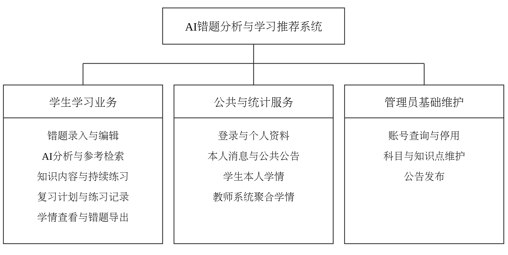

**图 5.2　系统功能模块**

### 5.4 角色与权限设计

系统同时使用角色约束和数据归属约束。角色约束决定是否允许执行某类业务，数据归属决定允许访问哪些记录。学生获得错题接口权限，并不意味着可以根据其他题目编号读取他人数据；教师能够读取聚合学情，也不意味着可以编辑学生题目。权限判断应由服务端执行，前端菜单仅用于提供相应操作入口。主要数据范围如表5.2所示。

**表 5.2　角色与数据访问范围**

| 参与者 | 允许的主要范围 | 设计约束 |
|---|---|---|
| 学生 | 本人账户、错题、练习、复习、报告与消息；公共科目、知识点和公告 | 题目与派生资源通过所属用户校验；图片访问同样受归属限制 |
| 教师 | 本人资料与消息、公共基础资料、系统聚合学情 | 不建立班级关系，不提供学生个人作答明细或题目维护权限 |
| 管理员 | 本人资料与消息、账户状态、科目、知识点及公告维护 | 不取得学生学习接口或教师报告接口权限 |
| AI模型 | 平台为当前任务准备的必要输入 | 不直接读写业务数据库，返回内容经平台校验后使用 |

角色判断与数据范围各自生效。公开入口只承担注册、登录和健康检查；登录后的资料、消息及公告按公共业务访问，学生学习接口继续限制角色。教师报告使用系统范围的聚合数据，不能据报告权限读取学生题图或提交练习。后台任务使用已保存的业务归属，不依赖前端传入用户编号作为授权依据。

### 5.5 核心业务操作流程设计

#### 5.5.1 错题保存与异步分析

保存错题与异步解析的交互如图5.3所示。错题和五阶段计划先在同一事务中保存，前端取得ID后另行触发解析。后台任务执行期间，前端通过轮询取得处理状态。

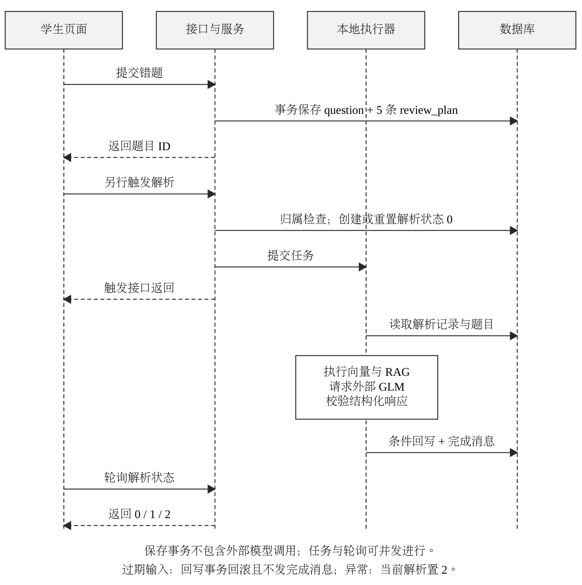

**图 5.3　错题保存与异步解析时序**


平台把“数据已保存”和“分析已完成”作为两个结果。保存接口建立原题和复习计划，前端随后发起分析任务并轮询状态。后台结果仅在题目输入和生成中记录仍有效时写回；用户编辑后应重新分析，迟到结果不能替代当前内容。若输入已过期，回写事务回滚，也不会发送完成消息；若解析出现异常，仍在处理的记录转为失败状态（2）。该安排使手工录入可以在模型暂不可用时继续。

#### 5.5.2 检索与推荐资源

AI 解析中的检索和校验过程如图 5.4 所示。参考题筛选不要求同一知识点；候选知识点则来自当前科目中 parent_id 非 0 的记录，在系统两级树约定下作为二级考点使用。参考题最多取 3 条，提示词只使用各题题干前 50 个字符及必要的省略标识。没有参考题时仍可请求模型，但结果需要经过相同的结构校验。解析记录以 reference_ids 保存本次实际采用的参考题编号。

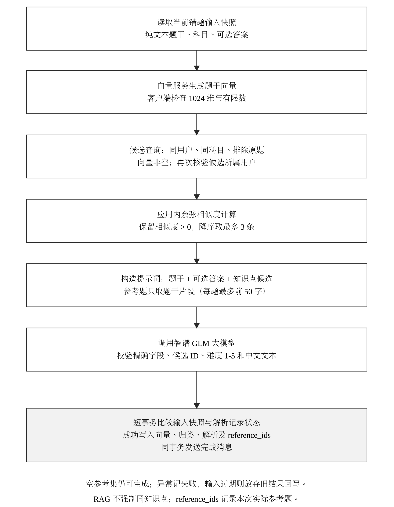

**图 5.4　AI 解析中的 RAG 与结构校验**


解析参考题与页面相似题使用不同规则。前者从同用户、同科目的向量候选中取得最多3条参考；后者采用“本人题库内同知识点及相近难度优先、题干向量余弦相似度补足”的混合策略，最多返回5条。相似题推荐依据知识点、难度与题干相似度排序。知识学习则优先查找当前原题的有效讲解缓存，缺少时才组织生成。

#### 5.5.3 持续练习与作答保存

练习提交如图 5.5 所示。用户提交结果自评，服务验证原题和变式题目标二选一及其归属，再于同一事务中保存记录并原子更新原题分值。变式题需要通过 question_id 回溯原题；同一练习记录不会同时填写两个目标。提交作答不会改变复习计划的完成状态或相似题的排序。

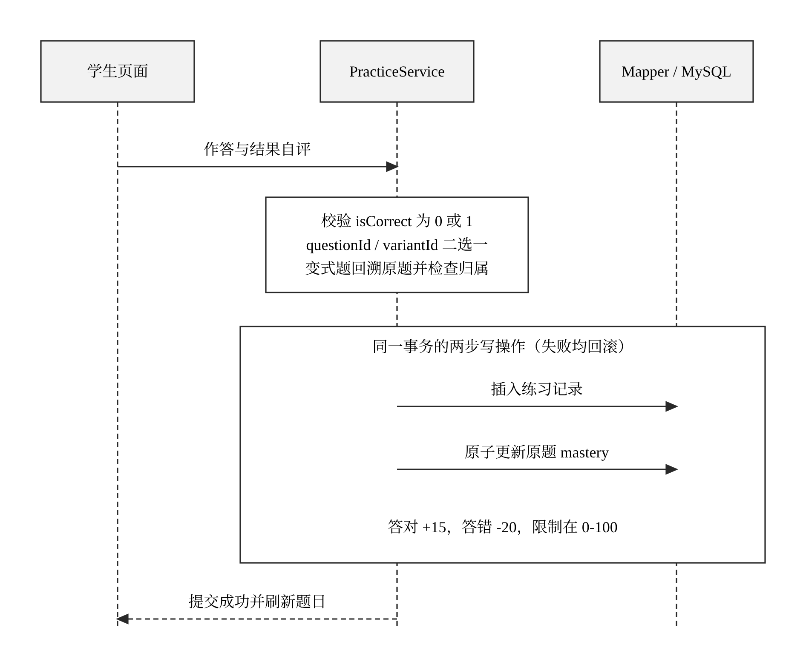

**图 5.5　练习提交与掌握度更新时序**


通过统一继续练习入口取得资源时，平台先判断本人原题是否已有实际作答，再查询关联的未练变式；全部耗尽后才补充生成。单独变式入口只查询关联变式，存在未练变式即复用，变式池耗尽后生成，不检查原题已练状态。一次“获取题目”不会消耗资源，答错提交仍表示已经练习。显式重做保留原资源身份并新增作答记录。生成失败时保留旧题供主动重做，不能把失败响应保存为新题。

#### 5.5.4 复习完成与学情查看

复习状态如图 5.6 所示。过期表示计划日期已过且尚未完成，用户仍可完成该计划。完成复习与保存一次练习记录是两个独立接口：前者更新计划状态和完成时间，后者更新作答记录与掌握度，两者不自动联动。定时任务不改变原计划日期，也不依据掌握度生成新的间隔。今日复习列表包含截至当天仍未完成的计划，已完成的计划不能重复确认。


**图 5.6　复习计划状态转换**

学情报告在请求时读取错题、练习及复习记录，学生查询本人统计，教师查看系统聚合。定时任务只标记逾期和发送站内提醒，不预先生成报告快照。这样可以区分原题分值、某次作答和某项复习任务，避免一次操作隐式更新多个不同含义的状态。

### 5.6 系统可靠性设计

可靠性首先体现在本地数据与外部服务分离。错题与计划关联写入使用事务，模型调用不占用持续的数据库写事务。生成内容通过校验后，在短事务内锁定或条件匹配原题，再保存派生记录。任何一项变式校验或插入失败都回滚整批，不留下部分可用、部分缺失的题组。

知识缓存按输入摘要判断有效性，摘要包含原题、归属、科目、知识点及其名称、题干和答案。命中有效缓存时可以直接返回，不以外部模型当前是否可调用为前提；核心输入变化时清理旧缓存。单实例使用有限数量的分段可重入锁串行同一原题请求，写回前重新检查数据一致性。

外部调用配置连接和读取超时，对指定暂时性异常有限重试。结构错误、旧输入和权限失败不能通过重试拼成成功结果。日志保留题目标识、状态和异常类型，界面提示重试或使用已有资料。上述机制保证外部调用失败时系统状态可控，已保存的题目与学习资料仍可继续使用。

### 5.7 安全性与数据隔离设计

账号密码使用BCrypt，接口使用JWT并重新读取账号当前状态与角色。服务端按角色限制业务入口，按用户归属限制对象查询，RAG和推荐再对候选执行归属检查。学生学习服务统一检查学生角色和原题归属，避免只保护某一个页面或接口。ThreadLocal中的登录信息在请求结束时清理。

题干按允许的标签集合过滤，显示端再次清理HTML；用于向量、模型和导出的内容转为纯文本。上传图片检查大小与类型，文件名由平台生成，关闭匿名静态访问，详情返回图片前校验题目归属。图片识别只返回表单候选，不自动保存或把学生作答写为正确答案。

外部模型凭据仅由环境变量或未入库配置注入，不发送到浏览器，不写入论文、截图或日志。错误提示不回显完整外部响应。个人资源目前不跨学生共享；教师的聚合报告权限也不扩展为个人明细访问权。上述约束分别在拦截器、查询与服务中落实，详细落点和边界用例见后续章节。

## 6 系统详细设计

### 6.1 数据库设计

#### 6.1.1 概念结构设计

数据库设计包含 11 张物理表：用户（user）、科目（subject）、知识点（knowledge_point）、错题（question）、AI 解析记录（ai_analysis）、变式题（variant_question）、复习计划（review_plan）、练习记录（practice_record）、消息通知（message）、公告（announcement）与知识内容（learning_content）。实体间主要关系如下：

（1）用户与错题为一对多关系，一名学生可录入多道错题；科目与知识点为一对多关系，一个科目包含多个知识点；知识点为自关联一对多关系，一级章节下包含多个二级考点。

（2）错题与 AI 解析记录为一对零或一关系，未触发解析时可以没有记录，触发后由 question_id 唯一约束保证最多一条记录；错题与变式题为一对多关系，一道原题可生成多道变式题。

（3）用户、错题与复习计划之间：一名用户可拥有多条复习计划，一道错题可对应多个复习阶段的复习计划；用户、错题、变式题与练习记录之间：练习记录同时关联用户与错题（或变式题），用于记录每次作答并支撑掌握度计算。

（4）用户与消息为一对多关系，每条消息对应一个接收用户；公告通过发布人 ID 逻辑关联用户，由管理员发布并供登录用户查看。

系统 E-R 关系拆分为图 6.1、图 6.2 和图 6.3：分别说明错题归属与解析、复习与练习、消息与公告。重复出现的实体表示同一张物理表，知识内容的归属与关联另见图6.4，四个视图共同覆盖11张物理表。连线按父实体与子记录标注基数，表间为逻辑关联，由服务层校验维护一致性。

四张分视图的物理表索引如下：

（1）图6.1：user、subject、knowledge_point、question、ai_analysis，说明错题归属、归类及解析。

（2）图6.2：user、question、variant_question、review_plan、practice_record，说明计划与实际作答目标。变式题的作答通过 variant_question.question_id 关联到原题，并更新原题掌握度。

（3）图6.3：user、message、announcement，说明消息接收与公告发布。

（4）图6.4：user、question、knowledge_point、learning_content，说明个人知识缓存的归属。重复实体仅为查阅方便，不增加物理表。

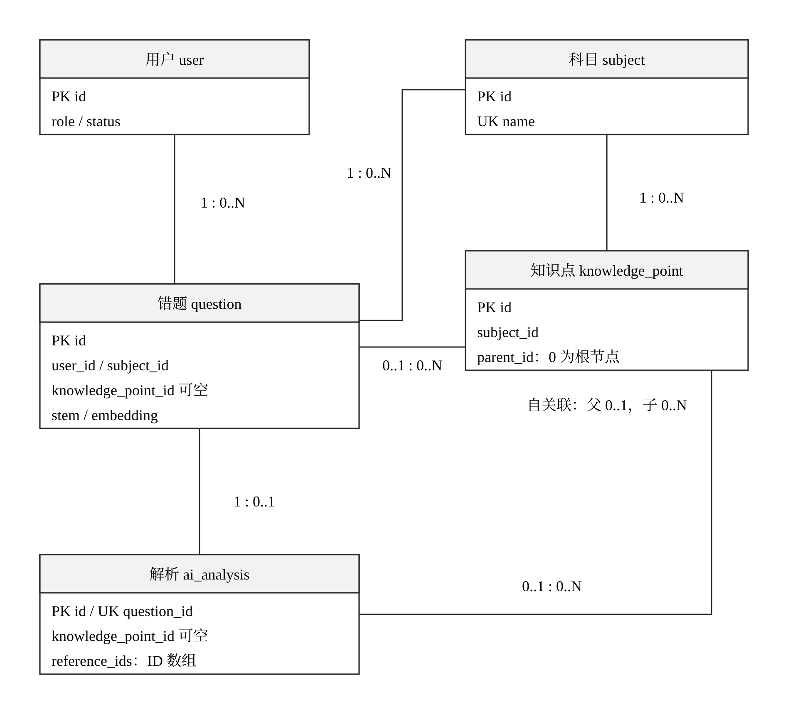

**图 6.1　错题归属、知识归类与解析关系**

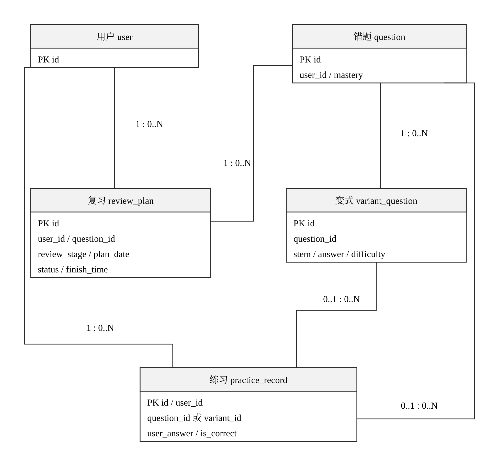

**图 6.2　复习计划与练习记录关系**

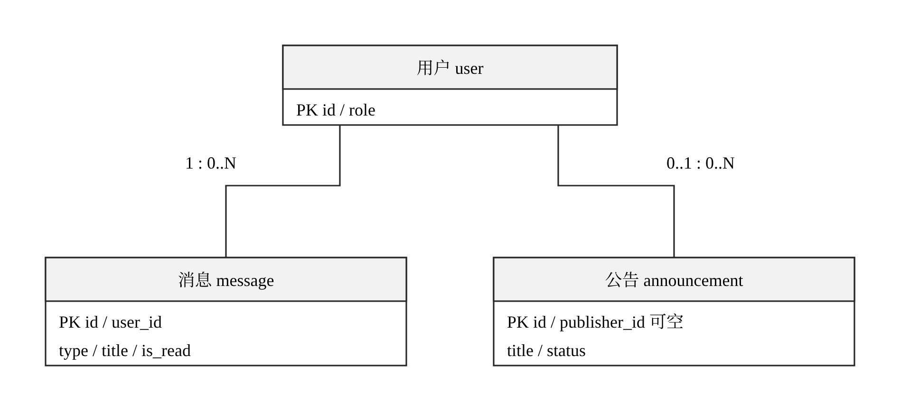

**图 6.3　消息与公告关系**

用户实体包含账号、角色与状态等属性，角色区分学生、教师与管理员；`class_name` 仅为预留文本字段，本课题不据此建立班级关系。科目与知识点构成错题归类基础，知识点通过 `parent_id` 形成两级树，不设计知识图谱。错题保存题干、答案、来源、难度、题目级掌握度与语义向量；AI 解析记录保存模型归类结果、错因、解析和参考题 ID；变式题、复习计划和练习记录均通过错题 ID 关联业务主线；消息记录接收用户与已读状态，公告记录发布人及上下线状态。

知识内容通过用户和原题确定归属，以输入摘要维护缓存有效性。其关联见图6.4，资源复用的业务约束见第6.2.4节。

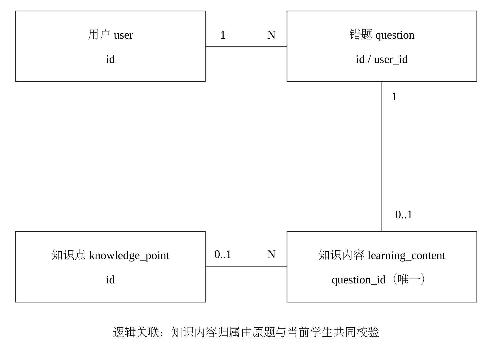

**图 6.4　知识内容与个人资源关联**


#### 6.1.2 逻辑结构设计

系统围绕用户、原题与学习记录建立关系。question以user_id、subject_id和knowledge_point_id关联归属及分类；ai_analysis通过唯一question_id对应当前解析；variant_question通过question_id关联原题。learning_content同时保存用户与原题标识，并用唯一原题约束维护一条当前知识内容，其input_hash用于判断缓存输入是否有效。

practice_record中的question_id与variant_id在业务层要求二选一：原题练习直接关联question，变式练习先关联variant_question，再回溯原题。两列在物理表均允许为空，二选一并非数据库CHECK约束；通过服务校验和事务写入保证本次请求的目标有效。review_plan通过用户和原题关联一个具体阶段，练习和复习完成不共用状态字段。

其余关系包括subject与knowledge_point的一对多、knowledge_point的父子关系、user与message的一对多，以及announcement与发布人的逻辑关联。错题创建与编辑校验科目有效；知识点新增只接受一级章节作为父节点，删除前检查孩子及原题、解析、知识缓存引用，避免产生新的无效关联。系统没有班级实体、报告快照表或独立学生解题步骤表；class_name为预留字段。

#### 6.1.3 物理结构设计

系统共设计 11 张物理表、88 个字段，各表结构如表 6.1 至表 6.11 所示。主键采用自增 BIGINT；表间不建立数据库外键，由业务层校验所属关系并处理关联数据。用户和错题使用状态字段停用或逻辑删除，AI 解析、变式题、复习计划和图片文件则在错题修改或删除流程中按规则清理。

为提高查询效率，在常用查询字段上建立索引：用户表的用户名字段建立唯一索引；错题表按（用户 ID，科目 ID）建立联合索引，支撑错题本的分页筛选；复习计划表按（用户 ID，计划日期）建立联合索引，支撑每日复习任务的快速检索；练习记录表按（用户 ID，创建时间）建立索引，支撑学情统计的按周聚合。

表6.1保存账户认证、角色和状态；username唯一，class_name仅为预留文本。

**表 6.1　用户表（user）**

| 字段名 | 数据类型 | 约束 | 注释 |
|---|---|---|---|
| id | BIGINT | PRIMARY KEY NOT NULL AUTO_INCREMENT | 用户 ID |
| username | VARCHAR(32) | NOT NULL UNIQUE | 登录用户名 |
| password | VARCHAR(128) | NOT NULL | 密码（加密存储） |
| nickname | VARCHAR(32) | DEFAULT NULL | 昵称 |
| role | VARCHAR(16) | NOT NULL DEFAULT 'student' | 角色：student/teacher/admin |
| class_name | VARCHAR(64) | DEFAULT NULL | 预留班级文本，不建立班级业务关系 |
| email | VARCHAR(64) | DEFAULT NULL | 邮箱 |
| status | TINYINT | NOT NULL DEFAULT 1 | 状态：1 正常，0 停用 |
| create_time | DATETIME | NOT NULL DEFAULT CURRENT_TIMESTAMP | 创建时间 |
| update_time | DATETIME | NOT NULL DEFAULT CURRENT_TIMESTAMP ON UPDATE CURRENT_TIMESTAMP | 更新时间 |

索引：`UNIQUE KEY uk_username (username)`。

表6.2保存科目名称、编码、排序与启用状态，为错题和知识点提供分类基础。

**表 6.2　科目表（subject）**

| 字段名 | 数据类型 | 约束 | 注释 |
|---|---|---|---|
| id | BIGINT | PRIMARY KEY NOT NULL AUTO_INCREMENT | 科目 ID |
| name | VARCHAR(32) | NOT NULL UNIQUE | 科目名称（如数学、物理） |
| code | VARCHAR(32) | DEFAULT NULL | 科目编码 |
| sort | INT | NOT NULL DEFAULT 0 | 排序号 |
| status | TINYINT | NOT NULL DEFAULT 1 | 状态：1 启用，0 停用 |
| create_time | DATETIME | NOT NULL DEFAULT CURRENT_TIMESTAMP | 创建时间 |

索引：`UNIQUE KEY uk_name (name)`。

表6.3通过subject_id及parent_id组织科目下的两级知识点，不包含图谱边或概率状态。

**表 6.3　知识点表（knowledge_point）**

| 字段名 | 数据类型 | 约束 | 注释 |
|---|---|---|---|
| id | BIGINT | PRIMARY KEY NOT NULL AUTO_INCREMENT | 知识点 ID |
| subject_id | BIGINT | NOT NULL | 所属科目，逻辑外键 → subject(id) |
| parent_id | BIGINT | NOT NULL DEFAULT 0 | 父级 ID：0 表示一级章节 |
| name | VARCHAR(64) | NOT NULL | 知识点名称 |
| sort | INT | NOT NULL DEFAULT 0 | 排序号 |
| create_time | DATETIME | NOT NULL DEFAULT CURRENT_TIMESTAMP | 创建时间 |

索引：除主键外无其他索引。

表6.4保存本人错题的核心输入及派生状态，图片只存路径，向量以文本列承载JSON数组。

**表 6.4　错题表（question）**

| 字段名 | 数据类型 | 约束 | 注释 |
|---|---|---|---|
| id | BIGINT | PRIMARY KEY NOT NULL AUTO_INCREMENT | 错题 ID |
| user_id | BIGINT | NOT NULL | 所属学生，逻辑外键 → user(id) |
| subject_id | BIGINT | NOT NULL | 所属科目，逻辑外键 → subject(id) |
| knowledge_point_id | BIGINT | DEFAULT NULL | 知识点（AI 归类后回填），逻辑外键 → knowledge_point(id) |
| stem | TEXT | NOT NULL | 题干 |
| answer | TEXT | DEFAULT NULL | 答案 |
| source | VARCHAR(128) | DEFAULT NULL | 题目来源（如作业、试卷） |
| image_url | VARCHAR(255) | DEFAULT NULL | 题目图片地址 |
| difficulty | TINYINT | DEFAULT NULL | 难度（1-5，AI 评估） |
| mastery | INT | NOT NULL DEFAULT 0 | 掌握度（0-100） |
| embedding | TEXT | DEFAULT NULL | 题干语义向量（JSON 数组） |
| status | TINYINT | NOT NULL DEFAULT 1 | 状态：1 正常，0 删除 |
| create_time | DATETIME | NOT NULL DEFAULT CURRENT_TIMESTAMP | 创建时间 |
| update_time | DATETIME | NOT NULL DEFAULT CURRENT_TIMESTAMP ON UPDATE CURRENT_TIMESTAMP | 更新时间 |

索引：`KEY idx_user_subject (user_id, subject_id)`。

表6.5保存当前分析状态、归类、错因及参考题标识，唯一question_id限制每原题至多一条当前解析。

**表 6.5　AI 解析记录表（ai_analysis）**

| 字段名 | 数据类型 | 约束 | 注释 |
|---|---|---|---|
| id | BIGINT | PRIMARY KEY NOT NULL AUTO_INCREMENT | 解析记录 ID |
| question_id | BIGINT | NOT NULL UNIQUE | 对应错题，逻辑外键 → question(id) |
| knowledge_point_id | BIGINT | DEFAULT NULL | AI 归类知识点，逻辑外键 → knowledge_point(id) |
| error_cause | TEXT | DEFAULT NULL | 错因分析 |
| analysis | TEXT | DEFAULT NULL | 解析内容 |
| reference_ids | VARCHAR(255) | DEFAULT NULL | 参考的本地题目 ID（JSON） |
| llm_model | VARCHAR(64) | DEFAULT NULL | 所用大模型标识 |
| status | TINYINT | NOT NULL DEFAULT 0 | 状态：0 生成中，1 成功，2 失败 |
| create_time | DATETIME | NOT NULL DEFAULT CURRENT_TIMESTAMP | 创建时间 |

索引：`UNIQUE KEY uk_question (question_id)`。

表6.6通过question_id关联原题，保存实际生成的题干、答案与难度；是否已练由作答记录查询，不新增物理标识。

**表 6.6　变式题表（variant_question）**

| 字段名 | 数据类型 | 约束 | 注释 |
|---|---|---|---|
| id | BIGINT | PRIMARY KEY NOT NULL AUTO_INCREMENT | 变式题 ID |
| question_id | BIGINT | NOT NULL | 原题 ID，逻辑外键 → question(id) |
| stem | TEXT | NOT NULL | 变式题题干 |
| answer | TEXT | DEFAULT NULL | 变式题答案 |
| difficulty | TINYINT | DEFAULT NULL | 难度（1-5） |
| create_time | DATETIME | NOT NULL DEFAULT CURRENT_TIMESTAMP | 创建时间 |

索引：除主键外无其他索引。

表6.7保存具体阶段、日期与完成状态，一项记录对应一条复习任务。

**表 6.7　复习计划表（review_plan）**

| 字段名 | 数据类型 | 约束 | 注释 |
|---|---|---|---|
| id | BIGINT | PRIMARY KEY NOT NULL AUTO_INCREMENT | 复习计划 ID |
| user_id | BIGINT | NOT NULL | 所属学生，逻辑外键 → user(id) |
| question_id | BIGINT | NOT NULL | 待复习错题，逻辑外键 → question(id) |
| review_stage | TINYINT | NOT NULL DEFAULT 1 | 复习阶段（第 1-5 次） |
| plan_date | DATE | NOT NULL | 计划复习日期 |
| status | TINYINT | NOT NULL DEFAULT 0 | 状态：0 待复习，1 已完成，2 已过期 |
| finish_time | DATETIME | DEFAULT NULL | 完成时间 |
| create_time | DATETIME | NOT NULL DEFAULT CURRENT_TIMESTAMP | 创建时间 |

索引：`KEY idx_user_date (user_id, plan_date)`。

表6.8记录实际作答目标、自评和用时；两类目标的二选一由业务层校验。

**表 6.8　练习记录表（practice_record）**

| 字段名 | 数据类型 | 约束 | 注释 |
|---|---|---|---|
| id | BIGINT | PRIMARY KEY NOT NULL AUTO_INCREMENT | 练习记录 ID |
| user_id | BIGINT | NOT NULL | 作答学生，逻辑外键 → user(id) |
| question_id | BIGINT | DEFAULT NULL | 重做的错题，逻辑外键 → question(id) |
| variant_id | BIGINT | DEFAULT NULL | 作答的变式题，逻辑外键 → variant_question(id) |
| user_answer | TEXT | DEFAULT NULL | 学生作答内容 |
| is_correct | TINYINT | DEFAULT NULL | 是否正确：1 正确，0 错误 |
| duration | INT | DEFAULT NULL | 作答用时（秒） |
| create_time | DATETIME | NOT NULL DEFAULT CURRENT_TIMESTAMP | 创建时间 |

索引：`KEY idx_user_time (user_id, create_time)`。

表6.9保存接收人的消息及已读状态，为提醒与消息中心提供数据。

**表 6.9　消息通知表（message）**

| 字段名 | 数据类型 | 约束 | 注释 |
|---|---|---|---|
| id | BIGINT | PRIMARY KEY NOT NULL AUTO_INCREMENT | 消息 ID |
| user_id | BIGINT | NOT NULL | 接收用户，逻辑外键 → user(id) |
| type | VARCHAR(32) | NOT NULL DEFAULT 'system' | 消息类型：review_remind 复习提醒/report 报告/system 系统 |
| title | VARCHAR(128) | NOT NULL | 消息标题 |
| content | VARCHAR(512) | DEFAULT NULL | 消息内容 |
| is_read | TINYINT | NOT NULL DEFAULT 0 | 是否已读：1 已读，0 未读 |
| create_time | DATETIME | NOT NULL DEFAULT CURRENT_TIMESTAMP | 创建时间 |

索引：`KEY idx_user_time (user_id, create_time)`。

表6.10保存公告及发布人，公告的可见状态与个人消息的已读状态分开。

**表 6.10　公告表（announcement）**

| 字段名 | 数据类型 | 约束 | 注释 |
|---|---|---|---|
| id | BIGINT | PRIMARY KEY NOT NULL AUTO_INCREMENT | 公告 ID |
| title | VARCHAR(128) | NOT NULL | 公告标题 |
| content | TEXT | DEFAULT NULL | 公告内容 |
| publisher_id | BIGINT | DEFAULT NULL | 发布人，逻辑外键 → user(id) |
| status | TINYINT | NOT NULL DEFAULT 1 | 状态：1 正常，0 下线 |
| create_time | DATETIME | NOT NULL DEFAULT CURRENT_TIMESTAMP | 创建时间 |

索引：除主键外无其他索引。

**（11）知识内容表**

知识内容按原题保存一份当前有效结果。question_id唯一索引限制重复缓存；input_hash保存题干、答案、科目、知识点及其名称的输入摘要。题目核心内容变化后清理旧缓存，生成期间输入变化则拒绝写回。仅修改来源不使缓存失效。

**表 6.11　知识内容表（learning_content）**

| 字段 | 类型 | 约束 | 说明 |
|---|---|---|---|
| id | BIGINT | PRIMARY KEY NOT NULL AUTO_INCREMENT | 内容标识 |
| user_id | BIGINT | NOT NULL | 所属学生 |
| question_id | BIGINT | NOT NULL UNIQUE | 关联原题 |
| knowledge_point_id | BIGINT | DEFAULT NULL | 关联知识点 |
| input_hash | CHAR(64) | NOT NULL | 输入快照摘要 |
| content | TEXT | NOT NULL | 校验后的知识讲解 |
| create_time | DATETIME | NOT NULL DEFAULT CURRENT_TIMESTAMP | 创建时间 |
| update_time | DATETIME | NOT NULL DEFAULT CURRENT_TIMESTAMP ON UPDATE CURRENT_TIMESTAMP | 最近更新时间 |

索引：`UNIQUE KEY uk_learning_question (question_id)`；`KEY idx_learning_user (user_id)`。

### 6.2 系统分层设计

#### 6.2.1 项目约定与职责边界

后端按controller、dto、vo、service、mapper、entity、config及util组织。Controller处理HTTP契约，DTO承载输入并执行参数约束，VO组织界面需要的返回字段；Service完成业务判断和事务，Mapper访问数据库，Entity与表映射。前端按views、components、api、router、store和utils组织，页面不直接拼接模型请求或数据库语句。

Java类采用业务含义明确的名称，Service接口与Impl实现分开；数据库列使用下划线，Java字段使用驼峰并由MyBatis-Plus映射。公共响应包含code、message、data，文件导出单独返回XLSX。模型状态、练习目标和复习状态分别建模，避免使用一个“完成”字段表达不同业务事实。

#### 6.2.2 实体与模型网关设计

实体层包含与11张物理表对应的User、Subject、KnowledgePoint、Question、AiAnalysis、VariantQuestion、ReviewPlan、PracticeRecord、Message、Announcement和LearningContent。业务服务通过模型网关取得生成与向量结果，再完成校验和写入。AI 辅助错因分析使用题干、参考答案与检索上下文，返回常见错因和解题提示。

核心业务类设计如下：

（1）QuestionService：负责错题的增删改查、分页筛选、XLSX 导出、所属用户校验与图片生命周期管理。创建错题时在同一事务中生成 5 条复习计划；AI 解析由前端在创建成功后通过独立接口触发。

（2）AiAnalysisService：使用本地执行器异步编排错题解析，调用 EmbeddingService 计算 1024 维题干向量，调用 RagService 在同用户、同科目候选中做余弦检索，再将题干、可选订正答案、候选叶子知识点与参考题题干片段组装为提示词，经 LlmClient 请求模型，校验结构化结果后写入 ai_analysis 并回填知识点与难度。分析以题干、订正答案与检索上下文为依据，输出辅助性错因分析。`reference_ids` 记录参与 RAG 的本地参考题 ID，保留参考来源。输入快照和记录状态校验用于阻止过期任务回写。

（3）LlmClient：大模型网关，封装 API 地址、密钥、模型参数与响应解析，提供文本生成与 Embedding 两类接口，屏蔽模型提供方差异。

（4）RagService：检索增强服务，在同一用户、同一科目、排除源题且向量非空的候选题中计算余弦相似度并排序；该服务不对知识点作硬过滤。

（5）VariantService：负责同步变式题生成，以原题上下文调用 LlmClient，严格校验 3 道结果后短事务保存，并通过输入快照避免并发编辑后的旧结果落库。

（6）ReviewPlanService：复习计划服务，在错题创建时按第 1、2、4、7、15 天生成 5 个固定阶段。计划不会依据个人作答自适应改期；完成接口将指定计划标为已完成。

（7）PracticeService：练习记录服务，保存作答记录并更新掌握度：答对掌握度加 15（上限 100），答错减 20（下限 0），掌握度变化同步写入 question 表。

（8）ReportService：学情报告服务，在请求时聚合错题总量、本周新增、当前平均掌握度、本周复习总数与完成数、知识点平均掌握度、薄弱知识点以及按日新增错题和练习次数。`generate` 接口复用同一聚合结果并额外发送一条站内消息，不生成报告 ID 或持久化快照。

（9）ScheduleTask：定时任务类，每日 08:00 标记早于当天的未完成计划为过期，并为当天待复习计划发送站内消息；每周一 09:00 仅向已有错题的用户发送周报查看提示，不调用 ReportService。

（10）MessageService：站内消息服务，负责 AI 分析完成、复习提醒、周报查看提示等消息的生成、分页查询、未读计数与已读状态维护，不包含 WebSocket、短信或邮件通知。

（11）LearningService：按本人原题与输入摘要查询知识内容，缓存失效时组织生成和校验；持续练习依次选择未练原题、未练变式或补充生成。LearningResourceAccess负责归属校验、已练状态与单实例分段锁，不提供独立按知识点查询全站资源的入口。

图 6.5 仅展开模型网关的核心类关系，以说明业务编排与模型实现的依赖边界；其中解析服务经 EmbeddingService 接口使用图中的向量服务实现，图中省略该接口。实体字段已由表 6.1 至表 6.11 给出，不在类图中重复列出。


**图 6.5　模型网关的核心类关系**

LearningContent与物理表一一对应，缓存是否复用通过LearningContentVO.reused表达；VariantQuestion的practiced用于本次查询结果标识，不新增物理字段。PracticeResourceVO只返回一种目标标识和来源类型，便于前端提交时继续保持原题与变式二选一。外部模型响应先进入结构化校验对象，再转换为业务字段，不能直接整体写入实体。

#### 6.2.3 数据访问层设计

数据访问层基于 MyBatis-Plus 实现。每张表对应一个实体类与一个 Mapper 接口，Mapper 继承 `BaseMapper<T>` 后直接获得通用 CRUD 能力，避免编写基础 SQL；分页筛选使用条件构造器，分组统计使用Mapper XML中的聚合SQL，写回前校验使用显式行锁查询。核心Mapper与查询代码在第7章展示。
`Question.status` 标注为 MyBatis-Plus 的逻辑删除字段，因此分页查询会自动排除状态为 0 的记录，不需要在每个条件构造器中重复添加状态条件。

多表写入由Service层通过`@Transactional`组织，例如删除错题时一并清理解析、变式题与复习计划，保证关联处理的一致性。

MyBatis-Plus的普通实体查询处理question的逻辑删除；自定义SQL需要显式写status=1。selectByIdForUpdate用于短写事务中的原题校验，避免在模型等待期间持有行锁。学习记录查询始终带当前用户条件，变式的已练集合由practice_record按用户及variant_id读取，不能通过全局作答次数推断个人状态。

#### 6.2.4 业务逻辑层设计

业务服务以原题生命周期协作。QuestionService保存题目及初始计划，AiAnalysisService在后台准备上下文并校验回写，RagService提供参考题，RecommendService组织页面相似题。LearningService编排知识与练习，VariantService负责生成题目的整批校验与保存；PracticeService保存自评并原子更新原题分值，ReviewPlanService独立处理计划完成。

表6.12把资源查询、生成、并发及重做的业务约束与存储处理对应起来。

**表 6.12　个人资源复用与持续练习设计**

| 业务 | 数据与处理 | 边界 |
|---|---|---|
| 查询知识内容 | 原题及输入摘要匹配learning_content，命中直接返回 | 仅本人资源；缺少模型配置仍可读有效缓存 |
| 取得未练题 | 统一next入口先本人未练原题，再按ID查关联未练变式 | 只有实际提交practice_record才记已练；答错也计已练 |
| 耗尽后生成 | 调用模型，校验结构、长度与批内及历史题干重复，短事务保存 | 失败不产生半批题目，不删除历史可重做题 |
| 并发与编辑 | 单实例按原题分段锁，写回时锁原题并复查快照和可用资源 | 多实例可能重复调用，但写入前再次判断；不承诺分布式单次调用 |
| 继续与重做 | 继续时重新查询；显式重做保存新的练习记录 | 不把获取或阅读当成已练；作答不自动完成复习任务 |

单独variant入口只对变式池执行复用与耗尽判断，与统一next入口的原题优先范围不同。具体业务规则约定见第3.3.2节。每批生成3道题属于现有接口约定，资源隔离和事务一致性由服务层保证。知识内容在结构校验之外结合样本做内容核查，题干去重以规范化文本比较实现。

### 6.3 系统内部接口设计

前后端通过 REST 接口交互，普通响应封装为 `{code, message, data}`，文件导出接口返回 XLSX 数据。系统设计 39 个控制器方法映射，其中注册、登录与健康检查 3 个接口公开，其余 36 个需要认证。JWT 通过后仍需从数据库读取用户状态和角色，停用账号不能继续使用旧令牌。学生业务查询以当前用户 ID 为数据边界。AI 解析采用“触发 + 轮询”，变式题生成采用同步请求。知识学习与继续练习为同步请求，接口如表 6.13 所示。

**表 6.13　系统接口一览**

| 模块 | 方法 | 路径 | 说明 |
|---|---|---|---|
| 用户管理 | POST | /api/auth/register | 用户注册；权限：公开 |
| 用户管理 | POST | /api/auth/login | 用户登录（返回 JWT）；权限：公开 |
| 系统状态 | GET | /api/health | 健康检查；权限：公开 |
| 用户管理 | GET | /api/user/profile | 查询个人信息；权限：登录用户 |
| 用户管理 | PUT | /api/user/profile | 修改个人信息；权限：登录用户 |
| 用户管理 | GET | /api/user/page | 用户分页查询（管理员）；权限：管理员 |
| 用户管理 | DELETE | /api/user/{id} | 停用用户（管理员，逻辑状态变更）；权限：管理员 |
| 科目管理 | GET | /api/subject/list | 科目列表；权限：登录用户 |
| 科目管理 | POST | /api/subject | 新增科目（管理员）；权限：管理员 |
| 科目管理 | PUT | /api/subject/{id} | 修改科目（管理员）；权限：管理员 |
| 知识点管理 | GET | /api/knowledge-point/tree | 知识点树（按科目）；权限：登录用户 |
| 知识点管理 | POST | /api/knowledge-point | 新增知识点（管理员）；权限：管理员 |
| 知识点管理 | DELETE | /api/knowledge-point/{id} | 删除知识点（管理员）；权限：管理员 |
| 错题录入管理 | POST | /api/question | 录入错题；权限：学生 |
| 错题录入管理 | POST | /api/question-recognition/recognize | 单图题目识别并返回表单候选值；权限：学生 |
| 错题录入管理 | GET | /api/question/page | 错题分页筛选（科目/知识点）；权限：学生 |
| 错题录入管理 | GET | /api/question/{id} | 错题详情；权限：学生 |
| 错题录入管理 | PUT | /api/question/{id} | 修改错题；权限：学生 |
| 错题录入管理 | DELETE | /api/question/{id} | 删除错题；权限：学生 |
| AI 解析管理 | POST | /api/ai/analyze/{questionId} | 触发 AI 解析（异步）；权限：学生 |
| AI 解析管理 | GET | /api/ai/analysis/{questionId} | 查询解析结果；权限：学生 |
| 相似题推荐管理 | GET | /api/recommend/similar | 相似题推荐（questionId 参数）；权限：学生 |
| 变式题管理 | POST | /api/variant/generate/{questionId} | 生成变式题；权限：学生 |
| 变式题管理 | GET | /api/variant/list | 变式题列表（questionId 参数）；权限：学生 |
| 复习计划管理 | GET | /api/review-plan/today | 到期及逾期未完成任务；权限：学生 |
| 复习计划管理 | PUT | /api/review-plan/{id}/finish | 完成复习任务；权限：学生 |
| 练习记录管理 | POST | /api/practice | 提交练习作答；权限：学生 |
| 练习记录管理 | GET | /api/practice/page | 练习记录分页；权限：学生 |
| 学情报告管理 | GET | /api/report/weekly | 查询学情周报；权限：学生、教师 |
| 学情报告管理 | POST | /api/report/generate | 聚合当前周报并发送一条站内消息；权限：学生、教师 |
| 错题本导出管理 | GET | /api/question/export | 导出错题本（筛选参数）；权限：学生 |
| 消息通知管理 | GET | /api/message/page | 消息分页查询；权限：登录用户 |
| 消息通知管理 | GET | /api/message/unread-count | 查询未读消息数；权限：登录用户 |
| 消息通知管理 | PUT | /api/message/{id}/read | 标记消息已读；权限：登录用户 |
| 公告管理 | GET | /api/announcement/list | 公告列表；权限：登录用户 |
| 公告管理 | POST | /api/announcement | 发布公告（管理员）；权限：管理员 |
| 学习资源 | POST | /api/learning/knowledge/{questionId} | 复用知识内容或生成校验后保存；权限：学生 |
| 学习资源 | POST | /api/learning/practice/next/{questionId} | 取得未练题或耗尽后生成；权限：学生 |
| 学习资源 | GET | /api/learning/practice/progress/{questionId} | 查询原题与变式的实际已练状态；权限：学生 |

接口参数和返回值按业务分为三组。错题写入接收科目、题干、答案、来源及可选图片；用户归属来自鉴权上下文，不信任客户端指定。学习接口以questionId定位本人原题，知识返回内容与reused，继续练习返回原题或变式的一种标识及source。练习提交接收自评、可选作答和用时，目标由后端再次校验，不能仅依靠前端类型。

分析触发接口与结果查询分开，返回状态区分生成中、成功和失败；知识与变式生成使用同步接口，页面需要显示等待和重试。POST获取知识与下一题可能触发持久化，因此不能当作无副作用的静态查询。模型响应、业务响应和文件导出是不同协议层次，网络成功不等于code表示业务成功。

### 6.4 表示层界面设计

前端按角色组织导航。学生端包含首页、错题录入、错题本、错题详情、练习历史、复习计划、学情报告与消息中心；教师端提供系统聚合学情报告、消息、公告和个人资料页面，不设计班级或学生明细页面；管理员端提供用户、科目、知识点与公告管理。界面采用侧边导航、顶部栏和内容区的统一布局。AI 解析区分生成中、成功和失败状态，变式题同步生成期间显示加载状态；掌握度和复习状态分别用进度条和标签表示。

（1）错题录入页。表单包含科目、题干、答案、来源与图片。题干采用富文本编辑器，支持新增、编辑以及文字格式、段落、换行、列表和上下标；旧纯文本题目仍能读取和编辑。图片识题默认开启，只接受单张不超过 5 MB 的 JPG/JPEG/PNG/WebP 图片，通过 GLM大模型返回科目名称、题干、学生作答和来源候选值，并匹配已有科目。科目、题干和来源可作为表单候选值，`studentAnswer` 只在前端临时展示，不写入 `Question.answer`，也不作为正式解析提示词的独立输入。用户必须人工确认后提交，识别过程不自动保存、拆题、整卷识别或判分，图片也不作为 RAG 输入。保存成功后前端另行触发 AI 解析。

（2）错题本页。左侧为科目—知识点两级树形筛选，右侧为错题卡片列表，卡片展示题干、科目与知识点标签、难度、来源、录入时间和掌握度进度条，点击卡片进入错题详情页。

（3）错题详情页。分区展示题干与答案、AI 解析、参考题、相似题与变式题，提供生成变式题和进入练习的操作。上传图片存于本地文件系统并以 UUID 命名，数据库仅保存路径；系统不提供匿名静态访问，所属学生查询详情时由后端以内联 Data URI 返回图片。

（4）复习计划页。`/today` 接口返回计划日期为当天或更早且仍未完成的任务，学生可将任务标记为完成并进入对应题目练习。页面定位为到期与逾期任务列表，不设计未来日历，也不提供从详情页临时加入“今日复习”的操作。

（5）学情报告页。使用 ECharts 展示最近一周每日新增错题柱状图与每日练习次数折线图，并以指标卡、进度和列表展示当前错题量、平均掌握度、复习完成情况及薄弱知识点。报告只展示请求时的聚合结果，不设计雷达图、掌握度历史趋势或历史报告页面。

（6）学习与练习页签。知识区区分生成和复用，练习区标明原题、已有题或新题来源。原题切换后丢弃迟到响应；保存失败保留作答。未提交时也可再次请求继续，获取本身不记已练，仍可能返回同一题；保存成功后显示显式重做入口。具体实现与真实界面见第7.6节。

## 7 系统开发与实现

### 7.1 系统实现概述

#### 7.1.1 项目结构与运行环境

系统采用前后端分离工程，server提供业务接口，web提供浏览器页面。后端基于JDK 21、Spring Boot 3.5.16与MyBatis-Plus 3.5.17，使用MySQL 8保存数据，Maven Wrapper管理构建；前端使用Vue 3、TypeScript、Vite、Element Plus、Pinia、Vue Router与Axios，ECharts展示聚合统计。工程目录及各层职责见表7.1。

**表 7.1　项目主要目录与实现职责**

| 项目位置 | 主要内容 | 对应职责 |
|---|---|---|
| server/.../controller、dto、vo | 控制器、请求及返回对象 | 接口契约、角色注解、参数接收和结果封装 |
| server/.../service/impl | 分析、检索、学习、练习与复习服务 | 业务编排、校验、快照及事务 |
| server/.../mapper、entity | Mapper、SQL与表实体 | 数据映射、筛选、行锁及聚合 |
| server/.../config、util | 鉴权、线程池、题干与文件工具 | 公共运行边界与安全处理 |
| web/src/views、components | 角色页面与通用组件 | 录入、学习交互及状态显示 |
| web/src/api、router、store、utils | API、导航、会话与文本工具 | 请求封装、路由和输入回显 |

开发与验证使用独立配置。测试只读取专用数据库及上传目录，模型显式设为Mock；需要真实网络的测试入口按开关单独运行。在隔离测试环境下，工程验证使用JDK 21.0.13、MySQL 8.0.46、Node.js 24.22.1与Chromium，结果及历史真实模型证据在第8章分别报告。

本章选取实际源码中与核心业务有关的代表性片段，每段代码的文件与行号索引见附录1表A.2；省略构造器、导入、普通访问器和无关分支，不以示意代码替代实际实现。各层依次说明数据如何表示、如何访问、服务如何编排，再说明HTTP入口与前端展示。

### 7.2 实体层实现

错题实体以question表为中心，保存归属、分类、题干、答案和题目级状态。embedding供服务内部检索，status用于逻辑删除；二者不应随普通详情直接返回浏览器。错题实体中向量隐藏与逻辑删除字段的代码对应如下所示：


```java
/** 题干语义向量（JSON 数组），不向前端返回 */
@JsonIgnore
private String embedding;

/** 状态：1 正常，0 删除（软删除标记） */
@TableLogic
@JsonIgnore
private Integer status;
……以下部分代码省略……
```

上面代码的解释：embedding字段标注@JsonIgnore，不随接口返回浏览器；status字段标注@TableLogic与@JsonIgnore，作为逻辑删除标记同样不向前端返回。

数据库设计中有11张物理表，实体与之对应。学习内容的输入摘要用于当前缓存有效性判断；练习记录保存真实目标和自评；变式查询返回的practiced为非持久化标识，由当前用户记录计算。实体字段本身不决定访问权限，归属还需在服务及查询中校验。

### 7.3 数据访问层实现

#### 7.3.1 本人题库筛选

错题本查询在构造条件时加入当前登录用户，再按可选科目、知识点筛选，以创建时间降序分页。代码中的UserContext来自服务端鉴权，不由页面请求参数指定。普通实体查询还受@TableLogic约束，已经删除的错题不会继续出现在列表中。


以下是错题分页查询的核心代码及其代码解释，对应如下所示：

```java
……以上部分代码省略……
LambdaQueryWrapper<Question> wrapper = new LambdaQueryWrapper<>();
wrapper.eq(Question::getUserId, UserContext.getUserId())
        .eq(subjectId != null, Question::getSubjectId, subjectId)
        .eq(knowledgePointId != null, Question::getKnowledgePointId, knowledgePointId)
        .orderByDesc(Question::getCreateTime);
return questionMapper.selectPage(new Page<>(pageNum, pageSize), wrapper);
……以下部分代码省略……
```

上面代码的解释：查询条件先以当前登录用户编号限定归属，再按可选的科目与知识点筛选，结果按创建时间降序分页返回。

#### 7.3.2 写回锁与聚合查询

模型生成期间不持有数据库行锁，准备写入时才通过selectByIdForUpdate读取正常原题。该方法供学习缓存和变式的短事务使用，取得记录后还需比较输入快照；只有锁而不比较输入，仍可能保存过时内容。


以下是原题行锁查询方法的核心代码及其代码解释，对应如下所示：

```java
@Select("SELECT * FROM question WHERE id = #{id} AND status = 1 FOR UPDATE")
Question selectByIdForUpdate(@Param("id") Long id);
……以下部分代码省略……
```

上面代码的解释：该方法以注解SQL按编号查询正常状态的原题并加FOR UPDATE行锁，供学习缓存与变式写入的短事务使用。

学情报告按知识点计算当前平均分值。自定义SQL不经过普通实体的逻辑删除条件拼接，因此显式过滤status=1；userId为空是教师系统聚合路径，非空时只统计该学生。该SQL给出当前记录的汇总结果。


以下是知识点掌握度聚合查询的核心代码及其代码解释，对应如下所示：

```xml
<select id="selectKpMastery" resultType="map">
    SELECT knowledge_point_id AS kpId, AVG(mastery) AS avgMastery, COUNT(*) AS questionCount
    FROM question
    WHERE status = 1
      AND knowledge_point_id IS NOT NULL
    <if test="userId != null">
      AND user_id = #{userId}
    </if>
    GROUP BY knowledge_point_id
</select>
……以下部分代码省略……
```

上面代码的解释：该查询显式过滤status=1，按知识点分组计算平均掌握度与题目数量；userId非空时只统计该学生，为空时走教师系统聚合路径。

### 7.4 核心业务逻辑实现

#### 7.4.1 错题录入与编辑失效

录入服务先验证科目存在且启用，将题干按允许的 HTML 标签集合规范化，以鉴权用户作为归属，保存题目并创建复习计划。图片通过FileStorageUtil写入日期目录并返回路径。以下为create方法的核心代码及其代码解释，对应如下所示：该方法使用@Transactional，后续异常分支清理本次写入的图片，数据库题目与计划则共同回滚。


```java
……以上部分代码省略……
Question question = new Question();
question.setUserId(UserContext.getUserId());
question.setSubjectId(requireSubject(request.getSubjectId()));
question.setStem(QuestionContent.validatedStem(request.getStem()));
question.setAnswer(request.getAnswer());
question.setSource(request.getSource());
String savedImageUrl = null;
try {
    if (StringUtils.hasText(request.getImageBase64())) {
        savedImageUrl = fileStorageUtil.saveBase64Image(request.getImageBase64());
        question.setImageUrl(savedImageUrl);
    }
    questionMapper.insert(question);
    // 录入成功建立固定第 1/2/4/7/15 天复习计划，不动态估计遗忘曲线。
    reviewPlanService.createPlans(question);
    return question.getId();
……以下部分代码省略……
```

上面代码的解释：代码以鉴权用户为题目归属，校验科目与题干后组装错题对象；请求带图片时先保存图片再插入题目，插入成功后调用复习计划服务建立固定第1/2/4/7/15天复习计划，并返回题目编号。

保存成功只代表原题及计划已经建立。前端随后单独调用分析入口，所以模型失败不会撤销录入。题干支持旧纯文本与HTML表示，向量、提示词和导出通过统一工具转成纯文本，避免将标签当作题意。

编辑时先比较科目、题干和答案。核心输入变化会使旧向量、归类、难度、分析、变式和知识缓存失效；只修改来源时保留。实际update方法在事务中完成这一比较，变化时清空派生字段并删除对应记录。历史练习与复习状态不因一次文字编辑而重写。


图片识别与保存是两条路径。识别服务先检查单图格式及5MB上限，调用模型提取候选，再按已有科目匹配；它不创建错题。普通附件保存上限为10MB，允许GIF，与识别上限分别设置。保存工具以UUID命名文件，私有图片只在本人详情校验后返回Data URI，路径解析还检查目录边界。


识别结果中的studentAnswer仅用于页面临时显示，不覆盖Question.answer，正式解析以保存的题干与参考答案为输入。

#### 7.4.2 GLM调用与结构化结果校验

模型网关由LlmClient接口隔离。调用端准备prompt，客户端负责请求协议、就绪检查、超时与有限重试；业务服务再检查返回字段。业务服务在JSON结构校验之外，继续检查知识点范围、难度及文本内容。


以下为GLM调用的核心代码及其代码解释，对应如下所示：

```java
……以上部分代码省略……
body.put("response_format", Map.of("type", "json_object"));
body.put("temperature", 0.2);
body.put("max_tokens", CHAT_MAX_TOKENS);
body.put("stream", false);

JsonNode response = post("/chat/completions", body);
requireResponseModel(response, chatModel, "Chat");
JsonNode content = response.path("choices").path(0).path("message").path("content");
if (!content.isTextual() || !StringUtils.hasText(content.asText())) {
    throw new IllegalStateException("大模型响应缺少 choices[0].message.content");
}
return content.asText();
……以下部分代码省略……
```

上面代码的解释：请求体指定JSON对象响应格式、温度0.2与最大输出长度并关闭流式输出；取得响应后校验模型标识，再读取choices首项的message.content，内容缺失或为空时抛出异常，不把空结果交给业务层。

解析任务先计算题干向量，在本人同科目题库中查找最多3条参考，再加入当前科目的二级知识点候选。模型返回后，parseStructuredAnalysis要求根对象只包含knowledgePointId、errorCause、analysis和difficulty。知识点必须属于候选集合，难度必须为1～5整数，错因和解析为非空中文字符串。


以下为候选知识点与难度范围校验的核心代码及其代码解释，对应如下所示：

```java
……以上部分代码省略……
Set<Long> candidateIds = candidates.stream().map(KnowledgePoint::getId).collect(Collectors.toSet());
if (knowledgePoint == null || !knowledgePoint.isIntegralNumber()
        || !knowledgePoint.canConvertToLong()
        || !candidateIds.contains(knowledgePoint.asLong())) {
    throw new IllegalArgumentException("AI 解析知识点必须属于当前候选集合");
}
if (difficulty == null || !difficulty.isIntegralNumber()
        || !difficulty.canConvertToInt()
        || difficulty.asInt() < 1 || difficulty.asInt() > 5) {
    throw new IllegalArgumentException("AI 解析难度必须是 1-5 的整数");
……以下部分代码省略……
```

上面代码的解释：校验先把候选知识点编号收集为集合，要求模型返回的知识点为整数且属于该集合；随后要求难度为1～5的整数，任一条件不满足即抛出异常拒绝落库。

校验后并非立即无条件落库。异步任务在短事务中按原题ID、科目、题干及答案匹配当前输入，再按分析记录ID、原题和生成中状态条件更新。任何一项没有更新到一行就回滚，完成通知也不能先于成功保存。


结构不合格或调用异常保持失败状态，已保存的错题仍存在。结构校验检查的是程序可处理性及业务关联，不检查数学推导是否正确，内容质量需要第8章中的独立样本评价支持。

#### 7.4.3 RAG检索与相似题推荐

相似题推荐采用“本人题库内同知识点及相近难度优先、题干向量余弦相似度补足”的混合策略；RAG 解析上下文则单独在同用户、同科目范围检索。两者候选范围相同，排序目的和返回数量不同。

RagService首先解析源题向量，从相同归属、相同科目且具有向量的题目中建立候选池，排除源题。查询后的归属过滤形成第二道检查。候选按余弦相似度降序，仅保留正相似度结果并取前N条；没有合法目标向量则直接返回空集合。


以下为相似度排序与结果归属复查的核心代码及其代码解释，对应如下所示：

```java
……以上部分代码省略……
return pool.stream()
        .filter(q -> ownerId.equals(q.getUserId()))
        .map(q -> Map.entry(q, cosine(target, parseVector(q.getEmbedding()))))
        .filter(e -> e.getValue() > 0)
        .sorted(Map.Entry.<Question, Double>comparingByValue().reversed())
        .limit(topN)
        .map(Map.Entry::getKey)
        .collect(Collectors.toList());
……以下部分代码省略……
```

上面代码的解释：候选先再次按归属过滤，再逐条计算与目标向量的余弦相似度，只保留正相似度结果并按相似度降序排列，最后取前N条返回。

向量服务校验1024维及有限数，检索内部对维度不同、无法解析或零范数的候选按不可用处理。向量存放于 MySQL 文本列并在应用内计算相似度，能够满足个人错题库规模的检索需求；若扩展至海量题库场景，可进一步引入专用向量检索引擎。

页面相似题推荐先选同知识点、相近难度的本人题目，再用向量结果补足。LinkedHashMap同时保留优先顺序和题目ID去重，最终最多返回5条。该服务没有读取掌握度、练习记录或复习日期，其个性化范围主要来自个人题库和知识点条件。


#### 7.4.4 个人知识内容缓存

LearningService在知识请求中先校验本人原题，计算输入摘要并查询learning_content。摘要包含归属、科目、知识点及名称、题干和答案；命中有效缓存时直接返回，verifyReady放在缓存判断之后，因此缺少模型配置也不会阻止读取已保存内容。


以下为知识缓存查询的核心代码及其代码解释，对应如下所示：

```java
……以上部分代码省略……
Question question = access.ownQuestion(questionId);
String hash = inputHash(question);
LearningContent cached = find(questionId);
if (cached != null && hash.equals(cached.getInputHash())) return view(cached, true);
// Cache hits remain available even when no model credential is configured.
llmClient.verifyReady();
……以下部分代码省略……
```

上面代码的解释：代码先校验原题归属并计算输入摘要，缓存存在且摘要一致时直接返回缓存内容；未命中才继续执行模型就绪检查，准备生成新内容。

未命中时才请求中文知识讲解。返回根对象必须只有字符串content，过滤为纯文本后校验非空、中文内容和长度，再进入短事务。事务内锁定原题、重新计算摘要并再次查缓存；这既防止过期输入，也允许复用另一实例刚保存的结果。


保存过程检查insert或update影响行数，失败时不返回“已生成并保存”。分段锁在单实例内串行同一原题请求；数据库写前复查和唯一原题约束用于约束保存结果。

#### 7.4.5 未练优先与耗尽生成

持续练习由nextPractice编排。原题没有当前学生的practice_record时先返回原题；否则读取关联变式的个人practiced标识，选择第一道未练题；没有可用项时才调用变式生成。返回对象在原题和变式目标之间二选一，source区分original、existing与generated。


以下为未练优先的核心代码及其代码解释，对应如下所示：

```java
……以上部分代码省略……
if (!access.originalPracticed(questionId)) {
    return new PracticeResourceVO(q.getId(), null, q.getStem(), q.getAnswer(), q.getDifficulty(), "original");
}
List<VariantQuestion> variants = variantService.list(questionId);
VariantQuestion available = variants.stream().filter(v -> !Boolean.TRUE.equals(v.getPracticed())).findFirst().orElse(null);
String source = "existing";
if (available == null) {
    List<VariantQuestion> supplied = variantService.generate(questionId);
    if (supplied.isEmpty()) throw new BizException("暂无可用练习题，可重做已练题或稍后重试");
    available = supplied.getFirst();
    source = "generated";
……以下部分代码省略……
```

上面代码的解释：原题没有本人作答记录时直接返回原题；否则从关联变式中取第一道未练题；没有可用题时调用变式生成，生成为空则抛出暂无可用练习题的业务异常。

“已练”来自实际作答，不来自阅读、页面进入或题目获取；答错也有作答记录，因此已经练习。变式列表按ID升序，已练集合按当前用户和variant_id查库，他人的练习不消耗本人资源。用户选择主动重做时直接再次提交该题，既有记录继续保留。

生成服务也先查询已有未练题。确需补充时，把原题、知识点和有限历史题干作为输入，要求恰好3题，每题包含题干、答案及1～5难度。全部结构通过后，在事务内锁定原题并匹配快照，再重新检查是否已有可用题；规范化题干与历史或本批重复时抛异常，整批插入回滚。


规范化去重以移除文本空白后的题干比较为准。当前每批3题沿用接口合同，个人范围和未练判定遵循第3.3.2节确立的业务规则约定。失败时保留旧题及已有资源，前端可提示稍后重试或主动重做。

#### 7.4.6 作答记录与固定复习

PracticeService先校验结果只能为0或1，目标必须且只能选择一种，然后解析变式对应的原题并检查归属。记录保存和分值更新位于同一事务，后者使用SQL原子表达式限制在0～100，避免多次练习从相同旧值更新造成丢失。


以下为作答后原子分值更新的核心代码及其代码解释，对应如下所示：

```java
……以上部分代码省略……
int delta = request.getIsCorrect() == 1 ? MASTERY_UP : -MASTERY_DOWN;
int updated = questionMapper.update(null, new LambdaUpdateWrapper<Question>()
        .eq(Question::getId, question.getId())
        .eq(Question::getUserId, UserContext.getUserId())
        .setSql("mastery = LEAST(100, GREATEST(0, mastery + {0}))", delta));
if (updated != 1) {
    throw new BizException(ResultCode.SERVER_ERROR.getCode(), "掌握度更新失败，请重试");
……以下部分代码省略……
```

上面代码的解释：分值增量按自评结果取+15或-20，更新条件同时限定题目编号与当前用户，SQL表达式把mastery限制在0～100之间；更新行数不为1时抛出异常回滚。

答对增加15、答错减少20是题目级规则分值，用于表示单题的练习状态。原题和变式练习最终更新同一原题分值，供页面和请求时报告展示；作答接口不会自动完成某个复习计划。

ReviewPlanService在录入日基础上按第1、2、4、7、15天创建5个阶段；完成接口单独检查计划归属并写完成时间。每日任务标记逾期、发送站内提醒，不根据一次答错动态改期。以下为五阶段复习计划日期生成的核心代码及其代码解释，对应如下所示：


```java
……以上部分代码省略……
LocalDate base = LocalDate.now();
for (int i = 0; i < REVIEW_DAYS.length; i++) {
    ReviewPlan plan = new ReviewPlan();
    plan.setUserId(question.getUserId());
    plan.setQuestionId(question.getId());
    plan.setReviewStage(i + 1);
    plan.setPlanDate(base.plusDays(REVIEW_DAYS[i]));
    reviewPlanMapper.insert(plan);
……以下部分代码省略……
```

上面代码的解释：代码以录入当天为基准，依次按固定间隔数组生成5个阶段的计划日期，连同用户与题目编号逐条写入复习计划表。

#### 7.4.7 账号与学习资源隔离

JWT通过后，AuthInterceptor仍读取数据库账号的当前状态和角色，停用账号不能继续使用旧令牌。Controller的角色注解决定入口，服务继续检查对象归属；前端路由和菜单只承担导航。学习服务将学生角色、本人原题和不存在对象的处理收敛到同一个入口，供知识、继续练习和进度查询调用。


请求结束时拦截器清理UserContext，后台模型任务则从已读取的原题快照取得归属。RAG、推荐、图片和练习分别保持自己的检查，不能因为学习入口已有校验就省略其他对象接口的限制。

### 7.5 控制器接口实现

控制器保持较薄，只接收合法参数、调用服务并封装返回。LearningController在类级限制student，三个映射对应知识获取、继续练习与进度查询；其中POST可能产生保存结果，GET仅查询状态。业务归属和缓存判断放在Service，不能从客户端传入userId绕过。


以下为学习控制器的核心代码及其代码解释，对应如下所示：

```java
@RestController
@RequestMapping("/api/learning")
@RequireRole("student")
@RequiredArgsConstructor
public class LearningController {
    private final LearningService learningService;
    @PostMapping("/knowledge/{questionId}")
    public RestResponse<LearningContentVO> knowledge(@PathVariable Long questionId) {
        return RestResponse.ok(learningService.knowledge(questionId));
    }
    @PostMapping("/practice/next/{questionId}")
    public RestResponse<PracticeResourceVO> nextPractice(@PathVariable Long questionId) {
        return RestResponse.ok(learningService.nextPractice(questionId));
    }
    @GetMapping("/practice/progress/{questionId}")
    public RestResponse<PracticeProgressVO> progress(@PathVariable Long questionId) {
        return RestResponse.ok(learningService.progress(questionId));
……以下部分代码省略……
```

上面代码的解释：控制器以类级注解限定student角色，三个映射分别把知识获取、继续练习与进度查询转发给学习服务并封装统一响应，不在控制器内处理业务归属与缓存判断。

AI解析另分触发与查询两个接口。触发调用trigger后返回受理结果，前端不能将HTTP成功直接显示为解析成功；需要继续查询status。服务失败由统一异常处理转换为业务消息，模型原始响应与凭据不回显到页面。39个映射的完整方法、路径和角色已列于表6.13，不在实现章重复堆叠控制器代码。

### 7.6 前端表现层实现

#### 7.6.1 输入与识别候选确认

QuestionCreateView以科目、题干、正确答案和来源组成录入表单，QuestionEditor负责题干编辑。显示端用DOMPurify 按允许的标签集合清理 HTML，服务端再用Jsoup处理，模型、向量及导出统一取纯文本。上下标和换行的转换与显示分开处理，防止富文本标签进入提示词。

识别请求使用修订计数防止图片替换后的迟到结果回填。返回候选中科目必须属于当前列表，题干转为可编辑HTML，学生作答单独保存于临时状态。以下为图片识别候选回填的核心代码及其代码解释，对应如下所示：


```typescript
……以上部分代码省略……
const result = await questionRecognitionApi.recognize(imageBase64.value)
if (currentRecognition !== recognitionVersion) return

if (result.subjectId && subjects.value.some((subject) => subject.id === result.subjectId)) {
  form.subjectId = result.subjectId
}
form.stem = plainTextToHtml(result.stem)
if (result.source?.trim()) form.source = result.source.trim()
recognizedStudentAnswer.value = result.studentAnswer?.trim() || ''
recognitionState.value = 'success'
……以下部分代码省略……
```

上面代码的解释：识别返回后先比较修订计数，图片已替换时丢弃迟到结果；科目编号属于当前列表时才回填表单，题干转为可编辑HTML，学生作答单独存入临时状态。格式与大小检查、错误反馈和状态复位位于同一组件的其他分支。

提交时先调用questionApi.create，取得ID后再触发分析；若分析未受理，页面提示题目已经归档并进入详情，而不是把它报成录入失败。识别功能关闭或模型不可用时，手工填写和保存仍是完整路径。

#### 7.6.2 学习与练习交互

LearningResources组件按原题ID和revision管理请求版本。用户主动点击后才查询知识或下一题，不在进入页签时无条件生成。nextPractice取得结果后比较请求版本，切换原题或组件卸载都会使旧版本失效，避免上一题返回内容覆盖当前题目。


以下为继续练习请求与迟到响应处理的核心代码及其代码解释，对应如下所示：

```typescript
……以上部分代码省略……
async function nextPractice() {
  if (practiceLoading.value || saving.value) return
  const requestVersion = version
  practiceLoading.value = true; practiceError.value = ''
  try {
    const result = await learningApi.next(props.questionId)
    if (version !== requestVersion) return
    target.value = result; resetAnswer()
……以下部分代码省略……
```

上面代码的解释：请求发出前记录当前版本号并置加载状态；响应返回时版本已变化说明用户已切换原题或组件已卸载，直接丢弃该结果，不更新当前题目。

作答提交由当前资源决定一种目标，等待服务保存成功后才设置completed并通知父组件刷新。保存失败保留输入并提示重试，主动重做只清空当前作答，不删除题目或历史记录。这与后端二选一和未练判定相互对应。


以下为作答提交的核心代码及其代码解释，对应如下所示：

```typescript
……以上部分代码省略……
await practiceApi.submit({
  ...(selected.variantId ? { variantId: selected.variantId } : { questionId: selected.questionId! }),
  userAnswer: answer.value.trim() || undefined, isCorrect: correct.value, duration: duration.value,
})
if (version !== requestVersion) return
completed.value = true; emit('practiced')
……以下部分代码省略……
```

上面代码的解释：提交参数按当前资源在变式编号与原题编号之间二选一，附带作答、自评结果与用时；服务保存成功且版本未变化时才设置完成状态并通知父组件刷新。

#### 7.6.3 主要界面效果

图7.1至图7.8展示隔离环境中的录入、个人资源复用、作答及报告界面，AI内容取自既有真实GLM结果。输入科目、题干及参考答案并提交后，平台保存原题，录入界面及图片辅助入口如图7.1所示。

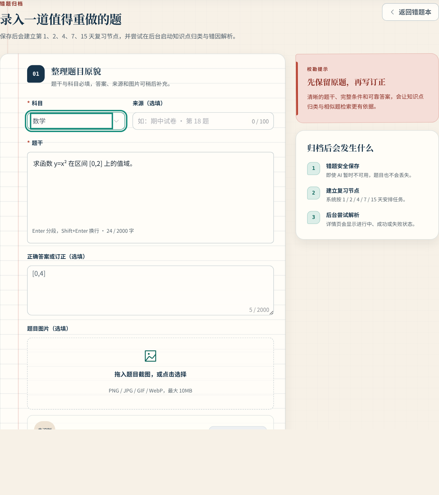

**图 7.1　错题录入界面**

学生选择原题并请求知识内容后，界面显示保存的讲解；再次请求显示复用状态，如图7.2所示。

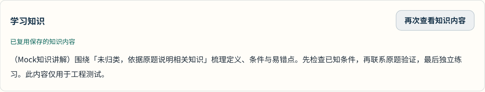

**图 7.2　个人知识内容复用界面**

学生取得未练题、作答并提交自评后，界面更新实际作答进度，同时保留主动重做入口，如图7.3所示。

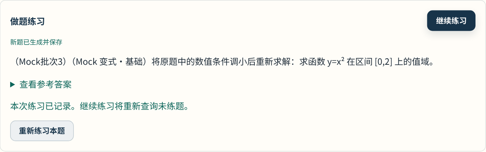

**图 7.3　持续练习与作答记录界面**

学生提交分析请求后，界面显示解析完成状态与知识归类，如图7.4所示。


**图 7.4　GLM解析界面局部**

解析使用个人题库上下文时，界面给出实际参考题 ID，便于核查本次检索来源，如图7.5所示。


**图 7.5　RAG参考题标识局部**

学生获取变式题后，页面列出已生成题目及作答入口，如图7.6所示；题组保存状态另由数据库回读核对。


**图 7.6　变式题及作答入口局部**

学生完成一次自评正确的作答后，报告展示题目与练习统计，如图7.7所示。七日图表示练习次数，不表示掌握度历史变化。


**图 7.7　学生统计与练习反馈局部**

教师与管理员使用相同公共布局，但教师仅查看系统聚合学情，管理员维护基础资料。图7.8所示的教师数据范围与服务端角色检查一致，教师报告也不具有班级或个人作答明细入口。


**图 7.8　教师系统聚合报告范围局部**

### 7.7 技术问题与处理

#### 7.7.1 外部异常与有限重试

模型接入初期，能被JSON解析的文本仍出现字段和难度不合格，单纯重复同一请求并不能解决契约错误。当前实现把HTTP暂时性异常与业务结构错误分开：连接异常进一步检查原因，限流只对指定平台过载码认定为可重试，服务端错误进入有限重试；结构校验失败保持业务失败。以下为可重试外部异常分类的核心代码及其代码解释，对应如下所示：


```java
private boolean isTransient(RestClientException exception) {
    if (exception instanceof ResourceAccessException) {
        return isConnectionFailure(exception);
    }
    if (exception instanceof HttpClientErrorException.TooManyRequests rateLimit) {
        return PLATFORM_OVERLOAD_CODE.matcher(rateLimit.getResponseBodyAsString()).find();
    }
    return exception instanceof HttpServerErrorException;
}
……以下部分代码省略……
```

上面代码的解释：连接类异常进一步判断是否为连接失败；限流异常只有响应体命中平台过载码才视为可重试；服务端错误直接归为可重试，其余异常不进入重试。

请求次数最多3次，连接及读取超时由配置限制，重试等待也有上限。失败日志只记录路径、次数和异常类型，不输出密钥及完整私有题干。结构验证与网络重试分开，既避免重复保存不合格结果，也使排查能够区分“没有取得响应”和“取得了不能使用的内容”。

#### 7.7.2 异步任务与输入快照

解析过程中编辑原题，已经发出的请求仍可能返回。若仅按题目ID写回，就会把旧题结果写入新题。matchingInput把科目、题干及可空答案加入条件；答案为空时使用isNull，不能把空值比较错误地变成无条件更新。以下为解析输入快照条件构造的核心代码及其代码解释，对应如下所示：


```java
private LambdaUpdateWrapper<Question> matchingInput(Question question) {
    LambdaUpdateWrapper<Question> wrapper = new LambdaUpdateWrapper<Question>()
            .eq(Question::getId, question.getId())
            .eq(Question::getSubjectId, question.getSubjectId())
            .eq(Question::getStem, question.getStem());
    if (question.getAnswer() == null) {
        wrapper.isNull(Question::getAnswer);
    } else {
        wrapper.eq(Question::getAnswer, question.getAnswer());
    }
    return wrapper;
}
……以下部分代码省略……
```

上面代码的解释：条件构造依次加入题目编号、科目与题干，答案为空时改用isNull匹配，避免空值比较失效。实际事务还检查生成中的分析记录，不能只依靠这一个快照条件。

变式则锁定正常原题后比较用户、科目、知识点、题干与答案，知识内容比较输入摘要。两种方式都以写入时的数据状态为准；前端请求版本只解决显示问题，不能代替数据库写回保护。现有集成测试通过“请求已发出后编辑”制造竞态，检查旧分析与知识内容不会落库。

#### 7.7.3 富文本与私有题图

富文本显示与模型输入对内容的要求不同。页面需要保留段落、换行和上下标，向量及提示词需要可读纯文本。QuestionContent在转换时先按允许的标签集合清理，再把上下标表示为^(...)或_(...)，并为段落与列表保留换行，避免直接删除标签后把多段题意连接在一起。


以下为纯文本转换的核心代码及其代码解释，对应如下所示：

```java
public static String plainText(String input) {
    if (input == null) {
        return "";
    }
    if (!MARKUP.matcher(input).find()) {
        return input.replace("\r\n", "\n").replace('\r', '\n').trim();
    }
    Element body = Jsoup.parseBodyFragment(sanitize(input)).body();
    for (Element index : body.select("sup, sub")) {
        index.replaceWith(new TextNode((index.tagName().equals("sup") ? "^(" : "_(") + index.text() + ")"));
    }
    body.select("br").forEach(element -> element.replaceWith(new TextNode("\n")));
    body.select("p, li, ul, ol").forEach(element -> element.appendChild(new TextNode("\n")));
    return body.wholeText().replace('\u00a0', ' ').replaceAll("\\n{3,}", "\n\n").trim();
}
……以下部分代码省略……
```

上面代码的解释：无标记文本只做换行规范化后直接返回；富文本先清理再解析，把上下标改写为^(...)与_(...)记号，段落、列表与换行转换为换行符，最后合并多余空行并去除首尾空白。

图片属于个人错题资料。后端关闭匿名目录，详情校验归属后才读取；路径工具还规范化根目录与相对路径，拒绝解析到上传根目录之外。该检查约束文件读取和删除，不能单独替代题目归属校验。


以下为私有题图路径边界检查的核心代码及其代码解释，对应如下所示：

```java
private Path resolveUploadPath(String imageUrl) {
    if (!isUploadPath(imageUrl)) {
        throw new BizException("题目图片路径无效");
    }
    Path root = Paths.get(uploadDir).toAbsolutePath().normalize();
    String relative = imageUrl.substring("/uploads/".length());
    Path resolved = root.resolve(relative).normalize();
    if (!resolved.startsWith(root)) {
        throw new BizException("题目图片路径无效");
    }
    return resolved;
}
……以下部分代码省略……
```

上面代码的解释：代码先校验路径前缀，再把相对路径拼到上传根目录并规范化，结果不以根目录开头时抛出路径无效异常，拒绝目录穿越。

#### 7.7.4 历史向量兼容处理

历史3条有效错题曾使用8维向量，不能与正式1024维数据混合计算。维护功能默认关闭，逐题获取新向量并校验维度和有限数，再按题干快照写回。以下为向量维护条件更新的核心代码及其代码解释，对应如下所示：


```java
@Update("""
        UPDATE question
        SET embedding = #{embedding}
        WHERE id = #{id}
          AND status = 1
          AND BINARY stem = BINARY #{stem}
        """)
int updateEmbeddingIfStemUnchanged(
        @Param("id") Long id,
        @Param("stem") String stem,
        @Param("embedding") String embedding);
……以下部分代码省略……
```

上面代码的解释：更新以题目编号、正常状态和BINARY题干逐字节一致为条件写入新向量，维护期间发生编辑时题干不再一致，更新自动落空，避免覆盖新内容。

当批维护结果为3/3成功，重建后均为合法有限1024维数组；失败、跳过和过期计数独立记录。该记录验证了当批历史数据的兼容处理。当前知识讲解质量、并发生成和检索规模的验证范围见第8章。

## 8 系统测试

### 8.1 测试目的与环境

#### 8.1.1 测试目的

系统测试检查需求、设计与实现之间是否一致，重点观察错题保存、模型结果校验、资源复用、持续练习、复习记录和角色隔离。对于外部模型，程序能够处理返回值和讲解内容正确是两种问题，应分别评价。本章分别报告隔离环境下的工程测试、资源循环专项回读及既有真实模型测试与固定小样本实验。各批次按实际日期、环境和入口独立统计。

验证以实际输入和保存状态为依据。页面显示成功时应能回读相应记录，模型失败时原题应保留，输入变化后旧资源应失效，越权请求应被服务端拒绝。验证范围覆盖接口契约、数据库持久化与自动化浏览器业务操作。

#### 8.1.2 测试环境与证据范围

在隔离测试环境下，完成科目有效性、两级知识点及引用删除校验后，对系统执行工程回归。后端使用JDK 21.0.13、Maven 3.9.16与MySQL 8.0.46，前端使用Node.js 24.22.1及Chromium。后端默认回归连接专用测试库，浏览器业务连接另建的浏览器联调库，均使用专用上传目录和本机监听地址。模型显式为Mock，图片识别关闭，未提供真实模型密钥。

表8.1汇总本次环境、数据范围与分项结果。

**表 8.1　本次工程验证的环境与分项结果**

| 项目 | 条件与数据范围 | 本次结果 |
|---|---|---|
| 后端默认全量回归 | 专用MySQL；Mock；联网入口按开关 | 113项，109通过、4跳过，0失败、0错误 |
| 前端单元测试 | Vitest，2个worker，11个测试文件 | 33/33通过 |
| 类型与生产构建 | vue-tsc与Vite | 通过；保留大包警告 |
| 真实数据库结构 | information_schema实际元数据，DDL静态比对 | 字段清单与静态审计结果均为11表88字段 |
| 浏览器业务联调 | 真实Spring Boot、MySQL与Chromium；Mock模型 | 健康检查后完整5/5通过 |

后端113项包含不启动Spring数据库上下文的60项和启动上下文的53项，分别为59通过、1跳过及50通过、3跳过，覆盖单元、边界与集成测试。4项跳过对应真实GLM、真实图片识别、历史向量维护和固定小样本实验的联网入口。表8.1采用完整回归批次，日志见附录1。

### 8.2 单元与边界测试

#### 8.2.1 后端契约与隔离测试

不连接数据库的测试重点验证模型客户端协议、文本处理、识别候选、变式校验及候选隔离。模型HTTP响应由测试替身控制，可以稳定输入空值、错误字段、非法难度和失败响应。这些测试用于判断程序是否接受或拒绝指定输入，不用于证明真实模型输出质量。

表8.2选取与模型契约、题干及隔离相关的边界输入，结果对应本次测试类。

**表 8.2　代表性单元与边界用例**

| 编号与输入 | 预期结果 | 实际结果与测试依据 |
|---|---|---|
| U01 GLM响应缺少正文、模型标识不符 | 拒绝作为有效生成内容 | OpenAiCompatibleLlmClientTests 12项通过，含协议及异常分支 |
| U02 向量含非数值、维度错误 | 拒绝非法向量 | 同组客户端测试及EmbeddingContentTests通过 |
| U03 识别图片类型、签名或大小不合格 | 识别前拒绝；保留手录路径 | QuestionRecognitionServiceImplTests 5项通过 |
| U04 变式字段、项数或难度不符 | 整体拒绝，不返回半批成功 | VariantServiceImplTests 10项通过 |
| U05 RAG候选混入其他用户记录 | 查询限定归属，结果再次过滤 | RagServiceImplDataIsolationTests 2项通过 |
| U06 推荐规则与向量补足含他人记录 | 其他用户题目不进入返回列表 | RecommendServiceImplDataIsolationTests 4项通过 |
| U07 题干包含脚本、格式标签与纯文本 | 危险内容过滤；纯文本转换一致 | QuestionContentTests 4项及EmbeddingContentTests通过 |
| U08 未登录或角色错误调用识别入口 | HTTP层拒绝，不调用识别业务 | QuestionRecognitionControllerTests 5项通过 |

表中结果为相关测试类的本次完整执行情况，单个测试类可以覆盖多种输入。测试方法、参数化实例名称及各测试类的完整输出均已归档。

#### 8.2.2 前端状态与构建验证

前端33项测试覆盖接口封装、题干显示、学习资源和页面交互等边界。LearningResources用例检查切换题目后的迟到响应丢弃、作答目标二选一、未选择自评时阻止提交、保存失败不显示成功以及主动重做。请求成功但页面状态更新过早也属于错误，因此测试同时观察调用参数和界面反馈。

类型检查和生产构建随后执行成功，说明当前源代码通过静态类型及打包约束。构建仍提示主入口块约773.70kB，超过500kB建议值；该提示没有阻止构建，后续可结合目标设备与网络条件做代码拆分优化。

### 8.3 集成与浏览器业务验证

#### 8.3.1 真实数据库集成

数据库上下文测试使用真实MySQL，写入错题、缓存、变式、练习及计划后检查持久化结果。LearningResourceIntegrationTests本次执行22个实例，包括缓存命中时不检查模型就绪、同原题并发请求、答错仍计已练、资源耗尽补充、重复题回滚以及编辑和删除的缓存清理。FinalDeliveryCoreIntegrationTests、QuestionAiInvalidationIntegrationTests和RichQuestionIntegrationTests分别检查事务、过期分析与富文本保存等行为。

以资源循环为例，先创建本人原题并获取知识，再次请求应复用同一条内容；只取得题目不应写practice_record。原题提交后取得第一批变式，已有未练题时不得再生成；将3题分别提交后，继续才补充新批次。显式重做只新增记录，不应改变题池身份。模型替身用于观测调用次数和制造失败，业务表操作仍由真实数据库执行。

表8.3列出数据库集成的代表性条件与预期写入或回滚行为。

**表 8.3　关键数据库集成用例**

| 编号与操作条件 | 预期持久化行为 | 本次结果与对应测试 |
|---|---|---|
| I01 同原题连续获取知识，第二次模型不可用 | 返回有效缓存，内容记录不重复 | LearningResourceIntegrationTests通过 |
| I02 取得题目后未提交；随后答错提交 | 取得不计已练，答错记录计已练 | 同组获取与未练状态用例通过 |
| I03 已有未练题，之后全部提交 | 先复用，耗尽后补充；旧题保留 | 同组资源循环及旧变式入口用例通过 |
| I04 新批次含重复题或中途保存失败 | 整批回滚，不留下部分题目 | 同组重复批次、已有题重复拒绝用例通过 |
| I05 生成期间编辑原题核心输入 | 旧讲解或旧分析不能写回 | 学习缓存及QuestionAiInvalidationIntegrationTests通过 |
| I06 创建计划或更新分值时异常 | 关联题目或练习记录一并回滚 | FinalDeliveryCoreIntegrationTests通过 |
| I07 他人记录、教师或管理员访问学习资源 | 拒绝访问，他人练习不消耗本人题池 | 学习权限与隔离用例通过 |
| I08 修改来源、修改题干、删除原题 | 来源修改保留缓存，核心编辑和删除清理缓存 | LearningResourceIntegrationTests通过 |

数据结构另以information_schema重新读取，与数据库建表脚本及第6章逐字段比对。实际11表88字段，列名、类型、空值、默认值与索引以DDL为依据；39个Controller映射由源代码重新提取，3个公开、36个需认证。字段与接口核对结果与第6章设计一致。

#### 8.3.2 浏览器端到端操作

浏览器联调使用实际前端、后端与另建数据库，避免固定HTTP响应替代后端。初始化账号仅用于本机隔离环境，不作为生产默认凭据。测试通过界面完成操作，并在需要时使用接口或数据库回读检查，不只截取成功提示。

表8.4按五条独立浏览器流程记录核验要点和本次结果。

**表 8.4　浏览器业务用例与结果**

| 编号与流程 | 核验要点 | 本次结果 |
|---|---|---|
| B01 知识获取、复用、原题与持续练习 | 缓存复用；原题优先；首批3题耗尽后累计6题；重做不再生成 | 通过 |
| B02 学生录入、编辑、练习、导出和删除 | JWT请求、保存结果、编辑回显与导出授权 | 通过 |
| B03 教师菜单与受限入口 | 报告菜单可见；错题路由和写入请求被拒绝 | 通过 |
| B04 管理员进入管理页面 | 用户、科目与知识点三个管理页面可访问 | 通过 |
| B05 题图访问 | 匿名路径不可取，所属学生详情鉴权返回 | 通过 |

健康检查后5项完整通过。浏览器测试记录见附录1。另有53项四视口Mock HTTP界面测试，用于检查布局和交互状态。

补充真实浏览器按四条流程核验管理员科目编辑、两级目录增删、公告发布后学生可见、教师聚合报告、学生生成报告与已读消息，以及从到期任务进入原题作答后单独确认完成。补充测试结果已单独归档，数据库回读为该原题1条练习、mastery=15、所选任务完成，作为补充业务验证与上述5项核心流程用例分开统计。

#### 8.3.3 资源循环的逐步回读

表8.5引用2026年11月13日资源循环专项回读。在浏览器联调库中另建一条合成数学原题，通过实际HTTP接口连续操作，并逐步读取MySQL，观察复用和耗尽时的记录变化。模型显式为Mock，该专项与表8.4的5项浏览器流程独立统计。输入为函数y=x²在[0,2]的值域，参考答案[0,4]，未触发AI解析，以便单独观察资源编排。

表8.5中的计数依次为知识内容、变式、练习记录和复习计划。最初保存建立5条固定计划；知识首次生成与再次复用均保持1条内容。获取原题后未提交，练习数仍为0；答错提交后才变为1。随后取得第一批3道变式，重复获取同一未提交题不增加记录，也不补充新批次。

**表 8.5　个人资源循环的实际接口与数据库回读**

| 步骤 | 接口返回或操作 | 知识/变式/练习/计划及分值 |
|---|---|---|
| 创建原题 | questionId=6 | 0/0/0/5；mastery=0 |
| 首次知识请求 | reused=false | 1/0/0/5；mastery=0 |
| 再次知识请求 | reused=true | 1/0/0/5；mastery=0 |
| 获取未练原题 | source=original；questionId=6；variantId=None | 1/0/0/5；mastery=0 |
| 原题答错提交 | isCorrect=0（答错），响应 code=0 | 1/0/1/5；mastery=0 |
| 首次补充变式 | source=generated；variantId=10 | 1/3/1/5；mastery=0 |
| 重复获取未提交题 | source=existing；variantId=10 | 1/3/1/5；mastery=0 |
| 三道变式全部提交 | submitted=3 | 1/3/4/5；mastery=0 |
| 耗尽后继续 | source=generated；variantId=13 | 1/6/4/5；mastery=0 |
| 主动重做原题 | isCorrect=1（答对），响应 code=0 | 1/6/5/5；mastery=15 |

注：code=0 表示接口业务响应成功，isCorrect 表示学生自评正误。

三道变式全部答错提交后，练习累计为4条，下一次继续才把变式数从3增加到6；说明是否已练与是否答对分开。随后主动重做原题并自评正确，练习数变为5、分值变为15，资源数保持6、复习计划仍为5。该过程验证了“作答不自动完成复习”和“重做不隐式扩容”的实现。

原始响应与各步查询结果已归档，当批断言通过后删除测试原题。另一批接口测试记录了旧变式入口、统一继续入口、固定日期、独立完成复习及权限检查，两个批次分别保留操作顺序、断言与失败条件。测试记录见附录1，具体业务规则约定见第3.3.2节。

### 8.4 历史真实模型与小样本实验

#### 8.4.1 历史真实链路

历史真实模型测试用于说明已发生的调用与受控结果，日期、输入和版本与本次工程回归不同。2026年8月25日最终同一轮固定分析5/5结构合规，变式生成后3/3保存并回读；初始结构不合格记录保留。8月26日3条旧向量重建为合法有限的1024维数组，并核对同用户检索命中，不将维护数据数目作为解析样本数。

同月26日真实浏览器业务记录了错题录入、模型解析、参考题命中、3道变式与一次正确练习，原题mastery从0变为15。首个复习节点尚未到期，当日待办为0；测试没有改日期制造复习任务。该批次记录了当时的真实调用过程和页面状态。

2026年8月28日的图片识别专项测试使用8张合成PNG/JPG，首轮7/8成功，失败样本立即重试后成功。识别结果作为录入候选，供学生确认后使用；识别专项记录中的输入与失败均保留。

#### 8.4.2 固定小样本实验设计与结果

固定小样本实验使用 27 道人工设计的合成错题，包含数学 12 题、物理 9 题、英语 6 题，覆盖 9 个叶子知识点，每个知识点 3 题。候选池限定为同用户、同科目的题目，排除查询源题自身；同一叶子知识点的其余 2 道题构成人工标注相关集 R_q，每题理论相关数 |R_q|=2。27 条向量均由向量服务生成并通过 1024 维有限数检查，27 次正式分析最终全部得到结构合规结果。知识点 Exact Match 为 26/27，即 96.30%；唯一不一致样本把“摩擦力”归入了“牛顿第二定律”。该比例只描述固定集合，不作为模型总体准确率。

错因关键概念覆盖率的自动代理均值为 94.14%，中位数为 100%，其中 22/27 达到全覆盖。人工复核采用 0、1、2 三级评分，0 表示明显错误或与题意矛盾，1 表示部分合理但错因或解释不完整，2 表示错因判断基本正确且解释清楚。27 题总分为 46/54，平均 1.7037；20 题得 2 分、6 题得 1 分、1 题得 0 分。0 分样本虽然把英语句子改成了正确过去式，却错误地把主语 `I` 解释为第三人称单数。该例表明，结构校验和关键词覆盖不能替代内容正确性审查。

Hit@K 为前 K 条结果中至少命中 1 道相关题的查询占比；Recall@K 为前 K 条结果命中相关题数除以理论相关总数 2 后，在全部查询上取平均；MRR@3 为首个相关题在前 3 条结果中的排名倒数的算术平均值，未命中记为 0。相关集依据预设知识点标签确定，模型预测不改变分母。

RAG 检索得到 Hit@3=0.962963、Recall@3=0.870370、MRR@3=0.864198；混合相似题推荐在该集合上得到 Hit@5=1.000000、Recall@5=1.000000。固定 6 题的 RAG ON/OFF 比较中，两组概念覆盖均为 88.89%，结构合规均为 6/6。27 题错因评分由测试者按上述准则逐项复核；6 题 A/B 则屏蔽 ON/OFF 组别标签独立填写偏好及理由，完成后才用既有对应键解盲。两项人工评价用于检验结构合规之外的内容质量。A/B 解盲后，RAG ON 获得 2/6 次偏好，RAG OFF 获得 4/6 次偏好。这个结果没有显示加入检索上下文在该 6 题集合中带来一致优势。

实验日志同时保留了调试期间的 34 次失败尝试（含接口限流与结构校验失败），用于分析外部异常分布。受控集合提供了较完整的错误答案和正确答案，与正式页面的日常输入分布有所不同。

各类指标的样本、数值和适用范围汇总如表 8.6 所示。自动指标来源于 2026 年 8 月 27 日固定实验结果，人工评价来源于 2026 年 9 月 7 日填写的原始 CSV；自动指标与人工评价分别按对应的原始记录统计。

**表 8.6　固定小样本实验指标**

| 指标 | 样本与结果 | 解释边界 |
|---|---|---|
| 知识点 Exact Match | 27 题；26/27，96.30% | 固定标签一致率，不是总体准确率 |
| 错因概念覆盖代理 | 27 题；均值 94.14%；22/27 全覆盖 | 反映字符串与概念的覆盖情况 |
| RAG 检索 | 27 题；Hit@3 0.962963；Recall@3 0.870370；MRR@3 0.864198 | 人工相关组定义下的检索结果 |
| 混合相似题推荐 | 27 题；Hit@5、Recall@5 均为 1.000000 | 规则优先加向量补足，不是纯向量模型 |
| 人工错因评分 | 27 题；46/54；均分 1.7037；2/1/0 分分别 20/6/1 题 | 本次用户复核（单人评分） |
| RAG ON/OFF 自动比较 | 固定 6 题；覆盖均为 88.89%；结构均 6/6 | 没有观察到概念覆盖增益 |
| RAG ON/OFF 人工偏好 | 固定 6 题；ON 2/6，OFF 4/6 | 不支持该集合中一致质量优势；无显著性检验 |
| 失败历史 | 34 次尝试：HTTP 429 为 14 次、解析状态 2 为 15 次、结构校验为 5 次 | 失败尝试不是 34 道独立错题，也不当作超时 |

固定小样本实验的原始结果、自动摘要、错因人工评分表、A/B 人工评价表和解盲键均已归档。人工统计按原始CSV复算，未改动评分或模型输出。

#### 8.4.3 结果复算与适用范围

上述指标依据历史JSON和人工CSV复算，所用样本、评分、盲评键及失败日志保持原件，未重新请求GLM。Exact Match以固定27题的标签一致数为分子；人工错因分数按0、1、2原始等级求和；A/B偏好按原有解盲键恢复ON与OFF。各项指标依据各自样本集独立统计。

固定小样本实验使用较完整的错误答案和参考答案，实验的错因信息比日常输入更充分。6题ON/OFF盲评没有观察到一致优势，RAG对解析质量的影响有待在更大样本上进一步验证。

### 8.5 系统测试报告

本次后端、前端与真实数据库浏览器验证覆盖了当前业务代码中的主要工程路径：原题保存、派生资源校验、个人范围、知识复用、未练筛选、耗尽补充、作答记录与复习。典型失败条件包括无效模型结构、重复变式、过期输入、越权、停用账号和事务异常；预期结果是拒绝不合格数据或回滚相关写入，同时保留此前有效资料。

从结果看，工程层面的契约、隔离与事务行为均按预期工作；内容层面，历史样本中出现过错因解释错误，生成质量通过人工复核单独评价。构建警告提示主入口包体积偏大，已列入后续优化。

个人资源范围、未练定义和重做细则已按第3.3.2节的业务约定完成实现与闭环验证。新增知识讲解提示词的真实模型质量、多实例并发与大规模向量检索等验证列入后续工作，见第9.2节。

需求、模块、接口与验证用例的对应见表8.7。U、I、B 分别对应表8.2、表8.3及表8.4；B06–B09 为已执行的补充浏览器流程在本文中的索引，与原 5 项端到端流程分别统计。B06 对应科目编辑、两级知识点增删，B07 对应公告发布与学生读取，B08 对应师生报告和消息已读，B09 对应到期任务作答与独立完成，原始记录均已归档。

**表 8.7　需求—设计—实现—测试可追踪矩阵**

| 需求与角色 | 概要设计模块（表5.1） | 核心接口映射（表6.13） | 验证用例 |
|---|---|---|---|
| FR01 三类角色账户 | 用户与权限 | /auth/register、/auth/login、/user/profile、/user/page、/user/{id} | B02–B04；权限专项 |
| FR02 科目；管理员维护 | 基础错题 | /subject/list、/subject、/subject/{id} | B04、B06 |
| FR03 知识点；管理员维护 | 基础错题 | /knowledge-point/tree、/knowledge-point、/knowledge-point/{id} | B04、B06 |
| FR04 本人错题；学生 | 基础错题 | /question、/question/page、/question/{id}、/question-recognition/recognize | U03、U07、U08、I05、B02、B05 |
| FR05 辅助分析；学生 | AI 辅助解析 | /ai/analyze/{questionId}、/ai/analysis/{questionId} | U01、U02、I05 |
| FR06 知识学习；学生 | 练习资源 | /learning/knowledge/{questionId} | I01、I05、I08、B01 |
| FR07 相似题；学生 | 练习资源 | /recommend/similar | U05、U06；检索专项 |
| FR08 持续练习；学生 | 练习资源 | /learning/practice/next/{questionId}、/learning/practice/progress/{questionId}、/variant/generate/{questionId}、/variant/list | U04、I02–I04、I07、B01 |
| FR09 复习；学生 | 复习计划 | /review-plan/today、/review-plan/{id}/finish | I06、B09 |
| FR10 作答记录；学生 | 练习记录 | /practice、/practice/page | I02、I06、B01、B02 |
| FR11 报告；学生、教师 | 学情与导出 | /report/weekly、/report/generate | B03、B08；统计回读 |
| FR12 导出；学生 | 学情与导出 | /question/export | U07、B02 |
| FR13 消息；登录用户 | 消息与公告 | /message/page、/message/unread-count、/message/{id}/read | B08；消息归属专项 |
| FR14 公告；管理员发布 | 消息与公告 | /announcement/list、/announcement | B07；角色权限专项 |

表中省略公共前缀 /api，HTTP 方法及完整路径以表6.13为准。权限、检索、统计与消息专项对应接口测试中已执行的断言，补充 U/I/B 所列代表用例；以上覆盖工程交付范围，模型教学内容质量仍按第8.4节单独评价。

## 9 总结与展望

### 9.1 主要工作

本课题完成了基于智谱 GLM 大模型的AI错题分析与学习推荐系统，按照需求分析、概要设计、详细设计、开发实现与系统测试的软件工程过程组织全篇工作。系统以 Vue 3、Spring Boot 与 MySQL 构建，11 张物理表、88 个字段及 39 个 Controller 映射支撑学生、教师、管理员三类角色，功能覆盖错题录入与图片识别候选、AI 辅助错因分析、知识讲解、持续练习、固定节点复习、学情报告与消息通知。

系统的主要工作体现在把大模型能力组织为可复用的学习流程。平台在模型调用之外承担输入准备、本人题库检索、结构校验、事务保存与资源复用：知识讲解按输入摘要缓存，命中时直接复用；统一继续练习入口先取本人未练原题与关联变式，资源耗尽后才补充生成，独立变式入口按变式池判断；核心内容编辑使派生数据失效，输入快照检查阻止过期结果回写。模型、数据库与前端职责分开，权限同时约束接口入口、数据对象与检索候选范围，保证生成内容始终处于平台的业务规则之内。

测试工作从单元、集成、浏览器业务流程与真实模型实验四个层面展开。工程回归中后端 109 项通过、4 项联网入口按开关跳过，前端 33 项单元测试与浏览器端到端流程全部通过，数据库集成测试在真实 MySQL 上完成写入与回读核对。历史真实模型实验中，27 题错因分析经人工复核得到 46/54 分，检索与混合推荐取得完整的定量指标，图片识别首轮 7/8 成功、失败样本重试后成功。上述结果表明，系统已经形成从错题录入、分析、学习、练习到复习的完整闭环，达到了预期的设计目标。

### 9.2 不足与展望

系统仍有若干可以继续完善的方向。题目级掌握度目前采用规则分值，后续可引入概率知识追踪方法，结合更长的作答历史刻画知识状态；复习计划采用固定日期节点，后续可根据作答结果自适应调整间隔；变式题去重以规范化题干文本比较为准，后续可加入语义相似度判断，提高题池的多样性。

在验证方面，后续将扩大样本对知识讲解等新增提示词的真实模型输出做专项内容评价，并在更大样本上继续检验检索增强对解析质量的作用；同时补充多实例并发与大规模向量检索的压力测试，评估向量索引与前端代码拆分等优化方案。在功能方面，班级关系、报告历史快照与更细粒度的学习反馈可作为下一阶段的需求方向，使系统从个人错题管理进一步走向班级教学支持。

## 参考文献

[1] 赵雅娟, 孟繁军, 徐行健. 在线教育学习者知识追踪综述[J]. 计算机应用, 2024, 44(6): 1683-1698.

[2] 董永峰, 王雅琮, 董瑶, 等. 在线学习资源推荐综述[J]. 计算机应用, 2023, 43(6): 1655-1663.

[3] 孙辉. 高中物理错题资源的整合[J]. 现代教育探索, 2024, 5(2): 131-133.

[4] 索晋贤, 张丽萍, 闫盛, 等. 可解释的深度知识追踪方法综述[J]. 计算机应用, 2025, 45(7): 2043-2055.

[5] 张维, 龚中伟, 李志新, 等. 学习行为增强的知识追踪模型[J]. 计算机应用, 2025, 45(9): 2747-2754.

[6] 何凡, 李理, 苑中旭, 等. 融合图注意力的概念关联记忆网络知识追踪模型[J]. 计算机应用, 2026, 46(1): 43-51.

[7] 周楚雄, 张丽萍, 闫盛, 等. 基于图神经网络的深度知识追踪方法综述[J]. 计算机工程与应用, 2026, 62(12): 37-59.

[8] 张所娟, 龙佳琪, 郝文宁, 等. 大语言模型时代的知识追踪: 教育智能化的新范式与路径展望[J]. 教育智能化前沿, 2026, 39(4): 40-49, 96.

[9] 朱敏. 基于大语言模型的个性化资源推荐方法研究[J]. 兰州文理学院学报(自然科学版), 2024, 38(5): 59-64.

[10] 韩姣, 付瑞, 孙昊, 等. 基于联邦学习的个性化学习资源推荐系统研究[J]. 教育学刊, 2025, 3(12): 74-81.

[11] 吴璇, 付涛. 检索增强生成技术研究综述[J]. 计算机工程与应用, 2025, 61(20): 19-35.

[12] 梅忆寒, 王琳琳, 王鹏飞, 等. 基于多模态与检索增强生成的数据库知识问答系统[J]. 计算机教育, 2024(12): 232-237.

[13] 张犬俊, 谢杨, 房春荣, 等. 检索增强生成在软件工程中的应用综述[J]. 软件学报, 2026, 37(3): 1316-1339.

[14] 贾洪愿, 居发礼, 余晓平. 基于检索增强生成(RAG)的《建环专业计算机应用》课程智能知识库构建[J]. 智慧教育, 2025, 2(2): 198-201.

[15] 徐刚, 刘志鹏, 冯骐, 等. 大语言模型在教育信息化中的实践: 规范、框架与应用[J]. 通信学报, 2024, 45(Z2): 229-241.

[16] 刘邦奇, 喻彦琨, 王涛, 等. 人工智能教育大模型: 体系架构与关键技术策略[J]. 开放教育研究, 2024, 30(5): 76-86.

[17] 余胜泉, 熊莎莎. 基于大模型增强的通用人工智能教师架构[J]. 开放教育研究, 2024, 30(1): 33-43.

[18] 肖建力, 黄星宇, 姜飞. 智慧教育中的大语言模型综述[J]. 智能系统学报, 2025, 20(5): 1054-1070.

[19] 陈静远, 高雨婕. 大语言模型赋能教育创新: 核心技术、应用场景与关键挑战[J]. 教育智能化前沿, 2026, 39(3): 24-32.

[20] 罗恒, 廖小芳, 茹琦琦, 等. 生成式人工智能支持的教师评语研究: 基于初中数学课堂的实践探索[J]. 电化教育研究, 2024, 45(5): 58-66.

[21] 唐颖川. 大语言模型赋能探究型高职教育——以Python语言课程为例[J]. 现代教育探索, 2025, 6(6): 44-46.

[22] 张鲁燕, 巩清波. 大语言模型赋能高职教育“双师课堂”的路径探索[J]. 教育学刊, 2026, 4(1): 136-141.

[23] (德)Ebbinghaus H. Über das Gedächtnis: Untersuchungen zur experimentellen Psychologie[M]. Leipzig: Duncker & Humblot, 1885.

[24] (美)Corbett A T, Anderson J R. Knowledge tracing: Modeling the acquisition of procedural knowledge[J]. User Modeling and User-Adapted Interaction, 1994, 4(4): 253-278.

[25] (德)Kasneci E, Sessler K, Küchemann S, 等. ChatGPT for good? On opportunities and challenges of large language models for education[J]. Learning and Individual Differences, 2023, 103: 102274.

[26] (中)Zhao P, Zhang H, Yu Q, 等. Retrieval-augmented generation for AI-generated content: A survey[J]. Data Science and Engineering, 2026, 11(1): 1-29.

[27] (中)Cheng C, Huang Z, Zhao G, 等. From Objectives to Questions: A Planning-based Framework for Educational Mathematical Question Generation[C]//Proceedings of the 63rd Annual Meeting of the Association for Computational Linguistics (Volume 1: Long Papers). Vienna: Association for Computational Linguistics, 2025: 12836-12856.

## 致　谢

感谢指导教师胡韬老师在课题选题和论文材料准备过程中给予的指导。老师对文献综述的组织顺序、逐篇评述方式，以及研究内容和研究方法的表述提出了具体修改意见，帮助我梳理文献与课题之间的联系，明确研究步骤和工作安排。在修改过程中，我也进一步认识到，论文中的方案、实现和结论需要相互对应，文字表述应有事实依据。谨向胡韬老师表示感谢。

## 附录1 核心代码与验证材料索引

正文选取的21段代码均与源码逐行对应。以下提供其源码位置和验证材料索引。后端路径以server/src/main/java/com/example/wrongbook/为前缀；SQL路径为server/src/main/resources/mapper/；前端路径以web/src/为前缀。

**表 A.1　测试批次与适用范围**

| 批次与模式 | 测试结果 | 适用范围 |
|---|---|---|
| 全量工程回归；Mock | 前一批后端回归：102 通过、4 跳过；后一批后端回归：109 通过、4 跳过；前端 33 项和真实数据库浏览器 5 项分别通过 | 当前 11 表 88 字段、39 个接口映射，事务回滚、权限隔离，以及知识缓存复用、未练优先、耗尽生成控制流；不同版本不累加 |
| 真实模型与小样本；Live GLM | 真实模型调用及浏览器链路；固定小样本实验的 27 题向量与固定题集；人工表另按原始记录复核 | 证明相应历史版本的真实智谱 GLM 调用与样本结果；图片候选提取另见 2026-08-28 独立专项记录 |

新增知识讲解提示词已完成工程契约与缓存复用验证，其真实模型教学内容质量列入后续专项评估。当前工程回归与历史真实模型结果分别记录。图片候选专项的首轮 7/8 与重试成功按原始识别记录报告。

**表 A.2　核心代码位置索引**

| 所在节 | 内容 | 文件 | 原始行范围 |
|---|---|---|---|
| 7.2 | 向量隐藏与逻辑删除字段 | entity/Question.java | 46—53 |
| 7.3.1 | 错题分页的用户范围 | service/impl/QuestionServiceImpl.java | 87—92 |
| 7.3.2 | 短事务的原题行锁查询 | mapper/QuestionMapper.java | 16—17 |
| 7.3.2 | 知识点聚合与逻辑删除条件 | SQL/QuestionMapper.xml | 6—15 |
| 7.4.1 | 保存错题并建立复习计划 | service/impl/QuestionServiceImpl.java | 63—78 |
| 7.4.2 | GLM响应获取与空内容拒绝 | service/impl/OpenAiCompatibleLlmClient.java | 106—117 |
| 7.4.2 | 候选知识点与难度范围校验 | service/impl/AiAnalysisServiceImpl.java | 233—242 |
| 7.4.3 | 相似度排序与结果归属复查 | service/impl/RagServiceImpl.java | 39—46 |
| 7.4.4 | 知识缓存优先于模型就绪检查 | service/impl/LearningServiceImpl.java | 49—54 |
| 7.4.5 | 原题与已有未练变式优先 | service/impl/LearningServiceImpl.java | 99—109 |
| 7.4.6 | 记录后的原子分值更新 | service/impl/PracticeServiceImpl.java | 52—58 |
| 7.4.6 | 五阶段复习计划的日期生成 | service/impl/ReviewPlanServiceImpl.java | 35—42 |
| 7.5 | 学习控制器的角色与业务映射 | controller/LearningController.java | 12—28 |
| 7.6.1 | 图片识别候选与临时学生作答 | 前端/views/question/QuestionCreateView.vue | 185—194 |
| 7.6.2 | 继续练习的迟到响应处理 | 前端/components/LearningResources.vue | 41—48 |
| 7.6.2 | 一种目标提交与成功后更新界面 | 前端/components/LearningResources.vue | 60—65 |
| 7.7.1 | 可重试外部异常分类 | service/impl/OpenAiCompatibleLlmClient.java | 191—199 |
| 7.7.2 | 解析输入快照的条件构造 | service/impl/AiAnalysisServiceImpl.java | 176—187 |
| 7.7.3 | 模型与导出共用的纯文本转换 | util/QuestionContent.java | 50—64 |
| 7.7.3 | 私有题图路径边界 | util/FileStorageUtil.java | 102—113 |
| 7.7.4 | 向量维护的二进制题干快照条件 | mapper/QuestionMapper.java | 29—39 |

本次工程回归的后端测试日志、前端单测与构建日志、数据库元数据比对清单及浏览器联调记录已统一归档至系统验证材料包，不包含任何模型密钥或真实用户隐私数据，供代码与测试复核使用。
