# 基于智谱GLM模型的AI错题分析与学习推荐系统设计与实现

> **英文题目**：Design and Implementation of an AI-Powered Wrong-Question Analysis and Learning Recommendation System Based on the Zhipu GLM Model

> 本文件为毕业论文正文的 Markdown 源稿，
> 章节结构依据 2027 届《云南工商学院本科毕业论文（设计）撰写规范及要求》和《毕业论文（设计）正文模板》整理。
> 源稿不承担排版：字体、页边距、页码、目录导航等在导出 DOCX 时统一处理。
> 参考文献角标 [n] 按本文首次出现顺序排列；与主库的身份对应见 `../notes/thesis-run-20260920/REFERENCE-MAP.md`，主库编号保持不变。
> 需求分析与设计章节按方案形成阶段表述，系统实现与测试章节只采用仓库代码和验证记录中已有的事实；不得将规划功能写成已实现功能。

---

## 封面（占位）

（导出时由论文系统导出正式封面，包含：学校名称、论文题目、学院、专业班级、姓名、学号、指导教师、完成日期等。）

## 目录（占位）

（导出时使用 Word 自动目录生成，支持点击导航；目录中的标题文字须与正文标题完全一致。）

---

## 摘　要

针对个人错题分散、解析与复习过程相互割裂的问题，本课题设计并实现了一个基于智谱 GLM 模型的 AI 错题分析与学习推荐系统。系统采用前后端分离架构，前端使用 Vue 3 与 Element Plus，后端使用 Spring Boot 3、MyBatis-Plus 和 MySQL。后端通过可配置模型网关调用智谱 `glm-4.7-flash` 和 `embedding-3`，将题干向量、同一学生同一科目的参考题以及候选知识点送入解析流程。系统可完成知识点归类、错因说明、相似题推荐和 3 道变式题生成；错题保存时按第 1、2、4、7、15 天建立复习计划，练习结果按答对加 15、答错减 20 更新题目级掌握度。系统还包括站内消息、请求时聚合的周报、XLSX 错题本导出和公告管理。验证工作覆盖真实模型调用、1024 维历史向量重建、浏览器业务流程和隔离数据库联调。现有掌握度是有界规则分值，不属于概率知识追踪模型。

**关键词**：错题分析；个性化推荐；检索增强生成；知识追踪

## Abstract

This project designs and implements an AI-powered wrong-question analysis and learning recommendation system based on the Zhipu GLM model to connect personal question records, analysis and review in one workflow. The front end uses Vue 3 and Element Plus, while the back end uses Spring Boot 3, MyBatis-Plus and MySQL. A configurable gateway calls `glm-4.7-flash` and `embedding-3`. The analysis workflow combines question embeddings, reference questions from the same student and subject, and candidate knowledge points. It supports knowledge-point classification, error-cause explanation, similar-question recommendation and the generation of three variant exercises. When a question is saved, the system creates review plans at fixed offsets of 1, 2, 4, 7 and 15 days. A correct attempt adds 15 to the question-level mastery score, whereas an incorrect attempt subtracts 20. The system also provides in-app messages, request-time weekly reports, XLSX export and announcement management. Validation covered live model calls, reconstruction of historical 1,024-dimensional embeddings, a browser-based business workflow and integration with an isolated database. The mastery score is a bounded rule-based value rather than a probabilistic knowledge-tracing model.

**Key words**: error analysis; personalized recommendation; retrieval-augmented generation; knowledge tracing

---

## 1 绪　论

### 1.1 研究背景

随着教育数字化持续推进，如何依据学习过程数据识别薄弱环节并组织适合的学习资源，已成为个性化学习研究的重要问题。知识追踪研究关注从历史作答中描述学习者知识状态[1]，在线学习资源推荐研究则关注学习者、知识点与资源之间的匹配[2]。在日常练习中，错题能够反映特定阶段的理解偏差，但手工摘抄、笼统归因和无计划重做会增加整理成本，也难以把错题、解析、推荐与复习连接成连续流程。

人工智能技术为上述问题提供了新的工程路径。Transformer 架构为大语言模型的发展奠定了基础[3]，相关教育研究表明，大模型可用于辅助答疑、反馈与学习支持，但输出不确定性、隐私和依赖风险需要受到约束[4][5]。检索增强生成（RAG）通过在生成前检索外部信息，为回答提供补充上下文，是缓解模型仅依赖参数化知识的一种技术路线[6]；国内课程知识问答研究也已探索多模态检索与大模型生成的结合[7]。因此，本课题围绕个人错题构建“录入—分析—推荐—复习—反馈”闭环，但不把模型输出、检索结果或规则化掌握度等同于教学结论。

### 1.2 研究意义

本课题关注的是检索增强生成在个人错题场景中的具体落地方式。解析流程不只向模型发送题干，还加入同一学生题库中的参考题和限定范围的知识点候选，并记录实际使用的参考题 ID。这样做不能保证生成内容正确，但能够缩小模型的输入范围，并为结果复核保留线索。复习部分采用固定日期节点和可解释的分值规则，避免在缺少长期作答序列时把简单反馈包装成复杂知识追踪。对软件工程实践而言，课题涵盖需求边界确定、10 张物理表设计、前后端接口实现、外部模型接入、异常处理和自动化测试。教师端仅查看系统范围的聚合报告，不包含班级、课程和学生明细管理。

### 1.3 研究内容

本课题的研究内容是设计并实现基于智谱 GLM 模型的 AI 错题分析与学习推荐系统，主要工作包括：

（1）需求分析。依据错题学习场景、相关研究与同类产品的公开功能，梳理错题录入、辅助解析、练习和复习之间的业务关系，确定功能需求与非功能需求。本研究未实施正式问卷或访谈，不使用样本量、比例或受访者意见作为需求依据。

（2）系统设计。采用前后端分离架构与面向对象设计原则，完成系统架构设计、功能模块划分、数据库设计、接口设计、数据访问层设计与界面设计，并针对 AI 解析、相似题推荐、复习计划等核心模块给出详细设计方案。

（3）系统实现与测试。使用 Spring Boot 3、Vue 3、MyBatis-Plus 与 MySQL 完成系统编码，通过大语言模型 API 与语义向量检索实现 AI 解析和练习内容生成，并用单元测试、集成测试、浏览器测试和受控小样本实验检查具体功能及其边界。

### 1.4 论文组织结构

本文共分为 7 章，各章内容安排如下：

第 1 章为绪论，介绍课题的研究背景、研究意义、研究内容与论文组织结构。

第 2 章为文献综述，梳理国内外在知识追踪、间隔重复、认知诊断、习题推荐、大语言模型教育应用与检索增强生成等方向的研究现状，并指出现有研究的不足与本系统的切入点。

第 3 章为系统分析，包括问题描述、可行性研究、需求获取、功能需求分析与非功能需求分析。

第 4 章为系统概要设计，给出系统的总体架构、功能模块划分与数据库概念设计。

第 5 章为系统详细设计，给出数据库表结构、接口设计、核心类设计、数据访问层设计与界面设计。

第 6 章为系统实现与测试，说明前后端代码结构、核心业务的实现过程、开发中处理的问题，以及自动化测试、真实模型和浏览器业务验证结果。

第 7 章为总结，归纳系统已完成的功能、验证边界和后续改进方向。

## 2 文献综述

### 2.1 前言

随着教育数字化和生成式人工智能技术的发展，错题管理正在由简单记录逐步向知识状态分析、个性化资源推荐和智能反馈延伸。围绕本课题，现有研究主要涉及知识追踪与学习状态建模、记忆与间隔复习规律、个性化学习资源推荐、大语言模型教育应用以及检索增强生成等方向。这些研究为错题知识点归类、辅助解析、相似题推荐和复习计划设计提供了理论与技术参考，但复杂模型对连续学习数据、知识库质量和结果评价条件具有较高要求，需要结合个人错题场景分析其适用范围。下文依次从国内研究现状和国外研究现状两个方面进行综述。

### 2.2 国内研究现状

赵雅娟等梳理了传统知识追踪与深度知识追踪的任务、模型、数据集、评价指标和应用，指出知识追踪需要从学习历史中建立学习者知识状态模型[1]。该综述帮助本课题区分正式知识追踪模型与轻量状态记录，避免把简单掌握度分值误写成 BKT 或 DKT。

董永峰等将在线学习资源推荐归纳为知识点习题、学习路径、学习视频和学习课程等对象，并总结学习者画像、行为数据和资源本体等常见依据[2]。该综述说明推荐需要同时考虑学习者与资源信息，本课题据此选择个人题库、知识点、难度和语义相似度作为可获得信号。

索晋贤等从学习者特征、习题特征、注意力机制以及认知理论融合等角度总结可解释深度知识追踪方法，指出预测性能与解释性仍需平衡[8]。该研究使本课题更加重视规则依据的可说明性，并明确不在小规模个人错题场景中训练深度知识追踪模型。

马华等基于 CNKI 和 WoS 文献进行可视化分析，归纳个性化在线学习资源推荐的研究热点与发展趋势，强调知识图谱、认知诊断、深度学习及多类资源融合[9]。其启示是推荐研究正在走向多信号融合，但本课题只能选取与数据条件匹配的轻量组合。

郑雅倩等比较机器学习、进化计算和知识图谱三类学习路径推荐框架，指出未来需要深化信息融合、动态感知并加强技术与真实教育情境的耦合[10]。该研究为需求分析提供了“推荐必须落到具体学习流程”的依据，本课题因此把推荐置于错题复习闭环而非独立展示。

韩姣等研究联邦学习条件下的个性化学习资源推荐，关注多方数据协同利用时的隐私保护问题[11]。该工作提示学习数据的归属与隔离是推荐系统的重要条件；本课题不实现联邦训练，但将相似题和 RAG 候选限定在同一用户范围。

朱敏探讨大语言模型参与个性化资源推荐的流程，说明自然语言理解与生成能力可以辅助分析学习需求和组织资源[12]。该研究为“生成式模型 + 推荐”组合提供思路，但本课题不让模型直接决定全部推荐结果，而采用规则优先、语义检索补足的方式控制范围。

孙辉以高中物理为例提出错题应经过及时收集、分类、错误原因分析、专题讲解和再次练习，强调错题资源的持续利用而非一次保存[13]。该研究直接支持本课题把错题录入、知识点整理、解析、练习和复习记录连接为业务闭环。

徐刚等从规范、框架与应用三个层面讨论大语言模型在教育信息化中的实践，强调技术接入需要与教育任务、平台架构和治理要求共同设计[14]。该研究提醒本课题不能只描述模型调用，还应在需求、接口、异常处理和使用边界中体现工程约束。

刘邦奇等分析人工智能教育大模型的概念、技术特征、体系框架与关键策略，指出通用模型仅依靠规模优势难以满足教育场景对知识准确性、价值观与安全性的要求[15]。本课题据此通过候选知识点、个人题库上下文和人工核查约束通用生成能力，但不宣称已训练教育专用模型。

余胜泉和熊莎莎提出大模型增强的通用人工智能教师架构，讨论通过专业知识库和外部智能组件增强知识与推理能力[4]。该研究为本课题使用外部题库检索增强模型提供架构启示，同时也说明单一大模型不应承担全部教学判断。

罗恒等将认知诊断数据与生成式人工智能结合生成教师评语，并在初中数学课堂中考察其对反馈和反思的支持作用[16]。该研究说明生成式反馈需要可靠的前置数据和具体教学语境；本课题没有完整认知诊断数据，故只生成基于现有题干、答案与参考题的辅助错因分析。

吴砥和吴河江从教育安全、教育关系与教育公平三个方面分析通用大模型的伦理风险，并提出制作、实践、管理和研究层面的治理思路[17]。该研究支持本课题坚持数据最小化、密钥隔离、用户核查和“AI 不替代教师评价”的边界。

梅忆寒等围绕数据库课程构建多模态与 RAG 知识问答系统，展示了课程内容检索、向量表示和大模型生成相结合的教育应用路径[7]。该案例证明 RAG 可用于具体课程知识服务，但其知识库与个人错题库的数据规模和质量不同，本课题需要限制候选范围并单独验证检索效果。

作为补充，吴永和等探讨多智能体教育应用[18]，本课题不实现该路线。贾洪愿等研究课程 RAG 知识库[19]，提示检索资源须匹配课程任务。唐颖川的 Python 课程研究[20]及张鲁燕、巩清波的“双师课堂”研究[21]强调教学情境，不能直接证明个人错题系统的教学效果。

### 2.3 国外研究现状

Vaswani 等提出完全基于注意力机制的 Transformer 架构，以并行的自注意力替代循环结构，为后续大语言模型处理长距离语义关系奠定了技术基础[3]。该研究能够解释 GLM 类模型的架构来源，但没有直接讨论错题分析，因此本课题只将其作为模型技术背景。

Corbett 和 Anderson 提出的贝叶斯知识追踪（BKT）用隐藏知识状态表示学生是否掌握程序性知识，并依据连续作答结果更新掌握概率[22]。其价值在于给出“作答反馈可以更新知识状态”的清晰框架；但本课题缺少训练概率模型所需的长期序列数据，只借鉴状态随练习变化的思想。

Piech 等提出深度知识追踪（DKT），利用循环神经网络从学生作答序列中学习潜在知识状态，并预测后续答题表现[23]。该方法增强了对复杂序列关系的表示能力，同时对数据规模和模型解释提出更高要求；因此本课题不实现 DKT，而采用可解释的题目级规则分值。

Ebbinghaus 通过实验研究揭示记忆保持随时间衰减的现象，为间隔复习的时间安排提供了经典理论来源[24]。该工作支持“复习应分散到不同时间点”的设计方向，但不能直接证明任意固定间隔适合所有学生，故本课题只设计规则化节点，不宣称预测个体遗忘速度。

Kasneci 等从学生和教师视角讨论大语言模型在内容生成、交互、反馈和个性化学习中的机会，同时强调事实错误、偏见、依赖、核查能力与持续人工监督等风险[5]。该研究提示本课题应把 GLM 输出定位为辅助内容，并保留用户核查和修正环节。

Zhao 等系统梳理 RAG 的检索来源、检索方式、生成融合和评价问题，指出外部知识能够补充模型上下文，但最终质量仍取决于语料、检索与生成环节[6]。本课题据此采用“个人题库检索 + GLM 生成”，同时将候选范围、参考题 ID 和输出边界写入设计，而不把 RAG 等同于准确性保证。

### 2.4 总结

上述文献分别提供了知识状态更新、间隔复习、资源推荐、生成式反馈、RAG 和风险治理方面的依据。国内研究主要讨论相关技术在我国在线学习、课堂反馈和课程知识服务中的应用，国外研究则为基础模型与通用技术机制提供参考。现有成果也表明，复杂知识追踪与推荐模型依赖连续作答数据，RAG 依赖候选知识质量，大模型输出仍需人工核查。基于这些结论，本课题采用个人错题范围内可实现的轻量路线：使用 GLM 辅助知识点归类、错因和解析生成，以同用户题库检索结果补充上下文，相似题采用规则排序与语义补足，复习采用固定节点，练习反馈只更新题目级规则分值。该方案的目标是形成边界清楚、可实现并可测试的业务闭环，不预设概率知识追踪、自适应遗忘模型或长期教学效果结论。

## 3 系统分析

### 3.1 问题描述

本系统主要面向有错题整理与复习需求的学生用户，同时提供教师与管理员角色的基础访问入口。通过对一般学习场景、相关研究和同类产品功能的梳理，当前错题管理流程中存在以下问题：

（1）错题信息分散。题干、答案、图片和订正记录常分布在练习册、试卷或不同工具中，后续按科目和知识点查找不方便。

（2）错因与知识点需要人工整理。只保存正确答案不能说明错误发生在哪个步骤，也不能直接形成可检索的知识点分类。

（3）解析与个人题库缺少联系。通用解析通常不引用学生已有错题，大模型直接生成又可能出现结构不稳定或内容错误，需要限制输入范围并保留人工判断。

（4）复习安排难以持续。错题保存后如果没有明确日期和待办状态，学生需要自行记忆复习时间，也难以区分待复习、已完成和已过期任务。

（5）错题、练习和复习记录彼此独立。学生难以直接查看当前题量、掌握度规则分值、薄弱知识点以及一周内的录题和练习次数。

针对这些问题，系统以个人错题记录为主线，把错题录入、AI 辅助解析、相似题与变式题、固定节点复习、练习记录和学情报告连接为一个业务流程。复习模块使用预设日期，不训练或拟合个体遗忘参数。

### 3.2 可行性研究

#### 3.2.1 技术可行性

后端拟采用 Spring Boot 3、MyBatis-Plus 和 MySQL 8，前端拟采用 Vue 3 与 Element Plus，这些组件均可在普通开发环境中运行。文本分析和变式题生成计划调用智谱 `glm-4.7-flash`，题干向量使用 `embedding-3` 的 1024 维输出，图片辅助录入单独调用支持图像输入的模型。RAG 流程可拆分为个人题库候选检索、提示词组装、模型调用和结构化输出校验，便于分别测试数据隔离、检索结果和模型响应。相关技术有公开文档与既有研究可供参考[6][7][19]，技术路线与本科软件工程项目的开发条件相匹配。

#### 3.2.2 经济可行性

Spring Boot、Vue、MyBatis-Plus、MySQL 社区版及开发工具均可免费使用。语义向量计划存入 MySQL，并在应用内计算余弦相似度，项目阶段不需要另行部署向量数据库。外部模型 API 会产生调用费用，因此开发和常规测试拟使用 Mock 实现，只在必要的联调和样本验证中调用真实模型。该方案不依赖专用硬件或额外商业软件，主要可变费用来自模型调用。

#### 3.2.3 操作可行性

系统采用浏览器访问，主要操作由表单、列表、详情页和侧边导航完成。学生可直接输入错题，也可先用单张图片识别表单候选值并人工确认；解析状态、生成失败、空结果和同步加载过程均需要在页面中显示。复习任务和消息集中在独立页面，不要求用户安装客户端或使用命令行。上述操作路径不需要专用设备，但实际易用性和用户满意度仍需在系统完成后通过用户体验测试评估。

### 3.3 需求获取

本课题未开展正式问卷调查或半结构化访谈，因此需求分析不使用样本量、比例或受访者结论作为依据。需求主要来自相关文献、典型错题学习场景以及同类产品的公开功能，并结合课题周期、数据条件和开发能力划定范围。

（1）文献与相关研究分析。错题资源研究为收集、分类、分析和再练习提供教学背景[13]；记忆研究为规则化分阶段复习提供理论来源[24]；个性化资源推荐研究为多信号混合推荐提供参考[2][9][10]；RAG 与大语言模型教育应用研究为本地上下文辅助生成提供技术依据[4]-[7][14]-[19]。这些文献用于提炼需求，不直接证明本系统具有概率知识追踪、自适应调度或教学增益。

（2）典型学习场景分析。在典型错题学习场景中，手工整理成本高，知识点归类与错因总结存在困难，同类错误可能重复出现，复习时间缺乏规律，且仅保存答案不能直接形成针对性巩固流程。从系统目标与学习流程分析，需要将错题保存、辅助解析、练习资源、复习节点和结果记录连接起来。

（3）竞品功能分析。对作业帮、小猿搜题等常见产品仅进行公开功能层面的定性观察：此类产品通常提供拍照搜题、答案展示或错题收藏。本系统将重点放在个人错题数据上的 AI 解析、相似题与变式题、固定节点复习计划以及请求时聚合的周报展示；不声称完成大规模竞品实测。

（4）需求归纳。系统功能范围包括文本录入与图片辅助录入、知识点归类和错因解析、个人题库内的相似题与变式题、固定节点复习及站内提醒、练习记录与题目级掌握度更新、请求时聚合的学情周报和 XLSX 错题本导出。课题不规划班级或课程管理、教师查看学生明细、报告历史快照和自适应知识追踪。

### 3.4 功能需求分析

系统设置学生、教师与管理员三类角色。学生使用错题录入、AI 解析、相似题与变式题、复习计划、练习记录、个人学情报告、错题本导出和消息等功能；教师维护个人资料，查看消息、公告和系统范围的聚合学情报告；管理员维护用户状态、科目、知识点与公告。需求范围不包含班级、课程、教师—学生关联或学生明细下钻。三类角色的功能权限如图 3.1 所示；图中共同入口仍按用户本人数据返回。

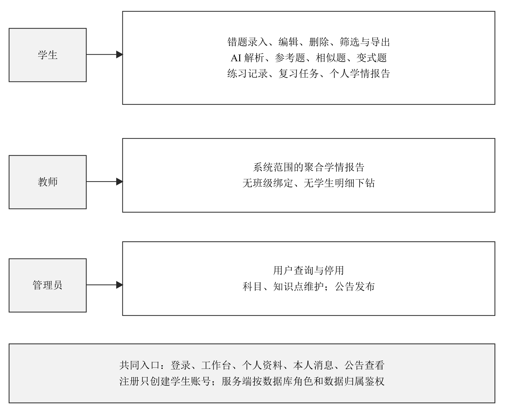

**图 3.1　角色与功能权限**

以学生的“错题分析与复习”用例为例，学生选择科目并填写题干、答案等信息，也可上传一张图片获取候选内容，确认后再保存。错题保存后建立 5 条复习计划，并单独触发 AI 解析。解析记录用状态 0、1、2 区分生成中、成功和失败，前端通过轮询取得结果。解析完成后，学生可查看知识点、错因和解析，并请求相似题或生成 3 道变式题。练习记录需要明确关联原题或变式题，提交后按固定规则更新原题掌握度。学情周报在访问时聚合，不保存报告快照；定时任务只处理复习状态和站内提示。教师查看系统范围的汇总数据，管理员完成基础数据维护和公告发布。

根据需求获取结果，系统共规划 13 项功能，如表 3.1 所示。

**表 3.1　系统功能需求清单**

| 编号 | 功能名称 | 功能需求描述 | 主要使用者 |
|---|---|---|---|
| 1 | 用户管理 | 公开注册学生账号、登录与修改本人信息；管理员分页查询并停用账号，角色由既有数据决定 | 全部角色、管理员 |
| 2 | 科目管理 | 维护系统涉及的学科信息（数学、物理、英语等） | 管理员 |
| 3 | 知识点管理 | 维护一级章节与二级考点的两级知识点体系 | 管理员 |
| 4 | 错题录入管理 | 学生以文本录入错题；可上传一张 JPG/JPEG/PNG/WebP 图片获取科目、题干与来源候选，学生作答仅临时显示，人工确认后保存 | 学生 |
| 5 | AI 解析管理 | 使用题干、可选答案、候选叶子知识点及同用户题库检索片段组装提示词，异步生成知识点归类、错因与解析 | 学生 |
| 6 | 相似题推荐管理 | 同用户同知识点、难度差优先；不足时由同用户同科目的向量检索补足，去重后最多返回 5 题 | 学生 |
| 7 | 变式题管理 | 基于原题上下文同步调用模型，严格生成并保存 3 道变式练习 | 学生 |
| 8 | 复习计划管理 | 创建错题时按第 1、2、4、7、15 天生成复习任务；定时任务处理过期状态并发送当天站内提醒 | 学生 |
| 9 | 练习记录管理 | 记录错题或变式题作答，按答对加 15、答错减 20 原子更新原题掌握度 | 学生 |
| 10 | 学情报告管理 | 请求时聚合系统或个人周报，展示当前知识点平均掌握度、薄弱点和一周新增/练习统计，不保存报告历史 | 学生、教师 |
| 11 | 错题本导出管理 | 按科目、知识点筛选导出 XLSX 错题本 | 学生 |
| 12 | 消息通知管理 | 提供站内消息分页、未读数和已读操作；系统生成 AI 完成、复习提醒与周报提示消息 | 全部角色、系统触发 |
| 13 | 公告管理 | 管理员发布系统公告，用户查看公告 | 管理员、全部角色 |

练习模块根据作答结果更新题目掌握度，推荐模块则依据知识点、难度和语义相似度选择相似题。两个模块分别承担状态记录与练习资源筛选职责，推荐规则不读取 `mastery`、PracticeRecord 或 ReviewPlan，也不把掌握度变化直接作为推荐信号。

核心业务流程从错题录入开始。文本或图片候选值经用户确认后形成错题记录，并生成 5 条固定节点复习计划；解析流程计算题干向量，从同一用户、同一科目中检索参考题，再调用 GLM 生成结构化结果。学生可请求最多 5 道相似题或生成 3 道变式题。到期任务通过站内消息提醒，练习提交后按固定增减规则更新原题掌握度。学情报告在请求时聚合当前数据，周一定时任务只发送查看提示。业务流程如图 3.2 所示。

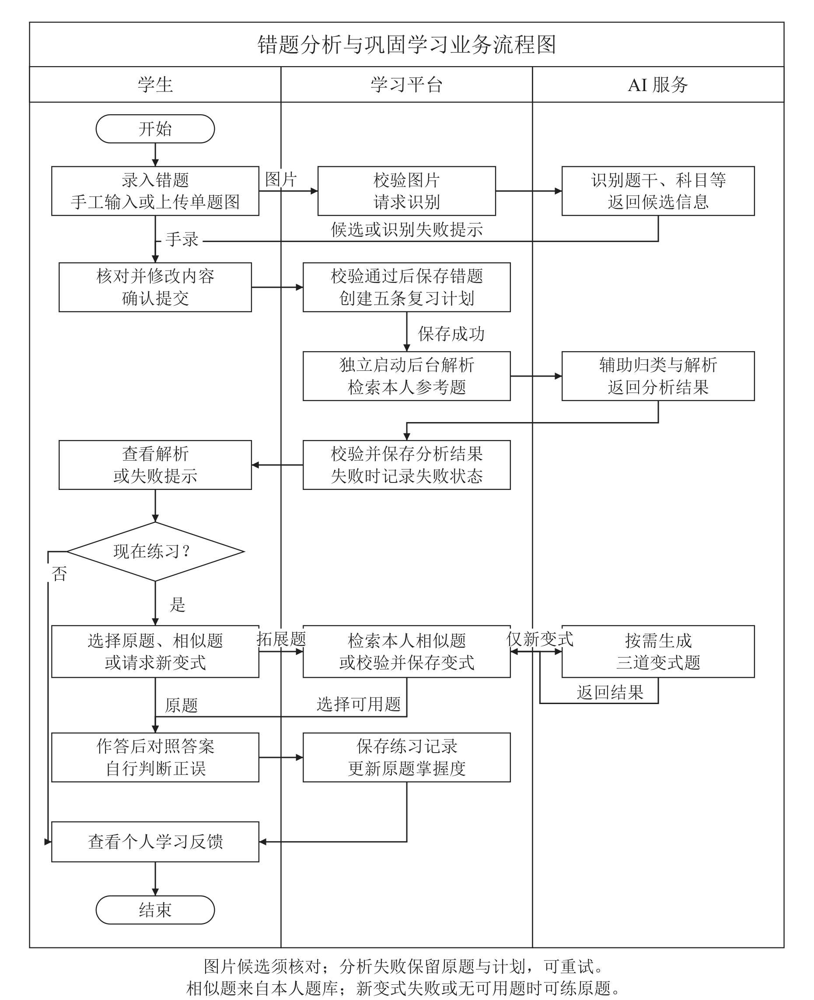

**图 3.2　错题学习业务闭环**

### 3.5 非功能需求分析

（1）性能需求。普通数据查询应在页面操作可接受的时间内返回。AI 解析采用后台任务并由前端轮询，避免模型响应阻塞错题保存；变式题生成保持同步请求，页面需显示等待状态。向量相似度在应用内逐条计算，本课题不预设固定响应时间或题库容量，相关上限需通过压力测试确定。

（2）安全需求。用户密码经加密后存储；登录采用 Token（JWT）机制鉴权；接口按角色进行权限控制，学生只能访问本人数据；所有数据库操作使用参数化查询，防止 SQL 注入；大模型 API 密钥保存在服务端，不向前端暴露。

（3）可用性需求。界面布局清晰、操作流程简单，错题录入、解析状态与复习任务均提供可见反馈；复习提醒、AI 完成和周报查看提示通过站内消息中心告知用户。

（4）可靠性需求。AI 调用失败时应记录失败状态并允许用户重新触发，不影响已经保存的错题和复习计划；模型返回的知识点、难度、错因和解析必须经过字段、类型与取值范围校验后才能写入数据库。学生数据需要按登录用户隔离，旧的异步结果不得覆盖已经编辑的题目。

（5）可维护性需求。代码按 Controller、Service、Mapper 分层，模型地址、密钥、模型名和图像识别开关使用配置项注入。固定复习节点与掌握度增减规则作为明确的业务常量管理，修改规则后需要重新执行相关测试。日志只记录错误类型和必要标识，不记录 API 密钥、完整模型响应或完整向量。

## 4 系统概要设计

### 4.1 系统架构设计

系统采用前后端分离的分层架构，整体划分为表现层、接口层、业务层与数据层四个层次，并嵌入独立的 AI 能力层，如图 4.1 所示。

（1）表现层。前端为基于 Vue 3、Vite 与 Element Plus 构建的单页应用（SPA），负责页面渲染与用户交互，通过 Axios 以 JSON 格式调用后端 REST 接口。

（2）接口层。后端基于 Spring Boot 3 提供 RESTful 接口，统一进行参数校验、身份鉴权（JWT）、权限控制与统一响应封装。

（3）业务层。按用户、科目、知识点、错题、复习计划、练习记录和学情报告等模块组织 Service。模型调用通过 `LlmClient` 接口完成，`RagService` 负责参考题检索，`RecommendService` 组合知识点、难度和向量结果，`ReviewPlanService` 生成固定日期计划。各类规则分别放在对应服务中，避免由 Controller 直接操作 Mapper 或拼装模型请求。

（4）数据层。使用 MyBatis-Plus 访问 MySQL 8。题目语义向量以 JSON 数组形式保存在错题表中，由应用读取候选向量并计算余弦相似度。该设计减少了毕业设计阶段的基础设施数量，但检索开销会随候选题数量增加，不能替代面向大规模数据的向量索引。

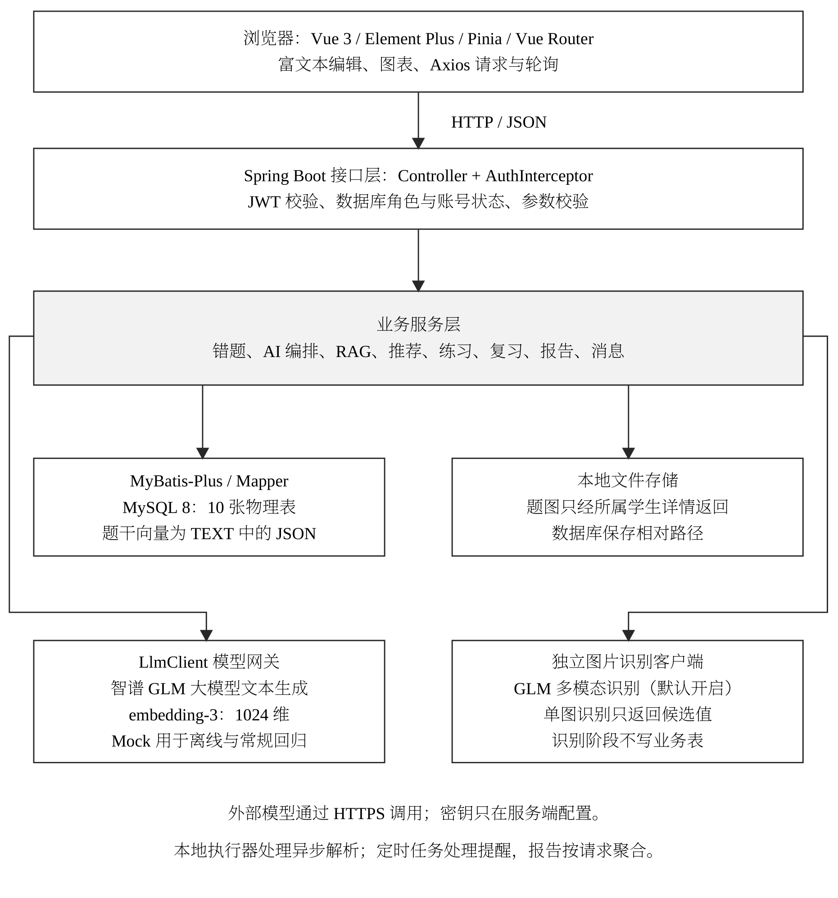

**图 4.1　系统分层架构与外部依赖**

在架构设计上还需说明三点约定：

（1）AI 调用方式。AI 解析采用本地 `Executor` 异步执行：触发接口返回后，后台任务将解析记录状态由生成中更新为成功或失败，前端轮询查询结果。变式题生成接口为同步调用，成功时一次校验并保存 3 道题；两者不可统称为异步任务。

（2）定时任务的引入。每日 08:00 的任务将早于当天且仍待复习的计划标为过期，并为当天待复习计划发送站内消息；每周一 09:00 的任务仅向已有错题的用户发送“周报已更新”提示。学情报告由接口在请求时聚合，不由定时任务生成，也不保存报告快照。

（3）安全设计的落点。密码加密、JWT 鉴权、角色权限控制统一在接口层完成；大模型 API 密钥仅配置在服务端，业务层通过大模型网关间接调用，密钥不进入代码仓库与前端。

### 4.2 功能模块划分

依据表 3.1 的 13 项功能需求，系统在实现层按职责归纳为 8 组模块。功能需求项与服务分组不要求一一对应，同一服务可以承接录入、查询和导出等相关操作。

各模块的主要实现职责和边界如表 4.1 所示。

**表 4.1　功能模块与实现职责**

| 功能模块 | 主要服务或接口 | 职责边界 |
|---|---|---|
| 用户与权限 | AuthService、UserService、AuthInterceptor | 注册学生、认证、资料维护、用户停用与角色校验 |
| 基础错题 | QuestionService、SubjectService、KnowledgePointService | 错题、科目和知识点；图片识别仅提供录入候选 |
| AI 辅助解析 | AiAnalysisService、EmbeddingService、LlmClient | 异步任务、向量、结构化校验和归类回填 |
| 练习资源 | RagService、RecommendService、VariantService | 个人题库检索、规则优先推荐、同步生成变式题 |
| 复习计划 | ReviewPlanService、ScheduleTask | 固定五阶段计划、完成与过期状态、到期提醒 |
| 练习记录 | PracticeService | 保存用户自评作答并更新原题规则分值 |
| 学情与导出 | ReportService、QuestionService | 请求时聚合报告与 XLSX 导出，无报告快照 |
| 消息与公告 | MessageService、AnnouncementService | 本人站内消息与管理员公告发布，无推送通道 |


上述模块以错题记录为业务主线。基础管理维护账号、科目、知识点和公告；错题相关服务处理录入、解析和练习题生成；学习服务处理复习计划、作答记录、统计和消息。变式练习通过变式题回溯原题，这种关联也用于在删除或编辑错题时处理派生数据。

### 4.3 数据库概念设计

数据库设计包含 10 张物理表：用户（user）、科目（subject）、知识点（knowledge_point）、错题（question）、AI 解析记录（ai_analysis）、变式题（variant_question）、复习计划（review_plan）、练习记录（practice_record）、消息通知（message）与公告（announcement）。实体间主要关系如下：

（1）用户与错题为一对多关系，一名学生可录入多道错题；科目与知识点为一对多关系，一个科目包含多个知识点；知识点为自关联一对多关系，一级章节下包含多个二级考点。

（2）错题与 AI 解析记录为一对零或一关系，未触发解析时可以没有记录，触发后由 question_id 唯一约束保证最多一条记录；错题与变式题为一对多关系，一道原题可生成多道变式题。

（3）用户、错题与复习计划之间：一名用户可拥有多条复习计划，一道错题可对应多个复习阶段的复习计划；用户、错题、变式题与练习记录之间：练习记录同时关联用户与错题（或变式题），用于记录每次作答并支撑掌握度计算。

（4）用户与消息为一对多关系，每条消息对应一个接收用户；公告通过发布人 ID 逻辑关联用户，由管理员发布并供登录用户查看。

系统 E-R 关系拆分为图 4.2、图 4.3 和图 4.4：分别说明错题归属与解析、复习与练习、消息与公告。重复出现的实体表示同一张物理表，三个视图合计覆盖 10 张表。连线按父实体与子记录标注基数，均为逻辑关联，不代表数据库已建立外键。

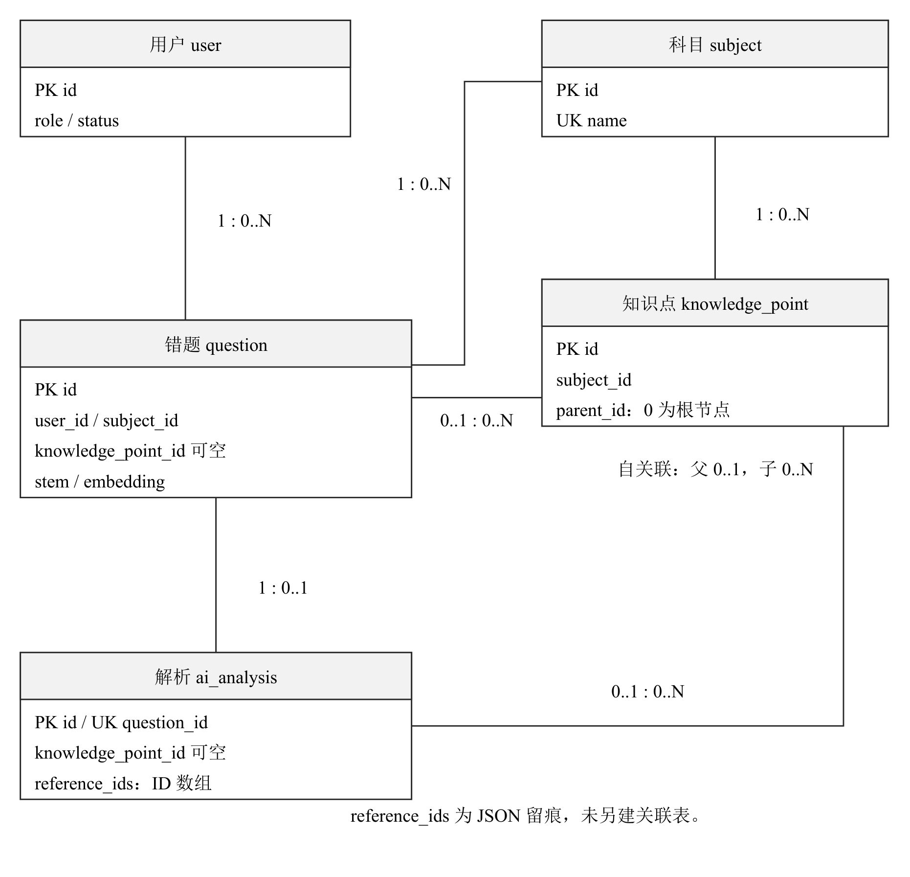

**图 4.2　错题归属、知识归类与解析关系**

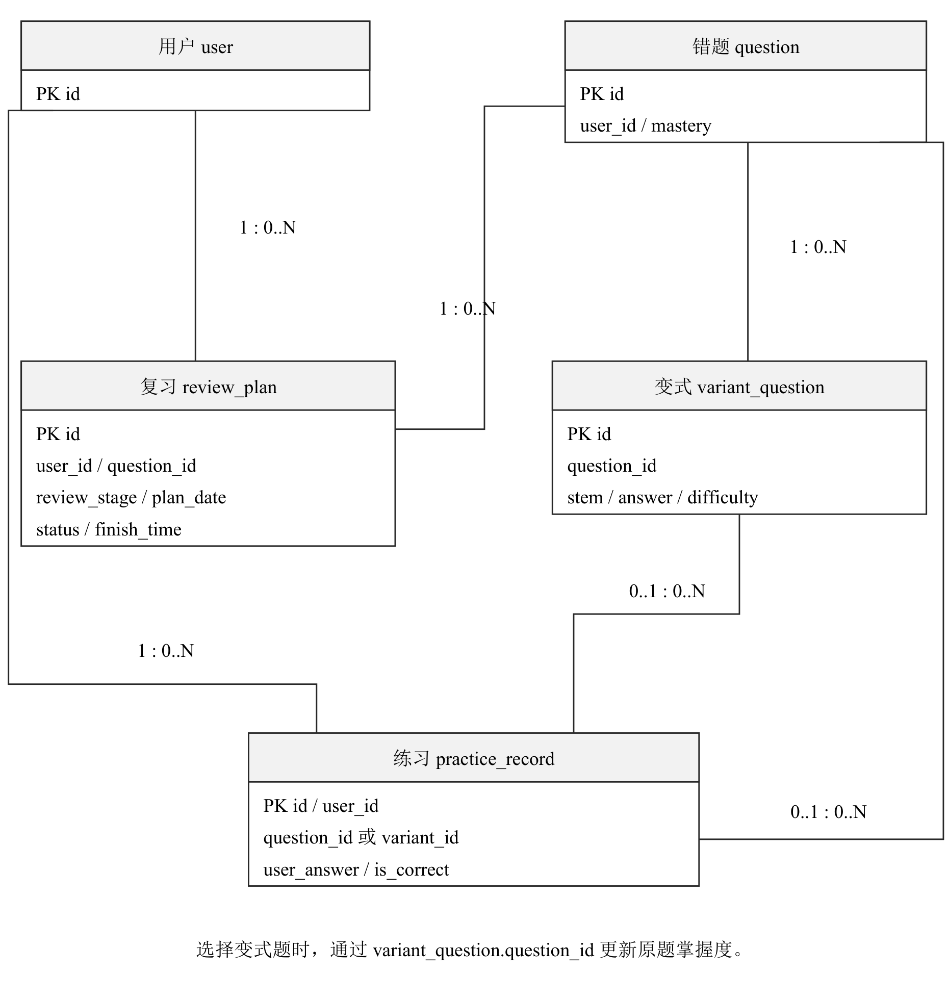

**图 4.3　复习计划与练习记录关系**

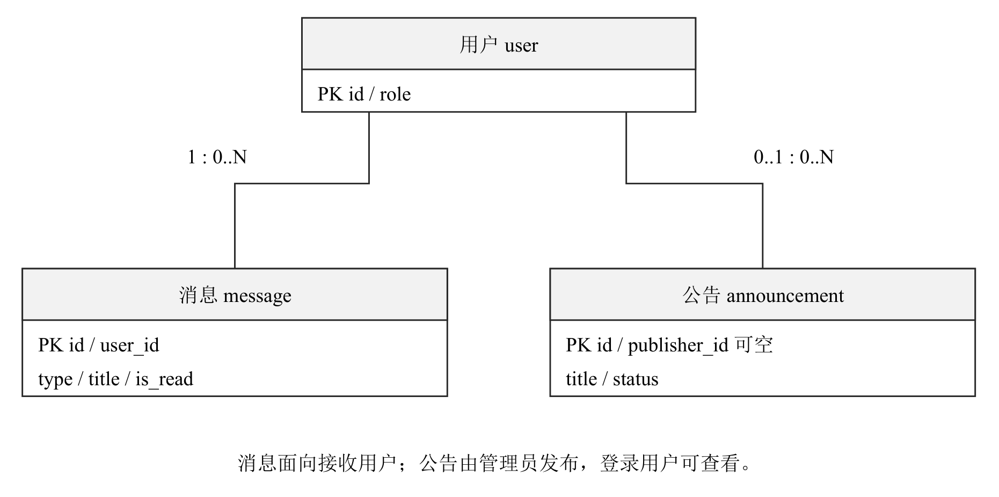

**图 4.4　消息与公告关系**

用户实体包含账号、角色与状态等属性，角色区分学生、教师与管理员；`class_name` 仅为预留文本字段，本课题不据此建立班级关系。科目与知识点构成错题归类基础，知识点通过 `parent_id` 形成两级树，不设计知识图谱。错题保存题干、答案、来源、难度、题目级掌握度与语义向量；AI 解析记录保存模型归类结果、错因、解析和参考题 ID；变式题、复习计划和练习记录均通过错题 ID 关联业务主线；消息记录接收用户与已读状态，公告记录发布人及上下线状态。

## 5 系统详细设计

### 5.1 数据库设计

系统共设计 10 张物理表，各表结构如表 5.1 至表 5.10 所示。主键采用自增 BIGINT；表间不建立数据库外键，由业务层校验所属关系并处理关联数据。用户和错题使用状态字段停用或逻辑删除，AI 解析、变式题、复习计划和图片文件则在错题修改或删除流程中按规则清理。

为提高查询效率，在常用查询字段上建立索引：用户表的用户名字段建立唯一索引；错题表按（用户 ID，科目 ID）建立联合索引，支撑错题本的分页筛选；复习计划表按（用户 ID，计划日期）建立联合索引，支撑每日复习任务的快速检索；练习记录表按（用户 ID，创建时间）建立索引，支撑学情统计的按周聚合。

**表 5.1　用户表（user）**

| 字段名 | 数据类型 | 约束 | 注释 |
|---|---|---|---|
| id | BIGINT | PRIMARY KEY NOT NULL AUTO_INCREMENT | 用户 ID |
| username | VARCHAR(32) | NOT NULL UNIQUE | 登录用户名 |
| password | VARCHAR(128) | NOT NULL | 密码（加密存储） |
| nickname | VARCHAR(32) | DEFAULT NULL | 昵称 |
| role | VARCHAR(16) | NOT NULL DEFAULT 'student' | 角色：student/teacher/admin |
| class_name | VARCHAR(64) | DEFAULT NULL | 预留班级文本，不建立班级业务关系 |
| email | VARCHAR(64) | DEFAULT NULL | 邮箱 |
| status | TINYINT | NOT NULL DEFAULT 1 | 状态：1 正常，0 停用 |
| create_time | DATETIME | NOT NULL DEFAULT CURRENT_TIMESTAMP | 创建时间 |
| update_time | DATETIME | NOT NULL DEFAULT CURRENT_TIMESTAMP ON UPDATE CURRENT_TIMESTAMP | 更新时间 |

索引：`UNIQUE KEY uk_username (username)`。

**表 5.2　科目表（subject）**

| 字段名 | 数据类型 | 约束 | 注释 |
|---|---|---|---|
| id | BIGINT | PRIMARY KEY NOT NULL AUTO_INCREMENT | 科目 ID |
| name | VARCHAR(32) | NOT NULL UNIQUE | 科目名称（如数学、物理） |
| code | VARCHAR(32) | DEFAULT NULL | 科目编码 |
| sort | INT | NOT NULL DEFAULT 0 | 排序号 |
| status | TINYINT | NOT NULL DEFAULT 1 | 状态：1 启用，0 停用 |
| create_time | DATETIME | NOT NULL DEFAULT CURRENT_TIMESTAMP | 创建时间 |

索引：`UNIQUE KEY uk_name (name)`。

**表 5.3　知识点表（knowledge_point）**

| 字段名 | 数据类型 | 约束 | 注释 |
|---|---|---|---|
| id | BIGINT | PRIMARY KEY NOT NULL AUTO_INCREMENT | 知识点 ID |
| subject_id | BIGINT | NOT NULL | 所属科目，逻辑外键 → subject(id) |
| parent_id | BIGINT | NOT NULL DEFAULT 0 | 父级 ID：0 表示一级章节 |
| name | VARCHAR(64) | NOT NULL | 知识点名称 |
| sort | INT | NOT NULL DEFAULT 0 | 排序号 |
| create_time | DATETIME | NOT NULL DEFAULT CURRENT_TIMESTAMP | 创建时间 |

索引：除主键外无其他索引。

**表 5.4　错题表（question）**

| 字段名 | 数据类型 | 约束 | 注释 |
|---|---|---|---|
| id | BIGINT | PRIMARY KEY NOT NULL AUTO_INCREMENT | 错题 ID |
| user_id | BIGINT | NOT NULL | 所属学生，逻辑外键 → user(id) |
| subject_id | BIGINT | NOT NULL | 所属科目，逻辑外键 → subject(id) |
| knowledge_point_id | BIGINT | DEFAULT NULL | 知识点（AI 归类后回填），逻辑外键 → knowledge_point(id) |
| stem | TEXT | NOT NULL | 题干 |
| answer | TEXT | DEFAULT NULL | 答案 |
| source | VARCHAR(128) | DEFAULT NULL | 题目来源（如作业、试卷） |
| image_url | VARCHAR(255) | DEFAULT NULL | 题目图片地址 |
| difficulty | TINYINT | DEFAULT NULL | 难度（1-5，AI 评估） |
| mastery | INT | NOT NULL DEFAULT 0 | 掌握度（0-100） |
| embedding | TEXT | DEFAULT NULL | 题干语义向量（JSON 数组） |
| status | TINYINT | NOT NULL DEFAULT 1 | 状态：1 正常，0 删除 |
| create_time | DATETIME | NOT NULL DEFAULT CURRENT_TIMESTAMP | 创建时间 |
| update_time | DATETIME | NOT NULL DEFAULT CURRENT_TIMESTAMP ON UPDATE CURRENT_TIMESTAMP | 更新时间 |

索引：`KEY idx_user_subject (user_id, subject_id)`。

**表 5.5　AI 解析记录表（ai_analysis）**

| 字段名 | 数据类型 | 约束 | 注释 |
|---|---|---|---|
| id | BIGINT | PRIMARY KEY NOT NULL AUTO_INCREMENT | 解析记录 ID |
| question_id | BIGINT | NOT NULL UNIQUE | 对应错题，逻辑外键 → question(id) |
| knowledge_point_id | BIGINT | DEFAULT NULL | AI 归类知识点，逻辑外键 → knowledge_point(id) |
| error_cause | TEXT | DEFAULT NULL | 错因分析 |
| analysis | TEXT | DEFAULT NULL | 解析内容 |
| reference_ids | VARCHAR(255) | DEFAULT NULL | 参考的本地题目 ID（JSON） |
| llm_model | VARCHAR(64) | DEFAULT NULL | 所用大模型标识 |
| status | TINYINT | NOT NULL DEFAULT 0 | 状态：0 生成中，1 成功，2 失败 |
| create_time | DATETIME | NOT NULL DEFAULT CURRENT_TIMESTAMP | 创建时间 |

索引：`UNIQUE KEY uk_question (question_id)`。

**表 5.6　变式题表（variant_question）**

| 字段名 | 数据类型 | 约束 | 注释 |
|---|---|---|---|
| id | BIGINT | PRIMARY KEY NOT NULL AUTO_INCREMENT | 变式题 ID |
| question_id | BIGINT | NOT NULL | 原题 ID，逻辑外键 → question(id) |
| stem | TEXT | NOT NULL | 变式题题干 |
| answer | TEXT | DEFAULT NULL | 变式题答案 |
| difficulty | TINYINT | DEFAULT NULL | 难度（1-5） |
| create_time | DATETIME | NOT NULL DEFAULT CURRENT_TIMESTAMP | 创建时间 |

索引：除主键外无其他索引。

**表 5.7　复习计划表（review_plan）**

| 字段名 | 数据类型 | 约束 | 注释 |
|---|---|---|---|
| id | BIGINT | PRIMARY KEY NOT NULL AUTO_INCREMENT | 复习计划 ID |
| user_id | BIGINT | NOT NULL | 所属学生，逻辑外键 → user(id) |
| question_id | BIGINT | NOT NULL | 待复习错题，逻辑外键 → question(id) |
| review_stage | TINYINT | NOT NULL DEFAULT 1 | 复习阶段（第 1-5 次） |
| plan_date | DATE | NOT NULL | 计划复习日期 |
| status | TINYINT | NOT NULL DEFAULT 0 | 状态：0 待复习，1 已完成，2 已过期 |
| finish_time | DATETIME | DEFAULT NULL | 完成时间 |
| create_time | DATETIME | NOT NULL DEFAULT CURRENT_TIMESTAMP | 创建时间 |

索引：`KEY idx_user_date (user_id, plan_date)`。

**表 5.8　练习记录表（practice_record）**

| 字段名 | 数据类型 | 约束 | 注释 |
|---|---|---|---|
| id | BIGINT | PRIMARY KEY NOT NULL AUTO_INCREMENT | 练习记录 ID |
| user_id | BIGINT | NOT NULL | 作答学生，逻辑外键 → user(id) |
| question_id | BIGINT | DEFAULT NULL | 重做的错题，逻辑外键 → question(id) |
| variant_id | BIGINT | DEFAULT NULL | 作答的变式题，逻辑外键 → variant_question(id) |
| user_answer | TEXT | DEFAULT NULL | 学生作答内容 |
| is_correct | TINYINT | DEFAULT NULL | 是否正确：1 正确，0 错误 |
| duration | INT | DEFAULT NULL | 作答用时（秒） |
| create_time | DATETIME | NOT NULL DEFAULT CURRENT_TIMESTAMP | 创建时间 |

索引：`KEY idx_user_time (user_id, create_time)`。

**表 5.9　消息通知表（message）**

| 字段名 | 数据类型 | 约束 | 注释 |
|---|---|---|---|
| id | BIGINT | PRIMARY KEY NOT NULL AUTO_INCREMENT | 消息 ID |
| user_id | BIGINT | NOT NULL | 接收用户，逻辑外键 → user(id) |
| type | VARCHAR(32) | NOT NULL DEFAULT 'system' | 消息类型：review_remind 复习提醒/report 报告/system 系统 |
| title | VARCHAR(128) | NOT NULL | 消息标题 |
| content | VARCHAR(512) | DEFAULT NULL | 消息内容 |
| is_read | TINYINT | NOT NULL DEFAULT 0 | 是否已读：1 已读，0 未读 |
| create_time | DATETIME | NOT NULL DEFAULT CURRENT_TIMESTAMP | 创建时间 |

索引：`KEY idx_user_time (user_id, create_time)`。

**表 5.10　公告表（announcement）**

| 字段名 | 数据类型 | 约束 | 注释 |
|---|---|---|---|
| id | BIGINT | PRIMARY KEY NOT NULL AUTO_INCREMENT | 公告 ID |
| title | VARCHAR(128) | NOT NULL | 公告标题 |
| content | TEXT | DEFAULT NULL | 公告内容 |
| publisher_id | BIGINT | DEFAULT NULL | 发布人，逻辑外键 → user(id) |
| status | TINYINT | NOT NULL DEFAULT 1 | 状态：1 正常，0 下线 |
| create_time | DATETIME | NOT NULL DEFAULT CURRENT_TIMESTAMP | 创建时间 |

索引：除主键外无其他索引。

### 5.2 接口设计

前后端通过 REST 接口交互，普通响应封装为 `{code, message, data}`，文件导出接口返回 XLSX 数据。系统设计 36 个控制器方法映射，其中注册、登录与健康检查 3 个接口公开，其余 33 个需要认证。JWT 通过后仍需从数据库读取用户状态和角色，停用账号不能继续使用旧令牌。学生业务查询以当前用户 ID 为数据边界。AI 解析采用“触发 + 轮询”，变式题生成采用同步请求。接口如表 5.11 所示。

**表 5.11　系统接口一览**

| 模块 | 方法 | 路径 | 说明 |
|---|---|---|---|
| 用户管理 | POST | /api/auth/register | 用户注册；权限：公开 |
| 用户管理 | POST | /api/auth/login | 用户登录（返回 JWT）；权限：公开 |
| 系统状态 | GET | /api/health | 健康检查；权限：公开 |
| 用户管理 | GET | /api/user/profile | 查询个人信息；权限：登录用户 |
| 用户管理 | PUT | /api/user/profile | 修改个人信息；权限：登录用户 |
| 用户管理 | GET | /api/user/page | 用户分页查询（管理员）；权限：管理员 |
| 用户管理 | DELETE | /api/user/{id} | 停用用户（管理员，逻辑状态变更）；权限：管理员 |
| 科目管理 | GET | /api/subject/list | 科目列表；权限：登录用户 |
| 科目管理 | POST | /api/subject | 新增科目（管理员）；权限：管理员 |
| 科目管理 | PUT | /api/subject/{id} | 修改科目（管理员）；权限：管理员 |
| 知识点管理 | GET | /api/knowledge-point/tree | 知识点树（按科目）；权限：登录用户 |
| 知识点管理 | POST | /api/knowledge-point | 新增知识点（管理员）；权限：管理员 |
| 知识点管理 | DELETE | /api/knowledge-point/{id} | 删除知识点（管理员）；权限：管理员 |
| 错题录入管理 | POST | /api/question | 录入错题；权限：学生 |
| 错题录入管理 | POST | /api/question-recognition/recognize | 单图题目识别并返回表单候选值；权限：学生 |
| 错题录入管理 | GET | /api/question/page | 错题分页筛选（科目/知识点）；权限：学生 |
| 错题录入管理 | GET | /api/question/{id} | 错题详情；权限：学生 |
| 错题录入管理 | PUT | /api/question/{id} | 修改错题；权限：学生 |
| 错题录入管理 | DELETE | /api/question/{id} | 删除错题；权限：学生 |
| AI 解析管理 | POST | /api/ai/analyze/{questionId} | 触发 AI 解析（异步）；权限：学生 |
| AI 解析管理 | GET | /api/ai/analysis/{questionId} | 查询解析结果；权限：学生 |
| 相似题推荐管理 | GET | /api/recommend/similar | 相似题推荐（questionId 参数）；权限：学生 |
| 变式题管理 | POST | /api/variant/generate/{questionId} | 生成变式题；权限：学生 |
| 变式题管理 | GET | /api/variant/list | 变式题列表（questionId 参数）；权限：学生 |
| 复习计划管理 | GET | /api/review-plan/today | 到期及逾期未完成任务；权限：学生 |
| 复习计划管理 | PUT | /api/review-plan/{id}/finish | 完成复习任务；权限：学生 |
| 练习记录管理 | POST | /api/practice | 提交练习作答；权限：学生 |
| 练习记录管理 | GET | /api/practice/page | 练习记录分页；权限：学生 |
| 学情报告管理 | GET | /api/report/weekly | 查询学情周报；权限：学生、教师 |
| 学情报告管理 | POST | /api/report/generate | 聚合当前周报并发送一条站内消息；权限：学生、教师 |
| 错题本导出管理 | GET | /api/question/export | 导出错题本（筛选参数）；权限：学生 |
| 消息通知管理 | GET | /api/message/page | 消息分页查询；权限：登录用户 |
| 消息通知管理 | GET | /api/message/unread-count | 查询未读消息数；权限：登录用户 |
| 消息通知管理 | PUT | /api/message/{id}/read | 标记消息已读；权限：登录用户 |
| 公告管理 | GET | /api/announcement/list | 公告列表；权限：登录用户 |
| 公告管理 | POST | /api/announcement | 发布公告（管理员）；权限：管理员 |

### 5.3 类设计

系统后端采用 Controller—Service—Mapper 分层设计：Controller 层负责接收请求、参数校验与响应封装；Service 层承载业务逻辑；Mapper 层为 MyBatis-Plus 数据访问接口；实体层包含与 10 张物理表对应的实体类（User、Subject、KnowledgePoint、Question、AiAnalysis、VariantQuestion、ReviewPlan、PracticeRecord、Message、Announcement）。

核心业务类设计如下：

（1）QuestionService：负责错题的增删改查、分页筛选、XLSX 导出、所属用户校验与图片生命周期管理。创建错题时在同一事务中生成 5 条复习计划；AI 解析由前端在创建成功后通过独立接口触发。

（2）AiAnalysisService：使用本地执行器异步编排错题解析，调用 EmbeddingService 计算 1024 维题干向量，调用 RagService 在同用户、同科目候选中做余弦检索，再将题干、可选订正答案、候选叶子知识点与参考题题干片段组装为提示词，经 LlmClient 请求模型，校验结构化结果后写入 ai_analysis 并回填知识点与难度。系统没有独立持久化的 `studentAnswer`、草稿步骤或完整作答轨迹，因而输出属于基于现有上下文的辅助性错因分析，不能表述为对学生完整思维过程的精准诊断。`reference_ids` 只记录参与 RAG 的本地参考题 ID，提供有限的参考来源留痕。输入快照和记录状态校验用于阻止过期任务回写。

（3）LlmClient：大模型网关，封装 API 地址、密钥、模型参数与响应解析，提供文本生成与 Embedding 两类接口，屏蔽模型提供方差异。

（4）RagService：检索增强服务，在同一用户、同一科目、排除源题且向量非空的候选题中计算余弦相似度并排序；该服务不对知识点作硬过滤。

（5）VariantService：负责同步变式题生成，以原题上下文调用 LlmClient，严格校验 3 道结果后短事务保存，并通过输入快照避免并发编辑后的旧结果落库。

（6）ReviewPlanService：复习计划服务，在错题创建时按第 1、2、4、7、15 天生成 5 个固定阶段。计划不会依据个人作答自适应改期；完成接口将指定计划标为已完成。

（7）PracticeService：练习记录服务，保存作答记录并更新掌握度：答对掌握度加 15（上限 100），答错减 20（下限 0），掌握度变化同步写入 question 表。

（8）ReportService：学情报告服务，在请求时聚合错题总量、本周新增、当前平均掌握度、本周复习总数与完成数、知识点平均掌握度、薄弱知识点以及按日新增错题和练习次数。`generate` 接口复用同一聚合结果并额外发送一条站内消息，不生成报告 ID 或持久化快照。

（9）ScheduleTask：定时任务类，每日 08:00 标记早于当天的未完成计划为过期，并为当天待复习计划发送站内消息；每周一 09:00 仅向已有错题的用户发送周报查看提示，不调用 ReportService。

（10）MessageService：站内消息服务，负责 AI 分析完成、复习提醒、周报查看提示等消息的生成、分页查询、未读计数与已读状态维护，不包含 WebSocket、短信或邮件通知。

图 5.1 仅展开模型网关的核心类关系，以说明业务编排与模型实现的依赖边界；其中解析服务经 EmbeddingService 接口使用图中的向量服务实现，图中省略该接口。实体字段已由表 5.1 至表 5.10 给出，不在类图中重复列出。

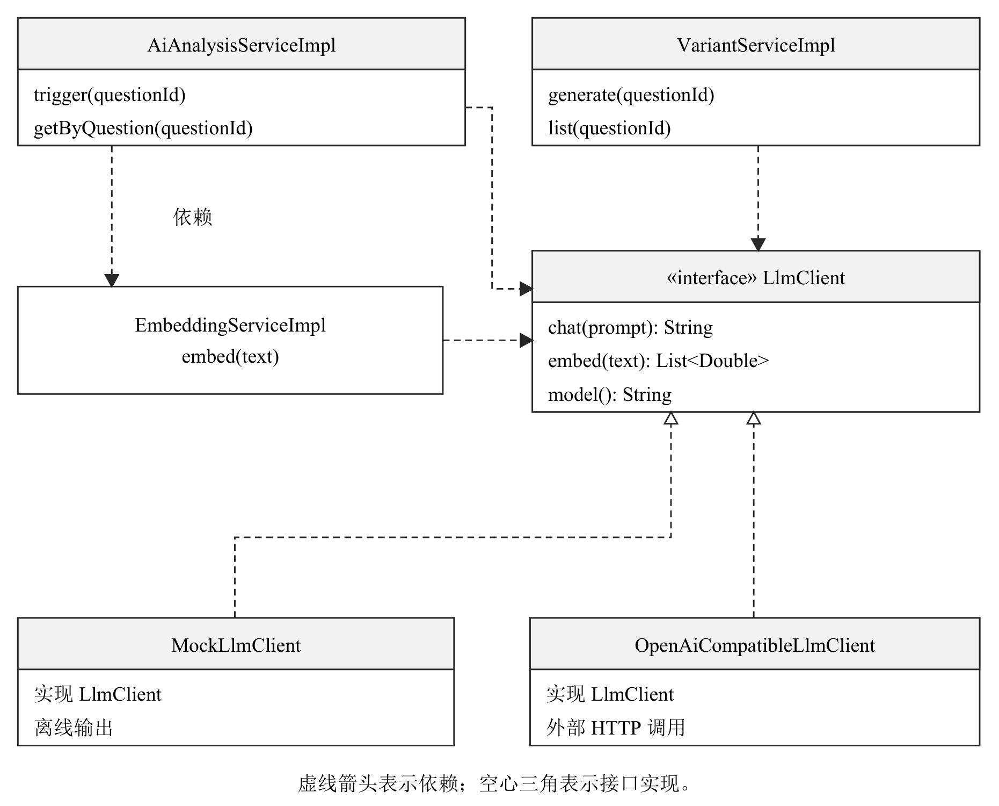

**图 5.1　模型网关的核心类关系**

### 5.4 数据访问层设计

数据访问层基于 MyBatis-Plus 实现。每张表对应一个实体类与一个 Mapper 接口，Mapper 继承 `BaseMapper<T>` 后直接获得通用 CRUD 能力，避免编写基础 SQL；复杂查询使用条件构造器完成。以错题分页筛选为例：

```java
public interface QuestionMapper extends BaseMapper<Question> {
}

LambdaQueryWrapper<Question> wrapper = new LambdaQueryWrapper<>();
wrapper.eq(Question::getUserId, UserContext.getUserId())
       .eq(subjectId != null, Question::getSubjectId, subjectId)
       .eq(knowledgePointId != null,
           Question::getKnowledgePointId, knowledgePointId)
       .orderByDesc(Question::getCreateTime);
return questionMapper.selectPage(new Page<>(pageNum, pageSize), wrapper);
```

`Question.status` 标注为 MyBatis-Plus 的逻辑删除字段，因此分页查询会自动排除状态为 0 的记录，不需要在每个条件构造器中重复添加状态条件。

对于学情统计类需求（如按知识点分组统计掌握度），在 Mapper XML 中编写自定义 SQL，使用 `GROUP BY` 聚合完成；涉及多表写操作的业务（如错题删除时级联清理解析、变式题与复习计划）通过 Service 层 `@Transactional` 声明式事务保证一致性。

### 5.5 界面设计

前端按角色组织导航。学生端包含首页、错题录入、错题本、错题详情、练习历史、复习计划、学情报告与消息中心；教师端提供系统聚合学情报告、消息、公告和个人资料页面，不设计班级或学生明细页面；管理员端提供用户、科目、知识点与公告管理。界面采用侧边导航、顶部栏和内容区的统一布局。AI 解析区分生成中、成功和失败状态，变式题同步生成期间显示加载状态；掌握度和复习状态分别用进度条和标签表示。

（1）错题录入页。系统将该功能称为“多模态图片辅助录入”。表单包含科目、题干、答案、来源与图片；功能默认关闭，启用时只接受单张不超过 5 MB 的 JPG/JPEG/PNG/WebP 图片，调用 `glm-5.3-flash` 返回科目名称、题干、学生作答和来源候选值，并匹配已有科目。科目、题干和来源可作为表单候选值，`studentAnswer` 只在前端临时展示，不写入 `Question.answer`，也不作为正式解析提示词的独立输入。用户必须人工确认后提交，识别过程不自动保存、拆题、整卷识别或判分，图片也不作为 RAG 输入。保存成功后前端另行触发 AI 解析。

（2）错题本页。左侧为科目—知识点两级树形筛选，右侧为错题卡片列表，卡片展示题干、科目与知识点标签、难度、来源、录入时间和掌握度进度条，点击卡片进入错题详情页。

（3）错题详情页。分区展示题干与答案、AI 解析、参考题、相似题与变式题，提供生成变式题和进入练习的操作。上传图片存于本地文件系统并以 UUID 命名，数据库仅保存路径；系统不提供匿名静态访问，所属学生查询详情时由后端以内联 Data URI 返回图片。

（4）复习计划页。`/today` 接口返回计划日期为当天或更早且仍未完成的任务，学生可将任务标记为完成并进入对应题目练习。页面定位为到期与逾期任务列表，不设计未来日历，也不提供从详情页临时加入“今日复习”的操作。

（5）学情报告页。使用 ECharts 展示最近一周每日新增错题柱状图与每日练习次数折线图，并以指标卡、进度和列表展示当前错题量、平均掌握度、复习完成情况及薄弱知识点。报告只展示请求时的聚合结果，不设计雷达图、掌握度历史趋势或历史报告页面。

上述界面结构对应第 6.3 节的真实实现截图。录入、模型解析、参考题、变式题、学生报告和教师数据范围分别见图 6.1 至图 6.6，不重复绘制与实现截图内容相同的原型图。

---

### 5.6 核心流程与状态设计

AI 解析中的检索和校验过程如图 5.2 所示。参考题筛选不要求同一知识点；候选知识点则来自当前科目中 parent_id 非 0 的记录，在系统两级树约定下作为二级考点使用。参考题最多取 3 条，提示词只使用各题题干前 50 个字符及必要的省略标识。没有参考题时仍可请求模型，但结果需要经过相同的结构校验。

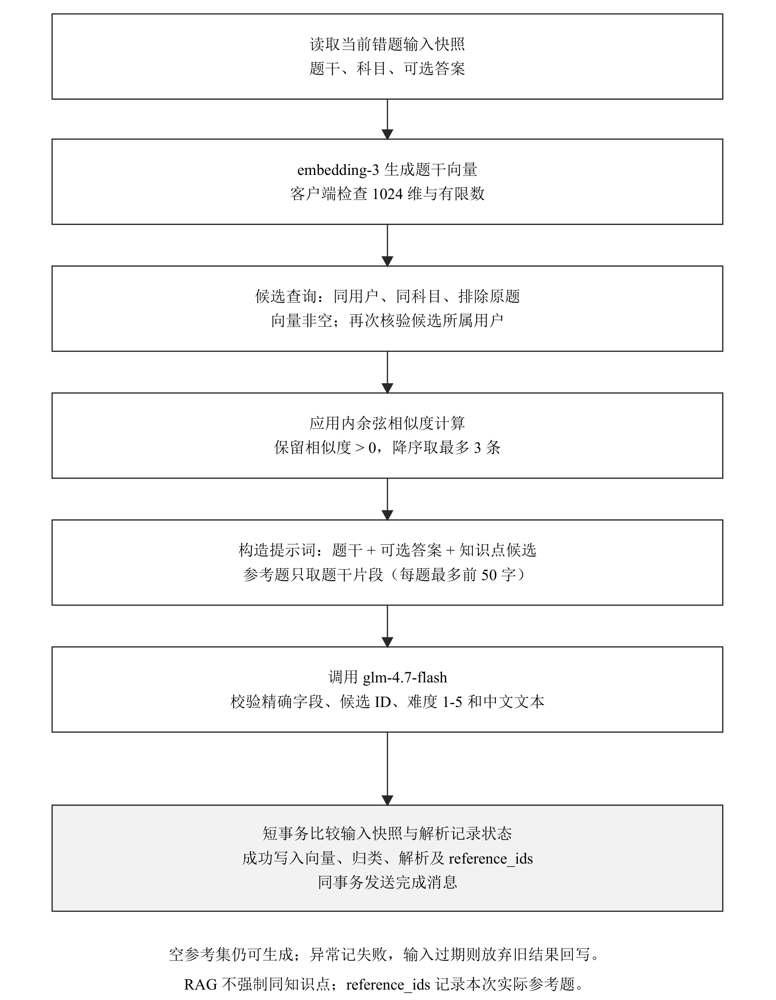

**图 5.2　AI 解析中的 RAG 与结构校验**

保存错题与异步解析的交互如图 5.3 所示。错题和五阶段计划先在同一事务中保存，前端取得 ID 后才另行触发解析。图中后台任务与轮询可以并发进行，不把图示纵向排列理解为页面必须等待后台计算完成才开始轮询。短事务回写还要匹配输入快照和生成中记录；过期结果不能覆盖当前输入。

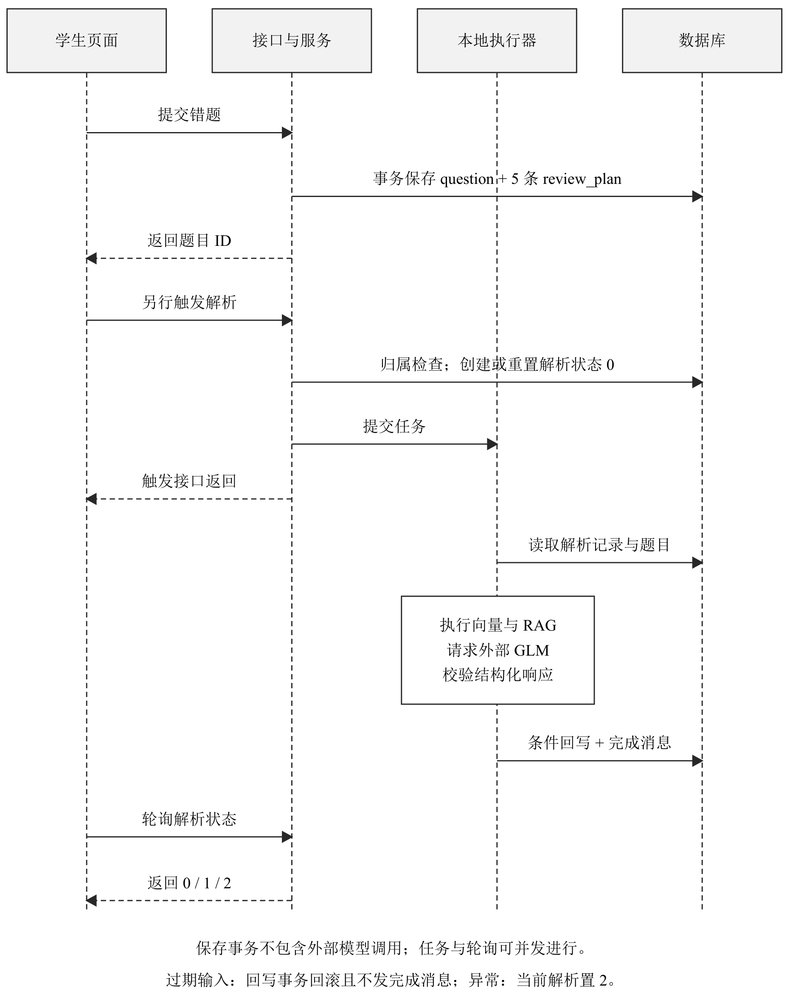

**图 5.3　错题保存与异步解析时序**

练习提交如图 5.4 所示。用户提交结果自评，服务验证原题和变式题目标二选一及其归属，再于同一事务中保存记录并原子更新原题分值。变式题需要通过 question_id 回溯原题；同一练习记录不会同时填写两个目标。

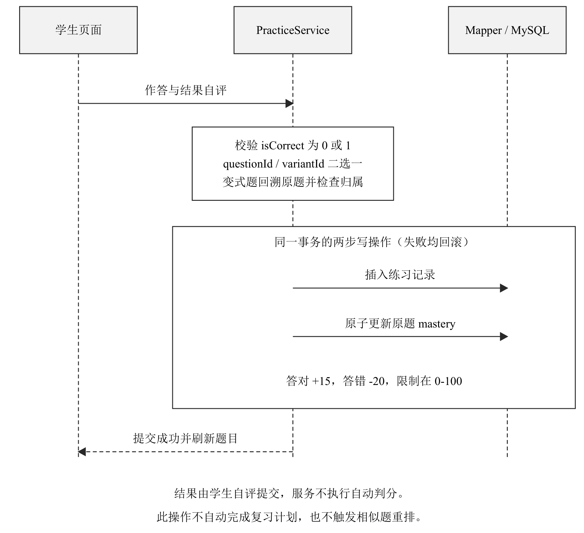

**图 5.4　练习提交与掌握度更新时序**

复习状态如图 5.5 所示。过期表示计划日期已过且尚未完成，用户仍可完成该计划。完成复习与保存一次练习记录是两个独立接口：前者更新计划状态和完成时间，后者更新作答记录与掌握度，两者不自动联动。定时任务不改变原计划日期，也不依据掌握度生成新的间隔。

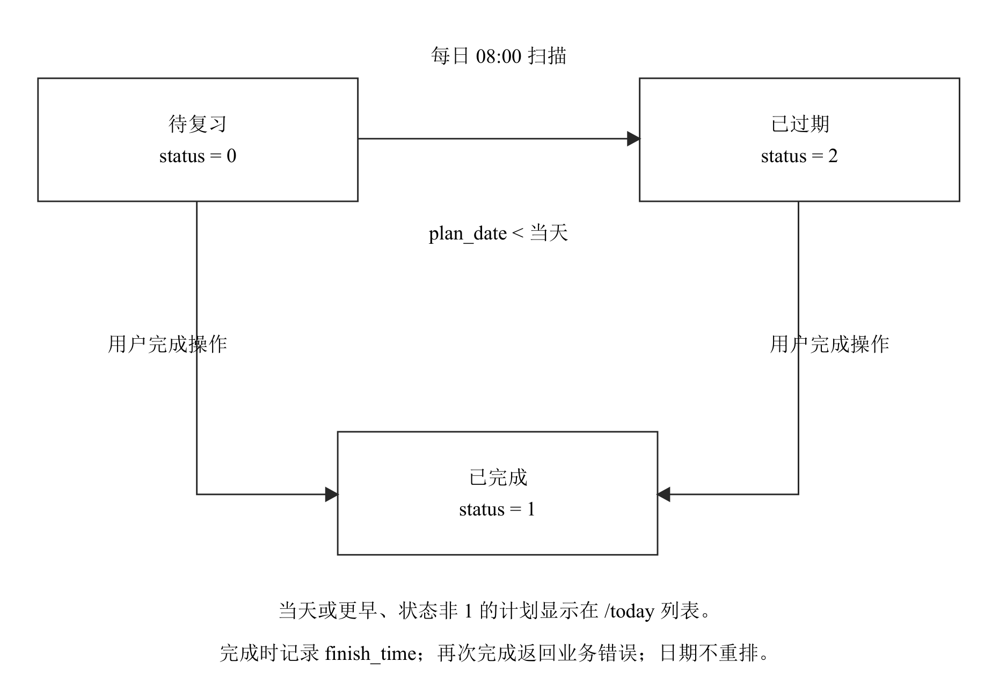

**图 5.5　复习计划状态转换**

## 6 系统实现与测试

### 6.1 开发与运行环境

后端使用 JDK 21 和 Spring Boot 3.5.16，依赖由 Maven Wrapper 3.9.16 管理。数据访问层采用 MyBatis-Plus 3.5.17，数据库为 MySQL 8；JWT 组件版本为 0.12.6，XLSX 导出使用 EasyExcel 4.0.3。前端基于 Vue 3.5、Element Plus 2.14、Pinia、Vue Router、Axios 和 ECharts 开发，构建工具为 Vite 8.2.0。项目约定的前端运行环境为 Node.js 22.23.1，浏览器测试使用 Playwright 1.62.1。

开发环境和测试环境使用不同的数据库配置。后端测试配置只读取专用测试库连接信息，模型提供方固定为 Mock，图片识别默认关闭；缺少测试数据库密码时应用直接启动失败，不回退到开发数据库。非公网部署测试又使用独立的 `wrongbook_deploy_test` 数据库和独立上传目录，后端、前端预览服务均只监听 `127.0.0.1`。这样处理是为了避免自动化测试改写日常开发数据，也防止测试账号和固定凭据进入可访问的网络环境。

### 6.2 后端核心功能实现

#### 6.2.1 用户认证与数据隔离

注册接口只创建学生账号，密码由 BCrypt 加密后写入 `user` 表。登录成功后，后端把用户 ID 和角色写入 JWT。请求到达业务 Controller 前，拦截器除校验令牌签名和有效期外，还根据用户 ID 查询数据库中的账号状态和当前角色。管理员停用账号后，旧令牌无法继续使用；角色变化也以数据库记录为准，不继续信任令牌中的旧角色。

学生业务接口在 Controller 层限制角色，在 Service 和查询条件中继续校验数据归属。错题分页、详情、导出、AI 解析、RAG、相似题、变式题、复习计划和练习记录均以当前登录用户或原题所属用户为边界。RAG 和推荐实现同时保留查询条件与结果级 ownership guard，避免管理员代查或补足候选时混入其他学生的题目。

#### 6.2.2 错题录入、编辑与删除

`QuestionServiceImpl.create` 在一个事务内保存错题并调用 `ReviewPlanService` 建立 5 条复习计划。AI 解析不在该事务中启动，而是在前端取得错题 ID 后调用 `/api/ai/analyze/{questionId}`。这样可以使错题保存与外部模型调用分离，模型暂时不可用时，题干和复习计划仍然存在。

图片录入包含两个不同步骤。图像识别接口接收一张不超过 5 MB 的 JPG、JPEG、PNG 或 WebP 图片，调用 `glm-5.3-flash` 返回科目名称、题干、学生作答和来源候选值，但不写业务表。用户确认表单后，图片才由错题创建接口保存到本地上传目录，文件名改为 UUID，数据库只记录相对路径。匿名静态访问被关闭，所属学生查询错题详情时，后端读取图片并以内联 Data URI 返回。识别结果中的 `studentAnswer` 只在前端临时显示，不写入 `Question.answer`，也不作为 AI 解析的独立输入。

错题编辑需要处理派生数据失效问题。科目、题干或答案发生变化时，原有 Embedding、知识点、难度、AI 解析和变式题都可能对应旧输入，因此服务在同一事务中清空这些字段并删除相关记录；只修改来源时不执行失效处理。异步解析任务在写回前再次比较题目的科目、题干和答案，并检查解析记录仍处于生成中。比较失败时放弃写回，防止用户编辑后被旧任务覆盖。删除错题时，解析、变式题、复习计划和图片文件一并清理，`question` 行改为逻辑删除；既有练习记录保留为历史记录，不再出现在活动错题查询中。

#### 6.2.3 AI 解析与 RAG

模型调用封装在 `LlmClient` 接口中。`MockLlmClient` 用于离线开发和多数回归测试，`OpenAiCompatibleLlmClient` 用于智谱接口。正式文本模型为 `glm-4.7-flash`，向量模型为 `embedding-3`，配置的向量维度为 1024。API 地址、模型名和密钥从服务端配置读取，密钥不返回前端，也不写入仓库。

触发解析时，系统先创建或重置一条状态为 0 的 `ai_analysis` 记录，再把任务提交给本地 `Executor`。后台任务计算题干向量，从 `question` 表中选取同一用户、同一科目、排除原题且向量非空的候选，在内存中计算余弦相似度并取前 3 条。提示词由题干、可选答案、当前科目的叶子知识点候选和参考题题干片段组成。模型必须返回且只返回 `knowledgePointId`、`errorCause`、`analysis` 和 `difficulty` 四个字段。

模型响应不能直接落库。服务检查根节点是否为 JSON 对象、字段数量是否为 4、知识点 ID 是否属于候选集合、难度是否为 1～5 的整数，并确认错因和解析是包含中文字符的非空文本。校验和输入快照都通过后，系统在短事务中写入 1024 维向量、知识点、难度和解析结果，并发送解析完成消息；异常时只把解析状态改为 2，保留原错题。`reference_ids` 记录本次实际使用的本地参考题 ID，但这些题只能作为生成上下文和复核线索，不能证明模型结论正确。

真实接口联调初期出现过返回字段不符合约定、难度不是整数、HTTP 429 和读取时间较长等情况。处理方式包括收紧 JSON Schema 说明、在服务端逐字段校验、为连接失败和部分限流设置有限重试，并把读取超时与其他 4xx 保持为显式失败。错误日志只记录题目 ID、HTTP 状态和异常类型，不打印 Authorization、完整响应或向量。

#### 6.2.4 相似题、变式题与练习记录

相似题服务采用两段式策略。若原题已经归类知识点，系统先从同一用户、同一知识点的题目中按难度差的绝对值升序选择；不足 5 条时，再用同一用户、同一科目的 RAG 结果补足，按题目 ID 去重后最多返回 5 条。该实现不读取掌握度、练习记录或复习计划，因此“个性化”主要体现在候选题属于当前学生的题库，而不是基于学习状态训练的推荐模型。

变式题由同步接口生成。模型输出的根对象只能包含 `variants` 数组，数组必须恰好有 3 项，每项包含非空题干、非空答案和 1～5 的整数难度。3 项全部通过校验后，服务在事务内锁定原题并比较用户、科目、知识点、题干和答案快照，再一次性写入数据库。任何一项不合格或原题已经变化时，本次结果整体不保存。

练习接口要求 `questionId` 和 `variantId` 二选一。服务先校验目标属于当前学生，再保存 `practice_record`。答对时使用 SQL 原子表达式把原题 `mastery` 增加 15，答错时减少 20，结果限制在 0～100。该数值用于页面展示和周报聚合，不作为相似题排序输入，也不表示学生掌握某知识点的概率。

#### 6.2.5 复习计划、报告与消息

错题录入日记为第 0 天，`ReviewPlanService` 按第 1、2、4、7、15 天生成 5 个阶段。完成接口把指定计划改为已完成并记录完成时间。每日 08:00 的任务将早于当天且仍未完成的计划标记为过期，并按用户汇总当天待复习数量后发送站内消息。日期不会因作答结果自动后移或重新计算。

`ReportController` 只允许学生和教师访问。`ReportService` 在收到请求时查询错题、复习计划和练习记录，计算错题总量、本周新增、当前平均掌握度、本周复习总数与完成数、各知识点平均掌握度、薄弱知识点以及一周内每日新增题数和练习次数。学生查询只聚合本人数据，教师查询不加用户过滤，得到系统范围的汇总结果。`/api/report/generate` 复用同一聚合逻辑并额外发送一条消息，不创建报告 ID 或历史快照。每周一 09:00 的定时任务只提醒有错题的用户查看周报，不预先生成报告。

### 6.3 前端实现

前端代码按 `views`、`api`、`router`、`store`、`layout` 和通用组件组织。Axios 请求拦截器统一附加 JWT，响应拦截器处理业务错误和 401；出现失效令牌时，应用清理会话并跳转登录页。路由守卫在进入受限页面前调用个人信息接口确认会话，学生、教师和管理员分别看到与角色匹配的导航。管理员路径在前端隐藏并不构成安全边界，实际权限仍由后端检查。

学生端包含今日工作台、错题录入、错题本、错题详情、练习历史、复习计划、学情报告、消息、公告和个人中心。错题详情页按需加载解析、参考题、相似题和变式题；相似题标签只有在用户打开时才请求接口，并分别显示加载失败、空结果和重试状态。教师端显示系统聚合报告、消息、公告和个人资料。管理员端提供用户、科目、两级知识点和公告维护。学情报告用柱状图显示每日新增错题，用折线图显示每日练习次数，没有雷达图和掌握度历史曲线。

下列截图均来自同一批真实 GLM 浏览器证据，按图 6.1 至图 6.6 的顺序展示录入、解析、RAG 参考、变式题、学生统计与教师权限边界。为满足 A4 正文宽度，图版只选取注明的原始局部，不修改像素中的数值或文字；完整原图与裁切坐标见图表目录。


**图 6.1　错题录入表单局部**

资料来源：2026-08-26 真实浏览器验证截图。图 6.1展示文本表单的局部输入和提交入口。截图取自 2026 年 8 月 26 日真实浏览器验证，不能作为后续新增图片识别功能的界面证据；题干全文保留在原图中。

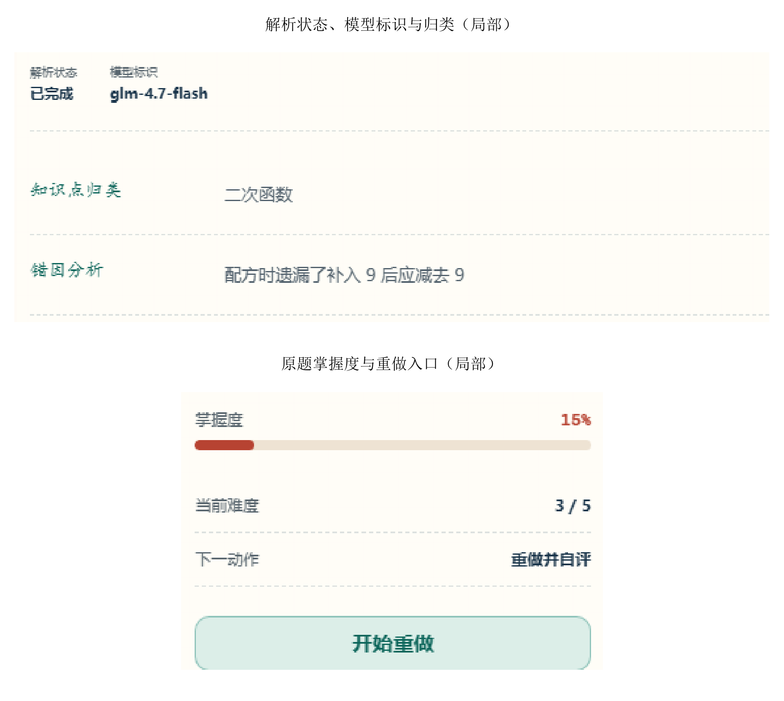

**图 6.2　真实 GLM 解析界面局部**

资料来源：2026-08-26 真实浏览器验证截图。图 6.2可见已完成状态、glm-4.7-flash 模型标识、知识点归类与掌握度。它证明一次真实链路的页面状态，不代表所有解析内容均正确。

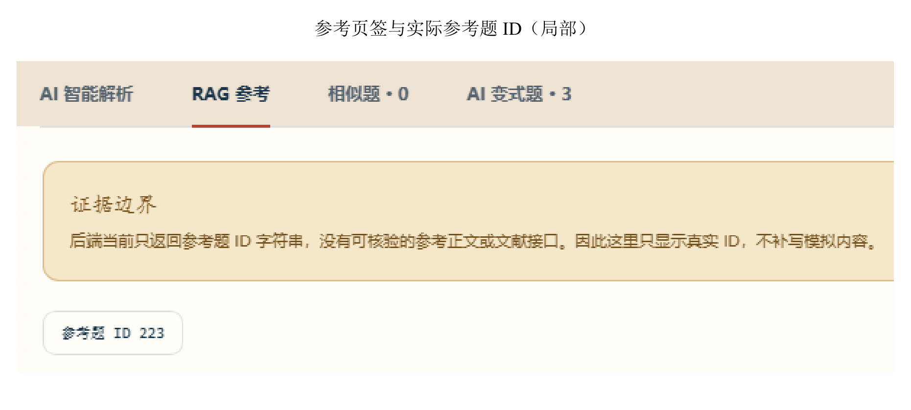

**图 6.3　RAG 参考题标识局部**

资料来源：2026-08-26 真实浏览器验证截图。图 6.3显示实际参考题 ID 223。页面未返回参考正文或相似度分数；同用户向量检索的检查依据为真实浏览器验证及数据库核验记录。

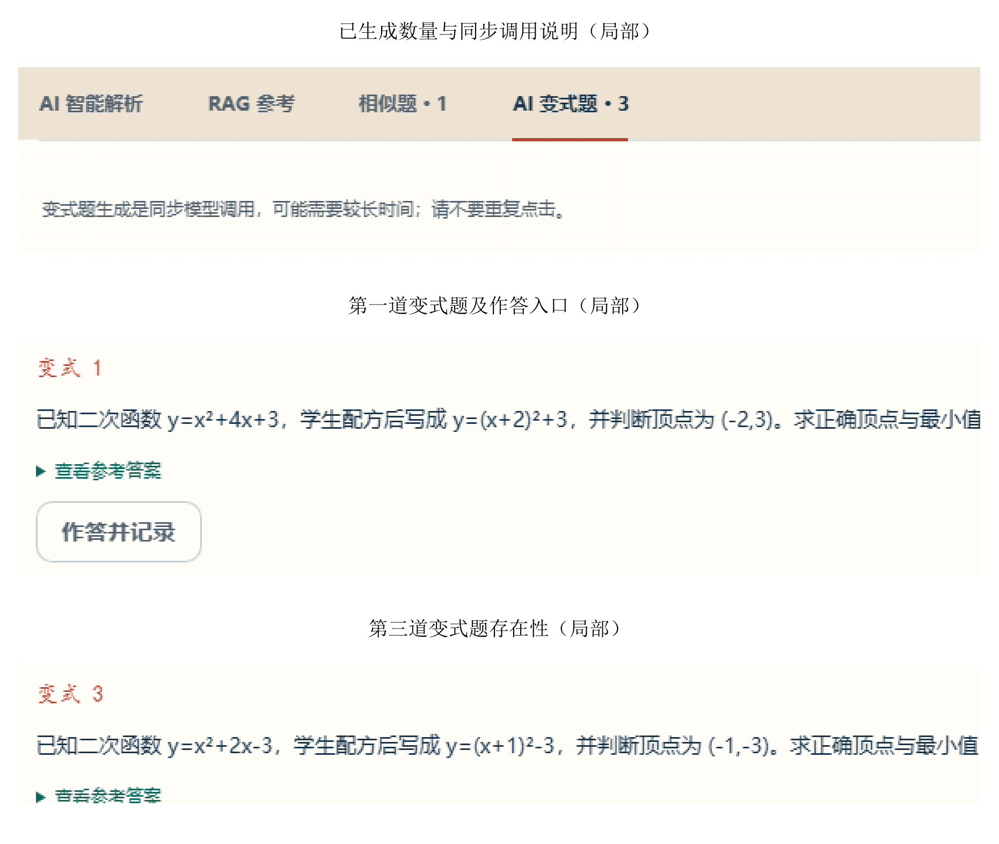

**图 6.4　变式题数量与作答入口局部**

资料来源：2026-08-26 真实浏览器验证截图。图 6.4选取已生成数量、第一题作答入口和第三题标识三个局部。三题完整内容保留在原始截图；3/3 持久化结果由验证记录中的数据库回读支持。


**图 6.5　学生报告的统计与练习反馈局部**

资料来源：2026-08-26 真实浏览器验证截图。图 6.5选取错题统计与每日练习次数区域，记录当时 2 道错题和 1 次练习。日期轴表示一周内的练习次数，不表示掌握度历史变化或学习效果。

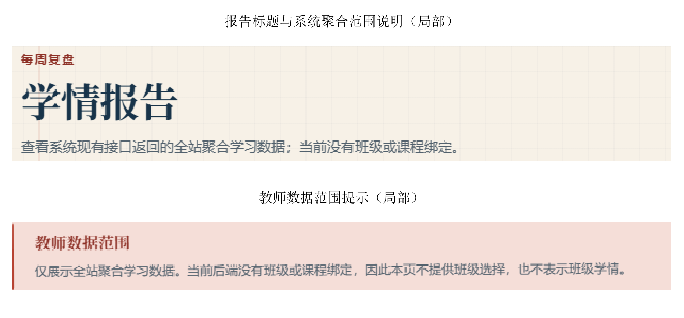

**图 6.6　教师聚合报告的数据范围局部**

资料来源：2026-08-26 真实浏览器验证截图。图 6.6显示教师报告的系统聚合范围提示，未包含账号昵称区域。教师数据范围也由服务端权限测试与报告查询代码共同核验。

### 6.4 开发过程中的问题处理

模型接入后较早暴露的问题是结构化输出不稳定。早期 5 个分析样本中，模型虽然返回了可解析 JSON，但字段结构全部未达到服务约定；变式题也出现过难度字段不是 1～5 整数的情况。仅在提示词中要求 JSON 仍不足以保证可写入数据库，因此实现中增加了精确字段集合、候选知识点、文本语言、数组长度和数值范围校验。无效响应保持失败状态，不用局部字段拼成成功结果。

另一类问题来自异步任务与用户编辑并发。解析期间修改题干会使已经发出的请求失去时效，如果任务仍按题目 ID 回写，旧分析会覆盖新题目。系统把科目、题干和答案作为输入快照，在最终事务中使用条件更新；变式题则锁定原题后比较完整输入。测试覆盖了题干、科目、答案变化以及解析记录被替换的情况，过期任务均不写回。

历史数据库中的 3 条有效错题向量为早期 Mock 使用的 8 维数组，无法与正式 `embedding-3` 的 1024 维向量混合计算。为此增加默认关闭的维护入口，对每题重新请求向量，检查长度、空值、NaN 和 Infinity，再以题干二进制快照作为条件写回。单题失败不会回滚已完成题目。实际维护结果为 3/3 重建成功，重建后 3 条向量均为合法有限的 1024 维数组。

权限审计还发现，相似题和 RAG 的候选范围不能只依靠入口处的题目归属检查。查询条件随后增加原题所属 `userId`，结果阶段再执行一次 ownership guard。停用账号旧 JWT、教师访问学生写接口、私有题图匿名访问以及练习目标同时填写或同时为空等边界也在同一阶段收紧，并增加对应回归测试。

### 6.5 系统测试

#### 6.5.1 测试范围与数据隔离

测试分为离线自动化、隔离数据库联调、真实模型链路和受控小样本实验。多数后端测试使用 Mock 模型和专用 MySQL schema，前端单元测试与浏览器冒烟测试使用固定接口响应。真实 GLM、真实图片识别、Embedding 重建和 Gate5 实验均由显式开关启动，默认测试不会访问外部模型。各类测试使用不同账号和数据集，不能把它们合并为同一次实验。

真实浏览器证据使用独立学生账号，完成错题录入、`glm-4.7-flash` 解析、RAG 参考题查看、3 道变式题展示与数据库回读，以及一次正确练习。该次练习使原题掌握度从 0 变为 15。新题的第 1 个复习节点尚未到期，因此当日复习列表为 0，这与固定日期规则一致，没有通过修改计划日期制造待办数据。

#### 6.5.2 功能与自动化测试结果

不同批次的测试结果如表 6.1 所示；各批次数据和模型开关不同，不合并计算总通过率。

**表 6.1　主要测试结果与证据批次**

| 测试项目 | 数据或环境范围 | 结果 | 证据批次 |
|---|---|---|---|
| 后端完整回归 | 独立 MySQL 回归库，Mock AI | 共 73 项：69 通过、4 跳过、0 失败、0 错误 | V1：2026-09-07 |
| 前端完整验证 | Node.js 22.23.1；Vitest、类型检查与构建 | 23/23 通过；类型与构建通过；保留大包警告 | V2：2026-09-07 |
| 浏览器冒烟 | Mock 接口，四档视口 | 44/44 通过 | V2：2026-09-07 |
| 隔离数据库联调 | 真实后端、专用 MySQL、Mock AI | 4/4 通过 | V3：2026-09-07 |
| 真实 GLM 固定链路 | Chat、Embedding、RAG、结构化分析与变式题 | 最终同一轮分析 5/5；变式题生成并回读 3/3 | V4：2026-08-25 |
| 历史向量重建 | 3 条有效历史错题 | 3/3 重建为合法有限 1024 维向量 | V5：2026-08-26 |
| 真实浏览器业务 | 独立证据学生，真实 GLM | 参考题命中；3 道变式题；一次练习后 mastery 为 15 | V6：2026-08-26 |
| 图片识别工程样本 | 8 张合成 PNG/JPG | 首轮 7/8；失败样本立即重试成功 | V7：识别专项记录 |

资料来源：[V1 非公网部署验证](../validation/deploy-test-validation.md)、[V2 前端验证基线](../validation/user-experience-test-plan.md)、[V3 隔离联调](../validation/isolated-functional-validation.md)、[V4 真实 GLM](../validation/live-glm-validation.md)、[V5 向量重建](../validation/embedding-rebuild.md)、[V6 真实浏览器](../validation/real-ai-e2e.md)、[V7 图片识别](../validation/image-question-recognition.md)。V2 只使用其中已经完成的技术验证，不将待开展的用户体验测试计为通过。

后端“4 项跳过”分别对应需要真实网络或维护数据的测试入口，属于默认关闭项，不是测试失败。非公网部署测试还检查了重启后的 JWT、数据库记录和上传图片，验证后端与前端预览只监听本机地址；未配置部署必填环境变量时，应用以启动失败结束，没有回退到开发配置。上述结果说明所列功能在当前环境和数据范围内可运行，但没有覆盖公网部署、并发压力和长期运行稳定性。

关键业务边界的输入、预期和已有核验结果如表 6.2 所示。这些是从现有测试及验证记录提取的代表性用例，并非本轮新增执行的业务测试。

**表 6.2　关键业务与异常边界验证**

| 编号与输入条件 | 预期行为 | 已有结果与依据 |
|---|---|---|
| F01 教师请求学生创建错题接口 | 服务端拒绝 | V3 教师权限用例通过 |
| F02 请求其他学生题目或候选 | 拒绝详情；候选不跨用户 | RAG、Recommend 隔离测试；V1 回归通过 |
| F03 建立复习计划时抛出异常 | 错题创建一并回滚 | 核心业务集成测试；V1 通过 |
| F04 解析期间修改题干 | 派生记录失效；旧任务不能回写 | 解析失效集成测试；V1 通过 |
| F05 questionId 与 variantId 同时提交 | 拒绝且不生成作答记录 | 核心业务集成测试；V1 通过 |
| F06 掌握度写入失败；重复练习 | 记录回滚；分值有界原子更新 | 核心业务集成测试；V1 通过 |
| F07 模型返回不合格字段或难度 | 校验失败且不作为成功结果保存 | V4 保留初始失败与最终修正结果 |
| F08 未登录读取题图 | 无匿名静态入口；只返回所属学生鉴权详情 | V3 私有题图用例通过 |
| F09 新录入题目首节点未到期 | 今日待办可以为 0 | V6 真实空状态与计划数据一致 |
| F10 未提供部署必填配置 | 启动失败，不回退开发配置 | V1 退出码 1；已记录 |

资料来源：表 6.1 对应验证批次。核心业务集成测试对应后端 `FinalDeliveryCoreIntegrationTests`，解析失效集成测试对应 `QuestionAiInvalidationIntegrationTests`；隔离测试对应 `RagServiceImplDataIsolationTests`、`RecommendServiceImplDataIsolationTests`，另参照前端真实后端联调用例。

#### 6.5.3 Gate5 小样本实验

Gate5 使用 27 道人工设计的合成错题，包含数学 12 题、物理 9 题、英语 6 题，覆盖 9 个叶子知识点，每个知识点 3 题。27 条向量均由 `embedding-3` 生成并通过 1024 维有限数检查，27 次正式分析最终全部得到结构合规结果。知识点 Exact Match 为 26/27，即 96.30%；唯一不一致样本把“摩擦力”归入了“牛顿第二定律”。该比例只描述固定集合，不作为模型总体准确率。

错因关键概念覆盖率的自动代理均值为 94.14%，中位数为 100%，其中 22/27 达到全覆盖。人工复核采用 0、1、2 三级评分，0 表示明显错误或与题意矛盾，1 表示部分合理但错因或解释不完整，2 表示错因判断基本正确且解释清楚。27 题总分为 46/54，平均 1.7037；20 题得 2 分、6 题得 1 分、1 题得 0 分。0 分样本虽然把英语句子改成了正确过去式，却错误地把主语 `I` 解释为第三人称单数。该例表明，结构校验和关键词覆盖不能替代内容正确性审查。

RAG 检索得到 Hit@3=0.962963、Recall@3=0.870370、MRR@3=0.864198；混合相似题推荐在该集合上得到 Hit@5=1.000000、Recall@5=1.000000。固定 6 题的 RAG ON/OFF 比较中，两组概念覆盖均为 88.89%，结构合规均为 6/6。人工盲评完成后解盲，RAG ON 获得 2/6 次偏好，RAG OFF 获得 4/6 次偏好。这个结果没有显示加入检索上下文在该 6 题集合中带来一致优势，因此论文不使用“RAG 显著提高解析质量”之类的结论。

实验运行期间保留了 34 次失败尝试，其中包含接口限流和结构校验失败。最终成功数据没有覆盖这些记录。受控集合提供了较完整的错误答案和正确答案，而正式页面没有独立持久化的学生作答字段，两者输入分布并不相同；实验也未测量学习成绩变化、长期保持率或教师评价。

各类指标的样本、数值和适用范围汇总如表 6.3 所示。自动指标来源于 2026 年 8 月 27 日固定实验结果，人工评价来源于 2026 年 9 月 7 日填写的原始 CSV；保留原自动摘要的历史状态，成稿以原始人工记录为准。

**表 6.3　Gate5 固定小样本指标及解释边界**

| 指标 | 样本与结果 | 解释边界 |
|---|---|---|
| 知识点 Exact Match | 27 题；26/27，96.30% | 固定标签一致率，不是总体准确率 |
| 错因概念覆盖代理 | 27 题；均值 94.14%；22/27 全覆盖 | 字符串与概念覆盖，不等同内容正确 |
| RAG 检索 | 27 题；Hit@3 0.962963；Recall@3 0.870370；MRR@3 0.864198 | 人工相关组定义下的检索结果 |
| 混合相似题推荐 | 27 题；Hit@5、Recall@5 均为 1.000000 | 规则优先加向量补足，不是纯向量模型 |
| 人工错因评分 | 27 题；46/54；均分 1.7037；2/1/0 分分别 20/6/1 题 | 本次用户复核，不宣称多专家一致性 |
| RAG ON/OFF 自动比较 | 固定 6 题；覆盖均为 88.89%；结构均 6/6 | 没有观察到概念覆盖增益 |
| RAG ON/OFF 人工偏好 | 固定 6 题；ON 2/6，OFF 4/6 | 不支持该集合中一致质量优势；无显著性检验 |
| 失败历史 | 34 次尝试：HTTP 429 为 14 次、解析状态 2 为 15 次、结构校验为 5 次 | 失败尝试不是 34 道独立错题，也不当作超时 |

资料来源：[固定实验结果](../experiments/gate5/results/experiment-results.json)、[自动摘要](../experiments/gate5/results/summary.md)、[错因人工原表](../experiments/gate5/manual/error-cause-review.csv)、[A/B 人工原表](../experiments/gate5/manual/rag-ab-review.csv)和[既有解盲键](../experiments/gate5/results/rag-ab-key.json)。人工统计本轮从 CSV 重新计算，未改动评分或模型输出。

### 6.6 测试结果分析

自动化和真实链路测试覆盖了账号认证、学生数据隔离、错题生命周期、模型输出校验、复习计划、练习分值、请求时报告、图片访问和三角色页面。测试中发现的问题主要集中在外部模型响应不稳定、异步写回竞态、旧向量维度和权限边界，而不是通过修改测试预期规避。对应修复均有定向测试或验证记录。

现有证据仍有明确限制。应用在内存中遍历候选向量，没有万级题库压力数据；模型受控实验样本较少，RAG ON/OFF 人工偏好也只有 6 题；用户体验测试尚未实施；教师端缺少班级和学生关系；前端生产构建仍有主入口包体积警告；非公网本机部署不等于生产环境部署。因此，测试结论限定为“当前实现与受控数据范围内的功能验证通过”，不推导学习效果、普遍可用性或大规模性能。

## 7 总　结

### 7.1 主要工作

本课题完成了一个基于 Spring Boot 3.5.16、Vue 3 和 MySQL 8 的错题分析与学习推荐系统。数据库由 10 张物理表组成，后端提供 36 个控制器方法映射，覆盖三类角色、错题与图片、AI 解析、相似题、变式题、复习计划、练习记录、学情报告、消息、公告和 XLSX 导出。正式模型链路使用智谱 `glm-4.7-flash` 和 `embedding-3`，图片辅助录入使用独立且默认关闭的 `glm-5.3-flash` 配置。

实现过程中没有把模型调用直接等同于可用结果。解析和变式题均增加严格结构校验，异步回写与同步生成分别使用输入快照防止旧结果落库；RAG 与推荐候选按用户隔离；错题关键字段变化时主动清理失效的向量和派生记录。固定复习节点、题目级掌握度和请求时周报均按代码中的简单规则描述，没有写成自适应知识追踪。

测试包括后端与前端自动化、隔离数据库联调、真实模型调用、历史向量重建、真实浏览器流程、图片识别和 Gate5 小样本实验。测试既记录成功结果，也保留限流、结构不合格和人工评分中的错误样本。RAG ON/OFF 的 6 题盲评没有支持一致的质量提升，说明检索上下文的作用仍需在更接近真实输入的数据上继续验证。

### 7.2 不足与后续工作

系统没有班级、课程和教师—学生关联，教师只能查看系统范围的汇总数据。掌握度是按单次练习增减的题目分值，复习日期为固定节点，相似题推荐也不读取掌握度和练习历史。报告不保存快照，无法展示长期变化。向量保存在 MySQL 文本字段并在应用内计算，数据规模增大后需要重新评估检索方式。

模型评估仍以受控样本为主。Gate5 的 27 题与正式页面输入存在差异，6 题消融和一次浏览器业务流程不足以代表真实学生长期使用。下一阶段应先完成已经准备的小规模用户体验测试，记录任务完成情况和具体操作问题；再补充更接近页面输入的人工标注题集、压力测试和安全测试。若后续引入班级关系、自适应复习或概率知识追踪，应同时调整数据库、接口、评价指标和论文表述，不能只在界面上增加名称。

<!-- 图表审计与证据索引：../notes/论文图表审计与事实基线.md；可维护源与导出：figures/README.md。 -->

---

## 参考文献

[1] 赵雅娟，孟繁军，徐行健．在线教育学习者知识追踪综述［J］．计算机应用，2024，44（6）：1683-1698．

[2] 董永峰，王雅琮，董瑶，等．在线学习资源推荐综述［J］．计算机应用，2023，43（6）：1655-1663．

[3] （印）Vaswani A，Shazeer N，Parmar N，等．Attention is all you need［C］//Advances in Neural Information Processing Systems 30．2017：5998-6008．

[4] 余胜泉，熊莎莎．基于大模型增强的通用人工智能教师架构［J］．开放教育研究，2024，30（1）：33-43．

[5] （德）Kasneci E，Sessler K，Küchemann S，等．ChatGPT for good? On opportunities and challenges of large language models for education［J］．Learning and Individual Differences，2023，103：102274．

[6] （中）Zhao P，Zhang H，Yu Q，等．Retrieval-augmented generation for AI-generated content：A survey［J］．Data Science and Engineering，2026，11（1）：1-29．

[7] 梅忆寒，王琳琳，王鹏飞，等．基于多模态与检索增强生成的数据库知识问答系统［J］．计算机教育，2024（12）：236-241．

[8] 索晋贤，张丽萍，闫盛，等．可解释的深度知识追踪方法综述［J］．计算机应用，2025，45（7）：2043-2055．

[9] 马华，李京泽，唐文胜，等．个性化在线学习资源推荐研究热点与趋势——基于2011—2021年CNKI和WoS文献的可视化分析［J］．软件导刊，2023，22（1）：29-37．

[10] 郑雅倩，李新，李艳燕，等．人工智能视域下个性化学习路径推荐：机理、演进、价值与趋势［J］．现代远距离教育，2023（3）：39-47．

[11] 韩姣，付瑞，孙昊，等．基于联邦学习的个性化学习资源推荐系统研究［J］．教育学刊，2025，3（12）：74-81．

[12] 朱敏．基于大语言模型的个性化资源推荐方法研究［J］．兰州文理学院学报（自然科学版），2024，38（5）：59-64．

[13] 孙辉．高中物理错题资源的整合［J］．现代教育探索，2024，5（2）：131-133．

[14] 徐刚，刘志鹏，冯骐，等．大语言模型在教育信息化中的实践：规范、框架与应用［J］．通信学报，2024，45（Z2）：229-241．

[15] 刘邦奇，喻彦瑾，王涛，等．人工智能教育大模型：体系架构与关键技术策略［J］．开放教育研究，2024，30（5）：76-86．

[16] 罗恒，廖小芳，茹琦琦，等．生成式人工智能支持的教师评语研究：基于初中数学课堂的实践探索［J］．电化教育研究，2024，45（5）：58-66．

[17] 吴砥，吴河江．通用大模型教育应用的潜在风险及其规避——基于技术伦理的视角［J］．华东师范大学学报（教育科学版），2024，42（8）：64-75．

[18] 吴永和，姜元昊，陈圆圆，等．大语言模型支持的多智能体：技术路径、教育应用与未来展望［J］．开放教育研究，2024，30（5）：63-75．

[19] 贾洪愿，居发礼，余晓平．基于检索增强生成（RAG）的《建环专业计算机应用》课程智能知识库构建［J］．智慧教育，2025，2（2）：198-201．

[20] 唐颖川．大语言模型赋能探究型高职教育——以Python语言课程为例［J］．现代教育探索，2025，6（6）：44-46．

[21] 张鲁燕，巩清波．大语言模型赋能高职教育“双师课堂”的路径探索［J］．教育学刊，2026，4（1）：136-141．

[22] （美）Corbett A T，Anderson J R．Knowledge tracing：Modeling the acquisition of procedural knowledge［J］．User Modeling and User-Adapted Interaction，1995，4（4）：253-278．

[23] （美）Piech C，Bassen J，Huang J，等．Deep knowledge tracing［C］//Advances in Neural Information Processing Systems 28．2015：505-513．

[24] （德）Ebbinghaus H．Über das Gedächtnis：Untersuchungen zur experimentellen Psychologie［M］．Leipzig：Duncker & Humblot，1885．

## 致　谢

感谢指导教师胡韬老师在课题选题和论文材料准备过程中给予的指导。老师对文献综述的组织顺序、逐篇评述方式，以及研究内容和研究方法的表述提出了具体修改意见，帮助我梳理文献与课题之间的联系，明确研究步骤和工作安排。在修改过程中，我也进一步认识到，论文中的方案、实现和结论需要相互对应，文字表述应有事实依据。谨向胡韬老师表示感谢。
