# 基于智谱GLM模型的AI错题分析与学习推荐系统设计与实现

> **英文题目**：Design and Implementation of an AI-Powered Wrong-Question Analysis and Learning Recommendation System Based on the Zhipu GLM Model

> 本文件为毕业论文正文的 Markdown 源稿，
> 章节结构依据 2027 届《云南工商学院本科毕业论文（设计）撰写规范及要求》和《毕业论文（设计）正文模板》整理。
> 源稿不承担排版：字体、页边距、页码、目录导航等在导出 DOCX 时统一处理。
> 参考文献及正文角标 [n] 统一采用已通过开题报告的20篇文献与编号顺序；本轮不改动文末列表。
> 需求分析与设计章节按方案形成阶段表述，系统实现与测试章节只采用仓库代码和验证记录中已有的事实；不得将规划功能写成已实现功能。

---

## 封面（占位）

（导出时由论文系统导出正式封面，包含：学校名称、论文题目、学院、专业班级、姓名、学号、指导教师、完成日期等。）

## 目录（占位）

（导出时使用 Word 自动目录生成，支持点击导航；目录中的标题文字须与正文标题完全一致。）

---

## 摘　要

针对个人错题分散、解析与后续练习脱节的问题，设计并实现基于智谱GLM大模型的AI错题分析与学习推荐系统。系统采用Vue 3、TypeScript、Spring Boot、MyBatis-Plus与MySQL构建前后端分离架构，结合个人题库检索组织模型上下文，由平台校验并保存分析和变式题。系统支持错题录入、图片辅助输入、相似题查询、练习记录、固定计划复习及学情查看，并通过角色和数据归属约束访问范围。测试包括离线自动化、隔离数据库联调、真实模型调用和受控小样本实验，结果支持所测条件下的功能可用性，不能推导普遍教学效果。题目级状态采用规则分值，尚未形成概率知识追踪；系统已实现个人知识内容缓存、未练题筛选与资源耗尽后的生成编排；其适用性结论限定在实际验证范围内。

**关键词**：错题分析；个性化推荐；检索增强生成；知识追踪

## Abstract

To connect scattered personal wrong-question records with analysis and follow-up practice, this project designs and implements an AI-powered wrong-question analysis and learning recommendation system based on the Zhipu GLM model. The system uses Vue 3, TypeScript, Spring Boot, MyBatis-Plus and MySQL in a decoupled front-end and back-end architecture. Retrieval from the learner's own question collection supplies model context, while the platform validates and stores analyses and variant exercises. Functions include question recording, image-assisted input, similar-question retrieval, practice records, fixed-schedule review and learning reports. Role and ownership checks constrain data access. Evaluation includes offline automated tests, integration with an isolated database, live model calls and controlled small-sample experiments. The results support functional operation under the tested conditions, without establishing general educational effectiveness. Question-level status uses a rule-based score rather than probabilistic knowledge tracing. The system implements personal knowledge-content caching, unpractised-question selection and generation after resource exhaustion, with claims limited to the verified scope.

**Key words**: error analysis; personalized recommendation; retrieval-augmented generation; knowledge tracing

---

## 1 绪　论

### 1.1 研究背景

随着教育数字化持续推进，如何依据学习过程数据识别薄弱环节并组织适合的学习资源，已成为个性化学习研究的重要问题。知识追踪研究关注从历史作答中描述学习者知识状态[1]，在线学习资源推荐研究则关注学习者、知识点与资源之间的匹配[2]。在日常练习中，错题能够反映特定阶段的理解偏差，但手工摘抄、笼统归因和无计划重做会增加整理成本，也难以把错题、解析、推荐与复习连接成连续流程。

人工智能技术为上述问题提供了新的工程路径。Transformer 架构为大语言模型的发展奠定了基础[15]，相关教育研究表明，大模型可用于辅助答疑、反馈与学习支持，但输出不确定性、隐私和依赖风险需要受到约束[11][19]。检索增强生成（RAG）通过在生成前检索外部信息，为回答提供补充上下文，是缓解模型仅依赖参数化知识的一种技术路线[20]；国内课程知识问答研究也已探索多模态检索与大模型生成的结合[14]。因此，本课题围绕个人错题构建“录入—分析—推荐—复习—反馈”闭环，但不把模型输出、检索结果或规则化掌握度等同于教学结论。

### 1.2 研究意义

本课题关注的是检索增强生成在个人错题场景中的具体落地方式。解析流程不只向模型发送题干，还加入同一学生题库中的参考题和限定范围的知识点候选，并记录实际使用的参考题 ID。这样做不能保证生成内容正确，但能够缩小模型的输入范围，并为结果复核保留线索。复习部分采用固定日期节点和可解释的分值规则，避免在缺少长期作答序列时把简单反馈包装成复杂知识追踪。对软件工程实践而言，课题涵盖需求边界确定、11 张物理表设计、前后端接口实现、外部模型接入、异常处理和自动化测试。教师端仅查看系统范围的聚合报告，不包含班级、课程和学生明细管理。

### 1.3 研究内容

本课题的研究内容是设计并实现基于智谱GLM大模型的 AI 错题分析与学习推荐系统，主要工作包括：

（1）需求分析。依据错题学习场景、相关研究与同类产品的公开功能，梳理错题录入、辅助解析、练习和复习之间的业务关系，确定功能需求与非功能需求。本研究未实施正式问卷或访谈，不使用样本量、比例或受访者意见作为需求依据。

（2）系统设计。采用前后端分离架构与面向对象设计原则，完成系统架构设计、功能模块划分、数据库设计、接口设计、数据访问层设计与界面设计，并针对 AI 解析、相似题推荐、复习计划等核心模块给出详细设计方案。

（3）系统实现与测试。使用 Spring Boot 3、Vue 3、MyBatis-Plus 与 MySQL 完成系统编码，通过大语言模型 API 与语义向量检索实现 AI 解析和练习内容生成，并用单元测试、集成测试、浏览器测试和受控小样本实验检查具体功能及其边界。

### 1.4 论文组织结构

本文共分为9章，按照需求分析、技术基础、系统设计、开发实现与测试评价组织。

第1章为绪论，介绍研究背景、研究意义与研究内容。第2章为文献综述，梳理错题学习、知识状态描述、资源推荐、大模型教育应用及检索增强生成研究，说明本课题的取舍。

第3章为系统需求分析，明确需求来源、参与角色、业务流程、功能与用例，给出分层数据流、数据字典及非功能要求。第4章为相关技术概述，说明前后端框架、关系数据存储、智谱GLM大模型和RAG在本系统中的作用及边界。

第5章为系统概要设计，说明架构、模块职责、权限和可靠性约束。第6章为系统详细设计，给出数据库概念与表结构、接口、核心类、数据访问、界面及核心流程，并说明个人资源复用的存储与并发约束。

第7章为系统开发与实现，结合代码和界面说明已实现的业务及问题处理。第8章为系统测试，分别报告自动化、隔离联调、真实模型与小样本实验的条件、结果和限制。第9章为总结与展望，归纳已完成工作，指出尚待补齐的需求和验证条件。

## 2 文献综述

### 2.1 前言

随着教育数字化和生成式人工智能技术的发展，错题管理正在由简单记录逐步向知识状态分析、个性化资源推荐和智能反馈延伸。围绕本课题，现有研究主要涉及知识追踪与学习状态建模、记忆与间隔复习规律、个性化学习资源推荐、大语言模型教育应用以及检索增强生成等方向。这些研究为错题知识点归类、辅助解析、相似题推荐和复习计划设计提供了理论与技术参考，但复杂模型对连续学习数据、知识库质量和结果评价条件具有较高要求，需要结合个人错题场景分析其适用范围。下文依次从国内研究现状和国外研究现状两个方面进行综述。

### 2.2 国内研究现状

赵雅娟等梳理了传统知识追踪与深度知识追踪的任务、模型、数据集、评价指标和应用，指出知识追踪需要从学习历史中建立学习者知识状态模型[1]。该综述帮助本课题区分正式知识追踪模型与轻量状态记录，避免把简单掌握度分值误写成 BKT 或 DKT。

董永峰等将在线学习资源推荐归纳为知识点习题、学习路径、学习视频和学习课程等对象，并总结学习者画像、行为数据和资源本体等常见依据[2]。该综述说明推荐需要同时考虑学习者与资源信息，本课题据此选择个人题库、知识点、难度和语义相似度作为可获得信号。

索晋贤等从学习者特征、习题特征、注意力机制以及认知理论融合等角度总结可解释深度知识追踪方法，指出预测性能与解释性仍需平衡[3]。该研究使本课题更加重视规则依据的可说明性，并明确不在小规模个人错题场景中训练深度知识追踪模型。

马华等基于 CNKI 和 WoS 文献进行可视化分析，归纳个性化在线学习资源推荐的研究热点与发展趋势，强调知识图谱、认知诊断、深度学习及多类资源融合[4]。其启示是推荐研究正在走向多信号融合，但本课题只能选取与数据条件匹配的轻量组合。

郑雅倩等比较机器学习、进化计算和知识图谱三类学习路径推荐框架，指出未来需要深化信息融合、动态感知并加强技术与真实教育情境的耦合[5]。该研究为需求分析提供了“推荐必须落到具体学习流程”的依据，本课题因此把推荐置于错题复习闭环而非独立展示。

韩姣等研究联邦学习条件下的个性化学习资源推荐，关注多方数据协同利用时的隐私保护问题[6]。该工作提示学习数据的归属与隔离是推荐系统的重要条件；本课题不实现联邦训练，但将相似题和 RAG 候选限定在同一用户范围。

朱敏探讨大语言模型参与个性化资源推荐的流程，说明自然语言理解与生成能力可以辅助分析学习需求和组织资源[7]。该研究为“生成式模型 + 推荐”组合提供思路，但本课题不让模型直接决定全部推荐结果，而采用规则优先、语义检索补足的方式控制范围。

孙辉以高中物理为例提出错题应经过及时收集、分类、错误原因分析、专题讲解和再次练习，强调错题资源的持续利用而非一次保存[8]。该研究直接支持本课题把错题录入、知识点整理、解析、练习和复习记录连接为业务闭环。

徐刚等从规范、框架与应用三个层面讨论大语言模型在教育信息化中的实践，强调技术接入需要与教育任务、平台架构和治理要求共同设计[9]。该研究提醒本课题不能只描述模型调用，还应在需求、接口、异常处理和使用边界中体现工程约束。

刘邦奇等分析人工智能教育大模型的概念、技术特征、体系框架与关键策略，指出通用模型仅依靠规模优势难以满足教育场景对知识准确性、价值观与安全性的要求[10]。本课题据此通过候选知识点、个人题库上下文和人工核查约束通用生成能力，但不宣称已训练教育专用模型。

余胜泉和熊莎莎提出大模型增强的通用人工智能教师架构，讨论通过专业知识库和外部智能组件增强知识与推理能力[11]。该研究为本课题使用外部题库检索增强模型提供架构启示，同时也说明单一大模型不应承担全部教学判断。

罗恒等将认知诊断数据与生成式人工智能结合生成教师评语，并在初中数学课堂中考察其对反馈和反思的支持作用[12]。该研究说明生成式反馈需要可靠的前置数据和具体教学语境；本课题没有完整认知诊断数据，故只生成基于现有题干、答案与参考题的辅助错因分析。

吴砥和吴河江从教育安全、教育关系与教育公平三个方面分析通用大模型的伦理风险，并提出制作、实践、管理和研究层面的治理思路[13]。该研究支持本课题坚持数据最小化、密钥隔离、用户核查和“AI 不替代教师评价”的边界。

梅忆寒等围绕数据库课程构建多模态与 RAG 知识问答系统，展示了课程内容检索、向量表示和大模型生成相结合的教育应用路径[14]。该案例证明 RAG 可用于具体课程知识服务，但其知识库与个人错题库的数据规模和质量不同，本课题需要限制候选范围并单独验证检索效果。

### 2.3 国外研究现状

Vaswani 等提出完全基于注意力机制的 Transformer 架构，以并行的自注意力替代循环结构，为后续大语言模型处理长距离语义关系奠定了技术基础[15]。该研究能够解释 GLM 类模型的架构来源，但没有直接讨论错题分析，因此本课题只将其作为模型技术背景。

Corbett 和 Anderson 提出的贝叶斯知识追踪（BKT）用隐藏知识状态表示学生是否掌握程序性知识，并依据连续作答结果更新掌握概率[16]。其价值在于给出“作答反馈可以更新知识状态”的清晰框架；但本课题缺少训练概率模型所需的长期序列数据，只借鉴状态随练习变化的思想。

Piech 等提出深度知识追踪（DKT），利用循环神经网络从学生作答序列中学习潜在知识状态，并预测后续答题表现[17]。该方法增强了对复杂序列关系的表示能力，同时对数据规模和模型解释提出更高要求；因此本课题不实现 DKT，而采用可解释的题目级规则分值。

Ebbinghaus 通过实验研究揭示记忆保持随时间衰减的现象，为间隔复习的时间安排提供了经典理论来源[18]。该工作支持“复习应分散到不同时间点”的设计方向，但不能直接证明任意固定间隔适合所有学生，故本课题只设计规则化节点，不宣称预测个体遗忘速度。

Kasneci 等从学生和教师视角讨论大语言模型在内容生成、交互、反馈和个性化学习中的机会，同时强调事实错误、偏见、依赖、核查能力与持续人工监督等风险[19]。该研究提示本课题应把 GLM 输出定位为辅助内容，并保留用户核查和修正环节。

Zhao 等系统梳理 RAG 的检索来源、检索方式、生成融合和评价问题，指出外部知识能够补充模型上下文，但最终质量仍取决于语料、检索与生成环节[20]。本课题据此采用“个人题库检索 + GLM 生成”，同时将候选范围、参考题 ID 和输出边界写入设计，而不把 RAG 等同于准确性保证。

### 2.4 总结

上述研究为知识状态更新、间隔复习、资源推荐、生成式反馈和 RAG 提供了依据，也提示连续作答数据、检索资源质量和人工核查的重要性。本课题据此采用适合个人错题库的实现路线：由 GLM 辅助知识点归类、错因和解析生成，以同用户历史题补充上下文；相似题采用规则排序与语义补足，复习采用固定节点，练习反馈更新题目级规则分值。系统以形成可追溯的学习流程为目标，不将上述机制视为概率知识追踪、自适应遗忘模型，也不据此推断长期教学效果。

## 3 系统需求分析

### 3.1 系统需求描述与获取

#### 3.1.1 问题与目标

错题整理不仅需要保存题干和答案，还需要把知识点、错误原因、后续练习和复习结果联系起来。若这些内容分散在不同记录中，学生再次遇到相近问题时，需要重复查找解析，也难以判断哪些题目已经练习、哪些复习任务尚未完成。错题资源研究强调分类、分析与再练习的连续性[8]，学习资源推荐研究则要求资源选择服务于具体学习过程[2][4][5]。本课题据此以个人错题为主线，组织录入、分析、知识学习、做题练习、复习和结果查看。

系统面向学生、教师和管理员。学生整理本人错题，根据解析选择学习知识内容或开展练习，并查看复习任务及个人学情；教师查看系统范围的聚合学情；管理员维护账号状态、科目、知识点与公告。AI模型属于平台调用的外部参与者，负责提供识别与生成结果，不直接访问业务数据库，也不代替学生判定作答结果。

学习资源的组织应体现平台自身的作用。学生提出学习或练习请求后，平台先检查已有资源；存在可用内容时直接提供，缺少时再调用GLM大模型。生成结果需要经平台接收、校验、保存并建立关联，才能继续提供给学生。平台同时记录生成题目和实际作答的标识，以支持后续复用和持续练习。知识内容缓存、未练题筛选与资源耗尽后的生成编排是核心需求，具体实现和验证见第6至8章。

#### 3.1.2 需求获取依据

需求分析采用文献分析、典型任务分析和指导讨论相结合的方式。错题资源、间隔复习及学习推荐研究提供业务背景[2][8][18]；大模型教育应用与检索增强生成研究用于识别上下文组织、结果核查和数据保护方面的约束[9][11][14][20]。文献中的模型效果和教学结论不直接转化为本系统的实验结论。

2026年11月1日的指导讨论进一步明确了业务要求：模型结果先返回学习平台；知识学习与题目练习分别组织；两类业务均优先查询已有资源；生成内容保存后供后续使用；记录已练题目并形成持续学习和练习的循环；管理与教师业务独立。需求梳理还按照各参与者的任务逐条检查输入、处理、反馈和结束条件，避免只列出孤立的功能名称。

本课题没有实施面向学生或教师的正式问卷、半结构化访谈，也没有可用于统计的竞品实测数据。因此，不以样本比例、满意度或用户原话证明需求的普遍性。代码与历史验证记录用于核对已有能力和数据边界，不能替代用户需求来源，更不能将代码中的固定参数倒写为导师已确认的业务规则。

#### 3.1.3 可行性分析

技术方面，Vue 3、TypeScript、Spring Boot、MyBatis-Plus与MySQL能够支撑浏览器交互、业务服务及关系数据存储。模型输入准备、参考题检索、结果校验与持久化可分成职责明确的处理环节，便于分别验证。RAG的检索范围限定在可访问的个人题库，避免在数据条件不足时承诺大规模知识库或复杂知识追踪能力。

经济方面，主要框架和数据库可采用开源版本，平台不要求专用训练设备。外部模型调用会产生费用，已有资源复用能够减少不必要的重复请求；具体调用次数与费用需要按实际运行记录计算，不能预先声称节省比例。常规工程测试可以使用明确标识的模拟模型，真实模型测试则单独执行和记录。

操作方面，学生通过表单、题目列表、内容展示与任务列表完成主要操作。识别失败时应能继续手工录入，模型等待、空资源、保存失败和权限不足应有明确反馈。浏览器测试可以检查操作路径是否可完成，本课题不安排真人体验测试，因此不对实际满意度和长期使用效果作结论。

### 3.2 用户角色与需求分析

学生是核心业务使用者，需要按科目和知识点整理本人错题，查看辅助解析，并在知识学习和做题练习之间选择。学习内容应能再次查找，练习结果应关联具体题目；继续练习时应优先使用平台中尚可使用的题目，资源不足后再补充生成。复习既可重做原题，也可结合相关知识内容进行巩固，但完成复习任务与记录一次作答是不同的业务事实。

教师需要了解系统范围的错题、练习和复习统计，以查看总体使用情况与薄弱知识点。当前课题范围不建立班级、课程或教师与学生的对应关系，不将系统聚合报告描述为班级报告，也不提供教师逐题批改或个人明细下钻。

管理员需要维护科目和知识点，为题目归类与资源查询提供基础数据；同时查询、停用账号并发布公告。管理员的维护动作和教师的报告查询分别与平台交互，不存在“管理员操作完毕后教师才能查看”的顺序要求。账号恢复、任意角色分配等未确定功能不列入本次业务范围。

图3.1给出系统的核心用例。图中的关联线表示参与关系，不表示调用顺序；AI模型位于系统边界之外。登录、本人资料、消息和公告查看作为共同入口在功能需求表中列出，避免把每一条公共关联都挤入核心用例图。


**图 3.1　系统用例图**

### 3.3 业务流程分析

#### 3.3.1 错题录入与分析

学生录入错题时可以手工填写，也可以通过图片辅助提取候选内容。平台对图片和输入资料进行处理，识别结果回填至录入环节；无法识别时提示学生手工补充。填写、补全与提交作为录入过程统一表达，不再突出一个独立的“修改内容确认”业务步骤。

平台接收提交后保存错题并建立复习安排，再准备分析所需的题目、知识点候选及本人参考题上下文。GLM大模型返回分析结果，平台进行结构与业务校验，保存知识点、错因及解析后供学生查看。保存失败应返回录入处理；分析失败不应删除已经保存的错题，学生可以重试或结束。本流程不展开生成批量、复习日期和算法参数，相关规则放在详细设计中说明。


**图 3.2　错题录入与AI分析业务流程图**

#### 3.3.2 知识学习、练习与复习

学生选择错题、知识点或待复习任务后，明确本次进行知识学习还是做题练习。平台按所选类型查询已有内容：知识学习查询相关讲解，练习查询本人原题及可用拓展题。复习允许重做原题；持续拓展练习则需要结合已练题目标识，优先提供尚未练习的可用题目。没有合适资源时，平台向GLM大模型提交生成上下文，将返回内容校验、保存并关联到知识点或原题后再提供。

阅读知识内容不产生作答记录。学生实际做题并提交自评结果后，平台记录作答目标与结果，并更新相应学习状态。学生选择完成某一复习任务时，平台单独记录该任务完成；一次作答不自动代表所有复习任务已经完成。学生继续学习或练习时，流程返回选择与平台查询，不能每循环一次便无条件重新调用模型。生成失败时不保存为有效资源，学生可选择继续或结束。

图3.3保留上述业务关系。批量题数、复习次数、掌握度分值和资源匹配阈值不在业务图中确定。资源默认在学生个人范围内复用，知识内容按原题及输入快照匹配，未练状态取自当前学生的实际练习记录。上述细则暂定，待导师最终确认；不开放跨学生私人错题共享。


**图 3.3　知识学习、练习与复习业务流程图**

#### 3.3.3 管理与学情查看

管理员按需选择科目、知识点、账号或公告等管理事项，平台验证权限及输入后完成查询或保存，向管理员返回处理结果。教师提出学情查看请求后，平台读取现有学习记录并进行系统范围聚合，再展示报告或空数据、失败提示。两条路径从当前登录角色分开，各自完成后结束，既不串行为前后步骤，也不要求两种角色同时执行。


**图 3.4　管理与学情查看业务流程图**

### 3.4 功能性需求分析

#### 3.4.1 功能需求清单

按照业务步骤及其所需数据，系统功能需求归纳为表3.1。功能需求描述系统应提供的业务能力，不限定控制器数量或界面菜单划分；一个功能可以由多个接口协作完成。

**表 3.1　系统功能需求清单**

| 编号 | 功能名称 | 功能需求描述 | 使用角色 |
|---|---|---|---|
| FR01 | 用户与账户 | 注册学生账号、登录及维护本人资料；管理员查询和停用账号 | 学生、教师、管理员 |
| FR02 | 科目管理 | 查询科目；管理员新增、修改科目信息 | 全部角色、管理员 |
| FR03 | 知识点管理 | 按科目查看知识点；管理员维护归类所需知识点 | 全部角色、管理员 |
| FR04 | 错题管理 | 录入、查询、编辑和删除本人错题，图片识别辅助填写；保留内容归属 | 学生 |
| FR05 | 错题分析 | 准备上下文、调用模型、校验保存分析并返回结果或失败信息 | 学生 |
| FR06 | 知识学习 | 按知识点查询已有讲解，缺少时生成并保存，支持再次使用 | 学生 |
| FR07 | 相似题查询 | 从本人可访问题库查询与所选错题相关的题目 | 学生 |
| FR08 | 拓展练习资源 | 查询已有变式题，结合已练标识选择可用题；资源耗尽后补充生成并保存 | 学生 |
| FR09 | 复习任务 | 查看到期及逾期未完成任务，围绕原题学习或练习，单独确认任务完成 | 学生 |
| FR10 | 练习记录 | 保存题目标识、作答与自评结果，更新学习状态并支持历史查询 | 学生 |
| FR11 | 学情报告 | 学生查看本人统计，教师查看系统聚合统计，明确数据范围 | 学生、教师 |
| FR12 | 错题本导出 | 按筛选条件导出本人错题，保持题干可读及数据隔离 | 学生 |
| FR13 | 消息通知 | 查看本人消息、未读状态并标记已读，接收业务提醒 | 全部角色 |
| FR14 | 公告 | 管理员发布公告，登录用户查看公告 | 管理员、全部角色 |

#### 3.4.2 需求范围与待定规则

系统不把知识点归类和错因解释等同于完整学习诊断。正式错题数据没有独立持久化的学生解题步骤，模型只能依据可获得的题干、答案和参考信息提供辅助分析。学生自评与题目级状态记录也不属于AI自动判卷或概率知识追踪。

资源复用需要保留资源身份、内容类型、原题或知识点关联以及实际练习目标。仅仅保存生成文本还不足以完成“未练优先”和“耗尽后生成”的业务：还需要明确可用资源的查询、已练状态的关联和生成请求的触发。已有资源列表与完整自动编排应分别验证，不将两者混为同一能力。

共享范围采用个人隔离；同一原题及其输入快照有效时复用知识内容；存在当前学生练习记录即视为已练，不以答对为必要条件；原题与关联变式均已练后才补充新题。上述规则暂定，待导师最终确认，已按此进行实现与测试。本文不提前给出固定题库容量、题数、复习次数或模型质量阈值。当前固定参数仅作为现有实现规则在详细设计中解释，不以此代替需求确认。

### 3.5 系统用例分析

图3.1中的核心用例按参与者目标划分。已登录和权限有效属于业务前提，不把“登录”重复画成每个用例的必然包含关系。图片辅助录入是录入方式，模型生成是平台取得资源的一种方式，二者不代表学生必须每次使用AI。

**表 3.2　核心用例说明**

| 用例 | 参与者与前提 | 基本交互 | 异常与完成结果 |
|---|---|---|---|
| UC01 录入与分析错题 | 学生；具有录入权限 | 填写或图片辅助录入；提交；平台保存错题并组织分析；学生查看平台处理后的结果 | 输入不合格返回修改；识别失败可手录；分析失败保留原题并允许重试 |
| UC02 学习知识内容 | 学生；已选择知识点或关联错题 | 平台查询已有知识内容；有则提供，无则组织生成、校验和保存；学生阅读并决定是否继续 | 无效生成不作为成功资源保存；纯阅读不写作答记录；继续时重新查库 |
| UC03 开展做题练习 | 学生；明确原题或知识点 | 平台优先提供已有可用题；必要时补充生成；学生作答并自评；平台保存题目标识与结果 | 无权题目拒绝；保存失败反馈；继续练习再次判断可用资源，不无条件调用模型 |
| UC04 完成复习 | 学生；存在本人待完成任务 | 查看任务，结合原题学习或练习，选择确认完成，平台更新该任务状态 | 无任务展示空状态；未确认则保留未完成；不据一次练习自动改期 |
| UC05 查看学情 | 学生或教师；具有报告权限 | 请求统计；平台读取记录并按角色确定范围；展示本人或系统聚合报告 | 无数据明确提示；教师不能据此钻取班级或个人作答详情 |
| UC06 维护基础资料 | 管理员；具有维护权限 | 选择科目、知识点、账户或公告事项；提交请求；平台校验并保存或查询 | 不合格输入和越权操作拒绝；返回处理结果，不依赖教师完成其他操作 |

这些用例的共同后置条件是平台反馈与已保存数据一致。外部模型请求成功并不意味着业务成功，只有结果通过校验并完成必要保存后，才可以作为可用分析或学习资源返回。

### 3.6 数据流分析

#### 3.6.1 顶层数据流

顶层图将整个平台视为一个加工，外部实体为学生、教师、管理员和AI模型。学生提供账户、错题、学习练习及复习资料，接收学习结果、记录反馈和个人统计；教师提供登录及报告查询资料，接收系统聚合统计；管理员提供账户和基础资料维护信息并接收处理结果。平台向AI模型提交经过整理的上下文，接收识别或生成结果。图中箭头表示数据传递，不表示业务执行顺序，也不使用开始、结束或判断菱形。

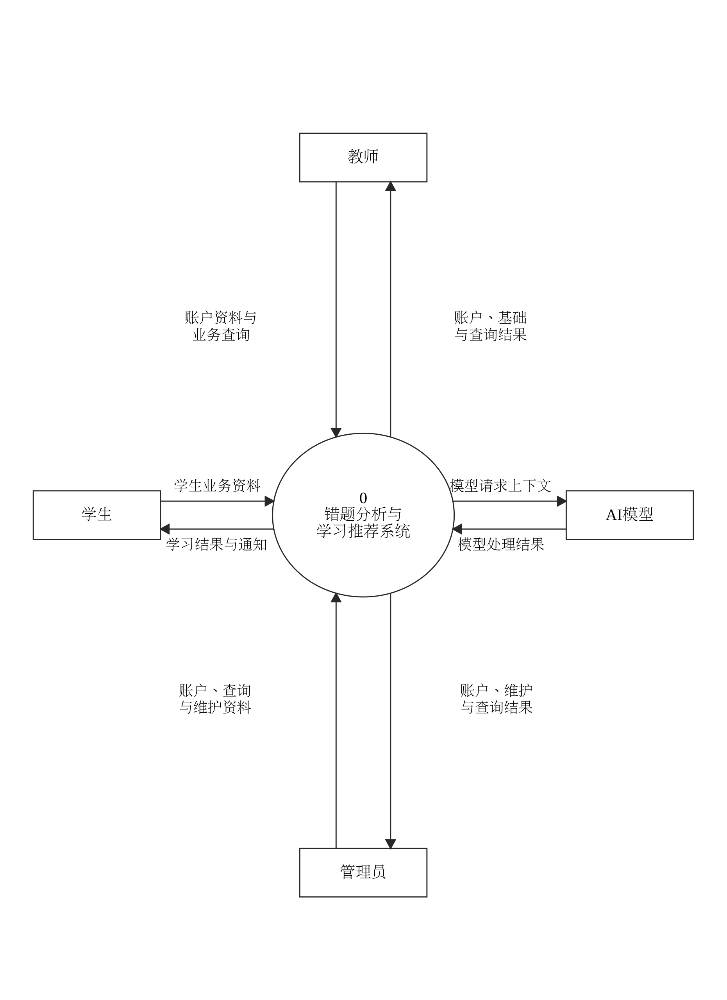

**图 3.5　系统顶层数据流图**

#### 3.6.2 系统0层数据流

0层将平台分解为P1认证与账户管理、P2基础资料维护、P3错题录入与分析、P4学习练习与复习、P5学情与通知处理。为保证打印可读性，同一层分为图3.6与图3.7两幅展示；两图合起来构成完整0层，而不是先后执行的两个流程。相同编号的数据存储表示同一逻辑对象，重复画出只是为了减少长连线。

P1处理身份和账户资料，账户操作受角色及数据归属约束；P2维护科目、知识点和公告；P3接收错题资料及导出查询，使用基础资料和本人题库组织模型分析，保存错题及解析并产生复习计划；P4承担资源查询、生成资源保存、作答记录和复习状态处理；P5按角色范围汇总学习记录，处理消息提醒、已读状态及消息与公告查询。公共实体合并表示共享接口的参与者，不表示三类角色拥有相同的管理权限。

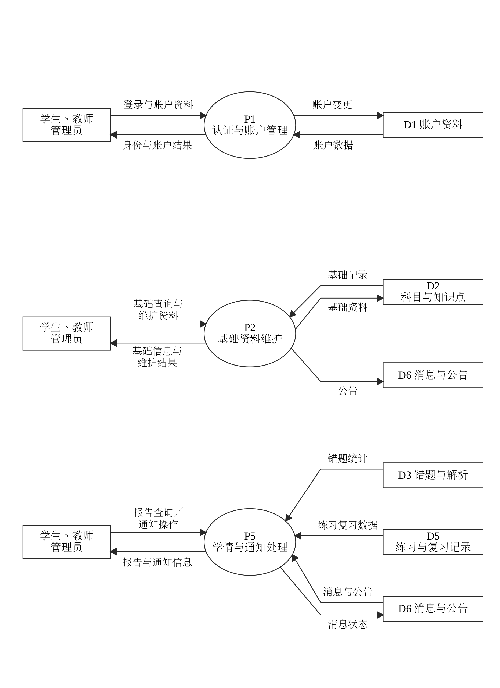

**图 3.6　系统0层数据流图（一）**

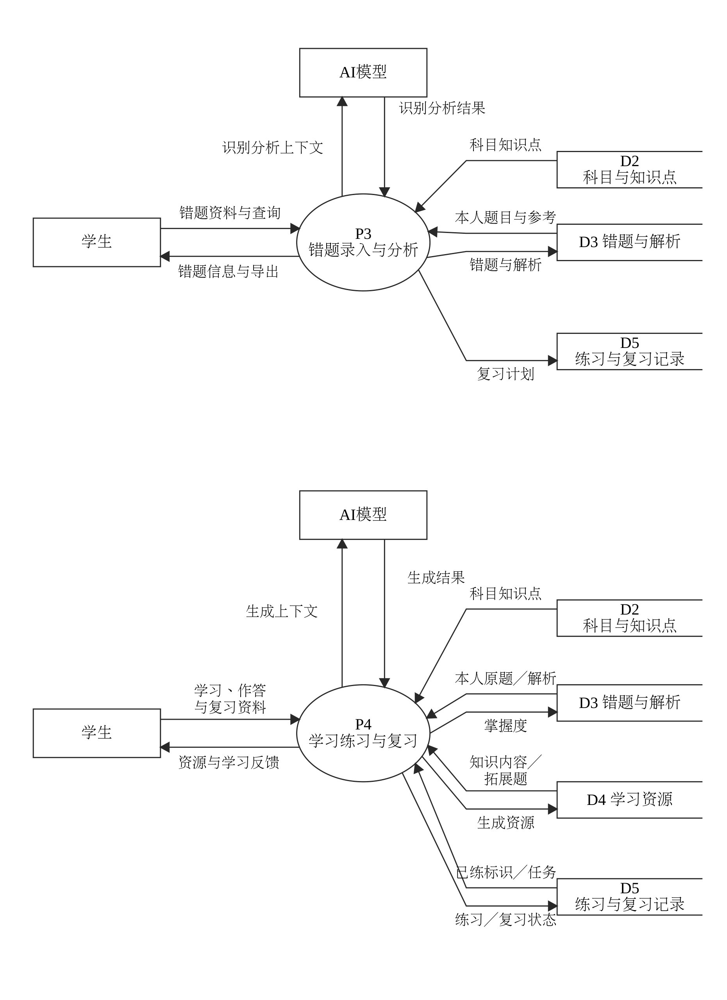

**图 3.7　系统0层数据流图（二）**

#### 3.6.3 学习练习加工的1层数据流

P4是已有资源复用和持续练习要求的集中加工，进一步分为P4.1查询可用资源、P4.2生成与校验入库、P4.3记录作答结果及P4.4更新复习状态。图3.8、图3.9共同展开P4，保持与父加工相同的外部输入、输出和数据存储接口。

P4.1依据学习请求读取科目知识点、本人原题、已有学习资源及已练题目标识，输出可用资源；未满足的资源请求交给P4.2。P4.2整理生成上下文、接收模型结果并完成校验和存储，再返回资源或失败提示。P4.3校验实际作答目标，保存练习记录并更新相应原题状态；P4.4读取所选复习任务，依据用户确认更新完成状态。阅读内容不流入P4.3，作答记录也不自动流入P4.4作为完成确认。

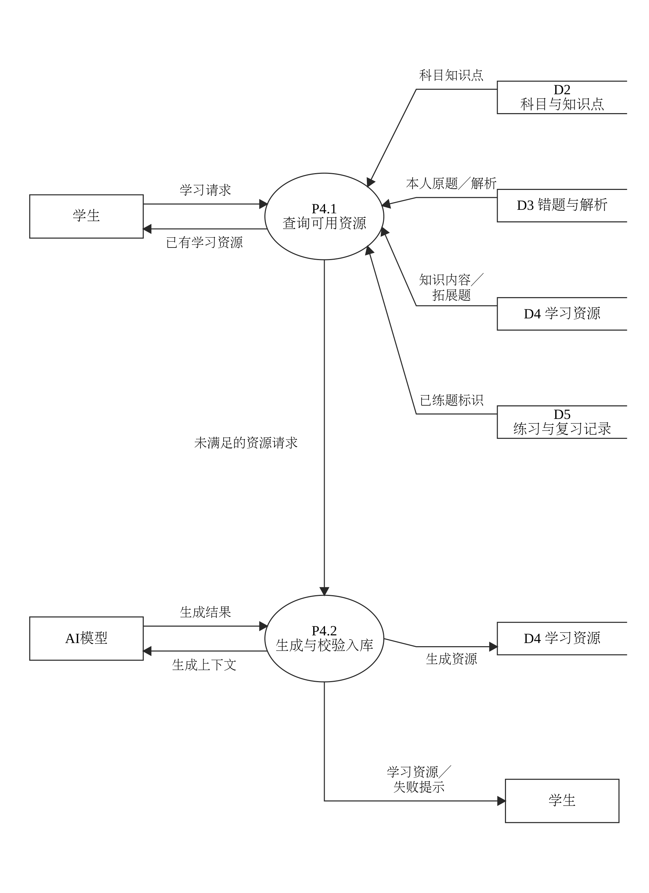

**图 3.8　学习练习加工1层数据流图（一）**

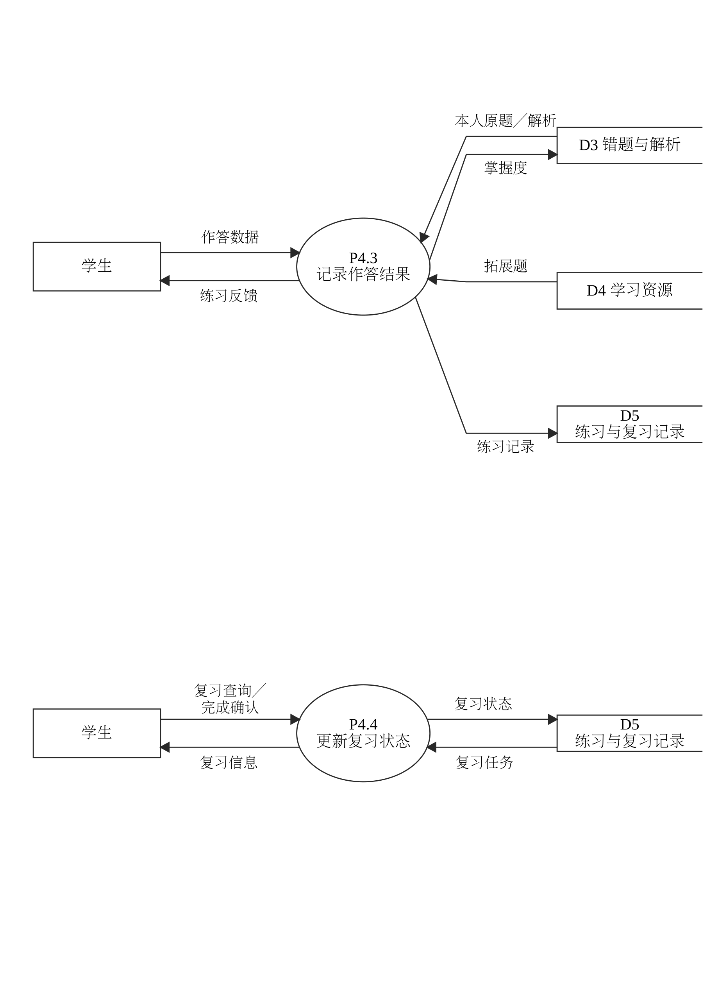

**图 3.9　学习练习加工1层数据流图（二）**

#### 3.6.4 数据字典

数据流分析采用逻辑数据存储，不直接等同于数据库物理表。表3.3说明数据来源与用途，表3.4列出核心流的内容及约束。D4中的变式题与知识内容分别对应variant_question和learning_content，均由平台校验后保存。

**表 3.3　逻辑数据存储说明**

| 编号 | 名称 | 主要内容与来源 | 用途及当前物理对应 |
|---|---|---|---|
| D1 | 账户资料 | 用户标识、账户、角色与状态；来自注册、资料维护及管理员操作 | 身份与权限判断；对应user |
| D2 | 科目与知识点 | 科目及知识点标识、名称和层级；来自管理员维护 | 输入选择、归类及资源查询；对应subject、knowledge_point |
| D3 | 错题与解析 | 归属、题干、答案、知识点、解析、参考标识与状态；来自录入及平台处理 | 本人错题查询、分析和统计；对应question、ai_analysis |
| D4 | 学习资源 | 内容类型、资源标识、内容及原题或知识点关联；来自平台校验后的生成结果 | 对应variant_question、learning_content；由原题限定个人归属 |
| D5 | 练习与复习记录 | 用户及作答目标、自评结果、用时、任务日期和完成状态 | 标识已练题、更新与统计；对应practice_record、review_plan |
| D6 | 消息与公告 | 接收人或发布人、标题、内容及阅读状态；来自业务提醒和管理员发布 | 个人消息与公告查看；对应message、announcement |

**表 3.4　核心数据流字典**

| 数据流 | 来源与去向 | 关键组成 | 约束 |
|---|---|---|---|
| 错题资料 | 学生→P3 | 科目、题干、可选答案、来源和图片 | 题干与归属有效；识别候选不直接当作正式保存结果 |
| 识别分析上下文 | P3→AI模型 | 输入内容、候选知识点、本人参考内容 | 最小必要数据，不含密钥或其他学生私有题目 |
| 识别分析结果 | AI模型→P3 | 候选题目信息或知识归类、错因、解析 | 平台校验后使用；失败保留已有错题 |
| 学习请求 | 学生→P4.1 | 原题或知识点标识、学习或练习类型 | 不把学习请求等同于作答记录 |
| 未满足的资源请求 | P4.1→P4.2 | 目标类型、知识点或原题上下文 | 只有缺少可用资源时形成，不携带擅定批量参数 |
| 生成上下文与结果 | P4.2↔AI模型 | 请求的内容类型、题目上下文；返回的讲解或练习题 | 未通过校验的内容不作为有效资源写入D4 |
| 作答数据 | 学生→P4.3 | 原题或变式目标、自评结果、可选作答及用时 | 目标明确且归属合法；不虚构自动判卷结果 |
| 练习记录 | P4.3→D5 | 用户、题目标识、结果与时间 | 支持后续识别已练题；不代表复习任务自动完成 |
| 完成确认与复习状态 | 学生→P4.4→D5 | 所选任务、本人确认与完成状态 | 只更新本人选定任务，不隐含动态改期 |
| 报告信息 | P5→学生或教师 | 题目、练习、复习及知识点聚合指标 | 学生本人范围、教师系统聚合范围；不推导学习效果 |

### 3.7 非功能性需求分析

（1）安全性。系统应验证登录状态、角色及数据归属，学生只能访问本人错题、图片、练习和复习记录。账号停用后旧会话不能继续访问受保护业务。富文本输入需要过滤危险内容，模型密钥只由服务端管理。验证时应覆盖跨用户访问、角色越权、停用账号与恶意输入，不能仅以隐藏菜单证明权限安全。

（2）可靠性。错题保存不应依赖外部模型成功；模型不可用或输出不合格时，应向用户反馈且保留已存数据。关联写入需要保持一致，异步旧结果不得覆盖修改后的题目。验证时应检查失败输入、并发编辑和事务回滚后的数据库状态，而不是只检查页面提示。

（3）易用性。页面应明确区分输入、等待、成功、空结果与失败，识别失败可转手工录入。知识阅读、练习自评和完成复习的含义应容易辨别，教师报告应明确其数据范围。浏览器走查可检查操作与反馈，本课题通过自动化浏览器检查操作路径，不开展真人体验测试，也不据此给出满意度结论。

（4）性能。普通查询与外部模型等待应分开观察，页面不能把模型等待误表现为错题尚未保存。资源复用应避免有可用资源时重复发起生成。题库规模、查询时延、模型耗时和并发负载需要在明确数据集及环境下测量；本课题尚无可据以确定统一响应时限和容量上限的证据，不在需求中编造数值门槛。

（5）可维护性。界面、接口、业务处理与数据访问应职责清晰；模型地址、凭据及运行开关通过配置管理。错误记录应能定位业务标识和失败类别，同时避免泄露密钥与完整私有内容。需求、数据流、接口和测试应能相互追踪，规则变化后可确定受影响的验证范围。

### 3.8 外部模型能力需求

GLM大模型需支持题目图片候选提取、知识点归类、辅助错因分析、知识讲解及练习题生成等任务。平台还需要向量表示能力，为本人题库中的参考内容检索提供依据。不同任务的输入和返回结构应明确，模型输出需能够由平台解析、校验并关联业务对象；超时、限流、无法识别或结构不合格时应作为失败处理，不以模拟内容伪装真实成功。

生成内容的结构合规与内容正确性需要分别检查。字段齐全不等于解析正确，检索到参考题也不等于模型结论可靠。系统以辅助学习为定位，不承诺自动评分、完整思维诊断或教学效果提升；模型质量结论只能由实际样本、人工核查与测试条件支持。

## 4 相关技术概述

### 4.1 Vue 3与TypeScript

Vue 3以组件组织页面内容，通过响应式状态驱动界面更新。错题列表、详情、复习任务和学情报告具有不同的数据与交互需求，按组件划分后可以分别管理加载、编辑和提交状态。单页应用中的路由负责切换业务页面，公共布局与登录状态不必在每次跳转时重新构建。对于模型调用这类耗时操作，前端可以先呈现已保存的题目，再依据接口结果更新分析状态，使数据保存与内容生成的反馈分开。

TypeScript在JavaScript基础上提供静态类型约束。为请求参数和响应对象定义类型，可以在开发阶段发现字段缺失、类型不匹配等问题，减少前后端契约变化造成的遗漏。但静态类型不会自动验证网络响应，也不能代替服务端权限与数据校验。本系统使用Vue 3和TypeScript组织页面，结合Vue Router、Pinia及Axios管理导航、会话状态和接口访问；Element Plus提供表单、列表与提示组件，ECharts用于展示统计数据。

### 4.2 Spring Boot

Spring Boot通过自动配置和依赖管理简化Spring应用的组织与运行。业务接口可以采用统一的请求映射、参数校验和响应结构，业务规则由服务类处理，数据访问则通过独立的Mapper接口完成。这样的分层使界面交互、业务约束和数据库查询之间的职责较为明确，也便于对关键服务进行单独验证。

事务管理用于保证一组关联写入的完整性。例如，保存错题和创建复习计划需要共同成功；保存练习记录和更新题目状态也需要保持一致。外部模型请求具有延迟和失败的不确定性，不宜简单地把整个远程调用过程纳入长数据库事务。本系统将调用与结果写入分开，并在写回前检查输入是否仍然有效。异步执行只改变任务的运行位置，并不会自动保证数据一致，因此还需要记录状态、异常处理与过期结果防护。

### 4.3 MyBatis-Plus与MySQL

MyBatis-Plus在MyBatis的数据访问能力上提供实体映射、条件构造、分页和逻辑删除等功能。常规查询可以通过带类型的条件构造器表达，统计类查询则仍可编写SQL。框架能够减少重复的数据访问代码，但不会自动推断“只允许查询本人错题”等业务约束；用户范围、科目条件和角色权限仍需在服务和查询中明确限定。

MySQL用于保存账户、错题、解析、练习与复习等具有稳定关联关系的数据。事务、唯一约束和索引分别支撑关联写入、账号唯一性及常用条件查询。本系统采用11张物理表，表间关系由业务层校验，不把逻辑关联描述为已建立的数据库外键。题目向量保存在文本字段中，由应用读取后计算相似度；这种方式适用于当前数据规模，不能据此推断已经具备大规模向量索引能力。

### 4.4 智谱GLM大模型

大语言模型通过上下文生成文本，可以承担题目信息整理、辅助解释和练习内容生成等任务。Transformer的注意力机制为相关模型处理上下文提供了技术基础[15]，教育应用研究则指出，生成能力需要与具体任务和结果核查相结合[9][11]。本课题通过接口调用智谱GLM大模型，不进行基础模型训练，也不把通用模型视为已经具备特定学科的可靠教学判断。

平台需要把题干、可选答案、候选知识点和参考内容组织为明确的任务输入，并约定返回字段。响应到达后，平台检查结构、字段类型、取值范围和业务关联，再决定是否保存和展示。JSON结构合规只能说明结果能够被程序处理，不能证明推理或答案正确；内容质量仍需通过样本核查评价。图片候选提取同样属于辅助输入，无法识别时应保留手工录入路径。

模型接口封装在服务端，客户端只访问业务接口。配置、凭据、超时和错误处理与页面逻辑分离，有利于控制输入范围和记录失败原因。模拟模型用于检查工程路径，真实模型用于检验实际调用和输出，两类结果不能相互替代。与生成任务配套的文本向量服务提供语义表示，向量维度和数值有效性需要单独校验。

### 4.5 检索增强生成

检索增强生成在调用生成模型前查找与当前问题相关的外部内容，并将检索结果加入上下文[20]。在错题场景中，个人题库可以提供相近题目的题干片段，使模型获得当前用户积累的参考内容。检索阶段解决“哪些内容可能相关”，生成阶段解决“如何利用上下文形成回答”，二者的质量需要分别评价。

本系统以题干向量计算余弦相似度。对两个非零向量，内积除以各自模长的乘积得到方向相似程度；实现前提是维度一致且数值有限。查询先限定用户和科目并排除当前题目，再对候选排序，避免把其他用户的私有错题带入模型上下文。检索得到的参考标识用于追溯输入，不构成答案正确性的证明。

RAG与学习资源复用解决的问题不同：前者为本次生成选择参考上下文，后者判断是否已经存在可直接交付的知识内容或练习题。即使解析过程使用了RAG，平台仍需另行设计资源查询、已练标识与耗尽后的生成触发。本系统已经具备个人题库检索和变式题持久化，完整资源复用编排的设计边界在后续章节中说明。

## 5 系统概要设计

### 5.1 系统架构设计

系统采用前后端分离的分层架构，整体划分为表现层、接口层、业务层与数据层四个层次，并嵌入独立的 AI 能力层，如图 5.1 所示。

（1）表现层。前端为基于 Vue 3、Vite 与 Element Plus 构建的单页应用（SPA），负责页面渲染与用户交互，通过 Axios 以 JSON 格式调用后端 REST 接口。

（2）接口层。后端基于 Spring Boot 3 提供 RESTful 接口，统一进行参数校验、身份鉴权（JWT）、权限控制与统一响应封装。

（3）业务层。按用户、科目、知识点、错题、复习计划、练习记录和学情报告等模块组织 Service。模型调用通过 `LlmClient` 接口完成，图片候选提取由独立识别客户端承担；GLM大模型处理识别与生成，平台负责校验、检索编排和数据写入。`RagService` 负责参考题检索，`RecommendService` 组合知识点、难度和向量结果，`ReviewPlanService` 生成固定日期计划。各类规则分别放在对应服务中，避免由 Controller 直接操作 Mapper 或拼装模型请求。

（4）数据层。使用 MyBatis-Plus 访问 MySQL 8。题目语义向量以 JSON 数组形式保存在错题表中，由应用读取候选向量并计算余弦相似度。该设计减少了毕业设计阶段的基础设施数量，但检索开销会随候选题数量增加，不能替代面向大规模数据的向量索引。

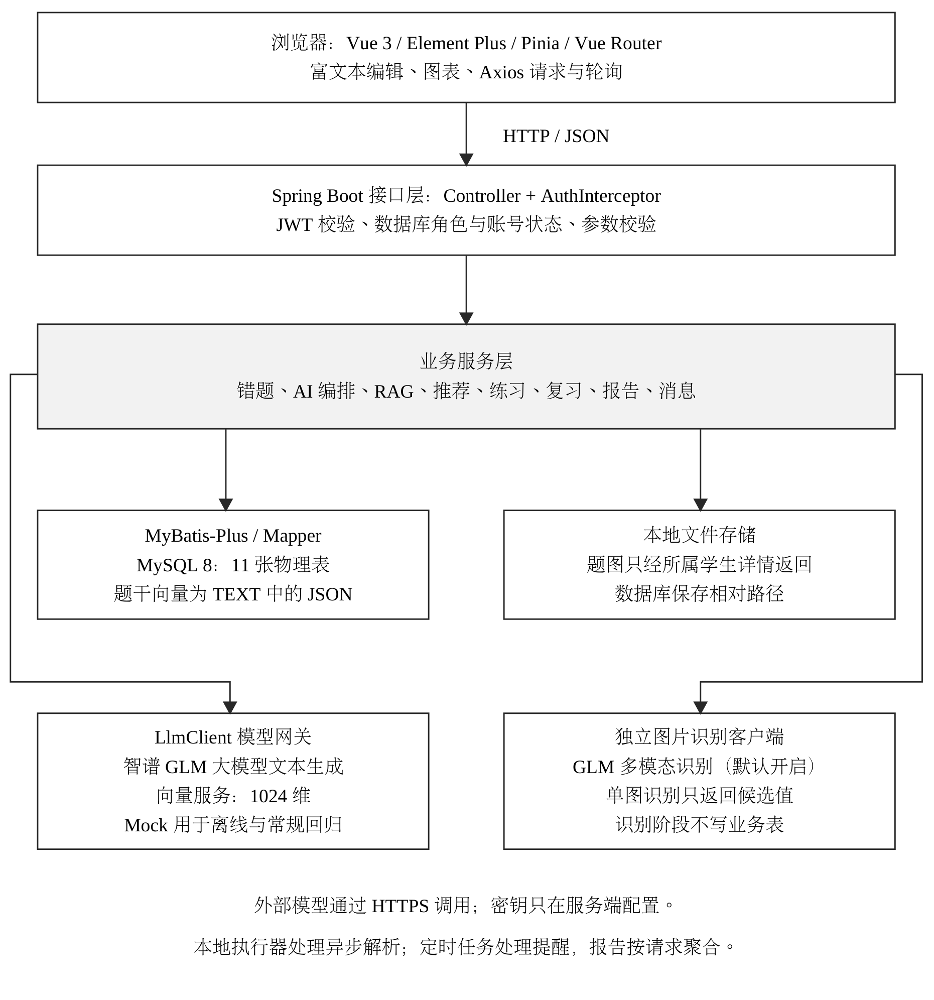

**图 5.1　系统分层架构与外部依赖**

在架构设计上还需说明三点约定：

（1）AI 调用方式。AI 解析采用本地 `Executor` 异步执行：触发接口返回后，后台任务将解析记录状态由生成中更新为成功或失败，前端轮询查询结果。变式题生成接口为同步调用，成功时一次校验并保存 3 道题；两者不可统称为异步任务。

（2）定时任务的引入。每日 08:00 的任务将早于当天且仍待复习的计划标为过期，并为当天待复习计划发送站内消息；每周一 09:00 的任务仅向已有错题的用户发送“周报已更新”提示。学情报告由接口在请求时聚合，不由定时任务生成，也不保存报告快照。

（3）安全设计的落点。密码加密、JWT 鉴权、角色权限控制统一在接口层完成；大模型 API 密钥仅配置在服务端，业务层通过大模型网关间接调用，密钥不进入代码仓库与前端。

### 5.2 功能模块划分

表3.1列出了14项功能需求，当前实现按职责归纳为8组模块。功能需求项与服务分组不要求一一对应，同一服务可以承接录入、查询和导出等相关操作。独立知识内容缓存与持续练习由LearningService编排，并与变式题及练习记录服务协作。

各模块的主要实现职责和边界如表 5.1 所示。

**表 5.1　功能模块与实现职责**

| 功能模块 | 主要服务或接口 | 职责边界 |
|---|---|---|
| 用户与权限 | AuthService、UserService、AuthInterceptor | 注册学生、认证、资料维护、用户停用与角色校验 |
| 基础错题 | QuestionService、SubjectService、KnowledgePointService | 错题、科目和知识点；图片识别仅提供录入候选 |
| AI 辅助解析 | AiAnalysisService、EmbeddingService、LlmClient | 异步任务、向量、结构化校验和归类回填 |
| 练习资源 | RagService、RecommendService、VariantService、LearningService | 个人题库检索、规则优先推荐、知识缓存与未练题优先编排 |
| 复习计划 | ReviewPlanService、ScheduleTask | 固定五阶段计划、完成与过期状态、到期提醒 |
| 练习记录 | PracticeService | 保存用户自评作答并更新原题规则分值 |
| 学情与导出 | ReportService、QuestionService | 请求时聚合报告与 XLSX 导出，无报告快照 |
| 消息与公告 | MessageService、AnnouncementService | 本人站内消息与管理员公告发布，无推送通道 |


上述模块以错题记录为业务主线。基础管理维护账号、科目、知识点和公告；错题相关服务处理录入、解析和练习题生成；学习服务处理复习计划、作答记录、统计和消息。变式练习通过变式题回溯原题，这种关联也用于在删除或编辑错题时处理派生数据。

### 5.3 权限与数据范围设计

系统同时使用角色约束和数据归属约束。角色约束决定是否允许执行某类业务，数据归属决定允许访问哪些记录。学生获得错题接口权限，并不意味着可以根据其他题目编号读取他人数据；教师能够读取聚合学情，也不意味着可以编辑学生题目。权限判断应由服务端执行，前端菜单仅用于提供相应操作入口。主要数据范围如表5.2所示。

**表 5.2　角色与数据访问范围**

| 参与者 | 允许的主要范围 | 设计约束 |
|---|---|---|
| 学生 | 本人账户、错题、练习、复习、报告与消息；公共科目、知识点和公告 | 题目与派生资源通过所属用户校验；图片访问同样受归属限制 |
| 教师 | 本人资料与消息、公共基础资料、系统聚合学情 | 不建立班级关系，不提供学生个人作答明细或题目维护权限 |
| 管理员 | 本人资料与消息、账户状态、科目、知识点及公告维护 | 不取得学生学习接口或教师报告接口权限 |
| AI模型 | 平台为当前任务准备的必要输入 | 不直接读写业务数据库，返回内容经平台校验后使用 |

### 5.4 可靠性与外部调用边界

错题保存与模型解析分开处理，使外部服务不可用时仍可保留用户输入。涉及多张表的本地写入使用事务保持一致，模型生成在数据库写入前完成必要校验；对于并发编辑，结果回写还需匹配原题输入和有效分析记录。模型请求完成、结构校验通过和业务保存成功是不同状态，界面反馈不能将其中任一步替代全部处理完成。

资源查询与生成由平台统一编排。知识内容先按原题和输入快照查库，练习先查询当前学生未练原题及变式题。仅在缺少可用资源时调用GLM大模型，返回内容经校验、事务保存后再展示。缓存与练习状态均以个人数据为边界，不引入共享私人题库或自动批改。

## 6 系统详细设计

### 6.1 数据库概念设计

数据库设计包含 11 张物理表：用户（user）、科目（subject）、知识点（knowledge_point）、错题（question）、AI 解析记录（ai_analysis）、变式题（variant_question）、复习计划（review_plan）、练习记录（practice_record）、消息通知（message）、公告（announcement）与知识内容（learning_content）。实体间主要关系如下：

（1）用户与错题为一对多关系，一名学生可录入多道错题；科目与知识点为一对多关系，一个科目包含多个知识点；知识点为自关联一对多关系，一级章节下包含多个二级考点。

（2）错题与 AI 解析记录为一对零或一关系，未触发解析时可以没有记录，触发后由 question_id 唯一约束保证最多一条记录；错题与变式题为一对多关系，一道原题可生成多道变式题。

（3）用户、错题与复习计划之间：一名用户可拥有多条复习计划，一道错题可对应多个复习阶段的复习计划；用户、错题、变式题与练习记录之间：练习记录同时关联用户与错题（或变式题），用于记录每次作答并支撑掌握度计算。

（4）用户与消息为一对多关系，每条消息对应一个接收用户；公告通过发布人 ID 逻辑关联用户，由管理员发布并供登录用户查看。

系统 E-R 关系拆分为图 6.1、图 6.2 和图 6.3：分别说明错题归属与解析、复习与练习、消息与公告。重复出现的实体表示同一张物理表，三个视图覆盖原有10张表，新增知识内容的归属与关联见图6.9，合计11张物理表。连线按父实体与子记录标注基数，均为逻辑关联，不代表数据库已建立外键。


**图 6.1　错题归属、知识归类与解析关系**


**图 6.2　复习计划与练习记录关系**


**图 6.3　消息与公告关系**

用户实体包含账号、角色与状态等属性，角色区分学生、教师与管理员；`class_name` 仅为预留文本字段，本课题不据此建立班级关系。科目与知识点构成错题归类基础，知识点通过 `parent_id` 形成两级树，不设计知识图谱。错题保存题干、答案、来源、难度、题目级掌握度与语义向量；AI 解析记录保存模型归类结果、错因、解析和参考题 ID；变式题、复习计划和练习记录均通过错题 ID 关联业务主线；消息记录接收用户与已读状态，公告记录发布人及上下线状态。


### 6.2 数据库设计

系统共设计 11 张物理表，各表结构如表 6.1 至表 6.11 所示。主键采用自增 BIGINT；表间不建立数据库外键，由业务层校验所属关系并处理关联数据。用户和错题使用状态字段停用或逻辑删除，AI 解析、变式题、复习计划和图片文件则在错题修改或删除流程中按规则清理。

为提高查询效率，在常用查询字段上建立索引：用户表的用户名字段建立唯一索引；错题表按（用户 ID，科目 ID）建立联合索引，支撑错题本的分页筛选；复习计划表按（用户 ID，计划日期）建立联合索引，支撑每日复习任务的快速检索；练习记录表按（用户 ID，创建时间）建立索引，支撑学情统计的按周聚合。

**表 6.1　用户表（user）**

| 字段名 | 数据类型 | 约束 | 注释 |
|---|---|---|---|
| id | BIGINT | PRIMARY KEY NOT NULL AUTO_INCREMENT | 用户 ID |
| username | VARCHAR(32) | NOT NULL UNIQUE | 登录用户名 |
| password | VARCHAR(128) | NOT NULL | 密码（加密存储） |
| nickname | VARCHAR(32) | DEFAULT NULL | 昵称 |
| role | VARCHAR(16) | NOT NULL DEFAULT 'student' | 角色：student/teacher/admin |
| class_name | VARCHAR(64) | DEFAULT NULL | 预留班级文本，不建立班级业务关系 |
| email | VARCHAR(64) | DEFAULT NULL | 邮箱 |
| status | TINYINT | NOT NULL DEFAULT 1 | 状态：1 正常，0 停用 |
| create_time | DATETIME | NOT NULL DEFAULT CURRENT_TIMESTAMP | 创建时间 |
| update_time | DATETIME | NOT NULL DEFAULT CURRENT_TIMESTAMP ON UPDATE CURRENT_TIMESTAMP | 更新时间 |

索引：`UNIQUE KEY uk_username (username)`。

**表 6.2　科目表（subject）**

| 字段名 | 数据类型 | 约束 | 注释 |
|---|---|---|---|
| id | BIGINT | PRIMARY KEY NOT NULL AUTO_INCREMENT | 科目 ID |
| name | VARCHAR(32) | NOT NULL UNIQUE | 科目名称（如数学、物理） |
| code | VARCHAR(32) | DEFAULT NULL | 科目编码 |
| sort | INT | NOT NULL DEFAULT 0 | 排序号 |
| status | TINYINT | NOT NULL DEFAULT 1 | 状态：1 启用，0 停用 |
| create_time | DATETIME | NOT NULL DEFAULT CURRENT_TIMESTAMP | 创建时间 |

索引：`UNIQUE KEY uk_name (name)`。

**表 6.3　知识点表（knowledge_point）**

| 字段名 | 数据类型 | 约束 | 注释 |
|---|---|---|---|
| id | BIGINT | PRIMARY KEY NOT NULL AUTO_INCREMENT | 知识点 ID |
| subject_id | BIGINT | NOT NULL | 所属科目，逻辑外键 → subject(id) |
| parent_id | BIGINT | NOT NULL DEFAULT 0 | 父级 ID：0 表示一级章节 |
| name | VARCHAR(64) | NOT NULL | 知识点名称 |
| sort | INT | NOT NULL DEFAULT 0 | 排序号 |
| create_time | DATETIME | NOT NULL DEFAULT CURRENT_TIMESTAMP | 创建时间 |

索引：除主键外无其他索引。

**表 6.4　错题表（question）**

| 字段名 | 数据类型 | 约束 | 注释 |
|---|---|---|---|
| id | BIGINT | PRIMARY KEY NOT NULL AUTO_INCREMENT | 错题 ID |
| user_id | BIGINT | NOT NULL | 所属学生，逻辑外键 → user(id) |
| subject_id | BIGINT | NOT NULL | 所属科目，逻辑外键 → subject(id) |
| knowledge_point_id | BIGINT | DEFAULT NULL | 知识点（AI 归类后回填），逻辑外键 → knowledge_point(id) |
| stem | TEXT | NOT NULL | 题干 |
| answer | TEXT | DEFAULT NULL | 答案 |
| source | VARCHAR(128) | DEFAULT NULL | 题目来源（如作业、试卷） |
| image_url | VARCHAR(255) | DEFAULT NULL | 题目图片地址 |
| difficulty | TINYINT | DEFAULT NULL | 难度（1-5，AI 评估） |
| mastery | INT | NOT NULL DEFAULT 0 | 掌握度（0-100） |
| embedding | TEXT | DEFAULT NULL | 题干语义向量（JSON 数组） |
| status | TINYINT | NOT NULL DEFAULT 1 | 状态：1 正常，0 删除 |
| create_time | DATETIME | NOT NULL DEFAULT CURRENT_TIMESTAMP | 创建时间 |
| update_time | DATETIME | NOT NULL DEFAULT CURRENT_TIMESTAMP ON UPDATE CURRENT_TIMESTAMP | 更新时间 |

索引：`KEY idx_user_subject (user_id, subject_id)`。

**表 6.5　AI 解析记录表（ai_analysis）**

| 字段名 | 数据类型 | 约束 | 注释 |
|---|---|---|---|
| id | BIGINT | PRIMARY KEY NOT NULL AUTO_INCREMENT | 解析记录 ID |
| question_id | BIGINT | NOT NULL UNIQUE | 对应错题，逻辑外键 → question(id) |
| knowledge_point_id | BIGINT | DEFAULT NULL | AI 归类知识点，逻辑外键 → knowledge_point(id) |
| error_cause | TEXT | DEFAULT NULL | 错因分析 |
| analysis | TEXT | DEFAULT NULL | 解析内容 |
| reference_ids | VARCHAR(255) | DEFAULT NULL | 参考的本地题目 ID（JSON） |
| llm_model | VARCHAR(64) | DEFAULT NULL | 所用大模型标识 |
| status | TINYINT | NOT NULL DEFAULT 0 | 状态：0 生成中，1 成功，2 失败 |
| create_time | DATETIME | NOT NULL DEFAULT CURRENT_TIMESTAMP | 创建时间 |

索引：`UNIQUE KEY uk_question (question_id)`。

**表 6.6　变式题表（variant_question）**

| 字段名 | 数据类型 | 约束 | 注释 |
|---|---|---|---|
| id | BIGINT | PRIMARY KEY NOT NULL AUTO_INCREMENT | 变式题 ID |
| question_id | BIGINT | NOT NULL | 原题 ID，逻辑外键 → question(id) |
| stem | TEXT | NOT NULL | 变式题题干 |
| answer | TEXT | DEFAULT NULL | 变式题答案 |
| difficulty | TINYINT | DEFAULT NULL | 难度（1-5） |
| create_time | DATETIME | NOT NULL DEFAULT CURRENT_TIMESTAMP | 创建时间 |

索引：除主键外无其他索引。

**表 6.7　复习计划表（review_plan）**

| 字段名 | 数据类型 | 约束 | 注释 |
|---|---|---|---|
| id | BIGINT | PRIMARY KEY NOT NULL AUTO_INCREMENT | 复习计划 ID |
| user_id | BIGINT | NOT NULL | 所属学生，逻辑外键 → user(id) |
| question_id | BIGINT | NOT NULL | 待复习错题，逻辑外键 → question(id) |
| review_stage | TINYINT | NOT NULL DEFAULT 1 | 复习阶段（第 1-5 次） |
| plan_date | DATE | NOT NULL | 计划复习日期 |
| status | TINYINT | NOT NULL DEFAULT 0 | 状态：0 待复习，1 已完成，2 已过期 |
| finish_time | DATETIME | DEFAULT NULL | 完成时间 |
| create_time | DATETIME | NOT NULL DEFAULT CURRENT_TIMESTAMP | 创建时间 |

索引：`KEY idx_user_date (user_id, plan_date)`。

**表 6.8　练习记录表（practice_record）**

| 字段名 | 数据类型 | 约束 | 注释 |
|---|---|---|---|
| id | BIGINT | PRIMARY KEY NOT NULL AUTO_INCREMENT | 练习记录 ID |
| user_id | BIGINT | NOT NULL | 作答学生，逻辑外键 → user(id) |
| question_id | BIGINT | DEFAULT NULL | 重做的错题，逻辑外键 → question(id) |
| variant_id | BIGINT | DEFAULT NULL | 作答的变式题，逻辑外键 → variant_question(id) |
| user_answer | TEXT | DEFAULT NULL | 学生作答内容 |
| is_correct | TINYINT | DEFAULT NULL | 是否正确：1 正确，0 错误 |
| duration | INT | DEFAULT NULL | 作答用时（秒） |
| create_time | DATETIME | NOT NULL DEFAULT CURRENT_TIMESTAMP | 创建时间 |

索引：`KEY idx_user_time (user_id, create_time)`。

**表 6.9　消息通知表（message）**

| 字段名 | 数据类型 | 约束 | 注释 |
|---|---|---|---|
| id | BIGINT | PRIMARY KEY NOT NULL AUTO_INCREMENT | 消息 ID |
| user_id | BIGINT | NOT NULL | 接收用户，逻辑外键 → user(id) |
| type | VARCHAR(32) | NOT NULL DEFAULT 'system' | 消息类型：review_remind 复习提醒/report 报告/system 系统 |
| title | VARCHAR(128) | NOT NULL | 消息标题 |
| content | VARCHAR(512) | DEFAULT NULL | 消息内容 |
| is_read | TINYINT | NOT NULL DEFAULT 0 | 是否已读：1 已读，0 未读 |
| create_time | DATETIME | NOT NULL DEFAULT CURRENT_TIMESTAMP | 创建时间 |

索引：`KEY idx_user_time (user_id, create_time)`。

**表 6.10　公告表（announcement）**

| 字段名 | 数据类型 | 约束 | 注释 |
|---|---|---|---|
| id | BIGINT | PRIMARY KEY NOT NULL AUTO_INCREMENT | 公告 ID |
| title | VARCHAR(128) | NOT NULL | 公告标题 |
| content | TEXT | DEFAULT NULL | 公告内容 |
| publisher_id | BIGINT | DEFAULT NULL | 发布人，逻辑外键 → user(id) |
| status | TINYINT | NOT NULL DEFAULT 1 | 状态：1 正常，0 下线 |
| create_time | DATETIME | NOT NULL DEFAULT CURRENT_TIMESTAMP | 创建时间 |

索引：除主键外无其他索引。

**（11）知识内容表**

知识内容按原题保存一份当前有效结果。question_id唯一索引限制重复缓存；input_hash保存题干、答案、科目、知识点及其名称的输入摘要。题目核心内容变化后清理旧缓存，生成期间输入变化则拒绝写回。仅修改来源不使缓存失效。

**表 6.11　知识内容表（learning_content）**

| 字段 | 类型 | 约束 | 说明 |
|---|---|---|---|
| id | BIGINT | 主键，自增 | 内容标识 |
| user_id | BIGINT | NOT NULL，索引 | 所属学生 |
| question_id | BIGINT | NOT NULL，唯一索引 | 关联原题 |
| knowledge_point_id | BIGINT | 可空 | 关联知识点 |
| input_hash | CHAR(64) | NOT NULL | 输入快照摘要 |
| content | TEXT | NOT NULL | 校验后的知识讲解 |
| create_time | DATETIME | 默认当前时间 | 创建时间 |
| update_time | DATETIME | 自动更新时间 | 最近更新时间 |

### 6.3 接口设计

前后端通过 REST 接口交互，普通响应封装为 `{code, message, data}`，文件导出接口返回 XLSX 数据。系统设计 39 个控制器方法映射，其中注册、登录与健康检查 3 个接口公开，其余 36 个需要认证。JWT 通过后仍需从数据库读取用户状态和角色，停用账号不能继续使用旧令牌。学生业务查询以当前用户 ID 为数据边界。AI 解析采用“触发 + 轮询”，变式题生成采用同步请求。知识学习与继续练习为同步请求，接口如表 6.12 所示。

**表 6.12　系统接口一览**

| 模块 | 方法 | 路径 | 说明 |
|---|---|---|---|
| 用户管理 | POST | /api/auth/register | 用户注册；权限：公开 |
| 用户管理 | POST | /api/auth/login | 用户登录（返回 JWT）；权限：公开 |
| 系统状态 | GET | /api/health | 健康检查；权限：公开 |
| 用户管理 | GET | /api/user/profile | 查询个人信息；权限：登录用户 |
| 用户管理 | PUT | /api/user/profile | 修改个人信息；权限：登录用户 |
| 用户管理 | GET | /api/user/page | 用户分页查询（管理员）；权限：管理员 |
| 用户管理 | DELETE | /api/user/{id} | 停用用户（管理员，逻辑状态变更）；权限：管理员 |
| 科目管理 | GET | /api/subject/list | 科目列表；权限：登录用户 |
| 科目管理 | POST | /api/subject | 新增科目（管理员）；权限：管理员 |
| 科目管理 | PUT | /api/subject/{id} | 修改科目（管理员）；权限：管理员 |
| 知识点管理 | GET | /api/knowledge-point/tree | 知识点树（按科目）；权限：登录用户 |
| 知识点管理 | POST | /api/knowledge-point | 新增知识点（管理员）；权限：管理员 |
| 知识点管理 | DELETE | /api/knowledge-point/{id} | 删除知识点（管理员）；权限：管理员 |
| 错题录入管理 | POST | /api/question | 录入错题；权限：学生 |
| 错题录入管理 | POST | /api/question-recognition/recognize | 单图题目识别并返回表单候选值；权限：学生 |
| 错题录入管理 | GET | /api/question/page | 错题分页筛选（科目/知识点）；权限：学生 |
| 错题录入管理 | GET | /api/question/{id} | 错题详情；权限：学生 |
| 错题录入管理 | PUT | /api/question/{id} | 修改错题；权限：学生 |
| 错题录入管理 | DELETE | /api/question/{id} | 删除错题；权限：学生 |
| AI 解析管理 | POST | /api/ai/analyze/{questionId} | 触发 AI 解析（异步）；权限：学生 |
| AI 解析管理 | GET | /api/ai/analysis/{questionId} | 查询解析结果；权限：学生 |
| 相似题推荐管理 | GET | /api/recommend/similar | 相似题推荐（questionId 参数）；权限：学生 |
| 变式题管理 | POST | /api/variant/generate/{questionId} | 生成变式题；权限：学生 |
| 变式题管理 | GET | /api/variant/list | 变式题列表（questionId 参数）；权限：学生 |
| 复习计划管理 | GET | /api/review-plan/today | 到期及逾期未完成任务；权限：学生 |
| 复习计划管理 | PUT | /api/review-plan/{id}/finish | 完成复习任务；权限：学生 |
| 练习记录管理 | POST | /api/practice | 提交练习作答；权限：学生 |
| 练习记录管理 | GET | /api/practice/page | 练习记录分页；权限：学生 |
| 学情报告管理 | GET | /api/report/weekly | 查询学情周报；权限：学生、教师 |
| 学情报告管理 | POST | /api/report/generate | 聚合当前周报并发送一条站内消息；权限：学生、教师 |
| 错题本导出管理 | GET | /api/question/export | 导出错题本（筛选参数）；权限：学生 |
| 消息通知管理 | GET | /api/message/page | 消息分页查询；权限：登录用户 |
| 消息通知管理 | GET | /api/message/unread-count | 查询未读消息数；权限：登录用户 |
| 消息通知管理 | PUT | /api/message/{id}/read | 标记消息已读；权限：登录用户 |
| 公告管理 | GET | /api/announcement/list | 公告列表；权限：登录用户 |
| 公告管理 | POST | /api/announcement | 发布公告（管理员）；权限：管理员 |
| 学习资源 | POST | /api/learning/knowledge/{questionId} | 学生；复用知识内容或生成校验后保存 |
| 学习资源 | POST | /api/learning/practice/next/{questionId} | 学生；取得未练题或耗尽后生成 |
| 学习资源 | GET | /api/learning/practice/progress/{questionId} | 学生；查询原题与变式的实际已练状态 |

### 6.4 类设计

系统后端采用 Controller—Service—Mapper 分层设计：Controller 层负责接收请求、参数校验与响应封装；Service 层承载业务逻辑；Mapper 层为 MyBatis-Plus 数据访问接口；实体层包含与 11 张物理表对应的实体类（User、Subject、KnowledgePoint、Question、AiAnalysis、VariantQuestion、ReviewPlan、PracticeRecord、Message、Announcement、LearningContent）。

核心业务类设计如下：

（1）QuestionService：负责错题的增删改查、分页筛选、XLSX 导出、所属用户校验与图片生命周期管理。创建错题时在同一事务中生成 5 条复习计划；AI 解析由前端在创建成功后通过独立接口触发。

（2）AiAnalysisService：使用本地执行器异步编排错题解析，调用 EmbeddingService 计算 1024 维题干向量，调用 RagService 在同用户、同科目候选中做余弦检索，再将题干、可选订正答案、候选叶子知识点与参考题题干片段组装为提示词，经 LlmClient 请求模型，校验结构化结果后写入 ai_analysis 并回填知识点与难度。系统没有独立持久化的 `studentAnswer`、草稿步骤或完整作答轨迹，因而输出属于基于现有上下文的辅助性错因分析，不能表述为对学生完整思维过程的精准诊断。`reference_ids` 只记录参与 RAG 的本地参考题 ID，提供有限的参考来源留痕。输入快照和记录状态校验用于阻止过期任务回写。

（3）LlmClient：大模型网关，封装 API 地址、密钥、模型参数与响应解析，提供文本生成与 Embedding 两类接口，屏蔽模型提供方差异。

（4）RagService：检索增强服务，在同一用户、同一科目、排除源题且向量非空的候选题中计算余弦相似度并排序；该服务不对知识点作硬过滤。

（5）VariantService：负责同步变式题生成，以原题上下文调用 LlmClient，严格校验 3 道结果后短事务保存，并通过输入快照避免并发编辑后的旧结果落库。

（6）ReviewPlanService：复习计划服务，在错题创建时按第 1、2、4、7、15 天生成 5 个固定阶段。计划不会依据个人作答自适应改期；完成接口将指定计划标为已完成。

（7）PracticeService：练习记录服务，保存作答记录并更新掌握度：答对掌握度加 15（上限 100），答错减 20（下限 0），掌握度变化同步写入 question 表。

（8）ReportService：学情报告服务，在请求时聚合错题总量、本周新增、当前平均掌握度、本周复习总数与完成数、知识点平均掌握度、薄弱知识点以及按日新增错题和练习次数。`generate` 接口复用同一聚合结果并额外发送一条站内消息，不生成报告 ID 或持久化快照。

（9）ScheduleTask：定时任务类，每日 08:00 标记早于当天的未完成计划为过期，并为当天待复习计划发送站内消息；每周一 09:00 仅向已有错题的用户发送周报查看提示，不调用 ReportService。

（10）MessageService：站内消息服务，负责 AI 分析完成、复习提醒、周报查看提示等消息的生成、分页查询、未读计数与已读状态维护，不包含 WebSocket、短信或邮件通知。

图 6.4 仅展开模型网关的核心类关系，以说明业务编排与模型实现的依赖边界；其中解析服务经 EmbeddingService 接口使用图中的向量服务实现，图中省略该接口。实体字段已由表 6.1 至表 6.11 给出，不在类图中重复列出。

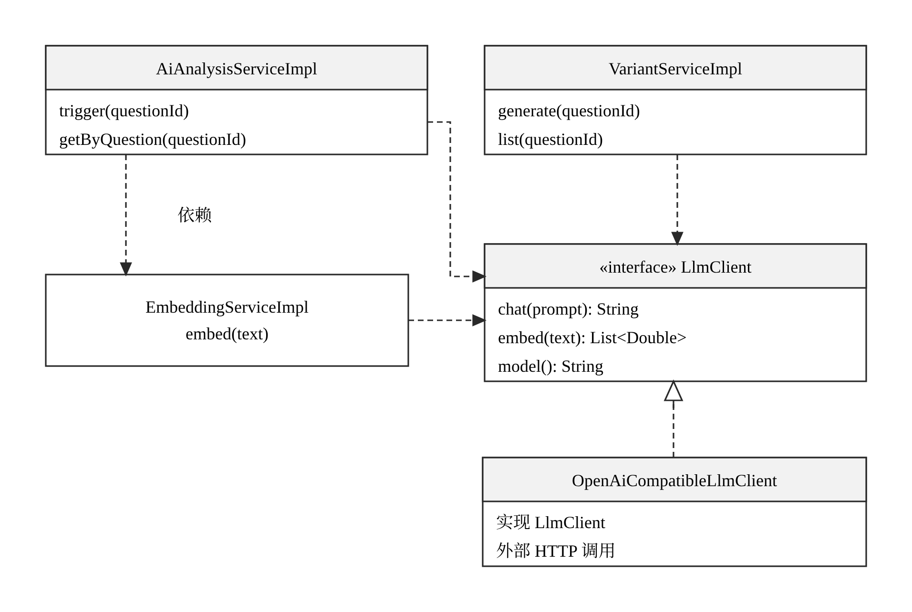

**图 6.4　模型网关的核心类关系**

### 6.5 数据访问层设计

数据访问层基于 MyBatis-Plus 实现。每张表对应一个实体类与一个 Mapper 接口，Mapper 继承 `BaseMapper<T>` 后直接获得通用 CRUD 能力，避免编写基础 SQL；复杂查询使用条件构造器完成。以错题分页筛选为例：

```java
public interface QuestionMapper extends BaseMapper<Question> {
}

LambdaQueryWrapper<Question> wrapper = new LambdaQueryWrapper<>();
wrapper.eq(Question::getUserId, UserContext.getUserId())
       .eq(subjectId != null, Question::getSubjectId, subjectId)
       .eq(knowledgePointId != null,
           Question::getKnowledgePointId, knowledgePointId)
       .orderByDesc(Question::getCreateTime);
return questionMapper.selectPage(new Page<>(pageNum, pageSize), wrapper);
```

`Question.status` 标注为 MyBatis-Plus 的逻辑删除字段，因此分页查询会自动排除状态为 0 的记录，不需要在每个条件构造器中重复添加状态条件。

对于学情统计类需求（如按知识点分组统计掌握度），在 Mapper XML 中编写自定义 SQL，使用 `GROUP BY` 聚合完成；涉及多表写操作的业务（如错题删除时级联清理解析、变式题与复习计划）通过 Service 层 `@Transactional` 声明式事务保证一致性。

### 6.6 界面设计

前端按角色组织导航。学生端包含首页、错题录入、错题本、错题详情、练习历史、复习计划、学情报告与消息中心；教师端提供系统聚合学情报告、消息、公告和个人资料页面，不设计班级或学生明细页面；管理员端提供用户、科目、知识点与公告管理。界面采用侧边导航、顶部栏和内容区的统一布局。AI 解析区分生成中、成功和失败状态，变式题同步生成期间显示加载状态；掌握度和复习状态分别用进度条和标签表示。

（1）错题录入页。表单包含科目、题干、答案、来源与图片。题干采用富文本编辑器，支持新增、编辑以及文字格式、段落、换行、列表和上下标；旧纯文本题目仍能读取和编辑。图片识题默认开启，只接受单张不超过 5 MB 的 JPG/JPEG/PNG/WebP 图片，通过 GLM大模型返回科目名称、题干、学生作答和来源候选值，并匹配已有科目。科目、题干和来源可作为表单候选值，`studentAnswer` 只在前端临时展示，不写入 `Question.answer`，也不作为正式解析提示词的独立输入。用户必须人工确认后提交，识别过程不自动保存、拆题、整卷识别或判分，图片也不作为 RAG 输入。保存成功后前端另行触发 AI 解析。

（2）错题本页。左侧为科目—知识点两级树形筛选，右侧为错题卡片列表，卡片展示题干、科目与知识点标签、难度、来源、录入时间和掌握度进度条，点击卡片进入错题详情页。

（3）错题详情页。分区展示题干与答案、AI 解析、参考题、相似题与变式题，提供生成变式题和进入练习的操作。上传图片存于本地文件系统并以 UUID 命名，数据库仅保存路径；系统不提供匿名静态访问，所属学生查询详情时由后端以内联 Data URI 返回图片。

（4）复习计划页。`/today` 接口返回计划日期为当天或更早且仍未完成的任务，学生可将任务标记为完成并进入对应题目练习。页面定位为到期与逾期任务列表，不设计未来日历，也不提供从详情页临时加入“今日复习”的操作。

（5）学情报告页。使用 ECharts 展示最近一周每日新增错题柱状图与每日练习次数折线图，并以指标卡、进度和列表展示当前错题量、平均掌握度、复习完成情况及薄弱知识点。报告只展示请求时的聚合结果，不设计雷达图、掌握度历史趋势或历史报告页面。

上述界面结构对应第7.3节的真实实现截图。录入、模型解析、参考题、变式题、学生报告和教师数据范围分别见图 7.1 至图 7.6，不重复绘制与实现截图内容相同的原型图。

---

### 6.7 核心流程与状态设计

AI 解析中的检索和校验过程如图 6.5 所示。参考题筛选不要求同一知识点；候选知识点则来自当前科目中 parent_id 非 0 的记录，在系统两级树约定下作为二级考点使用。参考题最多取 3 条，提示词只使用各题题干前 50 个字符及必要的省略标识。没有参考题时仍可请求模型，但结果需要经过相同的结构校验。


**图 6.5　AI 解析中的 RAG 与结构校验**

保存错题与异步解析的交互如图 6.6 所示。错题和五阶段计划先在同一事务中保存，前端取得 ID 后才另行触发解析。图中后台任务与轮询可以并发进行，不把图示纵向排列理解为页面必须等待后台计算完成才开始轮询。短事务回写还要匹配输入快照和生成中记录；过期结果不能覆盖当前输入。


**图 6.6　错题保存与异步解析时序**

练习提交如图 6.7 所示。用户提交结果自评，服务验证原题和变式题目标二选一及其归属，再于同一事务中保存记录并原子更新原题分值。变式题需要通过 question_id 回溯原题；同一练习记录不会同时填写两个目标。


**图 6.7　练习提交与掌握度更新时序**

复习状态如图 6.8 所示。过期表示计划日期已过且尚未完成，用户仍可完成该计划。完成复习与保存一次练习记录是两个独立接口：前者更新计划状态和完成时间，后者更新作答记录与掌握度，两者不自动联动。定时任务不改变原计划日期，也不依据掌握度生成新的间隔。

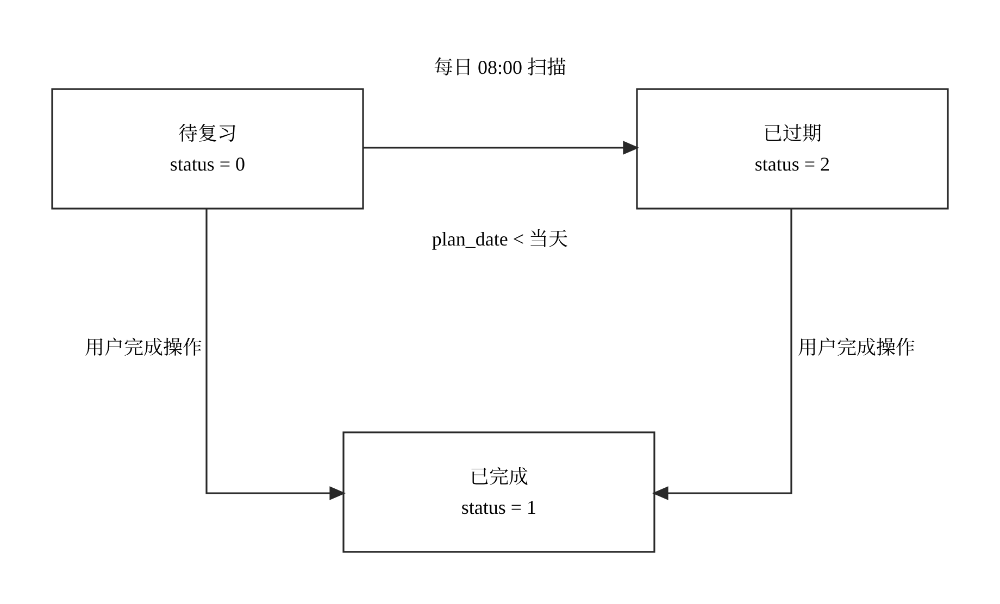

**图 6.8　复习计划状态转换**

### 6.8 资源复用与持续练习的设计约束

资源编排沿用原有错题、变式题、练习记录与权限边界，补充知识内容表和三个学习接口。原题与知识内容的关联见图6.9，具体约束如表6.13所示。


**图 6.9　知识内容与个人资源关联**

**表 6.13　个人资源复用与持续练习设计**

| 业务 | 数据与处理 | 边界 |
|---|---|---|
| 查询知识内容 | 原题及输入摘要匹配learning_content，命中直接返回 | 仅本人资源；缺少模型配置仍可读有效缓存 |
| 取得未练题 | 先本人未练原题，再按ID顺序查关联未练变式 | 只有实际提交practice_record才记已练；答错也计已练 |
| 耗尽后生成 | 调用模型，校验结构、长度与批内及历史题干重复，短事务保存 | 失败不产生半批题目，不删除历史可重做题 |
| 并发与编辑 | 单实例按原题分段锁，写回时锁原题并复查快照和可用资源 | 多实例可能重复调用，但写入前再次判断；不承诺分布式单次调用 |
| 继续与重做 | 继续时重新查询；显式重做保存新的练习记录 | 不把获取或阅读当成已练；作答不自动完成复习任务 |

默认规则暂定，待导师最终确认。资源隔离和事务一致性是实现约束；每次生成3道题沿用现有接口合同，不据此推断导师要求固定练习次数。知识内容的结构校验并不保证讲解正确，题干去重也不等同语义去重。

## 7 系统开发与实现

### 7.1 开发与运行环境

后端使用 JDK 21 和 Spring Boot 3.5.16，依赖由 Maven Wrapper 3.9.16 管理。数据访问层采用 MyBatis-Plus 3.5.17，数据库为 MySQL 8；JWT 组件版本为 0.12.6，XLSX 导出使用 EasyExcel 4.0.3。前端基于 Vue 3.5、Element Plus 2.14、Pinia、Vue Router、Axios 和 ECharts 开发，构建工具为 Vite 8.2.0。项目约定的前端运行环境为 Node.js 22.23.1，浏览器测试使用 Playwright 1.62.1。

开发环境和测试环境使用不同的数据库配置。后端测试配置只读取专用测试库连接信息，模型提供方固定为 Mock，图片识别默认关闭；缺少测试数据库密码时应用直接启动失败，不回退到开发数据库。非公网部署测试又使用独立的 `wrongbook_deploy_test` 数据库和独立上传目录，后端、前端预览服务均只监听 `127.0.0.1`。这样处理是为了避免自动化测试改写日常开发数据，也防止测试账号和固定凭据进入可访问的网络环境。

### 7.2 后端核心功能实现

#### 7.2.1 用户认证与数据隔离

注册接口只创建学生账号，密码由 BCrypt 加密后写入 `user` 表。登录成功后，后端把用户 ID 和角色写入 JWT。请求到达业务 Controller 前，拦截器除校验令牌签名和有效期外，还根据用户 ID 查询数据库中的账号状态和当前角色。管理员停用账号后，旧令牌无法继续使用；角色变化也以数据库记录为准，不继续信任令牌中的旧角色。

学生业务接口在 Controller 层限制角色，在 Service 和查询条件中继续校验数据归属。错题分页、详情、导出、AI 解析、RAG、相似题、变式题、复习计划和练习记录均以当前登录用户或原题所属用户为边界。RAG 和推荐实现同时保留查询条件与结果级 ownership guard，避免管理员代查或补足候选时混入其他学生的题目。

#### 7.2.2 错题录入、编辑与删除

`QuestionServiceImpl.create` 在一个事务内保存错题并调用 `ReviewPlanService` 建立 5 条复习计划。AI 解析不在该事务中启动，而是在前端取得错题 ID 后调用 `/api/ai/analyze/{questionId}`。这样可以使错题保存与外部模型调用分离，模型暂时不可用时，题干和复习计划仍然存在。

图片录入包含两个不同步骤。图像识别接口接收一张不超过 5 MB 的 JPG、JPEG、PNG 或 WebP 图片，调用智谱GLM大模型返回科目名称、题干、学生作答和来源候选值，但不写业务表。用户确认表单后，图片才由错题创建接口保存到本地上传目录，文件名改为 UUID，数据库只记录相对路径。匿名静态访问被关闭，所属学生查询错题详情时，后端读取图片并以内联 Data URI 返回。识别结果中的 `studentAnswer` 只在前端临时显示，不写入 `Question.answer`，也不作为 AI 解析的独立输入。

错题编辑需要处理派生数据失效问题。科目、题干或答案发生变化时，原有 Embedding、知识点、难度、AI 解析和变式题都可能对应旧输入，因此服务在同一事务中清空这些字段并删除相关记录；只修改来源时不执行失效处理。异步解析任务在写回前再次比较题目的科目、题干和答案，并检查解析记录仍处于生成中。比较失败时放弃写回，防止用户编辑后被旧任务覆盖。删除错题时，解析、变式题、复习计划和图片文件一并清理，`question` 行改为逻辑删除；既有练习记录保留为历史记录，不再出现在活动错题查询中。

题干富文本使用 Tiptap 的 Vue 3 组件，新增和编辑共用 `QuestionEditor`，详情、列表和练习使用 `QuestionContent` 安全展示。浏览器以 DOMPurify 过滤，服务端再以 Jsoup 白名单去掉脚本、事件、样式、外链和内嵌图像，只保留段落、换行、加粗、斜体、下划线、删除线、列表及上下标。空格式内容不能代替题干，题干纯文本上限为 2000 字，原始格式内容另设大小限制。

数据库沿用 `question.stem` 的 TEXT 字段，不新增表或列，也不批量改写旧数据。已有纯文本在展示时转义并保留换行，重新编辑后可保存安全富文本。`QuestionContent.plainText` 为模型提示词、Embedding、RAG 参考片段、复习摘要和 Excel 导出提供统一文本：去除格式标签，保留段落边界，上下标分别表示为 `^(内容)`、`_(内容)`。题目内容改变后仍执行原有 AI 派生数据失效机制，已有练习记录与复习计划保留。

#### 7.2.3 AI 解析与 RAG

模型调用封装在 `LlmClient` 接口中。`MockLlmClient` 用于离线开发和多数回归测试，`OpenAiCompatibleLlmClient` 用于智谱接口。正常运行默认调用智谱GLM大模型，配套向量服务输出1024维表示；离线开发和自动化测试显式使用 Mock，不将模拟结果作为真实模型输出。API 地址、模型名和密钥从服务端配置读取，密钥不返回前端，也不写入仓库。

触发解析时，系统先检查模型调用配置是否就绪，再创建或重置一条状态为0的 `ai_analysis` 记录，再把任务提交给本地 `Executor`。后台任务计算题干向量，从 `question` 表中选取同一用户、同一科目、排除原题且向量非空的候选，在内存中计算余弦相似度并取前 3 条。提示词由题干、可选答案、当前科目的叶子知识点候选和参考题题干片段组成。模型必须返回且只返回 `knowledgePointId`、`errorCause`、`analysis` 和 `difficulty` 四个字段。

模型响应不能直接落库。服务检查根节点是否为 JSON 对象、字段数量是否为 4、知识点 ID 是否属于候选集合、难度是否为 1～5 的整数，并确认错因和解析是包含中文字符的非空文本。校验和输入快照都通过后，系统在短事务中写入 1024 维向量、知识点、难度和解析结果，并发送解析完成消息；任务运行中出现异常时，在分析记录标识、题目标识和生成中状态仍匹配的条件下写入失败状态，保留原错题。若调用配置在任务启动前就不满足要求，则直接返回错误，不保证产生新的分析记录。`reference_ids` 记录本次实际使用的本地参考题 ID，但这些题只能作为生成上下文和复核线索，不能证明模型结论正确。

真实接口联调初期出现过返回字段不符合约定、难度不是整数、HTTP 429 和读取时间较长等情况。处理方式包括收紧 JSON Schema 说明、在服务端逐字段校验、为连接失败和部分限流设置有限重试，并把读取超时与其他 4xx 保持为显式失败。错误日志只记录题目 ID、HTTP 状态和异常类型，不打印 Authorization、完整响应或向量。

#### 7.2.4 相似题、变式题与练习记录

相似题服务采用两段式策略。若原题已经归类知识点，系统先从同一用户、同一知识点的题目中按难度差的绝对值升序选择；不足 5 条时，再用同一用户、同一科目的 RAG 结果补足，按题目 ID 去重后最多返回 5 条。该实现不读取掌握度、练习记录或复习计划，因此“个性化”主要体现在候选题属于当前学生的题库，而不是基于学习状态训练的推荐模型。

变式题接口先返回本人已有未练题，全部耗尽时再同步生成。模型输出的根对象只能包含 `variants` 数组，数组必须恰好有 3 项，每项包含非空题干、非空答案和 1～5 的整数难度。3 项全部通过校验后，服务在事务内锁定原题并比较用户、科目、知识点、题干和答案快照，再一次性写入数据库。任何一项不合格或原题已经变化时，本次结果整体不保存。

练习接口要求 `questionId` 和 `variantId` 二选一。服务先校验目标属于当前学生，再保存 `practice_record`。答对时使用 SQL 原子表达式把原题 `mastery` 增加 15，答错时减少 20，结果限制在 0～100。该数值用于页面展示和周报聚合，不作为相似题排序输入，也不表示学生掌握某知识点的概率。

#### 7.2.5 复习计划、报告与消息

错题录入日记为第 0 天，`ReviewPlanService` 按第 1、2、4、7、15 天生成 5 个阶段。完成接口把指定计划改为已完成并记录完成时间。每日 08:00 的任务将早于当天且仍未完成的计划标记为过期，并按用户汇总当天待复习数量后发送站内消息。日期不会因作答结果自动后移或重新计算。

`ReportController` 只允许学生和教师访问。`ReportService` 在收到请求时查询错题、复习计划和练习记录，计算错题总量、本周新增、当前平均掌握度、本周复习总数与完成数、各知识点平均掌握度、薄弱知识点以及一周内每日新增题数和练习次数。学生查询只聚合本人数据，教师查询不加用户过滤，得到系统范围的汇总结果。`/api/report/generate` 复用同一聚合逻辑并额外发送一条消息，不创建报告 ID 或历史快照。每周一 09:00 的定时任务只提醒有错题的用户查看周报，不预先生成报告。

#### 7.2.6 个人学习资源与持续练习

LearningService负责资源编排，LearningResourceAccess统一检查学生角色和原题归属。知识学习先读取learning_content并比较输入摘要；命中时直接返回，不检查外部模型是否可调用。未命中时向GLM大模型请求知识讲解，平台检查返回结构、非空中文内容与长度，再在短事务中复查原题快照并保存。题目核心内容修改或删除时同步清理关联缓存，修改来源不影响内容复用。

继续练习以当前学生practice_record为依据。原题没有实际作答记录时优先提供原题；否则查询关联变式，选取没有本学生练习记录的第一题。全部耗尽后，变式服务才生成新一批题，过滤规范化题干重复并检查输入快照；任意一题不合格则整批回滚。已有未练变式可在模型不可用时继续使用。新题生成失败时保留原题与历史变式，页面提示重试或主动重做。

前端“学习与练习”页签区分阅读和作答。进入页面不自动请求生成；用户主动获取知识或开始练习。作答后提交结果自评，成功保存才显示完成，并允许继续或显式重新练习本题。页面切换原题或修改输入后忽略旧请求的迟到结果，避免错误展示上一题资源。此流程没有自动批改，也不把记录答错解释为尚未练习。

### 7.3 前端实现

前端代码按 `views`、`api`、`router`、`store`、`layout` 和通用组件组织。Axios 请求拦截器统一附加 JWT，响应拦截器处理业务错误和 401；出现失效令牌时，应用清理会话并跳转登录页。路由守卫在进入受限页面前调用个人信息接口确认会话，学生、教师和管理员分别看到与角色匹配的导航。管理员路径在前端隐藏并不构成安全边界，实际权限仍由后端检查。

学生端包含今日工作台、错题录入、错题本、错题详情、练习历史、复习计划、学情报告、消息、公告和个人中心。错题详情页按需加载解析、参考题、相似题和变式题；相似题标签只有在用户打开时才请求接口，并分别显示加载失败、空结果和重试状态。教师端显示系统聚合报告、消息、公告和个人资料。管理员端提供用户、科目、两级知识点和公告维护。学情报告用柱状图显示每日新增错题，用折线图显示每日练习次数，没有雷达图和掌握度历史曲线。

下列截图均来自同一批真实 GLM 浏览器证据，按图 7.1 至图 7.6 的顺序展示录入、解析、RAG 参考、变式题、学生统计与教师权限边界。为满足 A4 正文宽度，图版只选取注明的原始局部，不修改像素中的数值或文字；完整原图与裁切坐标见图表目录。

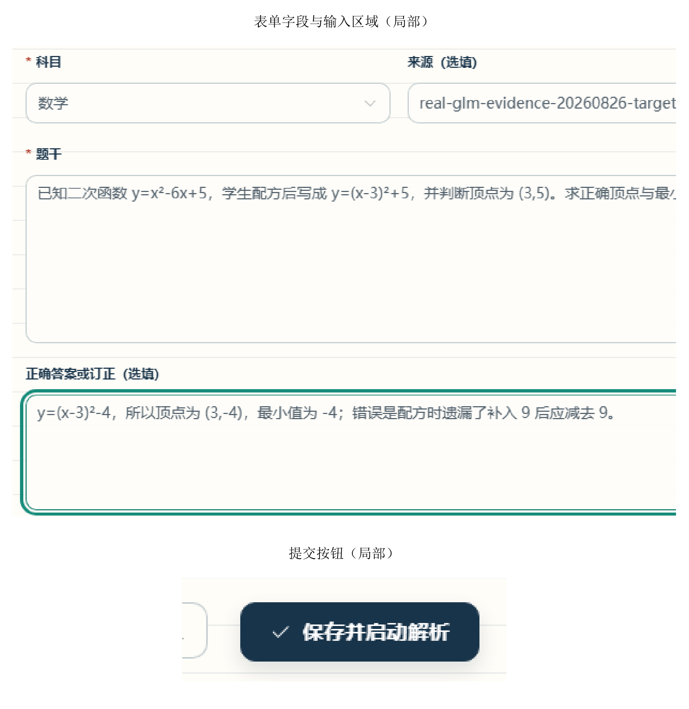

**图 7.1　错题录入表单局部**

资料来源：2026-08-26 真实浏览器验证截图。图 7.1展示文本表单的局部输入和提交入口。截图取自 2026 年 8 月 26 日真实浏览器验证，不能作为后续新增图片识别功能的界面证据；题干全文保留在原图中。


**图 7.2　真实 GLM 解析界面局部**

资料来源：2026-08-26 真实浏览器验证截图。图 7.2可见已完成状态、实际模型标识、知识点归类与掌握度。它证明一次真实链路的页面状态，不代表所有解析内容均正确。

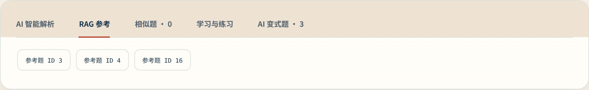

**图 7.3　RAG 参考题标识局部**

资料来源：2026-08-26 真实浏览器验证截图。图 7.3显示实际参考题 ID 223。页面未返回参考正文或相似度分数；同用户向量检索的检查依据为真实浏览器验证及数据库核验记录。


**图 7.4　变式题数量与作答入口局部**

资料来源：2026-08-26 真实浏览器验证截图。图 7.4选取已生成数量、第一题作答入口和第三题标识三个局部。三题完整内容保留在原始截图；3/3 持久化结果由验证记录中的数据库回读支持。

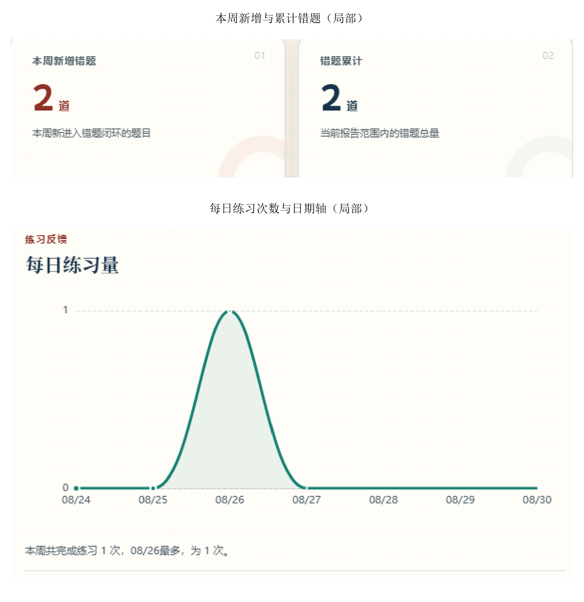

**图 7.5　学生报告的统计与练习反馈局部**

资料来源：2026-08-26 真实浏览器验证截图。图 7.5选取错题统计与每日练习次数区域，记录当时 2 道错题和 1 次练习。日期轴表示一周内的练习次数，不表示掌握度历史变化或学习效果。

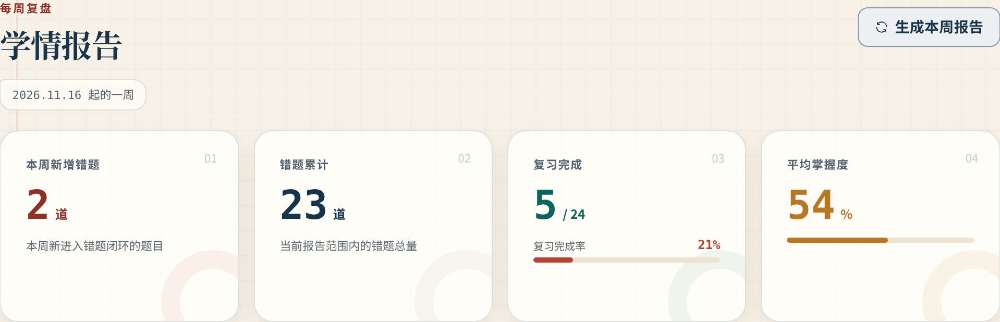

**图 7.6　教师聚合报告的数据范围局部**

资料来源：2026-08-26 真实浏览器验证截图。图 7.6显示教师报告的系统聚合范围提示，未包含账号昵称区域。教师数据范围也由服务端权限测试与报告查询代码共同核验。

图 7.7 至图 7.9 为富文本与图片候选回填的界面验证截图，使用合成单题图片和固定 Mock 接口响应；截图顶部保留验证标记，不能作为真实 GLM 识别准确率或新模型联网成功的证据。原有图 7.1 至图 7.6 的历史真实截图及原始像素保持不变。

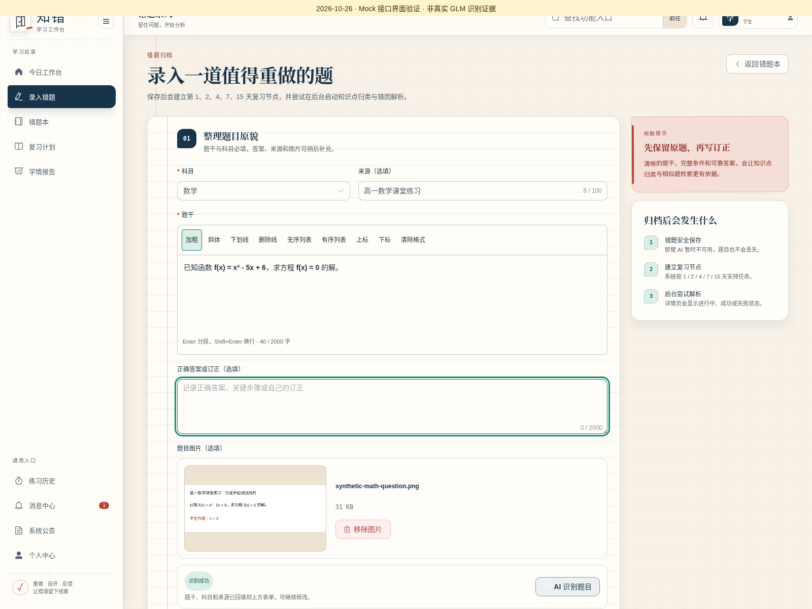

**图 7.7　富文本题干与候选回填界面**

图 7.7记录历史验证中的题干格式工具和候选回填内容。当前页面已移除格式工具栏，保留题干编辑及安全回显；此图用于说明候选回填关系，不代表最新界面的工具栏配置。

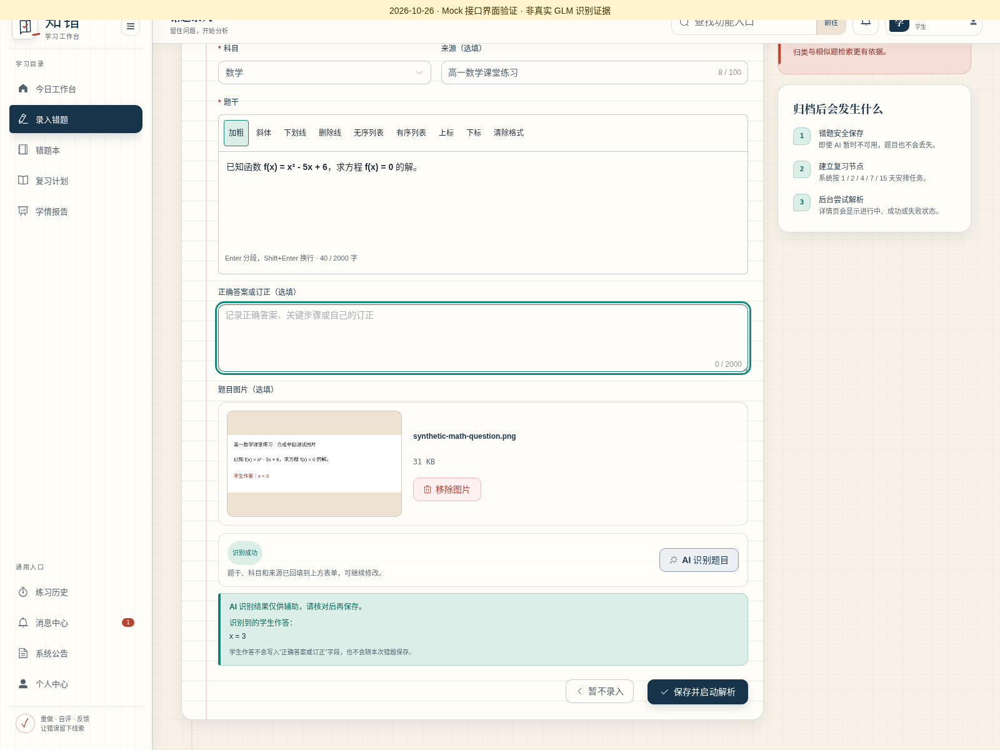

**图 7.8　图片候选确认与保存入口**

图 7.8 展示合成题图、识别状态、临时学生作答与保存入口。学生作答单独展示，不自动写入正确答案字段；识别完成前没有创建错题。

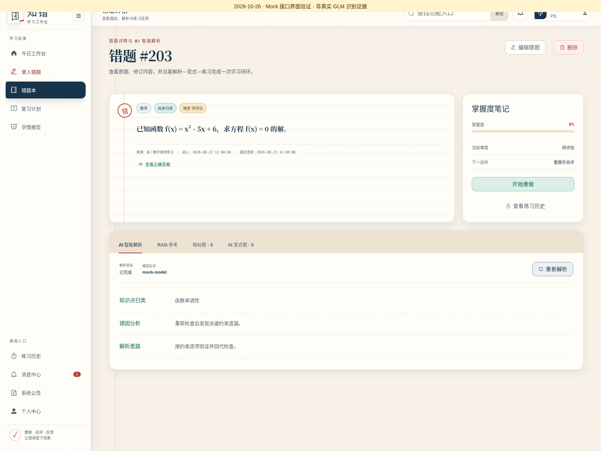

**图 7.9　富文本题干保存后回显**

图 7.9 展示保存后的题干格式及 Mock 分析标识。该截图用于验证界面回显，不用于证明模型推理质量。

### 7.4 开发过程中的问题处理

模型接入后较早暴露的问题是结构化输出不稳定。早期 5 个分析样本中，模型虽然返回了可解析 JSON，但字段结构全部未达到服务约定；变式题也出现过难度字段不是 1～5 整数的情况。仅在提示词中要求 JSON 仍不足以保证可写入数据库，因此实现中增加了精确字段集合、候选知识点、文本语言、数组长度和数值范围校验。无效响应保持失败状态，不用局部字段拼成成功结果。

另一类问题来自异步任务与用户编辑并发。解析期间修改题干会使已经发出的请求失去时效，如果任务仍按题目 ID 回写，旧分析会覆盖新题目。系统把科目、题干和答案作为输入快照，在最终事务中使用条件更新；变式题则锁定原题后比较完整输入。测试覆盖了题干、科目、答案变化以及解析记录被替换的情况，过期任务均不写回。

历史数据库中的 3 条有效错题向量为早期 Mock 使用的 8 维数组，无法与正式向量服务的1024维向量混合计算。为此增加默认关闭的维护入口，对每题重新请求向量，检查长度、空值、NaN 和 Infinity，再以题干二进制快照作为条件写回。单题失败不会回滚已完成题目。实际维护结果为 3/3 重建成功，重建后 3 条向量均为合法有限的 1024 维数组。

权限审计还发现，相似题和 RAG 的候选范围不能只依靠入口处的题目归属检查。查询条件随后增加原题所属 `userId`，结果阶段再执行一次 ownership guard。停用账号旧 JWT、教师访问学生写接口、私有题图匿名访问以及练习目标同时填写或同时为空等边界也在同一阶段收紧，并增加对应回归测试。

## 8 系统测试

### 8.1 测试范围与数据隔离

测试分为离线自动化、隔离数据库联调、真实模型链路和受控小样本实验。多数后端测试使用 Mock 模型和专用 MySQL schema，前端单元测试与浏览器冒烟测试使用固定接口响应。真实 GLM、真实图片识别、Embedding 重建和 Gate5 实验均由显式开关启动，默认测试不会访问外部模型。各类测试使用不同账号和数据集，不能把它们合并为同一次实验。

真实浏览器证据使用独立学生账号，完成错题录入、GLM大模型解析、RAG 参考题查看、3 道变式题展示与数据库回读，以及一次正确练习。该次练习使原题掌握度从 0 变为 15。新题的第 1 个复习节点尚未到期，因此当日复习列表为 0，这与固定日期规则一致，没有通过修改计划日期制造待办数据。

### 8.2 功能与自动化测试结果

不同批次的测试结果如表 8.1 所示；各批次数据和模型开关不同，不合并计算总通过率。

**表 8.1　主要测试结果与证据批次**

| 测试项目 | 数据或环境范围 | 结果 | 证据批次 |
|---|---|---|---|
| 后端完整回归 | 独立 MySQL 回归库，Mock AI | 共 73 项：69 通过、4 跳过、0 失败、0 错误 | V1：2026-09-07 |
| 前端完整验证 | Node.js 22.23.1；Vitest、类型检查与构建 | 23/23 通过；类型与构建通过；保留大包警告 | V2：2026-09-07 |
| 浏览器冒烟 | Mock 接口，四档视口 | 44/44 通过 | V2：2026-09-07 |
| 隔离数据库联调 | 真实后端、专用 MySQL、Mock AI | 4/4 通过 | V3：2026-09-07 |
| 真实 GLM 固定链路 | Chat、Embedding、RAG、结构化分析与变式题 | 最终同一轮分析 5/5；变式题生成并回读 3/3 | V4：2026-08-25 |
| 历史向量重建 | 3 条有效历史错题 | 3/3 重建为合法有限 1024 维向量 | V5：2026-08-26 |
| 真实浏览器业务 | 独立证据学生，真实 GLM | 参考题命中；3 道变式题；一次练习后 mastery 为 15 | V6：2026-08-26 |
| 图片识别工程样本 | 8 张合成 PNG/JPG | 首轮 7/8；失败样本立即重试成功 | V7：识别专项记录 |

资料来源：[V1 非公网部署验证](../validation/deploy-test-validation.md)、[V2 前端验证基线](../validation/user-experience-test-plan.md)、[V3 隔离联调](../validation/isolated-functional-validation.md)、[V4 真实 GLM](../validation/live-glm-validation.md)、[V5 向量重建](../validation/embedding-rebuild.md)、[V6 真实浏览器](../validation/real-ai-e2e.md)、[V7 图片识别](../validation/image-question-recognition.md)。V2 只使用其中已经完成的技术验证，仅保留历史技术验证，真人体验测试已取消，不计为通过或待办。

后端“4 项跳过”分别对应需要真实网络或维护数据的测试入口，属于默认关闭项，不是测试失败。非公网部署测试还检查了重启后的 JWT、数据库记录和上传图片，验证后端与前端预览只监听本机地址；未配置部署必填环境变量时，应用以启动失败结束，没有回退到开发配置。上述结果说明所列功能在当前环境和数据范围内可运行，但没有覆盖公网部署、并发压力和长期运行稳定性。

关键业务边界的输入、预期和已有核验结果如表 8.2 所示。这些是从现有测试及验证记录提取的代表性用例，并非本轮新增执行的业务测试。

**表 8.2　关键业务与异常边界验证**

| 编号与输入条件 | 预期行为 | 已有结果与依据 |
|---|---|---|
| F01 教师请求学生创建错题接口 | 服务端拒绝 | V3 教师权限用例通过 |
| F02 请求其他学生题目或候选 | 拒绝详情；候选不跨用户 | RAG、Recommend 隔离测试；V1 回归通过 |
| F03 建立复习计划时抛出异常 | 错题创建一并回滚 | 核心业务集成测试；V1 通过 |
| F04 解析期间修改题干 | 派生记录失效；旧任务不能回写 | 解析失效集成测试；V1 通过 |
| F05 questionId 与 variantId 同时提交 | 拒绝且不生成作答记录 | 核心业务集成测试；V1 通过 |
| F06 掌握度写入失败；重复练习 | 记录回滚；分值有界原子更新 | 核心业务集成测试；V1 通过 |
| F07 模型返回不合格字段或难度 | 校验失败且不作为成功结果保存 | V4 保留初始失败与最终修正结果 |
| F08 未登录读取题图 | 无匿名静态入口；只返回所属学生鉴权详情 | V3 私有题图用例通过 |
| F09 新录入题目首节点未到期 | 今日待办可以为 0 | V6 真实空状态与计划数据一致 |
| F10 未提供部署必填配置 | 启动失败，不回退开发配置 | V1 退出码 1；已记录 |

资料来源：表 8.1 对应验证批次。核心业务集成测试对应后端 `FinalDeliveryCoreIntegrationTests`，解析失效集成测试对应 `QuestionAiInvalidationIntegrationTests`；隔离测试对应 `RagServiceImplDataIsolationTests`、`RecommendServiceImplDataIsolationTests`，另参照前端真实后端联调用例。

### 8.3 Gate5 小样本实验

Gate5 使用 27 道人工设计的合成错题，包含数学 12 题、物理 9 题、英语 6 题，覆盖 9 个叶子知识点，每个知识点 3 题。27 条向量均由向量服务生成并通过 1024 维有限数检查，27 次正式分析最终全部得到结构合规结果。知识点 Exact Match 为 26/27，即 96.30%；唯一不一致样本把“摩擦力”归入了“牛顿第二定律”。该比例只描述固定集合，不作为模型总体准确率。

错因关键概念覆盖率的自动代理均值为 94.14%，中位数为 100%，其中 22/27 达到全覆盖。人工复核采用 0、1、2 三级评分，0 表示明显错误或与题意矛盾，1 表示部分合理但错因或解释不完整，2 表示错因判断基本正确且解释清楚。27 题总分为 46/54，平均 1.7037；20 题得 2 分、6 题得 1 分、1 题得 0 分。0 分样本虽然把英语句子改成了正确过去式，却错误地把主语 `I` 解释为第三人称单数。该例表明，结构校验和关键词覆盖不能替代内容正确性审查。

RAG 检索得到 Hit@3=0.962963、Recall@3=0.870370、MRR@3=0.864198；混合相似题推荐在该集合上得到 Hit@5=1.000000、Recall@5=1.000000。固定 6 题的 RAG ON/OFF 比较中，两组概念覆盖均为 88.89%，结构合规均为 6/6。人工盲评完成后解盲，RAG ON 获得 2/6 次偏好，RAG OFF 获得 4/6 次偏好。这个结果没有显示加入检索上下文在该 6 题集合中带来一致优势，因此论文不使用“RAG 显著提高解析质量”之类的结论。

实验运行期间保留了 34 次失败尝试，其中包含接口限流和结构校验失败。最终成功数据没有覆盖这些记录。受控集合提供了较完整的错误答案和正确答案，而正式页面没有独立持久化的学生作答字段，两者输入分布并不相同；实验也未测量学习成绩变化、长期保持率或教师评价。

各类指标的样本、数值和适用范围汇总如表 8.3 所示。自动指标来源于 2026 年 8 月 27 日固定实验结果，人工评价来源于 2026 年 9 月 7 日填写的原始 CSV；保留原自动摘要的历史状态，成稿以原始人工记录为准。

**表 8.3　Gate5 固定小样本指标及解释边界**

| 指标 | 样本与结果 | 解释边界 |
|---|---|---|
| 知识点 Exact Match | 27 题；26/27，96.30% | 固定标签一致率，不是总体准确率 |
| 错因概念覆盖代理 | 27 题；均值 94.14%；22/27 全覆盖 | 字符串与概念覆盖，不等同内容正确 |
| RAG 检索 | 27 题；Hit@3 0.962963；Recall@3 0.870370；MRR@3 0.864198 | 人工相关组定义下的检索结果 |
| 混合相似题推荐 | 27 题；Hit@5、Recall@5 均为 1.000000 | 规则优先加向量补足，不是纯向量模型 |
| 人工错因评分 | 27 题；46/54；均分 1.7037；2/1/0 分分别 20/6/1 题 | 本次用户复核，不宣称多专家一致性 |
| RAG ON/OFF 自动比较 | 固定 6 题；覆盖均为 88.89%；结构均 6/6 | 没有观察到概念覆盖增益 |
| RAG ON/OFF 人工偏好 | 固定 6 题；ON 2/6，OFF 4/6 | 不支持该集合中一致质量优势；无显著性检验 |
| 失败历史 | 34 次尝试：HTTP 429 为 14 次、解析状态 2 为 15 次、结构校验为 5 次 | 失败尝试不是 34 道独立错题，也不当作超时 |

资料来源：[固定实验结果](../experiments/gate5/results/experiment-results.json)、[自动摘要](../experiments/gate5/results/summary.md)、[错因人工原表](../experiments/gate5/manual/error-cause-review.csv)、[A/B 人工原表](../experiments/gate5/manual/rag-ab-review.csv)和[既有解盲键](../experiments/gate5/results/rag-ab-key.json)。人工统计本轮从 CSV 重新计算，未改动评分或模型输出。

### 8.4 富文本与图片录入补充验证

2026 年 10 月 26 日在独立工作树、专用 MySQL 8.4 容器和本机监听地址下执行本轮验证。此前表 8.1 中各项数据仍按原验证日期保留，不将历史结果计入本轮。后端测试共 84 项，80 项通过，4 个真实联网或维护入口按默认开关跳过；覆盖题干白名单过滤、空内容与长度校验、纯文本兼容、保存和再次编辑、复习摘要、Excel 单元格内容、Embedding 与变式提示词纯文本化，以及原有隔离和事务边界。

前端类型检查、29 项单元测试、生产构建和 46 项浏览器冒烟测试全部通过，真实后端配合 Mock AI 的三角色浏览器联调 4 项通过。浏览器验证覆盖题干格式保存、详情与练习展示、再次编辑、历史恶意标签过滤、图片候选回填、识别失败后的手工保存及三角色页面。浏览器旧测试初次因普通输入框定位与富文本工具栏名称相近而失败，修正为明确的文本框角色和精确按钮名称后复查。完整命令、各轮结果及修复记录见[本轮验证记录](../validation/advisor-20261026/README.md)。

另对真实配置但未提供密钥的后端执行接口检查，确认手工保存可用，解析、图片识题和变式生成均明确提示缺少密钥，已存错题保留且不返回 Mock 结果。隔离 Mock 链路实际完成解析、3 道变式题、学生自评练习及周报，正确练习后掌握度为 15，再提交错误自评后按下限约束回到 0。复习计划保持独立，练习不会自动完成复习任务。

本轮环境未配置真实模型密钥，因此没有执行新的真实 GLM 文本分析或图片识别联网测试。默认配置、请求参数和离线结构测试通过，不等于真实模型服务可用或识别结果正确；真实能力仍需在提供密钥后单独验证。历史真实实验保留原始配置、数据和验证记录，供复核时查阅，不改写为本轮实验结论。

### 8.5 个人资源复用与持续练习验证

2026年11月12日在隔离MySQL 8.4数据库中执行资源复用回归。后端共106项测试，102项通过，4个需要显式联网或维护开关的入口跳过。新增22项集成测试覆盖知识内容保存与缓存命中、原题及未练变式优先、整批耗尽后生成、答错也计已练、显式重做、其他学生记录不影响本人、教师和管理员拒绝、异常结构拒绝、生成失败回退、重复题整批回滚、编辑失效与并发请求。变式题原有10项测试同时通过。

前端53项界面冒烟中52项首轮通过，1项因临时磁盘空间不足未能写入截图；清理本轮工具缓存后该项重跑通过。为保护历史截图，另1项会覆盖历史图像的证据生成用例未执行。前端33项单元测试通过，包含学习资源组件的迟到响应丢弃、作答目标二选一、保存失败不显示成功及主动重做；TypeScript检查和生产构建通过，仍存在主入口包体积警告。真实Spring Boot、MySQL与浏览器之间的4项原有联调通过，新增1项联调实际完成知识生成后复用、原题作答、首批3题耗尽后累计6题及重做。后端模型为显式Mock，不能据此证明GLM讲解正确或评价真实模型响应速度；本轮未配置真实模型密钥，不复写历史联网结果。

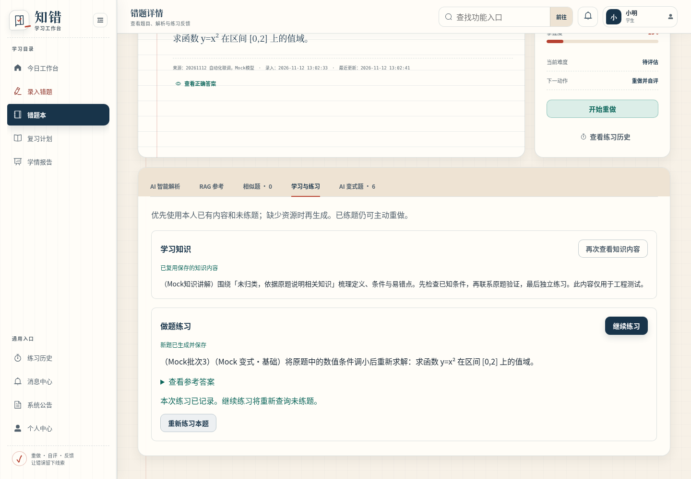

**图 8.1　资源复用与持续练习联调界面（Mock模型）**

资料来源：2026年11月12日隔离后端浏览器联调；页面和数据库为实际运行，模型内容为测试替身，不作为真实模型效果证据。

### 8.6 测试结果分析

自动化和真实链路测试覆盖了账号认证、学生数据隔离、错题生命周期、模型输出校验、复习计划、练习分值、请求时报告、图片访问和三角色页面。测试中发现的问题主要集中在外部模型响应不稳定、异步写回竞态、旧向量维度和权限边界，而不是通过修改测试预期规避。对应修复均有定向测试或验证记录。

现有证据仍有明确限制。应用在内存中遍历候选向量，没有万级题库压力数据；模型受控实验样本较少，RAG ON/OFF 人工偏好也只有 6 题；本课题不开展真人体验测试，不能报告用户满意度；教师端缺少班级和学生关系；前端生产构建仍有主入口包体积警告；非公网本机部署不等于生产环境部署。因此，测试结论限定为“当前实现与受控数据范围内的功能验证通过”，不推导学习效果、普遍可用性或大规模性能。

## 9 总结与展望

### 9.1 主要工作

本课题完成了一个基于 Spring Boot 3.5.16、Vue 3 和 MySQL 8 的错题分析与学习推荐系统。数据库由 11 张物理表组成，后端提供 39 个控制器方法映射，覆盖三类角色、错题与图片、AI 解析、相似题、变式题、复习计划、练习记录、学情报告、消息、公告和 XLSX 导出。系统以智谱GLM大模型承担图片识题、辅助归类、错因解析和变式题生成，图片识题默认开启，向量服务与现有 1024 维数据保持一致。题干富文本功能沿用原有字段，模型输入和导出使用规范化纯文本。

实现过程中没有把模型调用直接等同于可用结果。解析和变式题均增加严格结构校验，异步回写与同步生成分别使用输入快照防止旧结果落库；RAG 与推荐候选按用户隔离；错题关键字段变化时主动清理失效的向量和派生记录。固定复习节点、题目级掌握度和请求时周报均按代码中的简单规则描述，没有写成自适应知识追踪。

测试包括后端与前端自动化、隔离数据库联调、真实模型调用、历史向量重建、真实浏览器流程、图片识别和 Gate5 小样本实验。测试既记录成功结果，也保留限流、结构不合格和人工评分中的错误样本。RAG ON/OFF 的 6 题盲评没有支持一致的质量提升，说明检索上下文的作用仍需在更接近真实输入的数据上继续验证。

### 9.2 不足与后续工作

平台已完成知识内容缓存、未练筛选、资源耗尽后的生成与继续练习。默认按个人原题及关联变式组织资源，未练状态来自真实练习记录；资源共享范围、快照匹配和重做规则属于暂定细则，待导师最终确认。当前题干去重仅处理规范化文本完全重复，不能保证语义差异或生成内容的教学质量。

系统没有班级、课程和教师—学生关联，教师只能查看系统范围的汇总数据。掌握度是按单次练习增减的题目分值，复习日期为固定节点，相似题推荐也不读取掌握度和练习历史。报告不保存快照，无法展示长期变化。向量保存在 MySQL 文本字段并在应用内计算，数据规模增大后需要重新评估检索方式。

模型评估仍以受控样本为主。Gate5 的 27 题与正式页面输入存在差异，6 题消融和一次浏览器业务流程不足以代表真实学生长期使用。本课题取消真人体验测试，保留已有技术与实验记录，不补写参与者数据。后续验证可继续补充自动化异常、并发和压力场景；现有证据不足以推导长期教学效果。

<!-- 图表审计与证据索引：../notes/论文图表审计与事实基线.md；可维护源与导出：figures/README.md。 -->

---

## 参考文献

[1] 赵雅娟，孟繁军，徐行健．在线教育学习者知识追踪综述［J］．计算机应用，2024，44（6）：1683-1698．

[2] 董永峰，王雅琮，董瑶，等．在线学习资源推荐综述［J］．计算机应用，2023，43（6）：1655-1663．

[3] 索晋贤，张丽萍，闫盛，等．可解释的深度知识追踪方法综述［J］．计算机应用，2025，45（7）：2043-2055．

[4] 马华，李京泽，唐文胜，等．个性化在线学习资源推荐研究热点与趋势——基于2011—2021年CNKI和WoS文献的可视化分析［J］．软件导刊，2023，22（1）：29-37．

[5] 郑雅倩，李新，李艳燕，等．人工智能视域下个性化学习路径推荐：机理、演进、价值与趋势［J］．现代远距离教育，2023（3）：39-47．

[6] 韩姣，付瑞，孙昊，等．基于联邦学习的个性化学习资源推荐系统研究［J］．教育学刊，2025，3（12）：74-81．

[7] 朱敏．基于大语言模型的个性化资源推荐方法研究［J］．兰州文理学院学报（自然科学版），2024，38（5）：59-64．

[8] 孙辉．高中物理错题资源的整合［J］．现代教育探索，2024，5（2）：131-133．

[9] 徐刚，刘志鹏，冯骐，等．大语言模型在教育信息化中的实践：规范、框架与应用［J］．通信学报，2024，45（Z2）：229-241．

[10] 刘邦奇，喻彦瑾，王涛，等．人工智能教育大模型：体系架构与关键技术策略［J］．开放教育研究，2024，30（5）：76-86．

[11] 余胜泉，熊莎莎．基于大模型增强的通用人工智能教师架构［J］．开放教育研究，2024，30（1）：33-43．

[12] 罗恒，廖小芳，茹琦琦，等．生成式人工智能支持的教师评语研究：基于初中数学课堂的实践探索［J］．电化教育研究，2024，45（5）：58-66．

[13] 吴砥，吴河江．通用大模型教育应用的潜在风险及其规避——基于技术伦理的视角［J］．华东师范大学学报（教育科学版），2024，42（8）：64-75．

[14] 梅忆寒，王琳琳，王鹏飞，等．基于多模态与检索增强生成的数据库知识问答系统［J］．计算机教育，2024（12）：236-241．

[15] （印）Vaswani A，Shazeer N，Parmar N，等．Attention is all you need［C］//Advances in Neural Information Processing Systems 30．2017：5998-6008．

[16] （美）Corbett A T，Anderson J R．Knowledge tracing：Modeling the acquisition of procedural knowledge［J］．User Modeling and User-Adapted Interaction，1995，4（4）：253-278．

[17] （美）Piech C，Bassen J，Huang J，等．Deep knowledge tracing［C］//Advances in Neural Information Processing Systems 28．2015：505-513．

[18] （德）Ebbinghaus H．Über das Gedächtnis：Untersuchungen zur experimentellen Psychologie［M］．Leipzig：Duncker & Humblot，1885．

[19] （德）Kasneci E，Sessler K，Küchemann S，等．ChatGPT for good? On opportunities and challenges of large language models for education［J］．Learning and Individual Differences，2023，103：102274．

[20] （中）Zhao P，Zhang H，Yu Q，等．Retrieval-augmented generation for AI-generated content：A survey［J］．Data Science and Engineering，2026，11（1）：1-29．

## 致　谢

感谢指导教师胡韬老师在课题选题和论文材料准备过程中给予的指导。老师对文献综述的组织顺序、逐篇评述方式，以及研究内容和研究方法的表述提出了具体修改意见，帮助我梳理文献与课题之间的联系，明确研究步骤和工作安排。在修改过程中，我也进一步认识到，论文中的方案、实现和结论需要相互对应，文字表述应有事实依据。谨向胡韬老师表示感谢。
